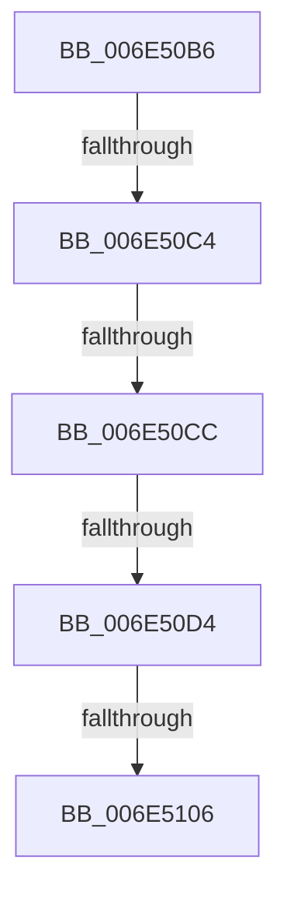

# sub_006E50B6

- RVA: `0x006E50B6`–`0x006E5110` (길이 `90` bytes)
- VA: `0x00000001406E50B6`
- 실행 섹션: `.text`
- PDB 이름 있음: `아니요`; PDB Function 태그: `아니요`
- unwind 정보 RVA: `0x0007FF38`
- 디코드: `22`개 명령, `90/90` bytes 표시
- 미해석 바이트: `0` (있으면 어셈블리에 `.byte`로 보존)

> 이 문서는 커널 이미지의 기계어와 PDB 기호를 분석해 생성했습니다. 4번과 5번은 함수 원형과 자료형을 바이너리 사용 방식에서 추정한 C 해석이며 원본 소스 복구 결과는 아닙니다.

## 1. Dependencies

- 직접 호출 지점: **0**; 고유 호출 대상: **0**
- 직접 호출자로 확인된 함수: **0**
- RIP 상대 이미지 참조: **1**

### Outgoing calls
- 직접 디코드된 call 명령이 없습니다.

### Direct callers
- 이 함수 시작 RVA로 연결되는 직접 call은 확인되지 않았습니다. 간접 호출은 완전히 역산할 수 없습니다.

### Static image references
- `0x006E50B6` → RVA `0x00E65B54` (`.data`; read)

## 2. Other-region calls and transfers

- 다른 실행 섹션으로 향하는 call: **0**
- call이 아닌 외부 분기/꼬리 이동: **5**
  - `0x006E50BE` → [CcCanIWriteStreamEx + 0x127](../38/CcCanIWriteStreamEx_function_0038993C.md) (`tail-transfer`)
  - `0x006E50C6` → [CcCanIWriteStreamEx + 0x127](../38/CcCanIWriteStreamEx_function_0038993C.md) (`tail-transfer`)
  - `0x006E50CE` → [CcCanIWriteStreamEx + 0x127](../38/CcCanIWriteStreamEx_function_0038993C.md) (`tail-transfer`)
  - `0x006E5100` → [CcCanIWriteStreamEx + 0x127](../38/CcCanIWriteStreamEx_function_0038993C.md) (`tail-transfer`)
  - `0x006E510B` → [CcCanIWriteStreamEx + 0x127](../38/CcCanIWriteStreamEx_function_0038993C.md) (`tail-transfer`)

## 3. Assembly (complete function range)

```asm
006E50B6  8B 05 98 0A 78 00               mov eax, dword ptr [rip + 0x780a98]
006E50BC  85 C0                           test eax, eax
006E50BE  0F 84 9F 49 CA FF               je 0x140389a63
006E50C4  85 FF                           test edi, edi
006E50C6  0F 84 97 49 CA FF               je 0x140389a63
006E50CC  3B F8                           cmp edi, eax
006E50CE  0F 82 8F 49 CA FF               jb 0x140389a63
006E50D4  4C 8B C1                        mov r8, rcx
006E50D7  48 B8 15 AE 47 E1 7A 14 AE 47   movabs rax, 0x47ae147ae147ae15
006E50E1  4D 0F AF 02                     imul r8, qword ptr [r10]
006E50E5  49 8B 0B                        mov rcx, qword ptr [r11]
006E50E8  49 F7 E0                        mul r8
006E50EB  49 03 C9                        add rcx, r9
006E50EE  4C 2B C2                        sub r8, rdx
006E50F1  49 D1 E8                        shr r8, 1
006E50F4  4C 03 C2                        add r8, rdx
006E50F7  33 D2                           xor edx, edx
006E50F9  49 C1 E8 06                     shr r8, 6
006E50FD  49 3B C8                        cmp rcx, r8
006E5100  0F 82 5D 49 CA FF               jb 0x140389a63
006E5106  41 C6 04 24 01                  mov byte ptr [r12], 1
006E510B  E9 53 49 CA FF                  jmp 0x140389a63
```

## 4. C-style interpretation (structured pseudocode)

```c
__int64 __fastcall sub_006E50B6(__int64 a1, __int64 a2, __int64 a3, __int64 a4)
{
    a3 = (a1) * (*(unsigned __int64 *)(v_r10));
    a1 = (*(unsigned __int64 *)(v_r11)) + (a4);
    a3 = (a3) - (a2);
    a3 = (a3) >> (1);
    a3 = (a3) + (a2);
    a2 = 0;
    a3 = (a3) >> (6);
    *(unsigned __int8 *)(v_r12) = 1;
}
```

## 5. (Beta) C Style

```c
int64_t sub_006E50B6(int64_t Arg1, int64_t Arg2, int64_t Arg3, int64_t Arg4)
{
    Arg3 = (Arg1) * (*(uint64_t *)(local_r10));
    Arg1 = (*(uint64_t *)(local_r11)) + (Arg4);
    Arg3 = (Arg3) - (Arg2);
    Arg3 = (Arg3) >> (1);
    Arg3 = (Arg3) + (Arg2);
    Arg2 = 0;
    Arg3 = (Arg3) >> (6);
    *(uint8_t *)(local_r12) = 1;
}
```

## 6. Execution-region graph

[열기: 2D/3D 그래프와 함수 탐색 컨트롤 패널](../../../control-panel.html?section=text&rva=0x006E50B6&view=graph)

- 2D 그래프는 위에서 아래로 흐르고, 3D 그래프는 빈 공간을 드래그해 회전합니다. Shift+드래그는 이동, 휠은 확대·축소, 함수 노드 선택은 대상 보고서 이동입니다.

### Static fallback


