# sub_006E5110

- RVA: `0x006E5110`–`0x006E532A` (길이 `538` bytes)
- VA: `0x00000001406E5110`
- 실행 섹션: `.text`
- PDB 이름 있음: `아니요`; PDB Function 태그: `아니요`
- unwind 정보 RVA: `0x0007FF88`
- 디코드: `122`개 명령, `538/538` bytes 표시
- 미해석 바이트: `0` (있으면 어셈블리에 `.byte`로 보존)

> 이 문서는 커널 이미지의 기계어와 PDB 기호를 분석해 생성했습니다. 4번과 5번은 함수 원형과 자료형을 바이너리 사용 방식에서 추정한 C 해석이며 원본 소스 복구 결과는 아닙니다.

## 1. Dependencies

- 직접 호출 지점: **11**; 고유 호출 대상: **10**
- 직접 호출자로 확인된 함수: **0**
- RIP 상대 이미지 참조: **23**

### Outgoing calls
- `0x006E5151` → [memset](../6C/memset_function_006C6C40.md) (function, `0x006C6C40`)
- `0x006E5182` → [CcGetDeviceGuid](../../page/AA/CcGetDeviceGuid_function_00AAFABC.md) (function, `0x00AAFABC`)
- `0x006E5193` → [KeAcquireInStackQueuedSpinLock](../27/KeAcquireInStackQueuedSpinLock_function_002757A0.md) (function, `0x002757A0`)
- `0x006E51D7` → [KeReleaseInStackQueuedSpinLock](../34/KeReleaseInStackQueuedSpinLock_function_00342CE0.md) (function, `0x00342CE0`)
- `0x006E51E4` → [ExFreePoolWithTag](../../poolcode/B8/ExFreePoolWithTag_function_00B82870.md) (function, `0x00B82870`)
- `0x006E5274` → [KeReleaseInStackQueuedSpinLock](../34/KeReleaseInStackQueuedSpinLock_function_00342CE0.md) (function, `0x00342CE0`)
- `0x006E5284` → [CcQueueAsyncGetDeviceGuid](../57/CcQueueAsyncGetDeviceGuid_function_0057EE74.md) (function, `0x0057EE74`)
- `0x006E5292` → [CcSetupWatchForRegistryChanges](../57/CcSetupWatchForRegistryChanges_function_0057CE10.md) (function, `0x0057CE10`)
- `0x006E52B5` → [McGenEventRegister_EtwRegister](../57/McGenEventRegister_EtwRegister_function_0057EF04.md) (function, `0x0057EF04`)
- `0x006E52DD` → [McTemplateK0j_EtwWriteTransfer](../57/McTemplateK0j_EtwWriteTransfer_function_0057B2AC.md) (function, `0x0057B2AC`)
- `0x006E531F` → [ExQueueWorkItem](../2F/ExQueueWorkItem_function_002F9520.md) (function, `0x002F9520`)

### Direct callers
- 이 함수 시작 RVA로 연결되는 직접 call은 확인되지 않았습니다. 간접 호출은 완전히 역산할 수 없습니다.

### Static image references
- `0x006E5132` → RVA `0x00E65B4C` (`.data`; read/write)
- `0x006E5166` → RVA `0x000112D0` (`.rdata`; read)
- `0x006E5173` → RVA `0x000112D8` (`.rdata`; read)
- `0x006E518C` → RVA `0x00E11CC0` (`.data`; read)
- `0x006E5198` → RVA `0x00F8F560` (`.data`; read)
- `0x006E51F1` → RVA `0x00F8F568` (`.data`; read)
- `0x006E5206` → RVA `0x00F8F568` (`.data`; write)
- `0x006E520D` → RVA `0x00F8F2A8` (`.data`; read/write)
- `0x006E525D` → RVA `0x00E65B10` (`.data`; read)
- `0x006E5266` → RVA `0x00E65B10` (`.data`; write)
- `0x006E5289` → RVA `0x00E65B48` (`.data`; read)
- `0x006E5297` → RVA `0x00E65BBC` (`.data`; read)
- `0x006E529D` → RVA `0x00E06BD0` (`.data`; read)
- `0x006E52AB` → RVA `0x000262E8` (`.rdata`; read)
- `0x006E52BE` → RVA `0x00E65BBC` (`.data`; write)
- `0x006E52C4` → RVA `0x00F8F600` (`.data`; reference)
- `0x006E52D6` → RVA `0x000262C8` (`.rdata`; read)
- `0x006E52EB` → RVA `0x00FC521C` (`ALMOSTRO`; read)
- `0x006E52F8` → RVA `0x00E65B08` (`.data`; read/write)
- `0x006E5300` → RVA `0x0057B220` (`CcRegisterForContainerRestore`; read)
- `0x006E5307` → RVA `0x00E65AF0` (`.data`; read/write)
- `0x006E530F` → RVA `0x00E65AF0` (`.data`; read)
- `0x006E5318` → RVA `0x00E65B00` (`.data`; write)

## 2. Other-region calls and transfers

- 다른 실행 섹션으로 향하는 call: **2**
  - `0x006E5182` → [CcGetDeviceGuid](../../page/AA/CcGetDeviceGuid_function_00AAFABC.md) (`.text` → `PAGE`)
  - `0x006E51E4` → [ExFreePoolWithTag](../../poolcode/B8/ExFreePoolWithTag_function_00B82870.md) (`.text` → `POOLCODE`)
- call이 아닌 외부 분기/꼬리 이동: **4**
  - `0x006E51EC` → [CcInitializeVolumeCacheMap + 0x82](../38/CcInitializeVolumeCacheMap_function_00389D60.md) (`tail-transfer`)
  - `0x006E52E5` → [CcInitializeVolumeCacheMap + 0x7F](../38/CcInitializeVolumeCacheMap_function_00389D60.md) (`tail-transfer`)
  - `0x006E52F2` → [CcInitializeVolumeCacheMap + 0x7F](../38/CcInitializeVolumeCacheMap_function_00389D60.md) (`tail-transfer`)
  - `0x006E5325` → [CcInitializeVolumeCacheMap + 0x7F](../38/CcInitializeVolumeCacheMap_function_00389D60.md) (`tail-transfer`)

## 3. Assembly (complete function range)

```asm
006E5110  C7 00 F8 02 C8 0A               mov dword ptr [rax], 0xac802f8
006E5116  BB 01 00 00 00                  mov ebx, 1
006E511B  48 89 58 08                     mov qword ptr [rax + 8], rbx
006E511F  48 89 68 10                     mov qword ptr [rax + 0x10], rbp
006E5123  48 05 D8 00 00 00               add rax, 0xd8
006E5129  48 89 40 08                     mov qword ptr [rax + 8], rax
006E512D  48 89 00                        mov qword ptr [rax], rax
006E5130  8B C3                           mov eax, ebx
006E5132  F0 0F C1 05 12 0A 78 00         lock xadd dword ptr [rip + 0x780a12], eax
006E513A  03 C3                           add eax, ebx
006E513C  48 8D 8F F8 00 00 00            lea rcx, [rdi + 0xf8]
006E5143  33 D2                           xor edx, edx
006E5145  89 87 D4 00 00 00               mov dword ptr [rdi + 0xd4], eax
006E514B  41 B8 D0 04 00 00               mov r8d, 0x4d0
006E5151  E8 EA 1A FE FF                  call 0x1406c6c40
006E5156  83 7D 48 14                     cmp dword ptr [rbp + 0x48], 0x14
006E515A  74 2B                           je 0x1406e5187
006E515C  48 8D 97 E8 00 00 00            lea rdx, [rdi + 0xe8]
006E5163  48 8B 02                        mov rax, qword ptr [rdx]
006E5166  48 2B 05 63 C1 92 FF            sub rax, qword ptr [rip - 0x6d3e9d]
006E516D  75 0B                           jne 0x1406e517a
006E516F  48 8B 42 08                     mov rax, qword ptr [rdx + 8]
006E5173  48 2B 05 5E C1 92 FF            sub rax, qword ptr [rip - 0x6d3ea2]
006E517A  48 85 C0                        test rax, rax
006E517D  75 08                           jne 0x1406e5187
006E517F  49 8B CE                        mov rcx, r14
006E5182  E8 35 A9 3C 00                  call 0x140aafabc
006E5187  48 8D 54 24 20                  lea rdx, [rsp + 0x20]
006E518C  48 8D 0D 2D CB 72 00            lea rcx, [rip + 0x72cb2d]
006E5193  E8 08 06 B9 FF                  call 0x1402757a0
006E5198  48 8B 05 C1 A3 8A 00            mov rax, qword ptr [rip + 0x8aa3c1]
006E519F  48 3B C6                        cmp rax, rsi
006E51A2  74 4D                           je 0x1406e51f1
006E51A4  48 8D 70 E8                     lea rsi, [rax - 0x18]
006E51A8  48 39 6E 10                     cmp qword ptr [rsi + 0x10], rbp
006E51AC  74 0C                           je 0x1406e51ba
006E51AE  48 8B 00                        mov rax, qword ptr [rax]
006E51B1  48 8D 35 A8 A3 8A 00            lea rsi, [rip + 0x8aa3a8]
006E51B8  EB E5                           jmp 0x1406e519f
006E51BA  48 8B C3                        mov rax, rbx
006E51BD  F0 48 0F C1 46 08               lock xadd qword ptr [rsi + 8], rax
006E51C3  48 03 C3                        add rax, rbx
006E51C6  48 3B C3                        cmp rax, rbx
006E51C9  7F 07                           jg 0x1406e51d2
006E51CB  B9 0E 00 00 00                  mov ecx, 0xe
006E51D0  CD 29                           int 0x29
006E51D2  48 8D 4C 24 20                  lea rcx, [rsp + 0x20]
006E51D7  E8 04 DB C5 FF                  call 0x140342ce0
006E51DC  BA 43 63 56 6D                  mov edx, 0x6d566343
006E51E1  48 8B CF                        mov rcx, rdi
006E51E4  E8 87 D6 49 00                  call 0x140b82870
006E51E9  49 89 37                        mov qword ptr [r15], rsi
006E51EC  E9 F1 4B CA FF                  jmp 0x140389de2
006E51F1  48 8B 05 70 A3 8A 00            mov rax, qword ptr [rip + 0x8aa370]
006E51F8  48 8D 4F 18                     lea rcx, [rdi + 0x18]
006E51FC  48 89 31                        mov qword ptr [rcx], rsi
006E51FF  48 89 41 08                     mov qword ptr [rcx + 8], rax
006E5203  48 89 08                        mov qword ptr [rax], rcx
006E5206  48 89 0D 5B A3 8A 00            mov qword ptr [rip + 0x8aa35b], rcx
006E520D  F0 48 01 1D 93 A0 8A 00         lock add qword ptr [rip + 0x8aa093], rbx
006E5215  48 8B 47 10                     mov rax, qword ptr [rdi + 0x10]
006E5219  83 78 48 14                     cmp dword ptr [rax + 0x48], 0x14
006E521D  74 3E                           je 0x1406e525d
006E521F  48 8B 87 E8 00 00 00            mov rax, qword ptr [rdi + 0xe8]
006E5226  48 2B 05 A3 C0 92 FF            sub rax, qword ptr [rip - 0x6d3f5d]
006E522D  75 0E                           jne 0x1406e523d
006E522F  48 8B 87 F0 00 00 00            mov rax, qword ptr [rdi + 0xf0]
006E5236  48 2B 05 9B C0 92 FF            sub rax, qword ptr [rip - 0x6d3f65]
006E523D  48 85 C0                        test rax, rax
006E5240  75 1B                           jne 0x1406e525d
006E5242  48 8B C3                        mov rax, rbx
006E5245  F0 48 0F C1 47 08               lock xadd qword ptr [rdi + 8], rax
006E524B  48 03 C3                        add rax, rbx
006E524E  48 3B C3                        cmp rax, rbx
006E5251  7F 07                           jg 0x1406e525a
006E5253  B9 0E 00 00 00                  mov ecx, 0xe
006E5258  CD 29                           int 0x29
006E525A  44 8A E3                        mov r12b, bl
006E525D  44 38 2D AC 08 78 00            cmp byte ptr [rip + 0x7808ac], r13b
006E5264  75 09                           jne 0x1406e526f
006E5266  88 1D A4 08 78 00               mov byte ptr [rip + 0x7808a4], bl
006E526C  44 8A EB                        mov r13b, bl
006E526F  48 8D 4C 24 20                  lea rcx, [rsp + 0x20]
006E5274  E8 67 DA C5 FF                  call 0x140342ce0
006E5279  45 84 E4                        test r12b, r12b
006E527C  74 0B                           je 0x1406e5289
006E527E  49 8B D6                        mov rdx, r14
006E5281  48 8B CF                        mov rcx, rdi
006E5284  E8 EB 9B E9 FF                  call 0x14057ee74
006E5289  83 3D B8 08 78 00 00            cmp dword ptr [rip + 0x7808b8], 0
006E5290  75 05                           jne 0x1406e5297
006E5292  E8 79 7B E9 FF                  call 0x14057ce10
006E5297  8A 05 1F 09 78 00               mov al, byte ptr [rip + 0x78091f]
006E529D  48 8D 35 2C 19 72 00            lea rsi, [rip + 0x72192c]
006E52A4  84 C0                           test al, al
006E52A6  75 1C                           jne 0x1406e52c4
006E52A8  4C 8B CE                        mov r9, rsi
006E52AB  48 8D 0D 36 10 94 FF            lea rcx, [rip - 0x6befca]
006E52B2  4C 8B C6                        mov r8, rsi
006E52B5  E8 4A 9C E9 FF                  call 0x14057ef04
006E52BA  85 C0                           test eax, eax
006E52BC  78 06                           js 0x1406e52c4
006E52BE  88 1D F8 08 78 00               mov byte ptr [rip + 0x7808f8], bl
006E52C4  84 1D 36 A3 8A 00               test byte ptr [rip + 0x8aa336], bl
006E52CA  74 16                           je 0x1406e52e2
006E52CC  4C 8D 8F E8 00 00 00            lea r9, [rdi + 0xe8]
006E52D3  48 8B CE                        mov rcx, rsi
006E52D6  48 8D 15 EB 0F 94 FF            lea rdx, [rip - 0x6bf015]
006E52DD  E8 CA 5F E9 FF                  call 0x14057b2ac
006E52E2  45 84 ED                        test r13b, r13b
006E52E5  0F 84 F4 4A CA FF               je 0x140389ddf
006E52EB  80 3D 2A FF 8D 00 00            cmp byte ptr [rip + 0x8dff2a], 0
006E52F2  0F 85 E7 4A CA FF               jne 0x140389ddf
006E52F8  48 83 25 08 08 78 00 00         and qword ptr [rip + 0x780808], 0
006E5300  48 8D 05 19 5F E9 FF            lea rax, [rip - 0x16a0e7]
006E5307  48 83 25 E1 07 78 00 00         and qword ptr [rip + 0x7807e1], 0
006E530F  48 8D 0D DA 07 78 00            lea rcx, [rip + 0x7807da]
006E5316  8B D3                           mov edx, ebx
006E5318  48 89 05 E1 07 78 00            mov qword ptr [rip + 0x7807e1], rax
006E531F  E8 FC 41 C1 FF                  call 0x1402f9520
006E5324  90                              nop
006E5325  E9 B5 4A CA FF                  jmp 0x140389ddf
```

## 4. C-style interpretation (structured pseudocode)

```c
__int64 __fastcall sub_006E5110(__int64 a1, int a2)
{
    __int64 result;
    __int64 v_r13;
    unsigned __int64 v_stack_p20;

    *(unsigned int *)(result) = 0xAC802F8ULL;
    *(unsigned __int64 *)(result + 8) = 1;
    *(unsigned __int64 *)(result + 16) = v_rbp;
    result = (result) + (216);
    *(unsigned __int64 *)(result + 8) = result;
    *(unsigned __int64 *)(result) = result;
    result = (unsigned int)((1) + (1));
    a2 = 0;
    *(unsigned int *)(v_rdi + 212) = (unsigned int)(result);
    result = memset(v_rdi + 248, a2, (unsigned int)(0x4D0ULL), a4);
    if ((*(unsigned int *)(v_rbp + 72)) == 20) goto loc_006E5187;
    result = (*(unsigned __int64 *)(v_rdi + 232)) - (*(unsigned __int64 *)(v_rip - 7159453));
    if (!(condition_is_not_equal)) {
        result = *(unsigned __int64 *)(v_rdi + 232 + 8);
        result = (result) - (*(unsigned __int64 *)(v_rip - 7159458));
    }
    if (result == 0) {
        a1 = v_r14;
        result = CcGetDeviceGuid(a1, v_rdi + 232, (unsigned int)(0x4D0ULL), a4);
    }
    result = KeAcquireInStackQueuedSpinLock(v_rip + 7523117, v_stack_p20, (unsigned int)(0x4D0ULL), a4);
loc_006E519F:
    if ((*(unsigned __int64 *)(v_rip + 9085889)) == v_rsi) goto loc_006E51F1;
    if ((*(unsigned __int64 *)(*(unsigned __int64 *)(v_rip + 9085889) - 24 + 16)) == v_rbp) goto loc_006E51BA;
    goto loc_006E519F;
loc_006E51BA:
    result = (1) + (1);
    if (result <= 1) {
        a1 = 14;
    }
    result = KeReleaseInStackQueuedSpinLock(v_stack_p20, v_stack_p20, (unsigned int)(0x4D0ULL), a4);
    result = ExFreePoolWithTag(v_rdi, (unsigned int)(0x6D566343ULL), (unsigned int)(0x4D0ULL), a4);
    *(unsigned __int64 *)(v_r15) = v_rip + 9085864;
loc_006E51F1:
    *(unsigned __int64 *)(v_rdi + 24) = v_rip + 9085864;
    *(unsigned __int64 *)(v_rdi + 24 + 8) = *(unsigned __int64 *)(v_rip + 9085808);
    *(unsigned __int64 *)(*(unsigned __int64 *)(v_rip + 9085808)) = v_rdi + 24;
    *(unsigned __int64 *)(v_rip + 9085787) = v_rdi + 24;
    if ((*(unsigned int *)(*(unsigned __int64 *)(v_rdi + 16) + 72)) == 20) goto loc_006E525D;
    result = (*(unsigned __int64 *)(v_rdi + 232)) - (*(unsigned __int64 *)(v_rip - 7159645));
    if (!(condition_is_not_equal)) {
        result = *(unsigned __int64 *)(v_rdi + 240);
        result = (result) - (*(unsigned __int64 *)(v_rip - 7159653));
    }
    if (result != 0) goto loc_006E525D;
    result = (1) + (1);
    if (result <= 1) {
        a1 = 14;
    }
loc_006E525D:
    if ((*(unsigned __int8 *)(v_rip + 7866540)) == ((unsigned __int8)(v_r13))) {
        *(unsigned __int8 *)(v_rip + 7866532) = 1;
        v_r13 = 1;
    }
    result = KeReleaseInStackQueuedSpinLock(v_stack_p20, (unsigned int)(0x6D566343ULL), (unsigned int)(0x4D0ULL), a4);
    if (1 != 0) {
        a2 = v_r14;
        a1 = v_rdi;
        result = CcQueueAsyncGetDeviceGuid(a1, a2, (unsigned int)(0x4D0ULL), a4);
    }
    if ((*(unsigned int *)(v_rip + 7866552)) == 0) {
        result = CcSetupWatchForRegistryChanges(a1, a2, (unsigned int)(0x4D0ULL), a4);
    }
    if ((unsigned __int8)(*(unsigned __int8 *)(v_rip + 7866655)) != 0) goto loc_006E52C4;
    result = McGenEventRegister_EtwRegister(v_rip - 7073738, a2, v_rip + 7477548, v_rip + 7477548);
    if (!(sign_flag)) {
        *(unsigned __int8 *)(v_rip + 7866616) = 1;
    }
    if (((*(unsigned __int8 *)(v_rip + 9085750)) & (1)) != 0) {
        a4 = v_rdi + 232;
        a1 = v_rip + 7477548;
        a2 = v_rip - 7073813;
        result = McTemplateK0j_EtwWriteTransfer(a1, a2, v_rip + 7477548, a4);
    }
    *(unsigned __int64 *)(v_rip + 7866337) = v_rip - 1482983;
    result = ExQueueWorkItem(v_rip + 7866330, 1, v_rip + 7477548, a4);
}
```

## 5. (Beta) C Style

```c
int64_t sub_006E5110(int64_t Arg1, int32_t Arg2)
{
    int64_t result;
    int64_t local_r13;
    uint64_t v_stack_p20;

    *(uint32_t *)(result) = 0xAC802F8ULL;
    *(uint64_t *)(result + 0x8) = 1;
    *(uint64_t *)(result + 0x10) = local_rbp;
    result = (result) + (216);
    *(uint64_t *)(result + 0x8) = result;
    *(uint64_t *)(result) = result;
    result = (uint32_t)((1) + (1));
    Arg2 = 0;
    *(uint32_t *)(local_rdi + 0xD4) = (uint32_t)(result);
    result = memset(local_rdi + 248, Arg2, (uint32_t)(0x4D0ULL), a4);
    if ((*(uint32_t *)(local_rbp + 0x48)) == 20) goto loc_006E5187;
    result = (*(uint64_t *)(local_rdi + 0xE8)) - (*(uint64_t *)(v_rip - 0x6D3E9D));
    if (!(condition_is_not_equal)) {
        result = *(uint64_t *)(local_rdi + 0xE8 + 0x8);
        result = (result) - (*(uint64_t *)(v_rip - 0x6D3EA2));
    }
    if (result == 0) {
        Arg1 = local_r14;
        result = CcGetDeviceGuid(Arg1, local_rdi + 232, (uint32_t)(0x4D0ULL), a4);
    }
    result = KeAcquireInStackQueuedSpinLock(v_rip + 7523117, v_stack_p20, (uint32_t)(0x4D0ULL), a4);
loc_006E519F:
    if ((*(uint64_t *)(v_rip + 0x8AA3C1)) == local_rsi) goto loc_006E51F1;
    if ((*(uint64_t *)(*(uint64_t *)(v_rip + 0x8AA3C1) - 0x18 + 0x10)) == local_rbp) goto loc_006E51BA;
    goto loc_006E519F;
loc_006E51BA:
    result = (1) + (1);
    if (result <= 1) {
        Arg1 = 14;
    }
    result = KeReleaseInStackQueuedSpinLock(v_stack_p20, v_stack_p20, (uint32_t)(0x4D0ULL), a4);
    result = ExFreePoolWithTag(local_rdi, (uint32_t)(0x6D566343ULL), (uint32_t)(0x4D0ULL), a4);
    *(uint64_t *)(local_r15) = v_rip + 9085864;
loc_006E51F1:
    *(uint64_t *)(local_rdi + 0x18) = v_rip + 9085864;
    *(uint64_t *)(local_rdi + 0x18 + 0x8) = *(uint64_t *)(v_rip + 0x8AA370);
    *(uint64_t *)(*(uint64_t *)(v_rip + 0x8AA370)) = local_rdi + 24;
    *(uint64_t *)(v_rip + 0x8AA35B) = local_rdi + 24;
    if ((*(uint32_t *)(*(uint64_t *)(local_rdi + 0x10) + 0x48)) == 20) goto loc_006E525D;
    result = (*(uint64_t *)(local_rdi + 0xE8)) - (*(uint64_t *)(v_rip - 0x6D3F5D));
    if (!(condition_is_not_equal)) {
        result = *(uint64_t *)(local_rdi + 0xF0);
        result = (result) - (*(uint64_t *)(v_rip - 0x6D3F65));
    }
    if (result != 0) goto loc_006E525D;
    result = (1) + (1);
    if (result <= 1) {
        Arg1 = 14;
    }
loc_006E525D:
    if ((*(uint8_t *)(v_rip + 0x7808AC)) == ((uint8_t)(local_r13))) {
        *(uint8_t *)(v_rip + 0x7808A4) = 1;
        local_r13 = 1;
    }
    result = KeReleaseInStackQueuedSpinLock(v_stack_p20, (uint32_t)(0x6D566343ULL), (uint32_t)(0x4D0ULL), a4);
    if (1 != 0) {
        Arg2 = local_r14;
        Arg1 = local_rdi;
        result = CcQueueAsyncGetDeviceGuid(Arg1, Arg2, (uint32_t)(0x4D0ULL), a4);
    }
    if ((*(uint32_t *)(v_rip + 0x7808B8)) == 0) {
        result = CcSetupWatchForRegistryChanges(Arg1, Arg2, (uint32_t)(0x4D0ULL), a4);
    }
    if ((uint8_t)(*(uint8_t *)(v_rip + 0x78091F)) != 0) goto loc_006E52C4;
    result = McGenEventRegister_EtwRegister(v_rip - 7073738, Arg2, v_rip + 7477548, v_rip + 7477548);
    if (!(sign_flag)) {
        *(uint8_t *)(v_rip + 0x7808F8) = 1;
    }
    if (((*(uint8_t *)(v_rip + 0x8AA336)) & (1)) != 0) {
        a4 = local_rdi + 232;
        Arg1 = v_rip + 7477548;
        Arg2 = v_rip - 7073813;
        result = McTemplateK0j_EtwWriteTransfer(Arg1, Arg2, v_rip + 7477548, a4);
    }
    *(uint64_t *)(v_rip + 0x7807E1) = v_rip - 1482983;
    result = ExQueueWorkItem(v_rip + 7866330, 1, v_rip + 7477548, a4);
}
```

## 6. Execution-region graph

[열기: 2D/3D 그래프와 함수 탐색 컨트롤 패널](../../../control-panel.html?section=text&rva=0x006E5110&view=graph)

- 2D 그래프는 위에서 아래로 흐르고, 3D 그래프는 빈 공간을 드래그해 회전합니다. Shift+드래그는 이동, 휠은 확대·축소, 함수 노드 선택은 대상 보고서 이동입니다.

### Static fallback

```mermaid
flowchart TD
  bb_006E5110[BB_006E5110]
  bb_006E515C[BB_006E515C]
  bb_006E516F[BB_006E516F]
  bb_006E517A[BB_006E517A]
  bb_006E517F[BB_006E517F]
  bb_006E5187[BB_006E5187]
  bb_006E519F[BB_006E519F]
  bb_006E51A4[BB_006E51A4]
  bb_006E51AE[BB_006E51AE]
  bb_006E51BA[BB_006E51BA]
  bb_006E51CB[BB_006E51CB]
  bb_006E51D2[BB_006E51D2]
  bb_006E51F1[BB_006E51F1]
  bb_006E521F[BB_006E521F]
  bb_006E522F[BB_006E522F]
  bb_006E523D[BB_006E523D]
  bb_006E5242[BB_006E5242]
  bb_006E5253[BB_006E5253]
  bb_006E525A[BB_006E525A]
  bb_006E525D[BB_006E525D]
  bb_006E5266[BB_006E5266]
  bb_006E526F[BB_006E526F]
  bb_006E527E[BB_006E527E]
  bb_006E5289[BB_006E5289]
  bb_006E5292[BB_006E5292]
  bb_006E5297[BB_006E5297]
  bb_006E52A8[BB_006E52A8]
  bb_006E52BE[BB_006E52BE]
  bb_006E52C4[BB_006E52C4]
  bb_006E52CC[BB_006E52CC]
  bb_006E52E2[BB_006E52E2]
  bb_006E52EB[BB_006E52EB]
  bb_006E52F8[BB_006E52F8]
  bb_006E5110 -->|branch| bb_006E5187
  bb_006E5110 -->|fallthrough| bb_006E515C
  bb_006E515C -->|branch| bb_006E517A
  bb_006E515C -->|fallthrough| bb_006E516F
  bb_006E516F -->|flow| bb_006E517A
  bb_006E517A -->|branch| bb_006E5187
  bb_006E517A -->|fallthrough| bb_006E517F
  bb_006E517F -->|flow| bb_006E5187
  bb_006E5187 -->|flow| bb_006E519F
  bb_006E519F -->|branch| bb_006E51F1
  bb_006E519F -->|fallthrough| bb_006E51A4
  bb_006E51A4 -->|branch| bb_006E51BA
  bb_006E51A4 -->|fallthrough| bb_006E51AE
  bb_006E51AE -->|branch| bb_006E519F
  bb_006E51BA -->|branch| bb_006E51D2
  bb_006E51BA -->|fallthrough| bb_006E51CB
  bb_006E51CB -->|flow| bb_006E51D2
  bb_006E51F1 -->|branch| bb_006E525D
  bb_006E51F1 -->|fallthrough| bb_006E521F
  bb_006E521F -->|branch| bb_006E523D
  bb_006E521F -->|fallthrough| bb_006E522F
  bb_006E522F -->|flow| bb_006E523D
  bb_006E523D -->|branch| bb_006E525D
  bb_006E523D -->|fallthrough| bb_006E5242
  bb_006E5242 -->|branch| bb_006E525A
  bb_006E5242 -->|fallthrough| bb_006E5253
  bb_006E5253 -->|flow| bb_006E525A
  bb_006E525A -->|flow| bb_006E525D
  bb_006E525D -->|branch| bb_006E526F
  bb_006E525D -->|fallthrough| bb_006E5266
  bb_006E5266 -->|flow| bb_006E526F
  bb_006E526F -->|branch| bb_006E5289
  bb_006E526F -->|fallthrough| bb_006E527E
  bb_006E527E -->|flow| bb_006E5289
  bb_006E5289 -->|branch| bb_006E5297
  bb_006E5289 -->|fallthrough| bb_006E5292
  bb_006E5292 -->|flow| bb_006E5297
  bb_006E5297 -->|branch| bb_006E52C4
  bb_006E5297 -->|fallthrough| bb_006E52A8
  bb_006E52A8 -->|branch| bb_006E52C4
  bb_006E52A8 -->|fallthrough| bb_006E52BE
  bb_006E52BE -->|flow| bb_006E52C4
  bb_006E52C4 -->|branch| bb_006E52E2
  bb_006E52C4 -->|fallthrough| bb_006E52CC
  bb_006E52CC -->|flow| bb_006E52E2
  bb_006E52E2 -->|fallthrough| bb_006E52EB
  bb_006E52EB -->|fallthrough| bb_006E52F8
```


