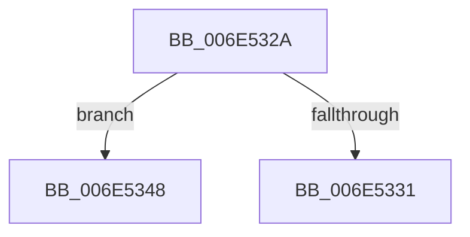

# sub_006E532A

- RVA: `0x006E532A`–`0x006E537E` (길이 `84` bytes)
- VA: `0x00000001406E532A`
- 실행 섹션: `.text`
- PDB 이름 있음: `아니요`; PDB Function 태그: `아니요`
- unwind 정보 RVA: `0x00080098`
- 디코드: `22`개 명령, `84/84` bytes 표시
- 미해석 바이트: `0` (있으면 어셈블리에 `.byte`로 보존)

> 이 문서는 커널 이미지의 기계어와 PDB 기호를 분석해 생성했습니다. 4번과 5번은 함수 원형과 자료형을 바이너리 사용 방식에서 추정한 C 해석이며 원본 소스 복구 결과는 아닙니다.

## 1. Dependencies

- 직접 호출 지점: **4**; 고유 호출 대상: **4**
- 직접 호출자로 확인된 함수: **0**
- RIP 상대 이미지 참조: **0**

### Outgoing calls
- `0x006E5334` → [KeResetEvent](../24/KeResetEvent_function_00248350.md) (function, `0x00248350`)
- `0x006E534E` → [CcReleaseBcbLockAndVacbLock](../2D/CcReleaseBcbLockAndVacbLock_function_002DFDF0.md) (function, `0x002DFDF0`)
- `0x006E5363` → [KeWaitForSingleObject](../20/KeWaitForSingleObject_function_0020E6B0.md) (function, `0x0020E6B0`)
- `0x006E5373` → [CcAcquireBcbLockAndVacbLock](../26/CcAcquireBcbLockAndVacbLock_function_0026FC58.md) (function, `0x0026FC58`)

### Direct callers
- 이 함수 시작 RVA로 연결되는 직접 call은 확인되지 않았습니다. 간접 호출은 완전히 역산할 수 없습니다.

### Static image references
- 디코드된 RIP-relative 메모리 참조가 없습니다.

## 2. Other-region calls and transfers

- 다른 실행 섹션으로 향하는 call: **0**
- call이 아닌 외부 분기/꼬리 이동: **2**
  - `0x006E5343` → [CcUnmapVacbArray + 0x84](../38/CcUnmapVacbArray_function_0038AEAC.md) (`tail-transfer`)
  - `0x006E5379` → [CcUnmapVacbArray + 0x84](../38/CcUnmapVacbArray_function_0038AEAC.md) (`tail-transfer`)

## 3. Assembly (complete function range)

```asm
006E532A  44 38 6C 24 70                  cmp byte ptr [rsp + 0x70], r13b
006E532F  74 17                           je 0x1406e5348
006E5331  48 8B CE                        mov rcx, rsi
006E5334  E8 17 30 B6 FF                  call 0x140248350
006E5339  F0 44 09 2C 24                  lock or dword ptr [rsp], r13d
006E533E  44 88 6C 24 70                  mov byte ptr [rsp + 0x70], r13b
006E5343  E9 E8 5B CA FF                  jmp 0x14038af30
006E5348  48 8B D5                        mov rdx, rbp
006E534B  41 8B CF                        mov ecx, r15d
006E534E  E8 9D AA BF FF                  call 0x1402dfdf0
006E5353  45 33 C9                        xor r9d, r9d
006E5356  4C 89 6C 24 20                  mov qword ptr [rsp + 0x20], r13
006E535B  45 33 C0                        xor r8d, r8d
006E535E  33 D2                           xor edx, edx
006E5360  48 8B CE                        mov rcx, rsi
006E5363  E8 48 93 B2 FF                  call 0x14020e6b0
006E5368  48 8B D5                        mov rdx, rbp
006E536B  44 88 74 24 70                  mov byte ptr [rsp + 0x70], r14b
006E5370  41 8B CF                        mov ecx, r15d
006E5373  E8 E0 A8 B8 FF                  call 0x14026fc58
006E5378  90                              nop
006E5379  E9 B2 5B CA FF                  jmp 0x14038af30
```

## 4. C-style interpretation (structured pseudocode)

```c
__int64 __fastcall sub_006E532A(__int64 a1, __int64 a2, int a3, int a4, __int64 a5, __int64 a6, __int64 a7, __int64 a8, __int64 a9, __int64 a10, __int64 a11, __int64 a12, __int64 a13, unsigned __int8 a14)
{
    __int64 result;
    unsigned int v_stack_p0;
    unsigned __int64 v_stack_p20;
    unsigned __int8 v_stack_p70;

    if (a14 == ((unsigned __int8)(v_r13))) goto loc_006E5348;
    result = KeResetEvent(v_rsi, a2, a3, a4);
    v_stack_p70 = (unsigned __int8)(v_r13);
loc_006E5348:
    result = CcReleaseBcbLockAndVacbLock((unsigned int)((unsigned int)(v_r15)), v_rbp, a3, a4);
    a4 = 0;
    v_stack_p20 = v_r13;
    a3 = 0;
    a2 = 0;
    result = KeWaitForSingleObject(v_rsi, a2, a3, a4);
    v_stack_p70 = (unsigned __int8)(v_r14);
    result = CcAcquireBcbLockAndVacbLock((unsigned int)((unsigned int)(v_r15)), v_rbp, a3, a4);
}
```

## 5. (Beta) C Style

```c
int64_t sub_006E532A(int64_t Arg1, int64_t Arg2, int32_t Arg3, int32_t Arg4, uint64_t Arg5, uint64_t Arg6, uint64_t Arg7, uint64_t Arg8, uint64_t Arg9, uint64_t Arg10, uint64_t Arg11, uint64_t Arg12, uint64_t Arg13, uint8_t Arg14)
{
    int64_t result;
    uint32_t v_stack_p0;
    uint64_t v_stack_p20;
    uint8_t v_stack_p70;

    if (Arg14 == ((uint8_t)(local_r13))) goto loc_006E5348;
    result = KeResetEvent(local_rsi, Arg2, Arg3, Arg4);
    v_stack_p70 = (uint8_t)(local_r13);
loc_006E5348:
    result = CcReleaseBcbLockAndVacbLock((uint32_t)((uint32_t)(local_r15)), local_rbp, Arg3, Arg4);
    Arg4 = 0;
    v_stack_p20 = local_r13;
    Arg3 = 0;
    Arg2 = 0;
    result = KeWaitForSingleObject(local_rsi, Arg2, Arg3, Arg4);
    v_stack_p70 = (uint8_t)(local_r14);
    result = CcAcquireBcbLockAndVacbLock((uint32_t)((uint32_t)(local_r15)), local_rbp, Arg3, Arg4);
}
```

## 6. Execution-region graph

[열기: 2D/3D 그래프와 함수 탐색 컨트롤 패널](../../../control-panel.html?section=text&rva=0x006E532A&view=graph)

- 2D 그래프는 위에서 아래로 흐르고, 3D 그래프는 빈 공간을 드래그해 회전합니다. Shift+드래그는 이동, 휠은 확대·축소, 함수 노드 선택은 대상 보고서 이동입니다.

### Static fallback


