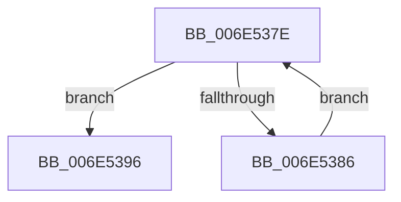

# sub_006E537E

- RVA: `0x006E537E`–`0x006E539F` (길이 `33` bytes)
- VA: `0x00000001406E537E`
- 실행 섹션: `.text`
- PDB 이름 있음: `아니요`; PDB Function 태그: `아니요`
- unwind 정보 RVA: `0x000800C4`
- 디코드: `10`개 명령, `33/33` bytes 표시
- 미해석 바이트: `0` (있으면 어셈블리에 `.byte`로 보존)

> 이 문서는 커널 이미지의 기계어와 PDB 기호를 분석해 생성했습니다. 4번과 5번은 함수 원형과 자료형을 바이너리 사용 방식에서 추정한 C 해석이며 원본 소스 복구 결과는 아닙니다.

## 1. Dependencies

- 직접 호출 지점: **1**; 고유 호출 대상: **1**
- 직접 호출자로 확인된 함수: **0**
- RIP 상대 이미지 참조: **0**

### Outgoing calls
- `0x006E538F` → [CcUninitializeCacheMap](../3C/CcUninitializeCacheMap_function_003CD520.md) (function, `0x003CD520`)

### Direct callers
- 이 함수 시작 RVA로 연결되는 직접 call은 확인되지 않았습니다. 간접 호출은 완전히 역산할 수 없습니다.

### Static image references
- 디코드된 RIP-relative 메모리 참조가 없습니다.

## 2. Other-region calls and transfers

- 다른 실행 섹션으로 향하는 call: **0**
- call이 아닌 외부 분기/꼬리 이동: **1**
  - `0x006E539A` → [CcPurgeCacheSection + 0x187](../38/CcPurgeCacheSection_function_0038B130.md) (`tail-transfer`)

## 3. Assembly (complete function range)

```asm
006E537E  48 8B 0E                        mov rcx, qword ptr [rsi]
006E5381  48 3B CE                        cmp rcx, rsi
006E5384  74 10                           je 0x1406e5396
006E5386  48 8B 49 A8                     mov rcx, qword ptr [rcx - 0x58]
006E538A  45 33 C0                        xor r8d, r8d
006E538D  33 D2                           xor edx, edx
006E538F  E8 8C 81 CE FF                  call 0x1403cd520
006E5394  EB E8                           jmp 0x1406e537e
006E5396  48 8B 75 40                     mov rsi, qword ptr [rbp + 0x40]
006E539A  E9 18 5F CA FF                  jmp 0x14038b2b7
```

## 4. C-style interpretation (structured pseudocode)

```c
__int64 __fastcall sub_006E537E(__int64 a1, int a2, int a3)
{
    __int64 result;

    if ((*(unsigned __int64 *)(v_rsi)) == v_rsi) goto loc_006E5396;
    a3 = 0;
    a2 = 0;
    result = CcUninitializeCacheMap(*(unsigned __int64 *)(*(unsigned __int64 *)(v_rsi) - 88), a2, a3, a4);
    goto loc_006E537E;
loc_006E5396:
}
```

## 5. (Beta) C Style

```c
int64_t sub_006E537E(int64_t Arg1, int32_t Arg2, int32_t Arg3)
{
    int64_t result;

    if ((*(uint64_t *)(local_rsi)) == local_rsi) goto loc_006E5396;
    Arg3 = 0;
    Arg2 = 0;
    result = CcUninitializeCacheMap(*(uint64_t *)(*(uint64_t *)(local_rsi) - 0x58), Arg2, Arg3, a4);
    goto loc_006E537E;
loc_006E5396:
}
```

## 6. Execution-region graph

[열기: 2D/3D 그래프와 함수 탐색 컨트롤 패널](../../../control-panel.html?section=text&rva=0x006E537E&view=graph)

- 2D 그래프는 위에서 아래로 흐르고, 3D 그래프는 빈 공간을 드래그해 회전합니다. Shift+드래그는 이동, 휠은 확대·축소, 함수 노드 선택은 대상 보고서 이동입니다.

### Static fallback


