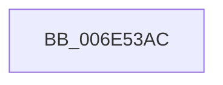

# sub_006E53AC

- RVA: `0x006E53AC`–`0x006E5437` (길이 `139` bytes)
- VA: `0x00000001406E53AC`
- 실행 섹션: `.text`
- PDB 이름 있음: `아니요`; PDB Function 태그: `아니요`
- unwind 정보 RVA: `0x00080124`
- 디코드: `28`개 명령, `139/139` bytes 표시
- 미해석 바이트: `0` (있으면 어셈블리에 `.byte`로 보존)

> 이 문서는 커널 이미지의 기계어와 PDB 기호를 분석해 생성했습니다. 4번과 5번은 함수 원형과 자료형을 바이너리 사용 방식에서 추정한 C 해석이며 원본 소스 복구 결과는 아닙니다.

## 1. Dependencies

- 직접 호출 지점: **3**; 고유 호출 대상: **3**
- 직접 호출자로 확인된 함수: **0**
- RIP 상대 이미지 참조: **2**

### Outgoing calls
- `0x006E53B8` → [KeReleaseInStackQueuedSpinLock](../34/KeReleaseInStackQueuedSpinLock_function_00342CE0.md) (function, `0x00342CE0`)
- `0x006E53EC` → [KiRcuStartGracePeriod](../5B/KiRcuStartGracePeriod_function_005BD2F4.md) (function, `0x005BD2F4`)
- `0x006E542C` → [DbgPrintEx](../35/DbgPrintEx_function_00359290.md) (function, `0x00359290`)

### Direct callers
- 이 함수 시작 RVA로 연결되는 직접 call은 확인되지 않았습니다. 간접 호출은 완전히 역산할 수 없습니다.

### Static image references
- `0x006E53CD` → RVA `0x0057B070` (`CcDeleteVolumeCacheMap`; read)
- `0x006E53FA` → RVA `0x006C7BD0` (` ?? ::FNODOBFM::`string'`; read)

## 2. Other-region calls and transfers

- 다른 실행 섹션으로 향하는 call: **0**
- call이 아닌 외부 분기/꼬리 이동: **1**
  - `0x006E5432` → [CcDecrementVolumeUseCountWithDelete + 0x35](../38/CcDecrementVolumeUseCountWithDelete_function_0038B888.md) (`tail-transfer`)

## 3. Assembly (complete function range)

```asm
006E53AC  B9 03 00 00 00                  mov ecx, 3
006E53B1  CD 29                           int 0x29
006E53B3  48 8D 4C 24 40                  lea rcx, [rsp + 0x40]
006E53B8  E8 23 D9 C5 FF                  call 0x140342ce0
006E53BD  8B 9F D4 00 00 00               mov ebx, dword ptr [rdi + 0xd4]
006E53C3  48 8D 8F 98 0A 00 00            lea rcx, [rdi + 0xa98]
006E53CA  0F 57 C0                        xorps xmm0, xmm0
006E53CD  48 8D 05 9C 5C E9 FF            lea rax, [rip - 0x16a364]
006E53D4  0F 11 01                        movups xmmword ptr [rcx], xmm0
006E53D7  0F 11 41 10                     movups xmmword ptr [rcx + 0x10], xmm0
006E53DB  0F 11 41 20                     movups xmmword ptr [rcx + 0x20], xmm0
006E53DF  48 83 61 28 00                  and qword ptr [rcx + 0x28], 0
006E53E4  48 89 41 18                     mov qword ptr [rcx + 0x18], rax
006E53E8  48 89 79 20                     mov qword ptr [rcx + 0x20], rdi
006E53EC  E8 03 7F ED FF                  call 0x1405bd2f4
006E53F1  65 48 8B 04 25 88 01 00 00      mov rax, qword ptr gs:[0x188]
006E53FA  4C 8D 05 CF 27 FE FF            lea r8, [rip - 0x1d831]
006E5401  65 4C 8B 0C 25 88 01 00 00      mov r9, qword ptr gs:[0x188]
006E540A  BA 03 00 00 00                  mov edx, 3
006E540F  89 5C 24 30                     mov dword ptr [rsp + 0x30], ebx
006E5413  48 89 7C 24 28                  mov qword ptr [rsp + 0x28], rdi
006E5418  8B 80 10 05 00 00               mov eax, dword ptr [rax + 0x510]
006E541E  45 8B 89 08 05 00 00            mov r9d, dword ptr [r9 + 0x508]
006E5425  8D 4A 7C                        lea ecx, [rdx + 0x7c]
006E5428  89 44 24 20                     mov dword ptr [rsp + 0x20], eax
006E542C  E8 5F 3E C7 FF                  call 0x140359290
006E5431  90                              nop
006E5432  E9 86 64 CA FF                  jmp 0x14038b8bd
```

## 4. C-style interpretation (structured pseudocode)

```c
__int64 __fastcall sub_006E53AC(__int64 a1, __int64 a2, __int64 a3, __int64 a4, __int64 a5, __int64 a6, __int64 a7, __int64 a8)
{
    __int64 result;
    unsigned int v_stack_p20;
    unsigned __int64 v_stack_p28;
    unsigned int v_stack_p30;

    result = KeReleaseInStackQueuedSpinLock(a8, a2, a3, a4);
    *(unsigned __int64 *)(v_rdi + 2712) = v_xmm0;
    *(unsigned __int64 *)(v_rdi + 2712 + 16) = v_xmm0;
    *(unsigned __int64 *)(v_rdi + 2712 + 32) = v_xmm0;
    *(unsigned __int64 *)(v_rdi + 2712 + 24) = v_rip - 1483620;
    *(unsigned __int64 *)(v_rdi + 2712 + 32) = v_rdi;
    result = KiRcuStartGracePeriod(v_rdi + 2712, a2, a3, a4);
    v_stack_p30 = (unsigned int)((unsigned int)(*(unsigned int *)(v_rdi + 212)));
    v_stack_p28 = v_rdi;
    v_stack_p20 = (unsigned int)((unsigned int)(*(unsigned int *)(*(unsigned __int64 *)(gs_base + (0 + 392)) + 1296)));
    result = DbgPrintEx(3 + 124, 3, v_rip - 120881, (unsigned int)(*(unsigned int *)(*(unsigned __int64 *)(gs_base + (0 + 392)) + 1288)));
}
```

## 5. (Beta) C Style

```c
int64_t sub_006E53AC(int64_t Arg1, int64_t Arg2, int64_t Arg3, int64_t Arg4, uint64_t Arg5, uint64_t Arg6, uint64_t Arg7, int64_t Arg8)
{
    int64_t result;
    uint32_t v_stack_p20;
    uint64_t v_stack_p28;
    uint32_t v_stack_p30;

    result = KeReleaseInStackQueuedSpinLock(Arg8, Arg2, Arg3, Arg4);
    *(uint64_t *)(local_rdi + 0xA98) = v_xmm0;
    *(uint64_t *)(local_rdi + 0xA98 + 0x10) = v_xmm0;
    *(uint64_t *)(local_rdi + 0xA98 + 0x20) = v_xmm0;
    *(uint64_t *)(local_rdi + 0xA98 + 0x18) = v_rip - 1483620;
    *(uint64_t *)(local_rdi + 0xA98 + 0x20) = local_rdi;
    result = KiRcuStartGracePeriod(local_rdi + 2712, Arg2, Arg3, Arg4);
    v_stack_p30 = (uint32_t)((uint32_t)(*(uint32_t *)(local_rdi + 0xD4)));
    v_stack_p28 = local_rdi;
    v_stack_p20 = (uint32_t)((uint32_t)(*(uint32_t *)(*(uint64_t *)(gs_base + (0 + 0x188)) + 0x510)));
    result = DbgPrintEx(3 + 124, 3, v_rip - 120881, (uint32_t)(*(uint32_t *)(*(uint64_t *)(gs_base + (0 + 0x188)) + 0x508)));
}
```

## 6. Execution-region graph

[열기: 2D/3D 그래프와 함수 탐색 컨트롤 패널](../../../control-panel.html?section=text&rva=0x006E53AC&view=graph)

- 2D 그래프는 위에서 아래로 흐르고, 3D 그래프는 빈 공간을 드래그해 회전합니다. Shift+드래그는 이동, 휠은 확대·축소, 함수 노드 선택은 대상 보고서 이동입니다.

### Static fallback


