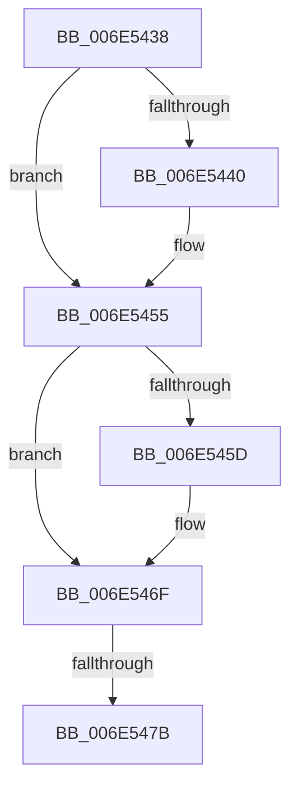

# sub_006E5438

- RVA: `0x006E5438`–`0x006E548E` (길이 `86` bytes)
- VA: `0x00000001406E5438`
- 실행 섹션: `.text`
- PDB 이름 있음: `아니요`; PDB Function 태그: `아니요`
- unwind 정보 RVA: `0x00080230`
- 디코드: `24`개 명령, `86/86` bytes 표시
- 미해석 바이트: `0` (있으면 어셈블리에 `.byte`로 보존)

> 이 문서는 커널 이미지의 기계어와 PDB 기호를 분석해 생성했습니다. 4번과 5번은 함수 원형과 자료형을 바이너리 사용 방식에서 추정한 C 해석이며 원본 소스 복구 결과는 아닙니다.

## 1. Dependencies

- 직접 호출 지점: **3**; 고유 호출 대상: **3**
- 직접 호출자로 확인된 함수: **0**
- RIP 상대 이미지 참조: **0**

### Outgoing calls
- `0x006E544B` → [PsBoostThreadIoEx](../39/PsBoostThreadIoEx_function_00392C00.md) (function, `0x00392C00`)
- `0x006E5465` → [PsBoostThreadIoQoS](../21/PsBoostThreadIoQoS_function_0021EFC0.md) (function, `0x0021EFC0`)
- `0x006E5483` → [ObDereferenceObjectDeferDeleteWithTag](../26/ObDereferenceObjectDeferDeleteWithTag_function_00263EA0.md) (function, `0x00263EA0`)

### Direct callers
- 이 함수 시작 RVA로 연결되는 직접 call은 확인되지 않았습니다. 간접 호출은 완전히 역산할 수 없습니다.

### Static image references
- 디코드된 RIP-relative 메모리 참조가 없습니다.

## 2. Other-region calls and transfers

- 다른 실행 섹션으로 향하는 call: **0**
- call이 아닌 외부 분기/꼬리 이동: **2**
  - `0x006E5475` → [sub_0038BEEF + 0x37](../38/Unknown_function_0038BEEF.md) (`tail-transfer`)
  - `0x006E5489` → [sub_0038BEEF + 0x37](../38/Unknown_function_0038BEEF.md) (`tail-transfer`)

## 3. Assembly (complete function range)

```asm
006E5438  41 8B 45 00                     mov eax, dword ptr [r13]
006E543C  A8 01                           test al, 1
006E543E  74 15                           je 0x1406e5455
006E5440  45 33 C9                        xor r9d, r9d
006E5443  45 33 C0                        xor r8d, r8d
006E5446  B2 01                           mov dl, 1
006E5448  49 8B CA                        mov rcx, r10
006E544B  E8 B0 D7 CA FF                  call 0x140392c00
006E5450  4C 8B 54 24 68                  mov r10, qword ptr [rsp + 0x68]
006E5455  41 8B 45 00                     mov eax, dword ptr [r13]
006E5459  A8 04                           test al, 4
006E545B  74 12                           je 0x1406e546f
006E545D  BA 01 00 00 00                  mov edx, 1
006E5462  49 8B CA                        mov rcx, r10
006E5465  E8 56 9B B3 FF                  call 0x14021efc0
006E546A  4C 8B 54 24 68                  mov r10, qword ptr [rsp + 0x68]
006E546F  41 8B 45 00                     mov eax, dword ptr [r13]
006E5473  A8 02                           test al, 2
006E5475  0F 84 AB 6A CA FF               je 0x14038bf26
006E547B  BA 44 66 6C 74                  mov edx, 0x746c6644
006E5480  49 8B CA                        mov rcx, r10
006E5483  E8 18 EA B7 FF                  call 0x140263ea0
006E5488  90                              nop
006E5489  E9 98 6A CA FF                  jmp 0x14038bf26
```

## 4. C-style interpretation (structured pseudocode)

```c
__int64 __fastcall sub_006E5438(__int64 a1, __int64 a2, int a3, int a4, __int64 a5, __int64 a6, __int64 a7, __int64 a8, __int64 a9, __int64 a10, __int64 a11, __int64 a12, __int64 a13)
{
    __int64 result;
    __int64 v_r10;

    result = (unsigned int)(*(unsigned int *)(v_r13));
    if ((((unsigned __int8)((unsigned int)(*(unsigned int *)(v_r13)))) & (1)) != 0) {
        a4 = 0;
        a3 = 0;
        a2 = 1;
        a1 = v_r10;
        result = PsBoostThreadIoEx(a1, a2, a3, a4);
        v_r10 = a13;
    }
    result = (unsigned int)(*(unsigned int *)(v_r13));
    if ((((unsigned __int8)((unsigned int)(*(unsigned int *)(v_r13)))) & (4)) != 0) {
        a2 = 1;
        a1 = v_r10;
        result = PsBoostThreadIoQoS(a1, a2, a3, a4);
        v_r10 = a13;
    }
    result = ObDereferenceObjectDeferDeleteWithTag(v_r10, (unsigned int)(0x746C6644ULL), a3, a4);
}
```

## 5. (Beta) C Style

```c
int64_t sub_006E5438(int64_t Arg1, int64_t Arg2, int32_t Arg3, int32_t Arg4, uint64_t Arg5, uint64_t Arg6, uint64_t Arg7, uint64_t Arg8, uint64_t Arg9, uint64_t Arg10, uint64_t Arg11, uint64_t Arg12, int64_t Arg13)
{
    int64_t result;
    int64_t local_r10;

    result = (uint32_t)(*(uint32_t *)(local_r13));
    if ((((uint8_t)((uint32_t)(*(uint32_t *)(local_r13)))) & (1)) != 0) {
        Arg4 = 0;
        Arg3 = 0;
        Arg2 = 1;
        Arg1 = local_r10;
        result = PsBoostThreadIoEx(Arg1, Arg2, Arg3, Arg4);
        local_r10 = Arg13;
    }
    result = (uint32_t)(*(uint32_t *)(local_r13));
    if ((((uint8_t)((uint32_t)(*(uint32_t *)(local_r13)))) & (4)) != 0) {
        Arg2 = 1;
        Arg1 = local_r10;
        result = PsBoostThreadIoQoS(Arg1, Arg2, Arg3, Arg4);
        local_r10 = Arg13;
    }
    result = ObDereferenceObjectDeferDeleteWithTag(local_r10, (uint32_t)(0x746C6644ULL), Arg3, Arg4);
}
```

## 6. Execution-region graph

[열기: 2D/3D 그래프와 함수 탐색 컨트롤 패널](../../../control-panel.html?section=text&rva=0x006E5438&view=graph)

- 2D 그래프는 위에서 아래로 흐르고, 3D 그래프는 빈 공간을 드래그해 회전합니다. Shift+드래그는 이동, 휠은 확대·축소, 함수 노드 선택은 대상 보고서 이동입니다.

### Static fallback


