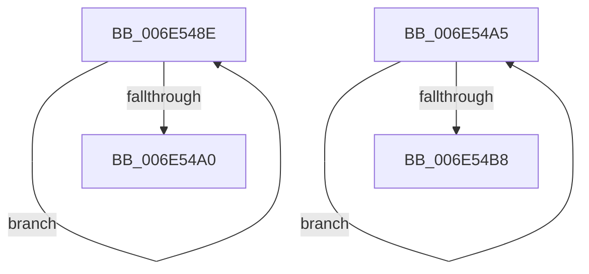

# sub_006E548E

- RVA: `0x006E548E`–`0x006E54BD` (길이 `47` bytes)
- VA: `0x00000001406E548E`
- 실행 섹션: `.text`
- PDB 이름 있음: `아니요`; PDB Function 태그: `아니요`
- unwind 정보 RVA: `0x000802F4`
- 디코드: `14`개 명령, `47/47` bytes 표시
- 미해석 바이트: `0` (있으면 어셈블리에 `.byte`로 보존)

> 이 문서는 커널 이미지의 기계어와 PDB 기호를 분석해 생성했습니다. 4번과 5번은 함수 원형과 자료형을 바이너리 사용 방식에서 추정한 C 해석이며 원본 소스 복구 결과는 아닙니다.

## 1. Dependencies

- 직접 호출 지점: **2**; 고유 호출 대상: **1**
- 직접 호출자로 확인된 함수: **0**
- RIP 상대 이미지 참조: **0**

### Outgoing calls
- `0x006E5496` → [ExFreePoolWithTag](../../poolcode/B8/ExFreePoolWithTag_function_00B82870.md) (function, `0x00B82870`)
- `0x006E54AB` → [ExFreePoolWithTag](../../poolcode/B8/ExFreePoolWithTag_function_00B82870.md) (function, `0x00B82870`)

### Direct callers
- 이 함수 시작 RVA로 연결되는 직접 call은 확인되지 않았습니다. 간접 호출은 완전히 역산할 수 없습니다.

### Static image references
- 디코드된 RIP-relative 메모리 참조가 없습니다.

## 2. Other-region calls and transfers

- 다른 실행 섹션으로 향하는 call: **2**
  - `0x006E5496` → [ExFreePoolWithTag](../../poolcode/B8/ExFreePoolWithTag_function_00B82870.md) (`.text` → `POOLCODE`)
  - `0x006E54AB` → [ExFreePoolWithTag](../../poolcode/B8/ExFreePoolWithTag_function_00B82870.md) (`.text` → `POOLCODE`)
- call이 아닌 외부 분기/꼬리 이동: **2**
  - `0x006E54A0` → [sub_0038C58B + 0x7B](../38/Unknown_function_0038C58B.md) (`tail-transfer`)
  - `0x006E54B8` → [sub_0038C58B + 0x7B](../38/Unknown_function_0038C58B.md) (`tail-transfer`)

## 3. Assembly (complete function range)

```asm
006E548E  49 8B CE                        mov rcx, r14
006E5491  33 D2                           xor edx, edx
006E5493  4D 8B 36                        mov r14, qword ptr [r14]
006E5496  E8 D5 D3 49 00                  call 0x140b82870
006E549B  4C 3B F7                        cmp r14, rdi
006E549E  75 EE                           jne 0x1406e548e
006E54A0  E9 61 71 CA FF                  jmp 0x14038c606
006E54A5  48 8B 79 28                     mov rdi, qword ptr [rcx + 0x28]
006E54A9  33 D2                           xor edx, edx
006E54AB  E8 C0 D3 49 00                  call 0x140b82870
006E54B0  48 8B CF                        mov rcx, rdi
006E54B3  48 85 FF                        test rdi, rdi
006E54B6  75 ED                           jne 0x1406e54a5
006E54B8  E9 49 71 CA FF                  jmp 0x14038c606
```

## 4. C-style interpretation (structured pseudocode)

```c
__int64 __fastcall sub_006E548E(__int64 a1, int a2)
{
    __int64 result;

    a2 = 0;
    result = ExFreePoolWithTag(v_r14, a2, a3, a4);
    if ((*(unsigned __int64 *)(v_r14)) != v_rdi) goto loc_006E548E;
}
```

## 5. (Beta) C Style

```c
int64_t sub_006E548E(int64_t Arg1, int32_t Arg2)
{
    int64_t result;

    Arg2 = 0;
    result = ExFreePoolWithTag(local_r14, Arg2, a3, a4);
    if ((*(uint64_t *)(local_r14)) != local_rdi) goto loc_006E548E;
}
```

## 6. Execution-region graph

[열기: 2D/3D 그래프와 함수 탐색 컨트롤 패널](../../../control-panel.html?section=text&rva=0x006E548E&view=graph)

- 2D 그래프는 위에서 아래로 흐르고, 3D 그래프는 빈 공간을 드래그해 회전합니다. Shift+드래그는 이동, 휠은 확대·축소, 함수 노드 선택은 대상 보고서 이동입니다.

### Static fallback


