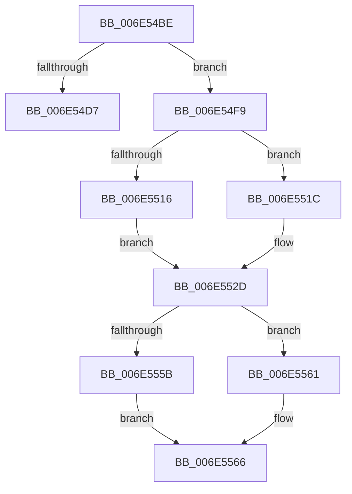

# sub_006E54BE

- RVA: `0x006E54BE`–`0x006E5573` (길이 `181` bytes)
- VA: `0x00000001406E54BE`
- 실행 섹션: `.text`
- PDB 이름 있음: `아니요`; PDB Function 태그: `아니요`
- unwind 정보 RVA: `0x00080418`
- 디코드: `47`개 명령, `181/181` bytes 표시
- 미해석 바이트: `0` (있으면 어셈블리에 `.byte`로 보존)

> 이 문서는 커널 이미지의 기계어와 PDB 기호를 분석해 생성했습니다. 4번과 5번은 함수 원형과 자료형을 바이너리 사용 방식에서 추정한 C 해석이며 원본 소스 복구 결과는 아닙니다.

## 1. Dependencies

- 직접 호출 지점: **2**; 고유 호출 대상: **2**
- 직접 호출자로 확인된 함수: **0**
- RIP 상대 이미지 참조: **1**

### Outgoing calls
- `0x006E54C5` → [ExAllocateFromNPagedLookasideList](../38/ExAllocateFromNPagedLookasideList_function_0038E6C0.md) (function, `0x0038E6C0`)
- `0x006E551F` → [RtlRealSuccessor](../38/RtlRealSuccessor_function_0038DF40.md) (function, `0x0038DF40`)

### Direct callers
- 이 함수 시작 RVA로 연결되는 직접 call은 확인되지 않았습니다. 간접 호출은 완전히 역산할 수 없습니다.

### Static image references
- `0x006E54BE` → RVA `0x00E11F80` (`.data`; read)

## 2. Other-region calls and transfers

- 다른 실행 섹션으로 향하는 call: **0**
- call이 아닌 외부 분기/꼬리 이동: **2**
  - `0x006E54F4` → [sub_0038CBC6 + 0x1F8](../38/Unknown_function_0038CBC6.md) (`tail-transfer`)
  - `0x006E556E` → [sub_0038CBC6 + 0x20E](../38/Unknown_function_0038CBC6.md) (`tail-transfer`)

## 3. Assembly (complete function range)

```asm
006E54BE  48 8D 0D BB CA 72 00            lea rcx, [rip + 0x72cabb]
006E54C5  E8 F6 91 CA FF                  call 0x14038e6c0
006E54CA  48 89 44 24 40                  mov qword ptr [rsp + 0x40], rax
006E54CF  48 8B C8                        mov rcx, rax
006E54D2  48 85 C0                        test rax, rax
006E54D5  75 22                           jne 0x1406e54f9
006E54D7  45 38 67 08                     cmp byte ptr [r15 + 8], r12b
006E54DB  B9 01 00 00 00                  mov ecx, 1
006E54E0  8B 44 24 20                     mov eax, dword ptr [rsp + 0x20]
006E54E4  0F 45 C1                        cmovne eax, ecx
006E54E7  41 88 4F 08                     mov byte ptr [r15 + 8], cl
006E54EB  48 8B 4C 24 38                  mov rcx, qword ptr [rsp + 0x38]
006E54F0  89 44 24 20                     mov dword ptr [rsp + 0x20], eax
006E54F4  E9 C5 78 CA FF                  jmp 0x14038cdbe
006E54F9  48 8D 78 18                     lea rdi, [rax + 0x18]
006E54FD  4C 89 67 08                     mov qword ptr [rdi + 8], r12
006E5501  48 89 3F                        mov qword ptr [rdi], rdi
006E5504  4C 89 67 10                     mov qword ptr [rdi + 0x10], r12
006E5508  44 88 60 08                     mov byte ptr [rax + 8], r12b
006E550C  49 8D 47 18                     lea rax, [r15 + 0x18]
006E5510  4D 39 67 28                     cmp qword ptr [r15 + 0x28], r12
006E5514  75 06                           jne 0x1406e551c
006E5516  48 89 78 10                     mov qword ptr [rax + 0x10], rdi
006E551A  EB 11                           jmp 0x1406e552d
006E551C  48 8B C8                        mov rcx, rax
006E551F  E8 1C 8A CA FF                  call 0x14038df40
006E5524  48 8B 4C 24 40                  mov rcx, qword ptr [rsp + 0x40]
006E5529  48 89 78 08                     mov qword ptr [rax + 8], rdi
006E552D  48 89 07                        mov qword ptr [rdi], rax
006E5530  48 8B F9                        mov rdi, rcx
006E5533  49 8B 06                        mov rax, qword ptr [r14]
006E5536  48 89 01                        mov qword ptr [rcx], rax
006E5539  4D 89 26                        mov qword ptr [r14], r12
006E553C  49 8B 47 30                     mov rax, qword ptr [r15 + 0x30]
006E5540  48 89 41 30                     mov qword ptr [rcx + 0x30], rax
006E5544  49 8B 47 10                     mov rax, qword ptr [r15 + 0x10]
006E5548  4D 89 77 30                     mov qword ptr [r15 + 0x30], r14
006E554C  48 89 41 10                     mov qword ptr [rcx + 0x10], rax
006E5550  49 89 5F 10                     mov qword ptr [r15 + 0x10], rbx
006E5554  44 39 64 24 20                  cmp dword ptr [rsp + 0x20], r12d
006E5559  75 06                           jne 0x1406e5561
006E555B  45 88 67 08                     mov byte ptr [r15 + 8], r12b
006E555F  EB 05                           jmp 0x1406e5566
006E5561  44 89 64 24 20                  mov dword ptr [rsp + 0x20], r12d
006E5566  4C 8B F9                        mov r15, rcx
006E5569  48 8B 4C 24 38                  mov rcx, qword ptr [rsp + 0x38]
006E556E  E9 61 78 CA FF                  jmp 0x14038cdd4
```

## 4. C-style interpretation (structured pseudocode)

```c
__int64 __fastcall sub_006E54BE(__int64 a1, __int64 a2, __int64 a3, __int64 a4, __int64 a5, __int64 a6, __int64 a7, __int64 a8)
{
    __int64 result;
    unsigned int v_stack_p20;
    unsigned __int64 v_stack_p40;

    result = ExAllocateFromNPagedLookasideList(v_rip + 7523003, a2, a3, a4);
    v_stack_p40 = result;
    if (result != 0) goto loc_006E54F9;
    result = (unsigned int)(v_stack_p20);
    if ((*(unsigned __int8 *)(v_r15 + 8)) != ((unsigned __int8)(v_r12))) { result = 1; }
    *(unsigned __int8 *)(v_r15 + 8) = 1;
    v_stack_p20 = (unsigned int)(result);
loc_006E54F9:
    *(unsigned __int64 *)(result + 24 + 8) = v_r12;
    *(unsigned __int64 *)(result + 24) = result + 24;
    *(unsigned __int64 *)(result + 24 + 16) = v_r12;
    *(unsigned __int8 *)(result + 8) = (unsigned __int8)(v_r12);
    if ((*(unsigned __int64 *)(v_r15 + 40)) != v_r12) goto loc_006E551C;
    *(unsigned __int64 *)(v_r15 + 24 + 16) = result + 24;
    goto loc_006E552D;
loc_006E551C:
    result = RtlRealSuccessor(v_r15 + 24, a2, a3, a4);
    *(unsigned __int64 *)(result + 8) = result + 24;
loc_006E552D:
    *(unsigned __int64 *)(result + 24) = result;
    *(unsigned __int64 *)(a8) = *(unsigned __int64 *)(v_r14);
    *(unsigned __int64 *)(v_r14) = v_r12;
    *(unsigned __int64 *)(a8 + 48) = *(unsigned __int64 *)(v_r15 + 48);
    *(unsigned __int64 *)(v_r15 + 48) = v_r14;
    *(unsigned __int64 *)(a8 + 16) = *(unsigned __int64 *)(v_r15 + 16);
    *(unsigned __int64 *)(v_r15 + 16) = v_rbx;
    if (v_stack_p20 != ((unsigned int)(v_r12))) goto loc_006E5561;
    *(unsigned __int8 *)(v_r15 + 8) = (unsigned __int8)(v_r12);
    goto loc_006E5566;
loc_006E5561:
    v_stack_p20 = (unsigned int)(v_r12);
loc_006E5566:
}
```

## 5. (Beta) C Style

```c
int64_t sub_006E54BE(int64_t Arg1, int64_t Arg2, int64_t Arg3, int64_t Arg4, uint64_t Arg5, uint64_t Arg6, int64_t Arg7, int64_t Arg8)
{
    int64_t result;
    uint32_t v_stack_p20;
    uint64_t v_stack_p40;

    result = ExAllocateFromNPagedLookasideList(v_rip + 7523003, Arg2, Arg3, Arg4);
    v_stack_p40 = result;
    if (result != 0) goto loc_006E54F9;
    result = (uint32_t)(v_stack_p20);
    if ((*(uint8_t *)(local_r15 + 0x8)) != ((uint8_t)(local_r12))) { result = 1; }
    *(uint8_t *)(local_r15 + 0x8) = 1;
    v_stack_p20 = (uint32_t)(result);
loc_006E54F9:
    *(uint64_t *)(result + 0x18 + 0x8) = local_r12;
    *(uint64_t *)(result + 0x18) = result + 24;
    *(uint64_t *)(result + 0x18 + 0x10) = local_r12;
    *(uint8_t *)(result + 0x8) = (uint8_t)(local_r12);
    if ((*(uint64_t *)(local_r15 + 0x28)) != local_r12) goto loc_006E551C;
    *(uint64_t *)(local_r15 + 0x18 + 0x10) = result + 24;
    goto loc_006E552D;
loc_006E551C:
    result = RtlRealSuccessor(local_r15 + 24, Arg2, Arg3, Arg4);
    *(uint64_t *)(result + 0x8) = result + 24;
loc_006E552D:
    *(uint64_t *)(result + 0x18) = result;
    *(uint64_t *)(Arg8) = *(uint64_t *)(local_r14);
    *(uint64_t *)(local_r14) = local_r12;
    *(uint64_t *)(Arg8 + 0x30) = *(uint64_t *)(local_r15 + 0x30);
    *(uint64_t *)(local_r15 + 0x30) = local_r14;
    *(uint64_t *)(Arg8 + 0x10) = *(uint64_t *)(local_r15 + 0x10);
    *(uint64_t *)(local_r15 + 0x10) = local_rbx;
    if (v_stack_p20 != ((uint32_t)(local_r12))) goto loc_006E5561;
    *(uint8_t *)(local_r15 + 0x8) = (uint8_t)(local_r12);
    goto loc_006E5566;
loc_006E5561:
    v_stack_p20 = (uint32_t)(local_r12);
loc_006E5566:
}
```

## 6. Execution-region graph

[열기: 2D/3D 그래프와 함수 탐색 컨트롤 패널](../../../control-panel.html?section=text&rva=0x006E54BE&view=graph)

- 2D 그래프는 위에서 아래로 흐르고, 3D 그래프는 빈 공간을 드래그해 회전합니다. Shift+드래그는 이동, 휠은 확대·축소, 함수 노드 선택은 대상 보고서 이동입니다.

### Static fallback


