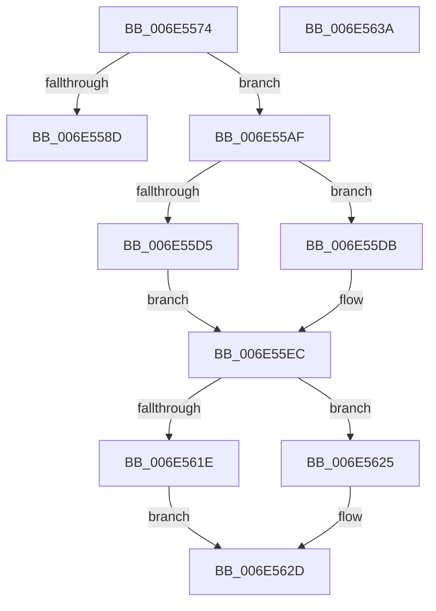

# sub_006E5574

- RVA: `0x006E5574`–`0x006E5690` (길이 `284` bytes)
- VA: `0x00000001406E5574`
- 실행 섹션: `.text`
- PDB 이름 있음: `아니요`; PDB Function 태그: `아니요`
- unwind 정보 RVA: `0x00080558`
- 디코드: `62`개 명령, `284/284` bytes 표시
- 미해석 바이트: `0` (있으면 어셈블리에 `.byte`로 보존)

> 이 문서는 커널 이미지의 기계어와 PDB 기호를 분석해 생성했습니다. 4번과 5번은 함수 원형과 자료형을 바이너리 사용 방식에서 추정한 C 해석이며 원본 소스 복구 결과는 아닙니다.

## 1. Dependencies

- 직접 호출 지점: **5**; 고유 호출 대상: **5**
- 직접 호출자로 확인된 함수: **0**
- RIP 상대 이미지 참조: **2**

### Outgoing calls
- `0x006E557B` → [ExAllocateFromNPagedLookasideList](../38/ExAllocateFromNPagedLookasideList_function_0038E6C0.md) (function, `0x0038E6C0`)
- `0x006E55DE` → [RtlRealSuccessor](../38/RtlRealSuccessor_function_0038DF40.md) (function, `0x0038DF40`)
- `0x006E5645` → [KeReleaseSpinLock](../39/KeReleaseSpinLock_function_00392BA0.md) (function, `0x00392BA0`)
- `0x006E565B` → [guard_dispatch_icall](../6B/guard_dispatch_icall_function_006BAAD0.md) (function, `0x006BAAD0`)
- `0x006E5663` → [KeAcquireSpinLockRaiseToDpc](../20/KeAcquireSpinLockRaiseToDpc_function_00208470.md) (function, `0x00208470`)

### Direct callers
- 이 함수 시작 RVA로 연결되는 직접 call은 확인되지 않았습니다. 간접 호출은 완전히 역산할 수 없습니다.

### Static image references
- `0x006E5574` → RVA `0x00E11F80` (`.data`; read)
- `0x006E566B` → RVA `0x00475D80` (`CmSiFreeMemory`; read)

## 2. Other-region calls and transfers

- 다른 실행 섹션으로 향하는 call: **0**
- call이 아닌 외부 분기/꼬리 이동: **3**
  - `0x006E55AA` → [sub_0038D2A1 + 0x1AD](../38/Unknown_function_0038D2A1.md) (`tail-transfer`)
  - `0x006E5635` → [sub_0038D2A1 + 0x1C3](../38/Unknown_function_0038D2A1.md) (`tail-transfer`)
  - `0x006E568B` → [sub_0038D2A1 + 0x218](../38/Unknown_function_0038D2A1.md) (`tail-transfer`)

## 3. Assembly (complete function range)

```asm
006E5574  48 8D 0D 05 CA 72 00            lea rcx, [rip + 0x72ca05]
006E557B  E8 40 91 CA FF                  call 0x14038e6c0
006E5580  48 89 44 24 40                  mov qword ptr [rsp + 0x40], rax
006E5585  48 8B C8                        mov rcx, rax
006E5588  48 85 C0                        test rax, rax
006E558B  75 22                           jne 0x1406e55af
006E558D  41 38 4F 08                     cmp byte ptr [r15 + 8], cl
006E5591  B9 01 00 00 00                  mov ecx, 1
006E5596  8B 44 24 30                     mov eax, dword ptr [rsp + 0x30]
006E559A  0F 45 C1                        cmovne eax, ecx
006E559D  41 88 4F 08                     mov byte ptr [r15 + 8], cl
006E55A1  48 8B 4C 24 38                  mov rcx, qword ptr [rsp + 0x38]
006E55A6  89 44 24 30                     mov dword ptr [rsp + 0x30], eax
006E55AA  E9 9F 7E CA FF                  jmp 0x14038d44e
006E55AF  48 8D 78 18                     lea rdi, [rax + 0x18]
006E55B3  48 C7 47 08 00 00 00 00         mov qword ptr [rdi + 8], 0
006E55BB  48 89 3F                        mov qword ptr [rdi], rdi
006E55BE  48 C7 47 10 00 00 00 00         mov qword ptr [rdi + 0x10], 0
006E55C6  C6 40 08 00                     mov byte ptr [rax + 8], 0
006E55CA  49 8D 47 18                     lea rax, [r15 + 0x18]
006E55CE  49 83 7F 28 00                  cmp qword ptr [r15 + 0x28], 0
006E55D3  75 06                           jne 0x1406e55db
006E55D5  48 89 78 10                     mov qword ptr [rax + 0x10], rdi
006E55D9  EB 11                           jmp 0x1406e55ec
006E55DB  48 8B C8                        mov rcx, rax
006E55DE  E8 5D 89 CA FF                  call 0x14038df40
006E55E3  48 8B 4C 24 40                  mov rcx, qword ptr [rsp + 0x40]
006E55E8  48 89 78 08                     mov qword ptr [rax + 8], rdi
006E55EC  83 7C 24 30 00                  cmp dword ptr [rsp + 0x30], 0
006E55F1  48 89 07                        mov qword ptr [rdi], rax
006E55F4  48 8B F9                        mov rdi, rcx
006E55F7  49 8B 06                        mov rax, qword ptr [r14]
006E55FA  48 89 01                        mov qword ptr [rcx], rax
006E55FD  49 C7 06 00 00 00 00            mov qword ptr [r14], 0
006E5604  49 8B 47 30                     mov rax, qword ptr [r15 + 0x30]
006E5608  48 89 41 30                     mov qword ptr [rcx + 0x30], rax
006E560C  49 8B 47 10                     mov rax, qword ptr [r15 + 0x10]
006E5610  4D 89 77 30                     mov qword ptr [r15 + 0x30], r14
006E5614  48 89 41 10                     mov qword ptr [rcx + 0x10], rax
006E5618  49 89 5F 10                     mov qword ptr [r15 + 0x10], rbx
006E561C  75 07                           jne 0x1406e5625
006E561E  41 C6 47 08 00                  mov byte ptr [r15 + 8], 0
006E5623  EB 08                           jmp 0x1406e562d
006E5625  C7 44 24 30 00 00 00 00         mov dword ptr [rsp + 0x30], 0
006E562D  4C 8B F9                        mov r15, rcx
006E5630  48 8B 4C 24 38                  mov rcx, qword ptr [rsp + 0x38]
006E5635  E9 2A 7E CA FF                  jmp 0x14038d464
006E563A  0F B6 94 24 A0 00 00 00         movzx edx, byte ptr [rsp + 0xa0]
006E5642  49 8B CD                        mov rcx, r13
006E5645  E8 56 D5 CA FF                  call 0x140392ba0
006E564A  48 8B 43 10                     mov rax, qword ptr [rbx + 0x10]
006E564E  49 8D 54 24 08                  lea rdx, [r12 + 8]
006E5653  48 8B 8C 24 C0 00 00 00         mov rcx, qword ptr [rsp + 0xc0]
006E565B  E8 70 54 FD FF                  call 0x1406baad0
006E5660  49 8B CD                        mov rcx, r13
006E5663  E8 08 2E B2 FF                  call 0x140208470
006E5668  0F B6 F8                        movzx edi, al
006E566B  4C 8D 0D 0E 07 D9 FF            lea r9, [rip - 0x26f8f2]
006E5672  B9 01 00 00 00                  mov ecx, 1
006E5677  49 BA 00 00 00 00 00 80 FF FF   movabs r10, 0xffff800000000000
006E5681  49 BB 00 00 00 00 00 80 00 00   movabs r11, 0x800000000000
006E568B  E9 29 7E CA FF                  jmp 0x14038d4b9
```

## 4. C-style interpretation (structured pseudocode)

```c
__int64 __fastcall sub_006E5574(__int64 a1, __int64 a2, __int64 a3, __int64 a4, __int64 a5, unsigned int a6, __int64 a7, __int64 a8)
{
    __int64 result;
    unsigned int v_stack_p30;
    unsigned __int64 v_stack_p40;
    unsigned __int8 v_stack_pA0;
    unsigned __int64 v_stack_pC0;

    result = ExAllocateFromNPagedLookasideList(v_rip + 7522821, a2, a3, a4);
    v_stack_p40 = result;
    if (result != 0) goto loc_006E55AF;
    result = (unsigned int)(a6);
    if ((*(unsigned __int8 *)(v_r15 + 8)) != ((unsigned __int8)(result))) { result = 1; }
    *(unsigned __int8 *)(v_r15 + 8) = 1;
    v_stack_p30 = (unsigned int)(result);
loc_006E55AF:
    *(unsigned __int64 *)(result + 24 + 8) = 0;
    *(unsigned __int64 *)(result + 24) = result + 24;
    *(unsigned __int64 *)(result + 24 + 16) = 0;
    *(unsigned __int8 *)(result + 8) = 0;
    if ((*(unsigned __int64 *)(v_r15 + 40)) != 0) goto loc_006E55DB;
    *(unsigned __int64 *)(v_r15 + 24 + 16) = result + 24;
    goto loc_006E55EC;
loc_006E55DB:
    result = RtlRealSuccessor(v_r15 + 24, a2, a3, a4);
    *(unsigned __int64 *)(result + 8) = result + 24;
loc_006E55EC:
    *(unsigned __int64 *)(result + 24) = result;
    *(unsigned __int64 *)(a8) = *(unsigned __int64 *)(v_r14);
    *(unsigned __int64 *)(v_r14) = 0;
    *(unsigned __int64 *)(a8 + 48) = *(unsigned __int64 *)(v_r15 + 48);
    *(unsigned __int64 *)(v_r15 + 48) = v_r14;
    *(unsigned __int64 *)(a8 + 16) = *(unsigned __int64 *)(v_r15 + 16);
    *(unsigned __int64 *)(v_r15 + 16) = v_rbx;
    if (a6 != 0) goto loc_006E5625;
    *(unsigned __int8 *)(v_r15 + 8) = 0;
    goto loc_006E562D;
loc_006E5625:
    v_stack_p30 = 0;
loc_006E562D:
}
```

## 5. (Beta) C Style

```c
int64_t sub_006E5574(int64_t Arg1, int64_t Arg2, int64_t Arg3, int64_t Arg4, uint64_t Arg5, uint32_t Arg6, int64_t Arg7, int64_t Arg8)
{
    int64_t result;
    uint32_t v_stack_p30;
    uint64_t v_stack_p40;
    uint8_t v_stack_pA0;
    uint64_t v_stack_pC0;

    result = ExAllocateFromNPagedLookasideList(v_rip + 7522821, Arg2, Arg3, Arg4);
    v_stack_p40 = result;
    if (result != 0) goto loc_006E55AF;
    result = (uint32_t)(Arg6);
    if ((*(uint8_t *)(local_r15 + 0x8)) != ((uint8_t)(result))) { result = 1; }
    *(uint8_t *)(local_r15 + 0x8) = 1;
    v_stack_p30 = (uint32_t)(result);
loc_006E55AF:
    *(uint64_t *)(result + 0x18 + 0x8) = 0;
    *(uint64_t *)(result + 0x18) = result + 24;
    *(uint64_t *)(result + 0x18 + 0x10) = 0;
    *(uint8_t *)(result + 0x8) = 0;
    if ((*(uint64_t *)(local_r15 + 0x28)) != 0) goto loc_006E55DB;
    *(uint64_t *)(local_r15 + 0x18 + 0x10) = result + 24;
    goto loc_006E55EC;
loc_006E55DB:
    result = RtlRealSuccessor(local_r15 + 24, Arg2, Arg3, Arg4);
    *(uint64_t *)(result + 0x8) = result + 24;
loc_006E55EC:
    *(uint64_t *)(result + 0x18) = result;
    *(uint64_t *)(Arg8) = *(uint64_t *)(local_r14);
    *(uint64_t *)(local_r14) = 0;
    *(uint64_t *)(Arg8 + 0x30) = *(uint64_t *)(local_r15 + 0x30);
    *(uint64_t *)(local_r15 + 0x30) = local_r14;
    *(uint64_t *)(Arg8 + 0x10) = *(uint64_t *)(local_r15 + 0x10);
    *(uint64_t *)(local_r15 + 0x10) = local_rbx;
    if (Arg6 != 0) goto loc_006E5625;
    *(uint8_t *)(local_r15 + 0x8) = 0;
    goto loc_006E562D;
loc_006E5625:
    v_stack_p30 = 0;
loc_006E562D:
}
```

## 6. Execution-region graph

[열기: 2D/3D 그래프와 함수 탐색 컨트롤 패널](../../../control-panel.html?section=text&rva=0x006E5574&view=graph)

- 2D 그래프는 위에서 아래로 흐르고, 3D 그래프는 빈 공간을 드래그해 회전합니다. Shift+드래그는 이동, 휠은 확대·축소, 함수 노드 선택은 대상 보고서 이동입니다.

### Static fallback


