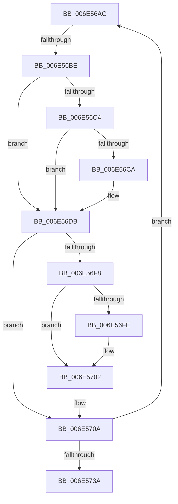

# sub_006E56AC

- RVA: `0x006E56AC`–`0x006E573F` (길이 `147` bytes)
- VA: `0x00000001406E56AC`
- 실행 섹션: `.text`
- PDB 이름 있음: `아니요`; PDB Function 태그: `아니요`
- unwind 정보 RVA: `0x000806B4`
- 디코드: `38`개 명령, `147/147` bytes 표시
- 미해석 바이트: `0` (있으면 어셈블리에 `.byte`로 보존)

> 이 문서는 커널 이미지의 기계어와 PDB 기호를 분석해 생성했습니다. 4번과 5번은 함수 원형과 자료형을 바이너리 사용 방식에서 추정한 C 해석이며 원본 소스 복구 결과는 아닙니다.

## 1. Dependencies

- 직접 호출 지점: **4**; 고유 호출 대상: **4**
- 직접 호출자로 확인된 함수: **0**
- RIP 상대 이미지 참조: **1**

### Outgoing calls
- `0x006E56D6` → [FsRtlSplitLocks](../3F/FsRtlSplitLocks_function_003FD8DC.md) (function, `0x003FD8DC`)
- `0x006E5711` → [RtlDeleteNoSplay](../38/RtlDeleteNoSplay_function_0038C410.md) (function, `0x0038C410`)
- `0x006E5721` → [ExFreeToNPagedLookasideList](../38/ExFreeToNPagedLookasideList_function_0038D9D0.md) (function, `0x0038D9D0`)
- `0x006E5729` → [RtlRealSuccessor](../38/RtlRealSuccessor_function_0038DF40.md) (function, `0x0038DF40`)

### Direct callers
- 이 함수 시작 RVA로 연결되는 직접 call은 확인되지 않았습니다. 간접 호출은 완전히 역산할 수 없습니다.

### Static image references
- `0x006E571A` → RVA `0x00E11F80` (`.data`; read)

## 2. Other-region calls and transfers

- 다른 실행 섹션으로 향하는 call: **0**
- call이 아닌 외부 분기/꼬리 이동: **2**
  - `0x006E56B8` → [FsRtlPrivateInsertSharedLock + 0x19C](../38/FsRtlPrivateInsertSharedLock_function_0038E810.md) (`tail-transfer`)
  - `0x006E573A` → [FsRtlPrivateInsertSharedLock + 0x19C](../38/FsRtlPrivateInsertSharedLock_function_0038E810.md) (`tail-transfer`)

## 3. Assembly (complete function range)

```asm
006E56AC  49 8B 56 E8                     mov rdx, qword ptr [r14 - 0x18]
006E56B0  48 8B 4D F8                     mov rcx, qword ptr [rbp - 8]
006E56B4  48 39 4A 08                     cmp qword ptr [rdx + 8], rcx
006E56B8  0F 87 EE 92 CA FF               ja 0x14038e9ac
006E56BE  44 38 7D F0                     cmp byte ptr [rbp - 0x10], r15b
006E56C2  75 17                           jne 0x1406e56db
006E56C4  45 38 7E F0                     cmp byte ptr [r14 - 0x10], r15b
006E56C8  74 11                           je 0x1406e56db
006E56CA  45 33 C9                        xor r9d, r9d
006E56CD  49 8D 4E E8                     lea rcx, [r14 - 0x18]
006E56D1  45 33 C0                        xor r8d, r8d
006E56D4  33 D2                           xor edx, edx
006E56D6  E8 01 82 D1 FF                  call 0x1403fd8dc
006E56DB  49 8B 46 E8                     mov rax, qword ptr [r14 - 0x18]
006E56DF  48 8B 4D 18                     mov rcx, qword ptr [rbp + 0x18]
006E56E3  48 89 01                        mov qword ptr [rcx], rax
006E56E6  49 8B 46 18                     mov rax, qword ptr [r14 + 0x18]
006E56EA  48 89 45 18                     mov qword ptr [rbp + 0x18], rax
006E56EE  48 8B 45 F8                     mov rax, qword ptr [rbp - 8]
006E56F2  49 39 46 F8                     cmp qword ptr [r14 - 8], rax
006E56F6  76 12                           jbe 0x1406e570a
006E56F8  45 38 7E F0                     cmp byte ptr [r14 - 0x10], r15b
006E56FC  74 04                           je 0x1406e5702
006E56FE  C6 45 F0 01                     mov byte ptr [rbp - 0x10], 1
006E5702  49 8B 46 F8                     mov rax, qword ptr [r14 - 8]
006E5706  48 89 45 F8                     mov qword ptr [rbp - 8], rax
006E570A  48 8D 57 08                     lea rdx, [rdi + 8]
006E570E  49 8B CE                        mov rcx, r14
006E5711  E8 FA 6C CA FF                  call 0x14038c410
006E5716  49 8D 56 E8                     lea rdx, [r14 - 0x18]
006E571A  48 8D 0D 5F C8 72 00            lea rcx, [rip + 0x72c85f]
006E5721  E8 AA 82 CA FF                  call 0x14038d9d0
006E5726  48 8B CD                        mov rcx, rbp
006E5729  E8 12 88 CA FF                  call 0x14038df40
006E572E  4C 8B F0                        mov r14, rax
006E5731  48 85 C0                        test rax, rax
006E5734  0F 85 72 FF FF FF               jne 0x1406e56ac
006E573A  E9 6D 92 CA FF                  jmp 0x14038e9ac
```

## 4. C-style interpretation (structured pseudocode)

```c
__int64 __fastcall sub_006E56AC(__int64 a1, __int64 a2, int a3, int a4)
{
    __int64 result;

    if ((*(unsigned __int8 *)(v_rbp - 16)) != ((unsigned __int8)(v_r15))) goto loc_006E56DB;
    if ((*(unsigned __int8 *)(v_r14 - 16)) != ((unsigned __int8)(v_r15))) {
        a4 = 0;
        a1 = v_r14 - 24;
        a3 = 0;
        a2 = 0;
        result = FsRtlSplitLocks(a1, a2, a3, a4);
    }
    *(unsigned __int64 *)(*(unsigned __int64 *)(v_rbp + 24)) = *(unsigned __int64 *)(v_r14 - 24);
    *(unsigned __int64 *)(v_rbp + 24) = *(unsigned __int64 *)(v_r14 + 24);
    if ((*(unsigned __int64 *)(v_r14 - 8)) <= (*(unsigned __int64 *)(v_rbp - 8))) goto loc_006E570A;
    if ((*(unsigned __int8 *)(v_r14 - 16)) != ((unsigned __int8)(v_r15))) {
        *(unsigned __int8 *)(v_rbp - 16) = 1;
    }
    *(unsigned __int64 *)(v_rbp - 8) = *(unsigned __int64 *)(v_r14 - 8);
loc_006E570A:
    result = RtlDeleteNoSplay(v_r14, v_rdi + 8, a3, a4);
    result = ExFreeToNPagedLookasideList(v_rip + 7522399, v_r14 - 24, a3, a4);
    result = RtlRealSuccessor(v_rbp, v_r14 - 24, a3, a4);
    if (result != 0) goto loc_006E56AC;
}
```

## 5. (Beta) C Style

```c
int64_t sub_006E56AC(int64_t Arg1, int64_t Arg2, int32_t Arg3, int32_t Arg4)
{
    int64_t result;

    if ((*(uint8_t *)(local_rbp - 0x10)) != ((uint8_t)(local_r15))) goto loc_006E56DB;
    if ((*(uint8_t *)(local_r14 - 0x10)) != ((uint8_t)(local_r15))) {
        Arg4 = 0;
        Arg1 = local_r14 - 24;
        Arg3 = 0;
        Arg2 = 0;
        result = FsRtlSplitLocks(Arg1, Arg2, Arg3, Arg4);
    }
    *(uint64_t *)(*(uint64_t *)(local_rbp + 0x18)) = *(uint64_t *)(local_r14 - 0x18);
    *(uint64_t *)(local_rbp + 0x18) = *(uint64_t *)(local_r14 + 0x18);
    if ((*(uint64_t *)(local_r14 - 0x8)) <= (*(uint64_t *)(local_rbp - 0x8))) goto loc_006E570A;
    if ((*(uint8_t *)(local_r14 - 0x10)) != ((uint8_t)(local_r15))) {
        *(uint8_t *)(local_rbp - 0x10) = 1;
    }
    *(uint64_t *)(local_rbp - 0x8) = *(uint64_t *)(local_r14 - 0x8);
loc_006E570A:
    result = RtlDeleteNoSplay(local_r14, local_rdi + 8, Arg3, Arg4);
    result = ExFreeToNPagedLookasideList(v_rip + 7522399, local_r14 - 24, Arg3, Arg4);
    result = RtlRealSuccessor(local_rbp, local_r14 - 24, Arg3, Arg4);
    if (result != 0) goto loc_006E56AC;
}
```

## 6. Execution-region graph

[열기: 2D/3D 그래프와 함수 탐색 컨트롤 패널](../../../control-panel.html?section=text&rva=0x006E56AC&view=graph)

- 2D 그래프는 위에서 아래로 흐르고, 3D 그래프는 빈 공간을 드래그해 회전합니다. Shift+드래그는 이동, 휠은 확대·축소, 함수 노드 선택은 대상 보고서 이동입니다.

### Static fallback


