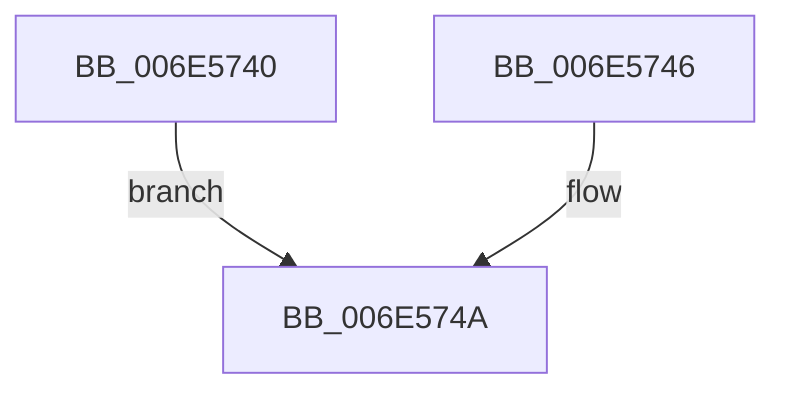

# sub_006E5740

- RVA: `0x006E5740`–`0x006E5752` (길이 `18` bytes)
- VA: `0x00000001406E5740`
- 실행 섹션: `.text`
- PDB 이름 있음: `아니요`; PDB Function 태그: `아니요`
- unwind 정보 RVA: `0x000806F4`
- 디코드: `5`개 명령, `18/18` bytes 표시
- 미해석 바이트: `0` (있으면 어셈블리에 `.byte`로 보존)

> 이 문서는 커널 이미지의 기계어와 PDB 기호를 분석해 생성했습니다. 4번과 5번은 함수 원형과 자료형을 바이너리 사용 방식에서 추정한 C 해석이며 원본 소스 복구 결과는 아닙니다.

## 1. Dependencies

- 직접 호출 지점: **0**; 고유 호출 대상: **0**
- 직접 호출자로 확인된 함수: **0**
- RIP 상대 이미지 참조: **0**

### Outgoing calls
- 직접 디코드된 call 명령이 없습니다.

### Direct callers
- 이 함수 시작 RVA로 연결되는 직접 call은 확인되지 않았습니다. 간접 호출은 완전히 역산할 수 없습니다.

### Static image references
- 디코드된 RIP-relative 메모리 참조가 없습니다.

## 2. Other-region calls and transfers

- 다른 실행 섹션으로 향하는 call: **0**
- call이 아닌 외부 분기/꼬리 이동: **1**
  - `0x006E574D` → [FsRtlPrivateInsertExclusiveLock + 0x90](../38/FsRtlPrivateInsertExclusiveLock_function_0038EBFC.md) (`tail-transfer`)

## 3. Assembly (complete function range)

```asm
006E5740  48 89 58 08                     mov qword ptr [rax + 8], rbx
006E5744  EB 04                           jmp 0x1406e574a
006E5746  48 89 58 10                     mov qword ptr [rax + 0x10], rbx
006E574A  48 89 03                        mov qword ptr [rbx], rax
006E574D  E9 3A 95 CA FF                  jmp 0x14038ec8c
```

## 4. C-style interpretation (structured pseudocode)

```c
void __fastcall sub_006E5740(void)
{
    *(unsigned __int64 *)(result + 8) = v_rbx;
    goto loc_006E574A;
loc_006E574A:
    *(unsigned __int64 *)(v_rbx) = result;
}
```

## 5. (Beta) C Style

```c
void sub_006E5740(void)
{
    *(uint64_t *)(result + 0x8) = local_rbx;
    goto loc_006E574A;
loc_006E574A:
    *(uint64_t *)(local_rbx) = result;
}
```

## 6. Execution-region graph

[열기: 2D/3D 그래프와 함수 탐색 컨트롤 패널](../../../control-panel.html?section=text&rva=0x006E5740&view=graph)

- 2D 그래프는 위에서 아래로 흐르고, 3D 그래프는 빈 공간을 드래그해 회전합니다. Shift+드래그는 이동, 휠은 확대·축소, 함수 노드 선택은 대상 보고서 이동입니다.

### Static fallback


