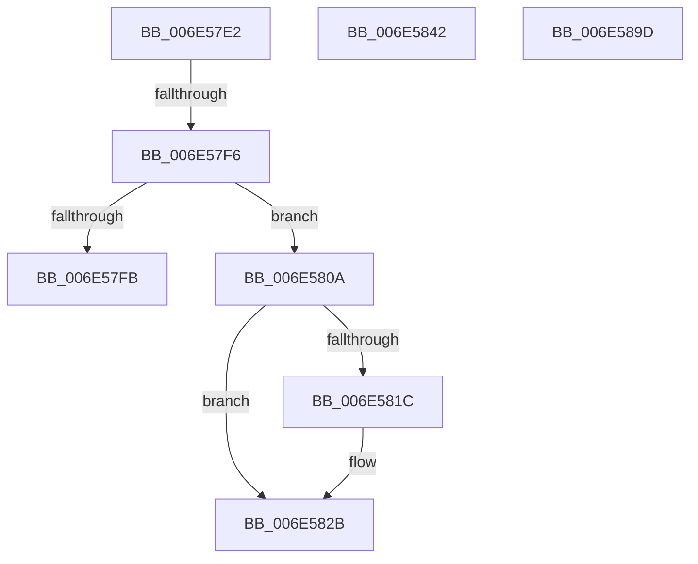

# sub_006E57E2

- RVA: `0x006E57E2`–`0x006E5985` (길이 `419` bytes)
- VA: `0x00000001406E57E2`
- 실행 섹션: `.text`
- PDB 이름 있음: `아니요`; PDB Function 태그: `아니요`
- unwind 정보 RVA: `0x00080CF8`
- 디코드: `87`개 명령, `419/419` bytes 표시
- 미해석 바이트: `0` (있으면 어셈블리에 `.byte`로 보존)

> 이 문서는 커널 이미지의 기계어와 PDB 기호를 분석해 생성했습니다. 4번과 5번은 함수 원형과 자료형을 바이너리 사용 방식에서 추정한 C 해석이며 원본 소스 복구 결과는 아닙니다.

## 1. Dependencies

- 직접 호출 지점: **4**; 고유 호출 대상: **3**
- 직접 호출자로 확인된 함수: **0**
- RIP 상대 이미지 참조: **8**

### Outgoing calls
- `0x006E57FF` → [KiSetVirtualHeteroClockIntervalRequest](../5C/KiSetVirtualHeteroClockIntervalRequest_function_005C45F8.md) (function, `0x005C45F8`)
- `0x006E5837` → [KeInsertQueueDpc](../20/KeInsertQueueDpc_function_00207C50.md) (function, `0x00207C50`)
- `0x006E5892` → [tlgWriteTransfer_EtwWriteTransfer](../42/tlgWriteTransfer_EtwWriteTransfer_function_004260E0.md) (function, `0x004260E0`)
- `0x006E597A` → [tlgWriteTransfer_EtwWriteTransfer](../42/tlgWriteTransfer_EtwWriteTransfer_function_004260E0.md) (function, `0x004260E0`)

### Direct callers
- 이 함수 시작 RVA로 연결되는 직접 call은 확인되지 않았습니다. 간접 호출은 완전히 역산할 수 없습니다.

### Static image references
- `0x006E57E5` → RVA `0x00E66894` (`.data`; read/write)
- `0x006E580A` → RVA `0x00F22E18` (`.data`; read)
- `0x006E5811` → RVA `0x00F21FB0` (`.data`; read)
- `0x006E5824` → RVA `0x00F22DE2` (`.data`; write)
- `0x006E582E` → RVA `0x00F22DE0` (`.data`; read)
- `0x006E585C` → RVA `0x0004861A` (`.rdata`; read)
- `0x006E588B` → RVA `0x00E070D8` (`.data`; read)
- `0x006E58AB` → RVA `0x00048592` (`.rdata`; read)

## 2. Other-region calls and transfers

- 다른 실행 섹션으로 향하는 call: **0**
- call이 아닌 외부 분기/꼬리 이동: **5**
  - `0x006E57F0` → [KeUpdatePendingQosRequest + 0x127](../39/KeUpdatePendingQosRequest_function_003924F4.md) (`tail-transfer`)
  - `0x006E5805` → [KeUpdatePendingQosRequest + 0x127](../39/KeUpdatePendingQosRequest_function_003924F4.md) (`tail-transfer`)
  - `0x006E583D` → [KeUpdatePendingQosRequest + 0x127](../39/KeUpdatePendingQosRequest_function_003924F4.md) (`tail-transfer`)
  - `0x006E5898` → [KeUpdatePendingQosRequest + 0x10B](../39/KeUpdatePendingQosRequest_function_003924F4.md) (`tail-transfer`)
  - `0x006E5980` → [KeUpdatePendingQosRequest + 0xB2](../39/KeUpdatePendingQosRequest_function_003924F4.md) (`tail-transfer`)

## 3. Assembly (complete function range)

```asm
006E57E2  83 C8 FF                        or eax, 0xffffffff
006E57E5  F0 0F C1 05 A7 10 78 00         lock xadd dword ptr [rip + 0x7810a7], eax
006E57ED  83 F8 01                        cmp eax, 1
006E57F0  0F 85 25 CE CA FF               jne 0x14039261b
006E57F6  38 59 21                        cmp byte ptr [rcx + 0x21], bl
006E57F9  74 0F                           je 0x1406e580a
006E57FB  8A D8                           mov bl, al
006E57FD  8A CB                           mov cl, bl
006E57FF  E8 F4 ED ED FF                  call 0x1405c45f8
006E5804  90                              nop
006E5805  E9 11 CE CA FF                  jmp 0x14039261b
006E580A  48 8B 05 07 D6 83 00            mov rax, qword ptr [rip + 0x83d607]
006E5811  8B 0D 99 C7 83 00               mov ecx, dword ptr [rip + 0x83c799]
006E5817  48 85 C0                        test rax, rax
006E581A  75 0F                           jne 0x1406e582b
006E581C  B8 00 08 00 00                  mov eax, 0x800
006E5821  66 03 C8                        add cx, ax
006E5824  66 89 0D B7 D5 83 00            mov word ptr [rip + 0x83d5b7], cx
006E582B  45 33 C0                        xor r8d, r8d
006E582E  48 8D 0D AB D5 83 00            lea rcx, [rip + 0x83d5ab]
006E5835  33 D2                           xor edx, edx
006E5837  E8 14 24 B2 FF                  call 0x140207c50
006E583C  90                              nop
006E583D  E9 D9 CD CA FF                  jmp 0x14039261b
006E5842  B9 04 00 00 00                  mov ecx, 4
006E5847  C7 44 24 34 06 00 00 00         mov dword ptr [rsp + 0x34], 6
006E584F  48 8D 44 24 34                  lea rax, [rsp + 0x34]
006E5854  48 89 4D 28                     mov qword ptr [rbp + 0x28], rcx
006E5858  48 89 45 20                     mov qword ptr [rbp + 0x20], rax
006E585C  48 8D 15 B7 2D 96 FF            lea rdx, [rip - 0x69d249]
006E5863  48 8D 44 24 30                  lea rax, [rsp + 0x30]
006E5868  88 5C 24 30                     mov byte ptr [rsp + 0x30], bl
006E586C  48 89 45 30                     mov qword ptr [rbp + 0x30], rax
006E5870  45 33 C9                        xor r9d, r9d
006E5873  48 8D 45 00                     lea rax, [rbp]
006E5877  48 C7 45 38 01 00 00 00         mov qword ptr [rbp + 0x38], 1
006E587F  48 89 44 24 28                  mov qword ptr [rsp + 0x28], rax
006E5884  45 33 C0                        xor r8d, r8d
006E5887  89 4C 24 20                     mov dword ptr [rsp + 0x20], ecx
006E588B  48 8D 0D 46 18 72 00            lea rcx, [rip + 0x721846]
006E5892  E8 49 08 D4 FF                  call 0x1404260e0
006E5897  90                              nop
006E5898  E9 62 CD CA FF                  jmp 0x1403925ff
006E589D  48 8D 44 24 48                  lea rax, [rsp + 0x48]
006E58A2  48 89 74 24 48                  mov qword ptr [rsp + 0x48], rsi
006E58A7  48 89 45 80                     mov qword ptr [rbp - 0x80], rax
006E58AB  48 8D 15 E0 2C 96 FF            lea rdx, [rip - 0x69d320]
006E58B2  48 8D 44 24 34                  lea rax, [rsp + 0x34]
006E58B7  48 C7 45 88 08 00 00 00         mov qword ptr [rbp - 0x78], 8
006E58BF  48 89 45 90                     mov qword ptr [rbp - 0x70], rax
006E58C3  48 8D 0D 0E 18 72 00            lea rcx, [rip + 0x72180e]
006E58CA  48 8D 44 24 50                  lea rax, [rsp + 0x50]
006E58CF  C7 44 24 34 06 00 00 00         mov dword ptr [rsp + 0x34], 6
006E58D7  48 89 45 A0                     mov qword ptr [rbp - 0x60], rax
006E58DB  45 33 C9                        xor r9d, r9d
006E58DE  49 8B C4                        mov rax, r12
006E58E1  48 C7 45 98 04 00 00 00         mov qword ptr [rbp - 0x68], 4
006E58E9  48 2B C6                        sub rax, rsi
006E58EC  4C 89 74 24 50                  mov qword ptr [rsp + 0x50], r14
006E58F1  48 89 44 24 58                  mov qword ptr [rsp + 0x58], rax
006E58F6  45 33 C0                        xor r8d, r8d
006E58F9  48 8D 44 24 58                  lea rax, [rsp + 0x58]
006E58FE  48 C7 45 A8 08 00 00 00         mov qword ptr [rbp - 0x58], 8
006E5906  48 89 45 B0                     mov qword ptr [rbp - 0x50], rax
006E590A  48 8D 44 24 40                  lea rax, [rsp + 0x40]
006E590F  48 89 45 C0                     mov qword ptr [rbp - 0x40], rax
006E5913  48 8D 44 24 38                  lea rax, [rsp + 0x38]
006E5918  48 89 45 D0                     mov qword ptr [rbp - 0x30], rax
006E591C  48 8D 44 24 30                  lea rax, [rsp + 0x30]
006E5921  48 89 45 E0                     mov qword ptr [rbp - 0x20], rax
006E5925  48 8D 44 24 31                  lea rax, [rsp + 0x31]
006E592A  48 89 45 F0                     mov qword ptr [rbp - 0x10], rax
006E592E  48 8D 44 24 60                  lea rax, [rsp + 0x60]
006E5933  48 89 44 24 28                  mov qword ptr [rsp + 0x28], rax
006E5938  C7 44 24 20 0A 00 00 00         mov dword ptr [rsp + 0x20], 0xa
006E5940  48 C7 45 B8 08 00 00 00         mov qword ptr [rbp - 0x48], 8
006E5948  4C 89 64 24 40                  mov qword ptr [rsp + 0x40], r12
006E594D  48 C7 45 C8 08 00 00 00         mov qword ptr [rbp - 0x38], 8
006E5955  89 5C 24 38                     mov dword ptr [rsp + 0x38], ebx
006E5959  48 C7 45 D8 04 00 00 00         mov qword ptr [rbp - 0x28], 4
006E5961  88 5C 24 30                     mov byte ptr [rsp + 0x30], bl
006E5965  48 C7 45 E8 01 00 00 00         mov qword ptr [rbp - 0x18], 1
006E596D  C6 44 24 31 01                  mov byte ptr [rsp + 0x31], 1
006E5972  48 C7 45 F8 01 00 00 00         mov qword ptr [rbp - 8], 1
006E597A  E8 61 07 D4 FF                  call 0x1404260e0
006E597F  90                              nop
006E5980  E9 21 CC CA FF                  jmp 0x1403925a6
```

## 4. C-style interpretation (structured pseudocode)

```c
__int64 __fastcall sub_006E57E2(__int64 a1, int a2, int a3, int a4)
{
    __int64 result;
    unsigned int v_stack_p20;
    unsigned __int64 v_stack_p28;
    unsigned __int64 v_stack_p30;
    unsigned __int64 v_stack_p31;
    unsigned int v_stack_p34;
    unsigned __int64 v_stack_p38;
    unsigned __int64 v_stack_p40;
    unsigned __int64 v_stack_p48;
    unsigned __int64 v_stack_p50;
    unsigned __int64 v_stack_p58;
    unsigned __int64 v_stack_p60;

    result = (unsigned int)((result) | (0xFFFFFFFFULL));
    if ((*(unsigned __int8 *)(a1 + 33)) == ((unsigned __int8)(v_rbx))) goto loc_006E580A;
    result = KiSetVirtualHeteroClockIntervalRequest((unsigned __int8)((unsigned __int8)(result)), a2, a3, a4);
loc_006E580A:
    result = *(unsigned __int64 *)(v_rip + 8640007);
    if (*(unsigned __int64 *)(v_rip + 8640007) == 0) {
        result = 0x800ULL;
        a1 = (unsigned __int16)(((unsigned int)(*(unsigned int *)(v_rip + 8636313))) + ((unsigned __int16)(result)));
        *(unsigned __int16 *)(v_rip + 8639927) = (unsigned __int16)(a1);
    }
    a3 = 0;
    a2 = 0;
    result = KeInsertQueueDpc(v_rip + 8639915, a2, a3, a4);
}
```

## 5. (Beta) C Style

```c
int64_t sub_006E57E2(void *Arg1, int32_t Arg2, int32_t Arg3, int32_t Arg4)
{
    uint8_t *arg1 = (uint8_t *)Arg1;

    int64_t result;
    uint32_t v_stack_p20;
    uint64_t v_stack_p28;
    uint64_t v_stack_p30;
    uint64_t v_stack_p31;
    uint32_t v_stack_p34;
    uint64_t v_stack_p38;
    uint64_t v_stack_p40;
    uint64_t v_stack_p48;
    uint64_t v_stack_p50;
    uint64_t v_stack_p58;
    uint64_t v_stack_p60;

    result = (uint32_t)((result) | (0xFFFFFFFFULL));
    if ((*(uint8_t *)(arg1 + 0x21)) == ((uint8_t)(local_rbx))) goto loc_006E580A;
    result = KiSetVirtualHeteroClockIntervalRequest((uint8_t)((uint8_t)(result)), Arg2, Arg3, Arg4);
loc_006E580A:
    result = *(uint64_t *)(v_rip + 0x83D607);
    if (*(uint64_t *)(v_rip + 0x83D607) == 0) {
        result = 0x800ULL;
        Arg1 = (uint16_t)(((uint32_t)(*(uint32_t *)(v_rip + 0x83C799))) + ((uint16_t)(result)));
        *(uint16_t *)(v_rip + 0x83D5B7) = (uint16_t)(Arg1);
    }
    Arg3 = 0;
    Arg2 = 0;
    result = KeInsertQueueDpc(v_rip + 8639915, Arg2, Arg3, Arg4);
}
```

### 관측된 메모리 오프셋

구조체 형식이 확인되지 않은 접근은 인자 기준의 오프셋으로만 기록했습니다.

| 기준 인자 | 오프셋 표현 | 폭 (bit) | 접근 |
|---|---:|---:|---|
| `Arg1` | `+ 0x21` | `8` | `R` |

## 6. Execution-region graph

[열기: 2D/3D 그래프와 함수 탐색 컨트롤 패널](../../../control-panel.html?section=text&rva=0x006E57E2&view=graph)

- 2D 그래프는 위에서 아래로 흐르고, 3D 그래프는 빈 공간을 드래그해 회전합니다. Shift+드래그는 이동, 휠은 확대·축소, 함수 노드 선택은 대상 보고서 이동입니다.

### Static fallback


