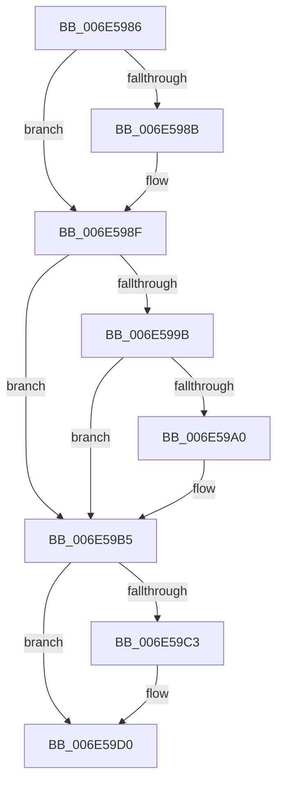

# sub_006E5986

- RVA: `0x006E5986`–`0x006E59DB` (길이 `85` bytes)
- VA: `0x00000001406E5986`
- 실행 섹션: `.text`
- PDB 이름 있음: `아니요`; PDB Function 태그: `아니요`
- unwind 정보 RVA: `0x0008100C`
- 디코드: `23`개 명령, `85/85` bytes 표시
- 미해석 바이트: `0` (있으면 어셈블리에 `.byte`로 보존)

> 이 문서는 커널 이미지의 기계어와 PDB 기호를 분석해 생성했습니다. 4번과 5번은 함수 원형과 자료형을 바이너리 사용 방식에서 추정한 C 해석이며 원본 소스 복구 결과는 아닙니다.

## 1. Dependencies

- 직접 호출 지점: **3**; 고유 호출 대상: **3**
- 직접 호출자로 확인된 함수: **0**
- RIP 상대 이미지 참조: **0**

### Outgoing calls
- `0x006E59A8` → [KeSetEvent](../33/KeSetEvent_function_0033F310.md) (function, `0x0033F310`)
- `0x006E59C3` → [ExfTryToWakePushLock](../26/ExfTryToWakePushLock_function_00265DD0.md) (function, `0x00265DD0`)
- `0x006E59D0` → [KeAbPostRelease](../2E/KeAbPostRelease_function_002E1600.md) (function, `0x002E1600`)

### Direct callers
- 이 함수 시작 RVA로 연결되는 직접 call은 확인되지 않았습니다. 간접 호출은 완전히 역산할 수 없습니다.

### Static image references
- 디코드된 RIP-relative 메모리 참조가 없습니다.

## 2. Other-region calls and transfers

- 다른 실행 섹션으로 향하는 call: **0**
- call이 아닌 외부 분기/꼬리 이동: **1**
  - `0x006E59D6` → [NtWaitForWorkViaWorkerFactory + 0xBAF](../39/NtWaitForWorkViaWorkerFactory_function_00394270.md) (`tail-transfer`)

## 3. Assembly (complete function range)

```asm
006E5986  48 85 C0                        test rax, rax
006E5989  74 04                           je 0x1406e598f
006E598B  C6 40 0A 01                     mov byte ptr [rax + 0xa], 1
006E598F  49 8B 86 98 01 00 00            mov rax, qword ptr [r14 + 0x198]
006E5996  48 85 C0                        test rax, rax
006E5999  74 1A                           je 0x1406e59b5
006E599B  3B 78 18                        cmp edi, dword ptr [rax + 0x18]
006E599E  75 15                           jne 0x1406e59b5
006E59A0  45 33 C0                        xor r8d, r8d
006E59A3  33 D2                           xor edx, edx
006E59A5  48 8B C8                        mov rcx, rax
006E59A8  E8 63 99 C5 FF                  call 0x14033f310
006E59AD  48 8B 8C 24 A0 00 00 00         mov rcx, qword ptr [rsp + 0xa0]
006E59B5  49 8B C4                        mov rax, r12
006E59B8  F0 48 0F C1 01                  lock xadd qword ptr [rcx], rax
006E59BD  24 06                           and al, 6
006E59BF  3C 02                           cmp al, 2
006E59C1  75 0D                           jne 0x1406e59d0
006E59C3  E8 08 04 B8 FF                  call 0x140265dd0
006E59C8  48 8B 8C 24 A0 00 00 00         mov rcx, qword ptr [rsp + 0xa0]
006E59D0  E8 2B BC BF FF                  call 0x1402e1600
006E59D5  90                              nop
006E59D6  E9 44 F4 CA FF                  jmp 0x140394e1f
```

## 4. C-style interpretation (structured pseudocode)

```c
__int64 __fastcall sub_006E5986(__int64 a1, int a2, int a3, __int64 a4, __int64 a5, __int64 a6, __int64 a7, __int64 a8, __int64 a9, __int64 a10, __int64 a11, __int64 a12, __int64 a13, __int64 a14, __int64 a15, __int64 a16, __int64 a17, __int64 a18, __int64 a19, __int64 a20)
{
    __int64 result;

    if (result != 0) {
        *(unsigned __int8 *)(result + 10) = 1;
    }
    if (*(unsigned __int64 *)(v_r14 + 408) == 0) goto loc_006E59B5;
    result = *(unsigned __int64 *)(v_r14 + 408);
    if (((unsigned int)(v_rdi)) == (*(unsigned int *)(*(unsigned __int64 *)(v_r14 + 408) + 24))) {
        a3 = 0;
        a2 = 0;
        a1 = *(unsigned __int64 *)(v_r14 + 408);
        result = KeSetEvent(a1, a2, a3, a4);
        a1 = a20;
    }
    result = (unsigned __int8)((v_r12) & (6));
    if (((unsigned __int8)(result)) == 2) {
        result = ExfTryToWakePushLock(a1, a2, a3, a4);
        a1 = a20;
    }
    result = KeAbPostRelease(a1, a2, a3, a4);
}
```

## 5. (Beta) C Style

```c
int64_t sub_006E5986(int64_t Arg1, int32_t Arg2, int32_t Arg3, int64_t Arg4, uint64_t Arg5, uint64_t Arg6, uint64_t Arg7, uint64_t Arg8, uint64_t Arg9, uint64_t Arg10, uint64_t Arg11, uint64_t Arg12, uint64_t Arg13, uint64_t Arg14, uint64_t Arg15, uint64_t Arg16, uint64_t Arg17, uint64_t Arg18, uint64_t Arg19, int64_t Arg20)
{
    int64_t result;

    if (result != 0) {
        *(uint8_t *)(result + 0xA) = 1;
    }
    if (*(uint64_t *)(local_r14 + 0x198) == 0) goto loc_006E59B5;
    result = *(uint64_t *)(local_r14 + 0x198);
    if (((uint32_t)(local_rdi)) == (*(uint32_t *)(*(uint64_t *)(local_r14 + 0x198) + 0x18))) {
        Arg3 = 0;
        Arg2 = 0;
        Arg1 = *(uint64_t *)(local_r14 + 0x198);
        result = KeSetEvent(Arg1, Arg2, Arg3, Arg4);
        Arg1 = Arg20;
    }
    result = (uint8_t)((local_r12) & (6));
    if (((uint8_t)(result)) == 2) {
        result = ExfTryToWakePushLock(Arg1, Arg2, Arg3, Arg4);
        Arg1 = Arg20;
    }
    result = KeAbPostRelease(Arg1, Arg2, Arg3, Arg4);
}
```

## 6. Execution-region graph

[열기: 2D/3D 그래프와 함수 탐색 컨트롤 패널](../../../control-panel.html?section=text&rva=0x006E5986&view=graph)

- 2D 그래프는 위에서 아래로 흐르고, 3D 그래프는 빈 공간을 드래그해 회전합니다. Shift+드래그는 이동, 휠은 확대·축소, 함수 노드 선택은 대상 보고서 이동입니다.

### Static fallback


