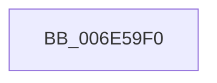

# sub_006E59F0

- RVA: `0x006E59F0`–`0x006E5A19` (길이 `41` bytes)
- VA: `0x00000001406E59F0`
- 실행 섹션: `.text`
- PDB 이름 있음: `아니요`; PDB Function 태그: `아니요`
- unwind 정보 RVA: `0x00081288`
- 디코드: `9`개 명령, `41/41` bytes 표시
- 미해석 바이트: `0` (있으면 어셈블리에 `.byte`로 보존)

> 이 문서는 커널 이미지의 기계어와 PDB 기호를 분석해 생성했습니다. 4번과 5번은 함수 원형과 자료형을 바이너리 사용 방식에서 추정한 C 해석이며 원본 소스 복구 결과는 아닙니다.

## 1. Dependencies

- 직접 호출 지점: **2**; 고유 호출 대상: **2**
- 직접 호출자로 확인된 함수: **0**
- RIP 상대 이미지 참조: **0**

### Outgoing calls
- `0x006E59F7` → [PsGetProcessSessionIdEx](../22/PsGetProcessSessionIdEx_function_0022F8F0.md) (function, `0x0022F8F0`)
- `0x006E5A13` → [KeBugCheckEx](../4F/KeBugCheckEx_function_004FD660.md) (function, `0x004FD660`)

### Direct callers
- 이 함수 시작 RVA로 연결되는 직접 call은 확인되지 않았습니다. 간접 호출은 완전히 역산할 수 없습니다.

### Static image references
- 디코드된 RIP-relative 메모리 참조가 없습니다.

## 2. Other-region calls and transfers

- 다른 실행 섹션으로 향하는 call: **0**
- 별도 외부 분기/꼬리 이동을 확인하지 못했습니다.

## 3. Assembly (complete function range)

```asm
006E59F0  48 8B 8E B8 00 00 00            mov rcx, qword ptr [rsi + 0xb8]
006E59F7  E8 F4 9E B4 FF                  call 0x14022f8f0
006E59FC  44 8B C8                        mov r9d, eax
006E59FF  4C 8B C7                        mov r8, rdi
006E5A02  48 8B D6                        mov rdx, rsi
006E5A05  48 C7 44 24 20 01 00 00 00      mov qword ptr [rsp + 0x20], 1
006E5A0E  B9 62 01 00 00                  mov ecx, 0x162
006E5A13  E8 48 7C E1 FF                  call 0x1404fd660
006E5A18  CC                              int3
```

## 4. C-style interpretation (structured pseudocode)

```c
__int64 __fastcall sub_006E59F0(void)
{
    __int64 result;
    unsigned __int64 v_stack_p20;

    result = PsGetProcessSessionIdEx(*(unsigned __int64 *)(v_rsi + 184), a2, a3, a4);
    v_stack_p20 = 1;
    result = KeBugCheckEx(354, v_rsi, v_rdi, (unsigned int)((unsigned int)(result)));
    return result;
}
```

## 5. (Beta) C Style

```c
void sub_006E59F0(void)
{
    int64_t result;
    uint64_t v_stack_p20;

    result = PsGetProcessSessionIdEx(*(uint64_t *)(local_rsi + 0xB8), a2, a3, a4);
    v_stack_p20 = 1;
    result = KeBugCheckEx(354, local_rsi, local_rdi, (uint32_t)((uint32_t)(result)));
    return result;
}
```

## 6. Execution-region graph

[열기: 2D/3D 그래프와 함수 탐색 컨트롤 패널](../../../control-panel.html?section=text&rva=0x006E59F0&view=graph)

- 2D 그래프는 위에서 아래로 흐르고, 3D 그래프는 빈 공간을 드래그해 회전합니다. Shift+드래그는 이동, 휠은 확대·축소, 함수 노드 선택은 대상 보고서 이동입니다.

### Static fallback


