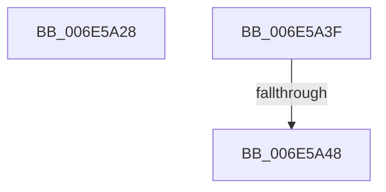

# sub_006E5A28

- RVA: `0x006E5A28`–`0x006E5A56` (길이 `46` bytes)
- VA: `0x00000001406E5A28`
- 실행 섹션: `.text`
- PDB 이름 있음: `아니요`; PDB Function 태그: `아니요`
- unwind 정보 RVA: `0x0008179C`
- 디코드: `10`개 명령, `46/46` bytes 표시
- 미해석 바이트: `0` (있으면 어셈블리에 `.byte`로 보존)

> 이 문서는 커널 이미지의 기계어와 PDB 기호를 분석해 생성했습니다. 4번과 5번은 함수 원형과 자료형을 바이너리 사용 방식에서 추정한 C 해석이며 원본 소스 복구 결과는 아닙니다.

## 1. Dependencies

- 직접 호출 지점: **1**; 고유 호출 대상: **1**
- 직접 호출자로 확인된 함수: **0**
- RIP 상대 이미지 참조: **0**

### Outgoing calls
- `0x006E5A34` → [KeFirstGroupAffinityEx](../46/KeFirstGroupAffinityEx_function_00463810.md) (function, `0x00463810`)

### Direct callers
- 이 함수 시작 RVA로 연결되는 직접 call은 확인되지 않았습니다. 간접 호출은 완전히 역산할 수 없습니다.

### Static image references
- 디코드된 RIP-relative 메모리 참조가 없습니다.

## 2. Other-region calls and transfers

- 다른 실행 섹션으로 향하는 call: **0**
- call이 아닌 외부 분기/꼬리 이동: **3**
  - `0x006E5A3A` → [sub_0039915F + 0xB6](../39/Unknown_function_0039915F.md) (`tail-transfer`)
  - `0x006E5A42` → [sub_0039915F + 0xB6](../39/Unknown_function_0039915F.md) (`tail-transfer`)
  - `0x006E5A51` → [sub_0039915F + 0xC7](../39/Unknown_function_0039915F.md) (`tail-transfer`)

## 3. Assembly (complete function range)

```asm
006E5A28  48 8B 97 40 02 00 00            mov rdx, qword ptr [rdi + 0x240]
006E5A2F  48 8D 4C 24 30                  lea rcx, [rsp + 0x30]
006E5A34  E8 D7 DD D7 FF                  call 0x140463810
006E5A39  90                              nop
006E5A3A  E9 D6 37 CB FF                  jmp 0x140399215
006E5A3F  45 84 E4                        test r12b, r12b
006E5A42  0F 84 CD 37 CB FF               je 0x140399215
006E5A48  C6 41 12 01                     mov byte ptr [rcx + 0x12], 1
006E5A4C  48 89 6C 24 70                  mov qword ptr [rsp + 0x70], rbp
006E5A51  E9 D0 37 CB FF                  jmp 0x140399226
```

## 4. C-style interpretation (structured pseudocode)

```c
__int64 __fastcall sub_006E5A28(__int64 a1, __int64 a2, __int64 a3, __int64 a4, __int64 a5, __int64 a6)
{
    __int64 result;
    unsigned __int64 v_stack_p70;

    result = KeFirstGroupAffinityEx(a6, *(unsigned __int64 *)(v_rdi + 576), a3, a4);
}
```

## 5. (Beta) C Style

```c
int64_t sub_006E5A28(int64_t Arg1, int64_t Arg2, int64_t Arg3, int64_t Arg4, uint64_t Arg5, int64_t Arg6)
{
    int64_t result;
    uint64_t v_stack_p70;

    result = KeFirstGroupAffinityEx(Arg6, *(uint64_t *)(local_rdi + 0x240), Arg3, Arg4);
}
```

## 6. Execution-region graph

[열기: 2D/3D 그래프와 함수 탐색 컨트롤 패널](../../../control-panel.html?section=text&rva=0x006E5A28&view=graph)

- 2D 그래프는 위에서 아래로 흐르고, 3D 그래프는 빈 공간을 드래그해 회전합니다. Shift+드래그는 이동, 휠은 확대·축소, 함수 노드 선택은 대상 보고서 이동입니다.

### Static fallback


