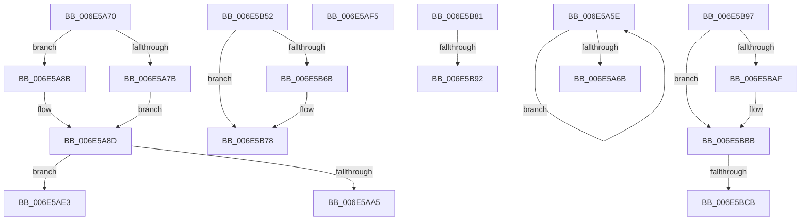

# sub_006E5A5E

- RVA: `0x006E5A5E`–`0x006E5BD0` (길이 `370` bytes)
- VA: `0x00000001406E5A5E`
- 실행 섹션: `.text`
- PDB 이름 있음: `아니요`; PDB Function 태그: `아니요`
- unwind 정보 RVA: `0x000818BC`
- 디코드: `80`개 명령, `370/370` bytes 표시
- 미해석 바이트: `0` (있으면 어셈블리에 `.byte`로 보존)

> 이 문서는 커널 이미지의 기계어와 PDB 기호를 분석해 생성했습니다. 4번과 5번은 함수 원형과 자료형을 바이너리 사용 방식에서 추정한 C 해석이며 원본 소스 복구 결과는 아닙니다.

## 1. Dependencies

- 직접 호출 지점: **7**; 고유 호출 대상: **5**
- 직접 호출자로 확인된 함수: **0**
- RIP 상대 이미지 참조: **13**

### Outgoing calls
- `0x006E5A82` → [guard_dispatch_icall](../6B/guard_dispatch_icall_function_006BAAD0.md) (function, `0x006BAAD0`)
- `0x006E5AEA` → [KiResetForceIdle](../3A/KiResetForceIdle_function_003A4160.md) (function, `0x003A4160`)
- `0x006E5B44` → [tlgWriteTransfer_EtwWriteTransfer](../42/tlgWriteTransfer_EtwWriteTransfer_function_004260E0.md) (function, `0x004260E0`)
- `0x006E5B73` → [KiLowerIrqlProcessIrqlFlags](../4F/KiLowerIrqlProcessIrqlFlags_function_004F5698.md) (function, `0x004F5698`)
- `0x006E5B81` → [KiSetClockIntervalToMinimumRequested](../39/KiSetClockIntervalToMinimumRequested_function_0039DF1C.md) (function, `0x0039DF1C`)
- `0x006E5BA1` → [KiSetClockIntervalToMinimumRequested](../39/KiSetClockIntervalToMinimumRequested_function_0039DF1C.md) (function, `0x0039DF1C`)
- `0x006E5BB6` → [KiLowerIrqlProcessIrqlFlags](../4F/KiLowerIrqlProcessIrqlFlags_function_004F5698.md) (function, `0x004F5698`)

### Direct callers
- 이 함수 시작 RVA로 연결되는 직접 call은 확인되지 않았습니다. 간접 호출은 완전히 역산할 수 없습니다.

### Static image references
- `0x006E5A70` → RVA `0x00F233C8` (`.data`; read)
- `0x006E5A7B` → RVA `0x00E00B20` (`.data`; read)
- `0x006E5A8D` → RVA `0x00F233C8` (`.data`; write)
- `0x006E5A96` → RVA `0x00F232F0` (`.data`; read)
- `0x006E5AA5` → RVA `0x00F21FC8` (`.data`; read)
- `0x006E5AAB` → RVA `0x00F22280` (`.data`; read)
- `0x006E5AB2` → RVA `0x00F21F70` (`.data`; read/write)
- `0x006E5ACF` → RVA `0x00F21FC8` (`.data`; write)
- `0x006E5B04` → RVA `0x0004861A` (`.rdata`; read)
- `0x006E5B1B` → RVA `0x00E070D8` (`.data`; read)
- `0x006E5B52` → RVA `0x00FC6D20` (`ALMOSTRO`; read)
- `0x006E5B58` → RVA `0x00F21FA8` (`.data`; write)
- `0x006E5B62` → RVA `0x00F21F90` (`.data`; write)

## 2. Other-region calls and transfers

- 다른 실행 섹션으로 향하는 call: **0**
- call이 아닌 외부 분기/꼬리 이동: **9**
  - `0x006E5A6B` → [KeClockInterruptNotify + 0x81B](../39/KeClockInterruptNotify_function_0039A970.md) (`tail-transfer`)
  - `0x006E5ADE` → [KeClockInterruptNotify + 0xF6](../39/KeClockInterruptNotify_function_0039A970.md) (`tail-transfer`)
  - `0x006E5AF0` → [KeClockInterruptNotify + 0xF6](../39/KeClockInterruptNotify_function_0039A970.md) (`tail-transfer`)
  - `0x006E5B4D` → [KeClockInterruptNotify + 0x59C](../39/KeClockInterruptNotify_function_0039A970.md) (`tail-transfer`)
  - `0x006E5B7C` → [KeClockInterruptNotify + 0x5B7](../39/KeClockInterruptNotify_function_0039A970.md) (`tail-transfer`)
  - `0x006E5B8C` → [KeClockInterruptNotify + 0x310](../39/KeClockInterruptNotify_function_0039A970.md) (`tail-transfer`)
  - `0x006E5B92` → [KeClockInterruptNotify + 0x303](../39/KeClockInterruptNotify_function_0039A970.md) (`tail-transfer`)
  - `0x006E5BC5` → [KeClockInterruptNotify + 0x190](../39/KeClockInterruptNotify_function_0039A970.md) (`tail-transfer`)
  - `0x006E5BCB` → [KeClockInterruptNotify + 0x18B](../39/KeClockInterruptNotify_function_0039A970.md) (`tail-transfer`)

## 3. Assembly (complete function range)

```asm
006E5A5E  8B D0                           mov edx, eax
006E5A60  0F BA F2 15                     btr edx, 0x15
006E5A64  F0 41 0F B1 10                  lock cmpxchg dword ptr [r8], edx
006E5A69  75 F3                           jne 0x1406e5a5e
006E5A6B  E9 1B 57 CB FF                  jmp 0x14039b18b
006E5A70  8B 05 52 D9 83 00               mov eax, dword ptr [rip + 0x83d952]
006E5A76  83 F8 20                        cmp eax, 0x20
006E5A79  75 10                           jne 0x1406e5a8b
006E5A7B  48 8B 05 9E B0 71 00            mov rax, qword ptr [rip + 0x71b09e]
006E5A82  E8 49 50 FD FF                  call 0x1406baad0
006E5A87  8B C3                           mov eax, ebx
006E5A89  EB 02                           jmp 0x1406e5a8d
006E5A8B  FF C0                           inc eax
006E5A8D  89 05 35 D9 83 00               mov dword ptr [rip + 0x83d935], eax
006E5A93  48 8B C6                        mov rax, rsi
006E5A96  48 2B 05 53 D8 83 00            sub rax, qword ptr [rip + 0x83d853]
006E5A9D  48 3D 00 2D 31 01               cmp rax, 0x1312d00
006E5AA3  77 3E                           ja 0x1406e5ae3
006E5AA5  8B 05 1D C5 83 00               mov eax, dword ptr [rip + 0x83c51d]
006E5AAB  48 8D 0D CE C7 83 00            lea rcx, [rip + 0x83c7ce]
006E5AB2  48 FF 05 B7 C4 83 00            inc qword ptr [rip + 0x83c4b7]
006E5AB9  44 8B E0                        mov r12d, eax
006E5ABC  49 C1 E4 04                     shl r12, 4
006E5AC0  41 B7 01                        mov r15b, 1
006E5AC3  4C 03 E1                        add r12, rcx
006E5AC6  FF C0                           inc eax
006E5AC8  4C 89 65 D7                     mov qword ptr [rbp - 0x29], r12
006E5ACC  83 E0 0F                        and eax, 0xf
006E5ACF  89 05 F3 C4 83 00               mov dword ptr [rip + 0x83c4f3], eax
006E5AD5  41 88 1C 24                     mov byte ptr [r12], bl
006E5AD9  49 89 74 24 08                  mov qword ptr [r12 + 8], rsi
006E5ADE  E9 83 4F CB FF                  jmp 0x14039aa66
006E5AE3  B2 01                           mov dl, 1
006E5AE5  B9 02 00 00 00                  mov ecx, 2
006E5AEA  E8 71 E6 CB FF                  call 0x1403a4160
006E5AEF  90                              nop
006E5AF0  E9 71 4F CB FF                  jmp 0x14039aa66
006E5AF5  48 8D 45 B3                     lea rax, [rbp - 0x4d]
006E5AF9  C7 45 B3 02 00 00 00            mov dword ptr [rbp - 0x4d], 2
006E5B00  48 89 45 07                     mov qword ptr [rbp + 7], rax
006E5B04  48 8D 15 0F 2B 96 FF            lea rdx, [rip - 0x69d4f1]
006E5B0B  48 8D 45 98                     lea rax, [rbp - 0x68]
006E5B0F  48 C7 45 0F 04 00 00 00         mov qword ptr [rbp + 0xf], 4
006E5B17  48 89 45 17                     mov qword ptr [rbp + 0x17], rax
006E5B1B  48 8D 0D B6 15 72 00            lea rcx, [rip + 0x7215b6]
006E5B22  48 8D 45 E7                     lea rax, [rbp - 0x19]
006E5B26  88 5D 98                        mov byte ptr [rbp - 0x68], bl
006E5B29  48 89 44 24 28                  mov qword ptr [rsp + 0x28], rax
006E5B2E  45 33 C9                        xor r9d, r9d
006E5B31  45 33 C0                        xor r8d, r8d
006E5B34  C7 44 24 20 04 00 00 00         mov dword ptr [rsp + 0x20], 4
006E5B3C  48 C7 45 1F 01 00 00 00         mov qword ptr [rbp + 0x1f], 1
006E5B44  E8 97 05 D4 FF                  call 0x1404260e0
006E5B49  48 8B 45 9F                     mov rax, qword ptr [rbp - 0x61]
006E5B4D  E9 BA 53 CB FF                  jmp 0x14039af0c
006E5B52  39 1D C8 11 8E 00               cmp dword ptr [rip + 0x8e11c8], ebx
006E5B58  C7 05 46 C4 83 00 02 00 00 00   mov dword ptr [rip + 0x83c446], 2
006E5B62  48 89 1D 27 C4 83 00            mov qword ptr [rip + 0x83c427], rbx
006E5B69  74 0D                           je 0x1406e5b78
006E5B6B  44 0F 20 C1                     mov rcx, cr8
006E5B6F  40 0F B6 D7                     movzx edx, dil
006E5B73  E8 20 FB E0 FF                  call 0x1404f5698
006E5B78  40 0F B6 C7                     movzx eax, dil
006E5B7C  E9 A6 53 CB FF                  jmp 0x14039af27
006E5B81  E8 96 83 CB FF                  call 0x14039df1c
006E5B86  39 1D 94 11 8E 00               cmp dword ptr [rip + 0x8e1194], ebx
006E5B8C  0F 84 EE 50 CB FF               je 0x14039ac80
006E5B92  E9 DC 50 CB FF                  jmp 0x14039ac73
006E5B97  C7 05 07 C4 83 00 02 00 00 00   mov dword ptr [rip + 0x83c407], 2
006E5BA1  E8 76 83 CB FF                  call 0x14039df1c
006E5BA6  83 3D 73 11 8E 00 00            cmp dword ptr [rip + 0x8e1173], 0
006E5BAD  74 0C                           je 0x1406e5bbb
006E5BAF  44 0F 20 C1                     mov rcx, cr8
006E5BB3  0F B6 D3                        movzx edx, bl
006E5BB6  E8 DD FA E0 FF                  call 0x1404f5698
006E5BBB  0F B6 C3                        movzx eax, bl
006E5BBE  44 0F 22 C0                     mov cr8, rax
006E5BC2  4D 85 E4                        test r12, r12
006E5BC5  0F 84 35 4F CB FF               je 0x14039ab00
006E5BCB  E9 2B 4F CB FF                  jmp 0x14039aafb
```

## 4. C-style interpretation (structured pseudocode)

```c
__int64 __fastcall sub_006E5A5E(__int64 a1, __int64 a2, __int64 a3, int a4)
{
    unsigned int v_stack_p20;
    unsigned __int64 v_stack_p28;

    if (condition_is_not_equal) goto loc_006E5A5E;
}
```

## 5. (Beta) C Style

```c
int64_t sub_006E5A5E(int64_t Arg1, int64_t Arg2, void *Arg3, int32_t Arg4)
{
    uint8_t *arg3 = (uint8_t *)Arg3;

    uint32_t v_stack_p20;
    uint64_t v_stack_p28;

    if (condition_is_not_equal) goto loc_006E5A5E;
}
```

### 관측된 메모리 오프셋

구조체 형식이 확인되지 않은 접근은 인자 기준의 오프셋으로만 기록했습니다.

| 기준 인자 | 오프셋 표현 | 폭 (bit) | 접근 |
|---|---:|---:|---|
| `Arg3` | `+ 0x0` | `32` | `R` |

## 6. Execution-region graph

[열기: 2D/3D 그래프와 함수 탐색 컨트롤 패널](../../../control-panel.html?section=text&rva=0x006E5A5E&view=graph)

- 2D 그래프는 위에서 아래로 흐르고, 3D 그래프는 빈 공간을 드래그해 회전합니다. Shift+드래그는 이동, 휠은 확대·축소, 함수 노드 선택은 대상 보고서 이동입니다.

### Static fallback


