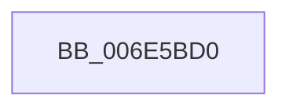

# sub_006E5BD0

- RVA: `0x006E5BD0`–`0x006E5CE5` (길이 `277` bytes)
- VA: `0x00000001406E5BD0`
- 실행 섹션: `.text`
- PDB 이름 있음: `아니요`; PDB Function 태그: `아니요`
- unwind 정보 RVA: `0x00081928`
- 디코드: `45`개 명령, `277/277` bytes 표시
- 미해석 바이트: `0` (있으면 어셈블리에 `.byte`로 보존)

> 이 문서는 커널 이미지의 기계어와 PDB 기호를 분석해 생성했습니다. 4번과 5번은 함수 원형과 자료형을 바이너리 사용 방식에서 추정한 C 해석이며 원본 소스 복구 결과는 아닙니다.

## 1. Dependencies

- 직접 호출 지점: **1**; 고유 호출 대상: **1**
- 직접 호출자로 확인된 함수: **0**
- RIP 상대 이미지 참조: **2**

### Outgoing calls
- `0x006E5CDA` → [tlgWriteTransfer_EtwWriteTransfer](../42/tlgWriteTransfer_EtwWriteTransfer_function_004260E0.md) (function, `0x004260E0`)

### Direct callers
- 이 함수 시작 RVA로 연결되는 직접 call은 확인되지 않았습니다. 간접 호출은 완전히 역산할 수 없습니다.

### Static image references
- `0x006E5C16` → RVA `0x00048592` (`.rdata`; read)
- `0x006E5C3E` → RVA `0x00E070D8` (`.data`; read)

## 2. Other-region calls and transfers

- 다른 실행 섹션으로 향하는 call: **0**
- call이 아닌 외부 분기/꼬리 이동: **1**
  - `0x006E5CE0` → [KiUpdateTime + 0x2D6](../39/KiUpdateTime_function_0039B530.md) (`tail-transfer`)

## 3. Assembly (complete function range)

```asm
006E5BD0  BA 01 00 00 00                  mov edx, 1
006E5BD5  48 89 4C 24 68                  mov qword ptr [rsp + 0x68], rcx
006E5BDA  48 8D 44 24 68                  lea rax, [rsp + 0x68]
006E5BDF  89 54 24 48                     mov dword ptr [rsp + 0x48], edx
006E5BE3  48 89 85 B0 00 00 00            mov qword ptr [rbp + 0xb0], rax
006E5BEA  45 33 C9                        xor r9d, r9d
006E5BED  48 8D 44 24 48                  lea rax, [rsp + 0x48]
006E5BF2  48 89 95 18 01 00 00            mov qword ptr [rbp + 0x118], rdx
006E5BF9  48 89 85 C0 00 00 00            mov qword ptr [rbp + 0xc0], rax
006E5C00  45 33 C0                        xor r8d, r8d
006E5C03  48 8D 44 24 70                  lea rax, [rsp + 0x70]
006E5C08  48 89 95 28 01 00 00            mov qword ptr [rbp + 0x128], rdx
006E5C0F  48 89 85 D0 00 00 00            mov qword ptr [rbp + 0xd0], rax
006E5C16  48 8D 15 75 29 96 FF            lea rdx, [rip - 0x69d68b]
006E5C1D  48 8B C7                        mov rax, rdi
006E5C20  48 C7 85 B8 00 00 00 08 00 00 00  mov qword ptr [rbp + 0xb8], 8
006E5C2B  48 2B C1                        sub rax, rcx
006E5C2E  48 C7 85 C8 00 00 00 04 00 00 00  mov qword ptr [rbp + 0xc8], 4
006E5C39  48 89 44 24 78                  mov qword ptr [rsp + 0x78], rax
006E5C3E  48 8D 0D 93 14 72 00            lea rcx, [rip + 0x721493]
006E5C45  48 8D 44 24 78                  lea rax, [rsp + 0x78]
006E5C4A  4C 89 7C 24 70                  mov qword ptr [rsp + 0x70], r15
006E5C4F  48 89 85 E0 00 00 00            mov qword ptr [rbp + 0xe0], rax
006E5C56  48 8D 44 24 60                  lea rax, [rsp + 0x60]
006E5C5B  48 89 85 F0 00 00 00            mov qword ptr [rbp + 0xf0], rax
006E5C62  48 8D 44 24 4C                  lea rax, [rsp + 0x4c]
006E5C67  48 89 85 00 01 00 00            mov qword ptr [rbp + 0x100], rax
006E5C6E  48 8D 44 24 30                  lea rax, [rsp + 0x30]
006E5C73  48 89 85 10 01 00 00            mov qword ptr [rbp + 0x110], rax
006E5C7A  48 8D 44 24 31                  lea rax, [rsp + 0x31]
006E5C7F  48 89 85 20 01 00 00            mov qword ptr [rbp + 0x120], rax
006E5C86  48 8D 85 90 00 00 00            lea rax, [rbp + 0x90]
006E5C8D  48 89 44 24 28                  mov qword ptr [rsp + 0x28], rax
006E5C92  C7 44 24 20 0A 00 00 00         mov dword ptr [rsp + 0x20], 0xa
006E5C9A  48 C7 85 D8 00 00 00 08 00 00 00  mov qword ptr [rbp + 0xd8], 8
006E5CA5  48 C7 85 E8 00 00 00 08 00 00 00  mov qword ptr [rbp + 0xe8], 8
006E5CB0  48 89 7C 24 60                  mov qword ptr [rsp + 0x60], rdi
006E5CB5  48 C7 85 F8 00 00 00 08 00 00 00  mov qword ptr [rbp + 0xf8], 8
006E5CC0  44 89 64 24 4C                  mov dword ptr [rsp + 0x4c], r12d
006E5CC5  48 C7 85 08 01 00 00 04 00 00 00  mov qword ptr [rbp + 0x108], 4
006E5CD0  44 88 74 24 30                  mov byte ptr [rsp + 0x30], r14b
006E5CD5  C6 44 24 31 00                  mov byte ptr [rsp + 0x31], 0
006E5CDA  E8 01 04 D4 FF                  call 0x1404260e0
006E5CDF  90                              nop
006E5CE0  E9 21 5B CB FF                  jmp 0x14039b806
```

## 4. C-style interpretation (structured pseudocode)

```c
__int64 __fastcall sub_006E5BD0(__int64 a1, __int64 a2, int a3, int a4, __int64 a5, __int64 a6, __int64 a7, __int64 a8, __int64 a9, __int64 a10, __int64 a11, __int64 a12, __int64 a13, __int64 a14, __int64 a15)
{
    __int64 result;
    unsigned int v_stack_p20;
    unsigned __int64 v_stack_p28;
    unsigned __int8 v_stack_p30;
    unsigned __int64 v_stack_p31;
    unsigned int v_stack_p48;
    unsigned __int64 v_stack_p4C;
    unsigned __int64 v_stack_p60;
    unsigned __int64 v_stack_p68;
    unsigned __int64 v_stack_p70;
    unsigned __int64 v_stack_p78;

    v_stack_p68 = a1;
    v_stack_p48 = 1;
    *(unsigned __int64 *)(v_rbp + 176) = a13;
    a4 = 0;
    *(unsigned __int64 *)(v_rbp + 280) = 1;
    *(unsigned __int64 *)(v_rbp + 192) = a9;
    a3 = 0;
    *(unsigned __int64 *)(v_rbp + 296) = 1;
    *(unsigned __int64 *)(v_rbp + 208) = a14;
    *(unsigned __int64 *)(v_rbp + 184) = 8;
    result = (v_rdi) - (a1);
    *(unsigned __int64 *)(v_rbp + 200) = 4;
    v_stack_p78 = result;
    v_stack_p70 = v_r15;
    *(unsigned __int64 *)(v_rbp + 224) = a15;
    *(unsigned __int64 *)(v_rbp + 240) = a12;
    *(unsigned __int64 *)(v_rbp + 256) = v_stack_p4C;
    *(unsigned __int64 *)(v_rbp + 272) = a6;
    *(unsigned __int64 *)(v_rbp + 288) = v_stack_p31;
    v_stack_p28 = v_rbp + 144;
    v_stack_p20 = 10;
    *(unsigned __int64 *)(v_rbp + 216) = 8;
    *(unsigned __int64 *)(v_rbp + 232) = 8;
    v_stack_p60 = v_rdi;
    *(unsigned __int64 *)(v_rbp + 248) = 8;
    v_stack_p4C = (unsigned int)(v_r12);
    *(unsigned __int64 *)(v_rbp + 264) = 4;
    v_stack_p30 = (unsigned __int8)(v_r14);
    v_stack_p31 = 0;
    result = tlgWriteTransfer_EtwWriteTransfer(v_rip + 7476371, v_rip - 6936203, a3, a4);
}
```

## 5. (Beta) C Style

```c
int64_t sub_006E5BD0(int64_t Arg1, int64_t Arg2, int32_t Arg3, int32_t Arg4, uint64_t Arg5, int64_t Arg6, uint64_t Arg7, uint64_t Arg8, int64_t Arg9, uint64_t Arg10, uint64_t Arg11, int64_t Arg12, int64_t Arg13, int64_t Arg14, int64_t Arg15)
{
    int64_t result;
    uint32_t v_stack_p20;
    uint64_t v_stack_p28;
    uint8_t v_stack_p30;
    uint64_t v_stack_p31;
    uint32_t v_stack_p48;
    uint64_t v_stack_p4C;
    uint64_t v_stack_p60;
    uint64_t v_stack_p68;
    uint64_t v_stack_p70;
    uint64_t v_stack_p78;

    v_stack_p68 = Arg1;
    v_stack_p48 = 1;
    *(uint64_t *)(local_rbp + 0xB0) = Arg13;
    Arg4 = 0;
    *(uint64_t *)(local_rbp + 0x118) = 1;
    *(uint64_t *)(local_rbp + 0xC0) = Arg9;
    Arg3 = 0;
    *(uint64_t *)(local_rbp + 0x128) = 1;
    *(uint64_t *)(local_rbp + 0xD0) = Arg14;
    *(uint64_t *)(local_rbp + 0xB8) = 8;
    result = (local_rdi) - (Arg1);
    *(uint64_t *)(local_rbp + 0xC8) = 4;
    v_stack_p78 = result;
    v_stack_p70 = local_r15;
    *(uint64_t *)(local_rbp + 0xE0) = Arg15;
    *(uint64_t *)(local_rbp + 0xF0) = Arg12;
    *(uint64_t *)(local_rbp + 0x100) = v_stack_p4C;
    *(uint64_t *)(local_rbp + 0x110) = Arg6;
    *(uint64_t *)(local_rbp + 0x120) = v_stack_p31;
    v_stack_p28 = local_rbp + 144;
    v_stack_p20 = 10;
    *(uint64_t *)(local_rbp + 0xD8) = 8;
    *(uint64_t *)(local_rbp + 0xE8) = 8;
    v_stack_p60 = local_rdi;
    *(uint64_t *)(local_rbp + 0xF8) = 8;
    v_stack_p4C = (uint32_t)(local_r12);
    *(uint64_t *)(local_rbp + 0x108) = 4;
    v_stack_p30 = (uint8_t)(local_r14);
    v_stack_p31 = 0;
    result = tlgWriteTransfer_EtwWriteTransfer(v_rip + 7476371, v_rip - 6936203, Arg3, Arg4);
}
```

## 6. Execution-region graph

[열기: 2D/3D 그래프와 함수 탐색 컨트롤 패널](../../../control-panel.html?section=text&rva=0x006E5BD0&view=graph)

- 2D 그래프는 위에서 아래로 흐르고, 3D 그래프는 빈 공간을 드래그해 회전합니다. Shift+드래그는 이동, 휠은 확대·축소, 함수 노드 선택은 대상 보고서 이동입니다.

### Static fallback


