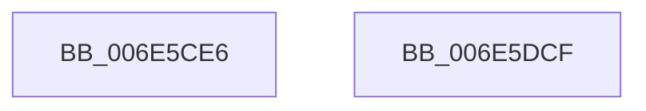

# sub_006E5CE6

- RVA: `0x006E5CE6`–`0x006E5E2E` (길이 `328` bytes)
- VA: `0x00000001406E5CE6`
- 실행 섹션: `.text`
- PDB 이름 있음: `아니요`; PDB Function 태그: `아니요`
- unwind 정보 RVA: `0x00081964`
- 디코드: `62`개 명령, `328/328` bytes 표시
- 미해석 바이트: `0` (있으면 어셈블리에 `.byte`로 보존)

> 이 문서는 커널 이미지의 기계어와 PDB 기호를 분석해 생성했습니다. 4번과 5번은 함수 원형과 자료형을 바이너리 사용 방식에서 추정한 C 해석이며 원본 소스 복구 결과는 아닙니다.

## 1. Dependencies

- 직접 호출 지점: **2**; 고유 호출 대상: **1**
- 직접 호출자로 확인된 함수: **0**
- RIP 상대 이미지 참조: **3**

### Outgoing calls
- `0x006E5DC4` → [tlgWriteTransfer_EtwWriteTransfer](../42/tlgWriteTransfer_EtwWriteTransfer_function_004260E0.md) (function, `0x004260E0`)
- `0x006E5E23` → [tlgWriteTransfer_EtwWriteTransfer](../42/tlgWriteTransfer_EtwWriteTransfer_function_004260E0.md) (function, `0x004260E0`)

### Direct callers
- 이 함수 시작 RVA로 연결되는 직접 call은 확인되지 않았습니다. 간접 호출은 완전히 역산할 수 없습니다.

### Static image references
- `0x006E5CF4` → RVA `0x00048592` (`.rdata`; read)
- `0x006E5D3B` → RVA `0x00E070D8` (`.data`; read)
- `0x006E5DE0` → RVA `0x0004861A` (`.rdata`; read)

## 2. Other-region calls and transfers

- 다른 실행 섹션으로 향하는 call: **0**
- call이 아닌 외부 분기/꼬리 이동: **2**
  - `0x006E5DCA` → [KiUpdateRunTime + 0x329](../39/KiUpdateRunTime_function_0039BB70.md) (`tail-transfer`)
  - `0x006E5E29` → [KiUpdateRunTime + 0x39D](../39/KiUpdateRunTime_function_0039BB70.md) (`tail-transfer`)

## 3. Assembly (complete function range)

```asm
006E5CE6  48 8D 44 24 60                  lea rax, [rsp + 0x60]
006E5CEB  48 89 4C 24 60                  mov qword ptr [rsp + 0x60], rcx
006E5CF0  48 89 45 C0                     mov qword ptr [rbp - 0x40], rax
006E5CF4  48 8D 15 97 28 96 FF            lea rdx, [rip - 0x69d769]
006E5CFB  48 8D 44 24 44                  lea rax, [rsp + 0x44]
006E5D00  48 C7 45 C8 08 00 00 00         mov qword ptr [rbp - 0x38], 8
006E5D08  48 89 45 D0                     mov qword ptr [rbp - 0x30], rax
006E5D0C  45 33 C9                        xor r9d, r9d
006E5D0F  48 8D 44 24 68                  lea rax, [rsp + 0x68]
006E5D14  C7 44 24 44 03 00 00 00         mov dword ptr [rsp + 0x44], 3
006E5D1C  48 89 45 E0                     mov qword ptr [rbp - 0x20], rax
006E5D20  45 33 C0                        xor r8d, r8d
006E5D23  48 8B C7                        mov rax, rdi
006E5D26  48 C7 45 D8 04 00 00 00         mov qword ptr [rbp - 0x28], 4
006E5D2E  48 2B C1                        sub rax, rcx
006E5D31  48 89 74 24 68                  mov qword ptr [rsp + 0x68], rsi
006E5D36  48 89 44 24 70                  mov qword ptr [rsp + 0x70], rax
006E5D3B  48 8D 0D 96 13 72 00            lea rcx, [rip + 0x721396]
006E5D42  48 8D 44 24 70                  lea rax, [rsp + 0x70]
006E5D47  48 C7 45 E8 08 00 00 00         mov qword ptr [rbp - 0x18], 8
006E5D4F  48 89 45 F0                     mov qword ptr [rbp - 0x10], rax
006E5D53  48 8D 44 24 78                  lea rax, [rsp + 0x78]
006E5D58  48 89 45 00                     mov qword ptr [rbp], rax
006E5D5C  48 8D 44 24 48                  lea rax, [rsp + 0x48]
006E5D61  48 89 45 10                     mov qword ptr [rbp + 0x10], rax
006E5D65  48 8D 44 24 40                  lea rax, [rsp + 0x40]
006E5D6A  48 89 45 20                     mov qword ptr [rbp + 0x20], rax
006E5D6E  48 8D 44 24 41                  lea rax, [rsp + 0x41]
006E5D73  48 89 45 30                     mov qword ptr [rbp + 0x30], rax
006E5D77  48 8D 45 A0                     lea rax, [rbp - 0x60]
006E5D7B  48 89 44 24 28                  mov qword ptr [rsp + 0x28], rax
006E5D80  C7 44 24 20 0A 00 00 00         mov dword ptr [rsp + 0x20], 0xa
006E5D88  48 C7 45 F8 08 00 00 00         mov qword ptr [rbp - 8], 8
006E5D90  48 89 7C 24 78                  mov qword ptr [rsp + 0x78], rdi
006E5D95  48 C7 45 08 08 00 00 00         mov qword ptr [rbp + 8], 8
006E5D9D  44 89 64 24 48                  mov dword ptr [rsp + 0x48], r12d
006E5DA2  48 C7 45 18 04 00 00 00         mov qword ptr [rbp + 0x18], 4
006E5DAA  C6 44 24 40 01                  mov byte ptr [rsp + 0x40], 1
006E5DAF  48 C7 45 28 01 00 00 00         mov qword ptr [rbp + 0x28], 1
006E5DB7  44 88 6C 24 41                  mov byte ptr [rsp + 0x41], r13b
006E5DBC  48 C7 45 38 01 00 00 00         mov qword ptr [rbp + 0x38], 1
006E5DC4  E8 17 03 D4 FF                  call 0x1404260e0
006E5DC9  90                              nop
006E5DCA  E9 CA 60 CB FF                  jmp 0x14039be99
006E5DCF  48 8D 44 24 4C                  lea rax, [rsp + 0x4c]
006E5DD4  C7 44 24 4C 04 00 00 00         mov dword ptr [rsp + 0x4c], 4
006E5DDC  48 89 45 60                     mov qword ptr [rbp + 0x60], rax
006E5DE0  48 8D 15 33 28 96 FF            lea rdx, [rip - 0x69d7cd]
006E5DE7  48 8D 44 24 42                  lea rax, [rsp + 0x42]
006E5DEC  48 C7 45 68 04 00 00 00         mov qword ptr [rbp + 0x68], 4
006E5DF4  48 89 45 70                     mov qword ptr [rbp + 0x70], rax
006E5DF8  48 8D 0D D9 12 72 00            lea rcx, [rip + 0x7212d9]
006E5DFF  48 8D 45 40                     lea rax, [rbp + 0x40]
006E5E03  44 88 6C 24 42                  mov byte ptr [rsp + 0x42], r13b
006E5E08  48 89 44 24 28                  mov qword ptr [rsp + 0x28], rax
006E5E0D  45 33 C9                        xor r9d, r9d
006E5E10  45 33 C0                        xor r8d, r8d
006E5E13  C7 44 24 20 04 00 00 00         mov dword ptr [rsp + 0x20], 4
006E5E1B  48 C7 45 78 01 00 00 00         mov qword ptr [rbp + 0x78], 1
006E5E23  E8 B8 02 D4 FF                  call 0x1404260e0
006E5E28  90                              nop
006E5E29  E9 DF 60 CB FF                  jmp 0x14039bf0d
```

## 4. C-style interpretation (structured pseudocode)

```c
__int64 __fastcall sub_006E5CE6(__int64 a1, __int64 a2, int a3, int a4, __int64 a5, __int64 a6, __int64 a7, __int64 a8, __int64 a9, __int64 a10, __int64 a11, __int64 a12, __int64 a13, __int64 a14, __int64 a15)
{
    __int64 result;
    unsigned int v_stack_p20;
    unsigned __int64 v_stack_p28;
    unsigned __int8 v_stack_p40;
    unsigned __int64 v_stack_p41;
    unsigned __int64 v_stack_p42;
    unsigned __int64 v_stack_p44;
    unsigned int v_stack_p48;
    unsigned __int64 v_stack_p4C;
    unsigned __int64 v_stack_p60;
    unsigned __int64 v_stack_p68;
    unsigned __int64 v_stack_p70;
    unsigned __int64 v_stack_p78;

    v_stack_p60 = a1;
    *(unsigned __int64 *)(v_rbp - 64) = a12;
    *(unsigned __int64 *)(v_rbp - 56) = 8;
    *(unsigned __int64 *)(v_rbp - 48) = v_stack_p44;
    a4 = 0;
    v_stack_p44 = 3;
    *(unsigned __int64 *)(v_rbp - 32) = a13;
    a3 = 0;
    *(unsigned __int64 *)(v_rbp - 40) = 4;
    result = (v_rdi) - (a1);
    v_stack_p68 = v_rsi;
    v_stack_p70 = result;
    *(unsigned __int64 *)(v_rbp - 24) = 8;
    *(unsigned __int64 *)(v_rbp - 16) = a14;
    *(unsigned __int64 *)(v_rbp) = a15;
    *(unsigned __int64 *)(v_rbp + 16) = a9;
    *(unsigned __int64 *)(v_rbp + 32) = a8;
    *(unsigned __int64 *)(v_rbp + 48) = v_stack_p41;
    v_stack_p28 = v_rbp - 96;
    v_stack_p20 = 10;
    *(unsigned __int64 *)(v_rbp - 8) = 8;
    v_stack_p78 = v_rdi;
    *(unsigned __int64 *)(v_rbp + 8) = 8;
    v_stack_p48 = (unsigned int)(v_r12);
    *(unsigned __int64 *)(v_rbp + 24) = 4;
    v_stack_p40 = 1;
    *(unsigned __int64 *)(v_rbp + 40) = 1;
    v_stack_p41 = (unsigned __int8)(v_r13);
    *(unsigned __int64 *)(v_rbp + 56) = 1;
    result = tlgWriteTransfer_EtwWriteTransfer(v_rip + 7476118, v_rip - 6936425, a3, a4);
}
```

## 5. (Beta) C Style

```c
int64_t sub_006E5CE6(int64_t Arg1, int64_t Arg2, int32_t Arg3, int32_t Arg4, uint64_t Arg5, uint64_t Arg6, uint64_t Arg7, int64_t Arg8, int64_t Arg9, uint64_t Arg10, uint64_t Arg11, int64_t Arg12, int64_t Arg13, int64_t Arg14, int64_t Arg15)
{
    int64_t result;
    uint32_t v_stack_p20;
    uint64_t v_stack_p28;
    uint8_t v_stack_p40;
    uint64_t v_stack_p41;
    uint64_t v_stack_p42;
    uint64_t v_stack_p44;
    uint32_t v_stack_p48;
    uint64_t v_stack_p4C;
    uint64_t v_stack_p60;
    uint64_t v_stack_p68;
    uint64_t v_stack_p70;
    uint64_t v_stack_p78;

    v_stack_p60 = Arg1;
    *(uint64_t *)(local_rbp - 0x40) = Arg12;
    *(uint64_t *)(local_rbp - 0x38) = 8;
    *(uint64_t *)(local_rbp - 0x30) = v_stack_p44;
    Arg4 = 0;
    v_stack_p44 = 3;
    *(uint64_t *)(local_rbp - 0x20) = Arg13;
    Arg3 = 0;
    *(uint64_t *)(local_rbp - 0x28) = 4;
    result = (local_rdi) - (Arg1);
    v_stack_p68 = local_rsi;
    v_stack_p70 = result;
    *(uint64_t *)(local_rbp - 0x18) = 8;
    *(uint64_t *)(local_rbp - 0x10) = Arg14;
    *(uint64_t *)(local_rbp) = Arg15;
    *(uint64_t *)(local_rbp + 0x10) = Arg9;
    *(uint64_t *)(local_rbp + 0x20) = Arg8;
    *(uint64_t *)(local_rbp + 0x30) = v_stack_p41;
    v_stack_p28 = local_rbp - 96;
    v_stack_p20 = 10;
    *(uint64_t *)(local_rbp - 0x8) = 8;
    v_stack_p78 = local_rdi;
    *(uint64_t *)(local_rbp + 0x8) = 8;
    v_stack_p48 = (uint32_t)(local_r12);
    *(uint64_t *)(local_rbp + 0x18) = 4;
    v_stack_p40 = 1;
    *(uint64_t *)(local_rbp + 0x28) = 1;
    v_stack_p41 = (uint8_t)(local_r13);
    *(uint64_t *)(local_rbp + 0x38) = 1;
    result = tlgWriteTransfer_EtwWriteTransfer(v_rip + 7476118, v_rip - 6936425, Arg3, Arg4);
}
```

## 6. Execution-region graph

[열기: 2D/3D 그래프와 함수 탐색 컨트롤 패널](../../../control-panel.html?section=text&rva=0x006E5CE6&view=graph)

- 2D 그래프는 위에서 아래로 흐르고, 3D 그래프는 빈 공간을 드래그해 회전합니다. Shift+드래그는 이동, 휠은 확대·축소, 함수 노드 선택은 대상 보고서 이동입니다.

### Static fallback


