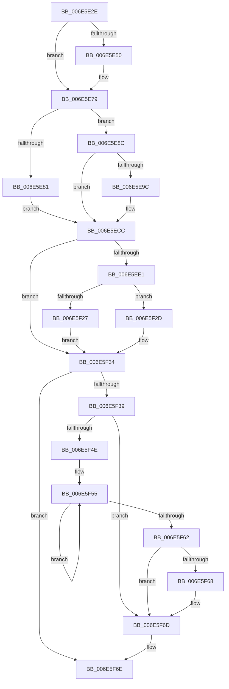

# sub_006E5E2E

- RVA: `0x006E5E2E`–`0x006E5F75` (길이 `327` bytes)
- VA: `0x00000001406E5E2E`
- 실행 섹션: `.text`
- PDB 이름 있음: `아니요`; PDB Function 태그: `아니요`
- unwind 정보 RVA: `0x00081A24`
- 디코드: `87`개 명령, `327/327` bytes 표시
- 미해석 바이트: `0` (있으면 어셈블리에 `.byte`로 보존)

> 이 문서는 커널 이미지의 기계어와 PDB 기호를 분석해 생성했습니다. 4번과 5번은 함수 원형과 자료형을 바이너리 사용 방식에서 추정한 C 해석이며 원본 소스 복구 결과는 아닙니다.

## 1. Dependencies

- 직접 호출 지점: **5**; 고유 호출 대상: **5**
- 직접 호출자로 확인된 함수: **0**
- RIP 상대 이미지 참조: **8**

### Outgoing calls
- `0x006E5E2E` → [KeDisableInterrupts](../21/KeDisableInterrupts_function_00217BE0.md) (function, `0x00217BE0`)
- `0x006E5E93` → [KxTryToAcquireSpinLock](../46/KxTryToAcquireSpinLock_function_0046BE18.md) (function, `0x0046BE18`)
- `0x006E5EAD` → `kdcom.dll!KdReceivePacket` (import, 간접 대상; import `kdcom.dll!KdReceivePacket`)
- `0x006E5EC2` → [KxReleaseSpinLock](../20/KxReleaseSpinLock_function_00206670.md) (function, `0x00206670`)
- `0x006E5F68` → [KiRemoveSystemWorkPriorityKick](../26/KiRemoveSystemWorkPriorityKick_function_002631D0.md) (function, `0x002631D0`)

### Direct callers
- 이 함수 시작 RVA로 연결되는 직접 call은 확인되지 않았습니다. 간접 호출은 완전히 역산할 수 없습니다.

### Static image references
- `0x006E5E36` → RVA `0x00F55CC0` (`.data`; read)
- `0x006E5E68` → RVA `0x00F475DC` (`.data`; read)
- `0x006E5E79` → RVA `0x00F475E4` (`.data`; read)
- `0x006E5E83` → RVA `0x00F475E4` (`.data`; write)
- `0x006E5E8C` → RVA `0x00FCF280` (`CACHEALI`; read)
- `0x006E5EAD` → RVA `0x001516B0` (`kdcom.dll!KdReceivePacket (IAT)`; read)
- `0x006E5ECC` → RVA `0x00F475F8` (`.data`; read)
- `0x006E5ED2` → RVA `0x00F49B61` (`.data`; read/write)

## 2. Other-region calls and transfers

- 다른 실행 섹션으로 향하는 call: **0**
- call이 아닌 외부 분기/꼬리 이동: **1**
  - `0x006E5F70` → [KdPollBreakIn + 0x29](../39/KdPollBreakIn_function_0039CE80.md) (`tail-transfer`)

## 3. Assembly (complete function range)

```asm
006E5E2E  E8 AD 1D B3 FF                  call 0x140217be0
006E5E33  40 8A F0                        mov sil, al
006E5E36  4C 8D 35 83 FE 86 00            lea r14, [rip + 0x86fe83]
006E5E3D  65 8B 04 25 A4 01 00 00         mov eax, dword ptr gs:[0x1a4]
006E5E45  8B F8                           mov edi, eax
006E5E47  49 8B 14 C6                     mov rdx, qword ptr [r14 + rax*8]
006E5E4B  48 85 D2                        test rdx, rdx
006E5E4E  74 29                           je 0x1406e5e79
006E5E50  8B 0A                           mov ecx, dword ptr [rdx]
006E5E52  48 FF C1                        inc rcx
006E5E55  48 C1 E1 04                     shl rcx, 4
006E5E59  48 03 CA                        add rcx, rdx
006E5E5C  0F 31                           rdtsc
006E5E5E  48 C1 E2 20                     shl rdx, 0x20
006E5E62  48 0B C2                        or rax, rdx
006E5E65  48 89 01                        mov qword ptr [rcx], rax
006E5E68  0F B6 05 6D 17 86 00            movzx eax, byte ptr [rip + 0x86176d]
006E5E6F  83 E0 01                        and eax, 1
006E5E72  C1 E0 02                        shl eax, 2
006E5E75  48 89 41 08                     mov qword ptr [rcx + 8], rax
006E5E79  38 1D 65 17 86 00               cmp byte ptr [rip + 0x861765], bl
006E5E7F  74 0B                           je 0x1406e5e8c
006E5E81  B3 01                           mov bl, 1
006E5E83  C6 05 5A 17 86 00 00            mov byte ptr [rip + 0x86175a], 0
006E5E8A  EB 40                           jmp 0x1406e5ecc
006E5E8C  48 8D 0D ED 93 8E 00            lea rcx, [rip + 0x8e93ed]
006E5E93  E8 80 5F D8 FF                  call 0x14046be18
006E5E98  84 C0                           test al, al
006E5E9A  74 30                           je 0x1406e5ecc
006E5E9C  48 83 64 24 20 00               and qword ptr [rsp + 0x20], 0
006E5EA2  33 D2                           xor edx, edx
006E5EA4  45 33 C9                        xor r9d, r9d
006E5EA7  45 33 C0                        xor r8d, r8d
006E5EAA  8D 4A 08                        lea ecx, [rdx + 8]
006E5EAD  48 FF 15 FC B7 A6 FF            call qword ptr [rip - 0x594804]
006E5EB4  0F 1F 44 00 00                  nop dword ptr [rax + rax]
006E5EB9  48 8D 0D C0 93 8E 00            lea rcx, [rip + 0x8e93c0]
006E5EC0  8B D8                           mov ebx, eax
006E5EC2  E8 A9 07 B2 FF                  call 0x140206670
006E5EC7  85 DB                           test ebx, ebx
006E5EC9  0F 94 C3                        sete bl
006E5ECC  22 1D 26 17 86 00               and bl, byte ptr [rip + 0x861726]
006E5ED2  08 1D 89 3C 86 00               or byte ptr [rip + 0x863c89], bl
006E5ED8  4D 8B 0C FE                     mov r9, qword ptr [r14 + rdi*8]
006E5EDC  4D 85 C9                        test r9, r9
006E5EDF  74 53                           je 0x1406e5f34
006E5EE1  45 8B 11                        mov r10d, dword ptr [r9]
006E5EE4  4D 8D 42 01                     lea r8, [r10 + 1]
006E5EE8  4D 03 C0                        add r8, r8
006E5EEB  0F 31                           rdtsc
006E5EED  48 C1 E2 20                     shl rdx, 0x20
006E5EF1  48 0B C2                        or rax, rdx
006E5EF4  48 8B C8                        mov rcx, rax
006E5EF7  0F B6 05 DE 16 86 00            movzx eax, byte ptr [rip + 0x8616de]
006E5EFE  4B 2B 0C C1                     sub rcx, qword ptr [r9 + r8*8]
006E5F02  83 E0 01                        and eax, 1
006E5F05  03 C0                           add eax, eax
006E5F07  48 83 E1 F0                     and rcx, 0xfffffffffffffff0
006E5F0B  48 0B C8                        or rcx, rax
006E5F0E  43 8B 44 C1 08                  mov eax, dword ptr [r9 + r8*8 + 8]
006E5F13  83 E0 04                        and eax, 4
006E5F16  48 0B C8                        or rcx, rax
006E5F19  4B 89 4C C1 08                  mov qword ptr [r9 + r8*8 + 8], rcx
006E5F1E  41 81 FA FE 00 00 00            cmp r10d, 0xfe
006E5F25  75 06                           jne 0x1406e5f2d
006E5F27  41 83 21 00                     and dword ptr [r9], 0
006E5F2B  EB 07                           jmp 0x1406e5f34
006E5F2D  41 8D 42 01                     lea eax, [r10 + 1]
006E5F31  41 89 01                        mov dword ptr [r9], eax
006E5F34  40 84 F6                        test sil, sil
006E5F37  74 35                           je 0x1406e5f6e
006E5F39  65 48 8B 0C 25 20 00 00 00      mov rcx, qword ptr gs:[0x20]
006E5F42  4C 8B 81 B8 8E 00 00            mov r8, qword ptr [rcx + 0x8eb8]
006E5F49  4D 85 C0                        test r8, r8
006E5F4C  74 1F                           je 0x1406e5f6d
006E5F4E  41 0F 0D 08                     prefetchw byte ptr [r8]
006E5F52  41 8B 00                        mov eax, dword ptr [r8]
006E5F55  8B D0                           mov edx, eax
006E5F57  0F BA F2 15                     btr edx, 0x15
006E5F5B  F0 41 0F B1 10                  lock cmpxchg dword ptr [r8], edx
006E5F60  75 F3                           jne 0x1406e5f55
006E5F62  0F BA E0 15                     bt eax, 0x15
006E5F66  73 05                           jae 0x1406e5f6d
006E5F68  E8 63 D2 B7 FF                  call 0x1402631d0
006E5F6D  FB                              sti
006E5F6E  8A C3                           mov al, bl
006E5F70  E9 34 6F CB FF                  jmp 0x14039cea9
```

## 4. C-style interpretation (structured pseudocode)

```c
__int64 __fastcall sub_006E5E2E(__int64 a1, __int64 a2, int a3, int a4)
{
    __int64 result;
    __int64 v_rbx;
    unsigned __int64 v_stack_p20;

    result = KeDisableInterrupts(a1, a2, a3, a4);
    result = (unsigned int)(*(unsigned int *)(gs_base + (0 + 420)));
    if (*(unsigned __int64 *)(v_rip + 8846979 + (unsigned int)(*(unsigned int *)(gs_base + (0 + 420))) * 8) != 0) {
        a1 = *(unsigned int *)(*(unsigned __int64 *)(v_rip + 8846979 + (unsigned int)(*(unsigned int *)(gs_base + (0 + 420))) * 8));
        a1 = (a1) + 1;
        a1 = (a1) << (4);
        a1 = (a1) + (*(unsigned __int64 *)(v_rip + 8846979 + (unsigned int)(*(unsigned int *)(gs_base + (0 + 420))) * 8));
        a2 = (*(unsigned __int64 *)(v_rip + 8846979 + (unsigned int)(*(unsigned int *)(gs_base + (0 + 420))) * 8)) << (32);
        result = ((unsigned int)(*(unsigned int *)(gs_base + (0 + 420)))) | (a2);
        *(unsigned __int64 *)(a1) = result;
        result = *(unsigned __int8 *)(v_rip + 8787821);
        result = (unsigned int)((result) & (1));
        result = (unsigned int)((result) << (2));
        *(unsigned __int64 *)(a1 + 8) = result;
    }
    if ((*(unsigned __int8 *)(v_rip + 8787813)) == ((unsigned __int8)(v_rbx))) goto loc_006E5E8C;
    *(unsigned __int8 *)(v_rip + 8787802) = 0;
    goto loc_006E5ECC;
loc_006E5E8C:
    result = KxTryToAcquireSpinLock(v_rip + 9343981, a2, a3, a4);
    v_rbx = 1;
    if ((unsigned __int8)(result) != 0) {
        a2 = 0;
        a4 = 0;
        a3 = 0;
        a1 = a2 + 8;
        result = kdcom_dll_KdReceivePacket(a1, a2, a3, a4);
        a1 = v_rip + 9343936;
        v_rbx = (unsigned int)(result);
        result = KxReleaseSpinLock(a1, a2, a3, a4);
        v_rbx = ((unsigned int)(v_rbx) == 0) ? 1 : 0;
    }
    v_rbx = (unsigned __int8)((v_rbx) & (*(unsigned __int8 *)(v_rip + 8787750)));
    if (*(unsigned __int64 *)(v_rip + 8846979 + (unsigned int)((unsigned int)((unsigned int)(*(unsigned int *)(gs_base + (0 + 420))))) * 8) == 0) goto loc_006E5F34;
    a3 = ((unsigned int)(*(unsigned int *)(*(unsigned __int64 *)(v_rip + 8846979 + (unsigned int)((unsigned int)((unsigned int)(*(unsigned int *)(gs_base + (0 + 420))))) * 8))) + 1) + ((unsigned int)(*(unsigned int *)(*(unsigned __int64 *)(v_rip + 8846979 + (unsigned int)((unsigned int)((unsigned int)(*(unsigned int *)(gs_base + (0 + 420))))) * 8))) + 1);
    a2 = (a2) << (32);
    result = (result) | (a2);
    a1 = (result) - (*(unsigned __int64 *)(*(unsigned __int64 *)(v_rip + 8846979 + (unsigned int)((unsigned int)((unsigned int)(*(unsigned int *)(gs_base + (0 + 420))))) * 8) + a3 * 8));
    result = (unsigned int)((*(unsigned __int8 *)(v_rip + 8787678)) & (1));
    result = (unsigned int)((result) + ((unsigned int)(result)));
    a1 = (a1) & (-16);
    a1 = (a1) | (result);
    result = (unsigned int)(((unsigned int)(*(unsigned int *)(*(unsigned __int64 *)(v_rip + 8846979 + (unsigned int)((unsigned int)((unsigned int)(*(unsigned int *)(gs_base + (0 + 420))))) * 8) + a3 * 8 + 8))) & (4));
    a1 = (a1) | (result);
    *(unsigned __int64 *)(*(unsigned __int64 *)(v_rip + 8846979 + (unsigned int)((unsigned int)((unsigned int)(*(unsigned int *)(gs_base + (0 + 420))))) * 8) + a3 * 8 + 8) = a1;
    if (((unsigned int)((unsigned int)(*(unsigned int *)(*(unsigned __int64 *)(v_rip + 8846979 + (unsigned int)((unsigned int)((unsigned int)(*(unsigned int *)(gs_base + (0 + 420))))) * 8))))) != 254) goto loc_006E5F2D;
    goto loc_006E5F34;
loc_006E5F2D:
    *(unsigned int *)(*(unsigned __int64 *)(v_rip + 8846979 + (unsigned int)((unsigned int)((unsigned int)(*(unsigned int *)(gs_base + (0 + 420))))) * 8)) = (unsigned int)((unsigned int)(*(unsigned int *)(*(unsigned __int64 *)(v_rip + 8846979 + (unsigned int)((unsigned int)((unsigned int)(*(unsigned int *)(gs_base + (0 + 420))))) * 8))) + 1);
loc_006E5F34:
    if ((unsigned __int8)((unsigned __int8)(result)) == 0) goto loc_006E5F6E;
    if (*(unsigned __int64 *)(*(unsigned __int64 *)(gs_base + (0 + 32)) + 36536) == 0) goto loc_006E5F6D;
loc_006E5F55:
    if (*(unsigned __int64 *)(*(unsigned __int64 *)(gs_base + (0 + 32)) + 36536) != 0) goto loc_006E5F55;
    result = (unsigned int)(*(unsigned int *)(*(unsigned __int64 *)(*(unsigned __int64 *)(gs_base + (0 + 32)) + 36536)));
    if (!(condition_is_above_or_equal)) {
        result = KiRemoveSystemWorkPriorityKick(*(unsigned __int64 *)(gs_base + (0 + 32)), (unsigned int)((unsigned int)((unsigned int)(*(unsigned int *)(*(unsigned __int64 *)(*(unsigned __int64 *)(gs_base + (0 + 32)) + 36536))))), *(unsigned __int64 *)(*(unsigned __int64 *)(gs_base + (0 + 32)) + 36536), *(unsigned __int64 *)(v_rip + 8846979 + (unsigned int)((unsigned int)((unsigned int)(*(unsigned int *)(gs_base + (0 + 420))))) * 8));
    }
loc_006E5F6E:
}
```

## 5. (Beta) C Style

```c
int64_t sub_006E5E2E(int64_t Arg1, int64_t Arg2, int32_t Arg3, int32_t Arg4)
{
    int64_t result;
    int64_t local_rbx;
    uint64_t v_stack_p20;

    result = KeDisableInterrupts(Arg1, Arg2, Arg3, Arg4);
    result = (uint32_t)(*(uint32_t *)(gs_base + (0 + 0x1A4)));
    if (*(uint64_t *)(v_rip + 0x86FE83 + (uint32_t)(*(uint32_t *)(gs_base + (0 + 0x1A4))) * 8) != 0) {
        Arg1 = *(uint32_t *)(*(uint64_t *)(v_rip + 0x86FE83 + (uint32_t)(*(uint32_t *)(gs_base + (0 + 0x1A4))) * 8));
        Arg1 = (Arg1) + 1;
        Arg1 = (Arg1) << (4);
        Arg1 = (Arg1) + (*(uint64_t *)(v_rip + 0x86FE83 + (uint32_t)(*(uint32_t *)(gs_base + (0 + 0x1A4))) * 8));
        Arg2 = (*(uint64_t *)(v_rip + 0x86FE83 + (uint32_t)(*(uint32_t *)(gs_base + (0 + 0x1A4))) * 8)) << (32);
        result = ((uint32_t)(*(uint32_t *)(gs_base + (0 + 0x1A4)))) | (Arg2);
        *(uint64_t *)(Arg1) = result;
        result = *(uint8_t *)(v_rip + 0x86176D);
        result = (uint32_t)((result) & (1));
        result = (uint32_t)((result) << (2));
        *(uint64_t *)(Arg1 + 0x8) = result;
    }
    if ((*(uint8_t *)(v_rip + 0x861765)) == ((uint8_t)(local_rbx))) goto loc_006E5E8C;
    *(uint8_t *)(v_rip + 0x86175A) = 0;
    goto loc_006E5ECC;
loc_006E5E8C:
    result = KxTryToAcquireSpinLock(v_rip + 9343981, Arg2, Arg3, Arg4);
    local_rbx = 1;
    if ((uint8_t)(result) != 0) {
        Arg2 = 0;
        Arg4 = 0;
        Arg3 = 0;
        Arg1 = Arg2 + 8;
        result = kernel_indirect_call(Arg1, Arg2, Arg3, Arg4);
        Arg1 = v_rip + 9343936;
        local_rbx = (uint32_t)(result);
        result = KxReleaseSpinLock(Arg1, Arg2, Arg3, Arg4);
        local_rbx = ((uint32_t)(local_rbx) == 0) ? 1 : 0;
    }
    local_rbx = (uint8_t)((local_rbx) & (*(uint8_t *)(v_rip + 0x861726)));
    if (*(uint64_t *)(v_rip + 0x86FE83 + (uint32_t)((uint32_t)((uint32_t)(*(uint32_t *)(gs_base + (0 + 0x1A4))))) * 8) == 0) goto loc_006E5F34;
    Arg3 = ((uint32_t)(*(uint32_t *)(*(uint64_t *)(v_rip + 0x86FE83 + (uint32_t)((uint32_t)((uint32_t)(*(uint32_t *)(gs_base + (0 + 0x1A4))))) * 8))) + 1) + ((uint32_t)(*(uint32_t *)(*(uint64_t *)(v_rip + 0x86FE83 + (uint32_t)((uint32_t)((uint32_t)(*(uint32_t *)(gs_base + (0 + 0x1A4))))) * 8))) + 1);
    Arg2 = (Arg2) << (32);
    result = (result) | (Arg2);
    Arg1 = (result) - (*(uint64_t *)(*(uint64_t *)(v_rip + 0x86FE83 + (uint32_t)((uint32_t)((uint32_t)(*(uint32_t *)(gs_base + (0 + 0x1A4))))) * 8) + Arg3 * 8));
    result = (uint32_t)((*(uint8_t *)(v_rip + 0x8616DE)) & (1));
    result = (uint32_t)((result) + ((uint32_t)(result)));
    Arg1 = (Arg1) & (-16);
    Arg1 = (Arg1) | (result);
    result = (uint32_t)(((uint32_t)(*(uint32_t *)(*(uint64_t *)(v_rip + 0x86FE83 + (uint32_t)((uint32_t)((uint32_t)(*(uint32_t *)(gs_base + (0 + 0x1A4))))) * 8) + Arg3 * 8 + 0x8))) & (4));
    Arg1 = (Arg1) | (result);
    *(uint64_t *)(*(uint64_t *)(v_rip + 0x86FE83 + (uint32_t)((uint32_t)((uint32_t)(*(uint32_t *)(gs_base + (0 + 0x1A4))))) * 8) + Arg3 * 8 + 0x8) = Arg1;
    if (((uint32_t)((uint32_t)(*(uint32_t *)(*(uint64_t *)(v_rip + 0x86FE83 + (uint32_t)((uint32_t)((uint32_t)(*(uint32_t *)(gs_base + (0 + 0x1A4))))) * 8))))) != 254) goto loc_006E5F2D;
    goto loc_006E5F34;
loc_006E5F2D:
    *(uint32_t *)(*(uint64_t *)(v_rip + 0x86FE83 + (uint32_t)((uint32_t)((uint32_t)(*(uint32_t *)(gs_base + (0 + 0x1A4))))) * 8)) = (uint32_t)((uint32_t)(*(uint32_t *)(*(uint64_t *)(v_rip + 0x86FE83 + (uint32_t)((uint32_t)((uint32_t)(*(uint32_t *)(gs_base + (0 + 0x1A4))))) * 8))) + 1);
loc_006E5F34:
    if ((uint8_t)((uint8_t)(result)) == 0) goto loc_006E5F6E;
    if (*(uint64_t *)(*(uint64_t *)(gs_base + (0 + 0x20)) + 0x8EB8) == 0) goto loc_006E5F6D;
loc_006E5F55:
    if (*(uint64_t *)(*(uint64_t *)(gs_base + (0 + 0x20)) + 0x8EB8) != 0) goto loc_006E5F55;
    result = (uint32_t)(*(uint32_t *)(*(uint64_t *)(*(uint64_t *)(gs_base + (0 + 0x20)) + 0x8EB8)));
    if (!(condition_is_above_or_equal)) {
        result = KiRemoveSystemWorkPriorityKick(*(uint64_t *)(gs_base + (0 + 0x20)), (uint32_t)((uint32_t)((uint32_t)(*(uint32_t *)(*(uint64_t *)(*(uint64_t *)(gs_base + (0 + 0x20)) + 0x8EB8))))), *(uint64_t *)(*(uint64_t *)(gs_base + (0 + 0x20)) + 0x8EB8), *(uint64_t *)(v_rip + 0x86FE83 + (uint32_t)((uint32_t)((uint32_t)(*(uint32_t *)(gs_base + (0 + 0x1A4))))) * 8));
    }
loc_006E5F6E:
}
```

## 6. Execution-region graph

[열기: 2D/3D 그래프와 함수 탐색 컨트롤 패널](../../../control-panel.html?section=text&rva=0x006E5E2E&view=graph)

- 2D 그래프는 위에서 아래로 흐르고, 3D 그래프는 빈 공간을 드래그해 회전합니다. Shift+드래그는 이동, 휠은 확대·축소, 함수 노드 선택은 대상 보고서 이동입니다.

### Static fallback


