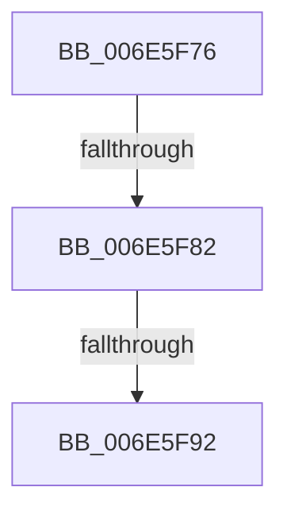

# sub_006E5F76

- RVA: `0x006E5F76`–`0x006E5F9D` (길이 `39` bytes)
- VA: `0x00000001406E5F76`
- 실행 섹션: `.text`
- PDB 이름 있음: `아니요`; PDB Function 태그: `아니요`
- unwind 정보 RVA: `0x00081AA4`
- 디코드: `9`개 명령, `39/39` bytes 표시
- 미해석 바이트: `0` (있으면 어셈블리에 `.byte`로 보존)

> 이 문서는 커널 이미지의 기계어와 PDB 기호를 분석해 생성했습니다. 4번과 5번은 함수 원형과 자료형을 바이너리 사용 방식에서 추정한 C 해석이며 원본 소스 복구 결과는 아닙니다.

## 1. Dependencies

- 직접 호출 지점: **1**; 고유 호출 대상: **1**
- 직접 호출자로 확인된 함수: **0**
- RIP 상대 이미지 참조: **1**

### Outgoing calls
- `0x006E5F85` → [KeCheckProcessorAffinityEx](../30/KeCheckProcessorAffinityEx_function_00305150.md) (function, `0x00305150`)

### Direct callers
- 이 함수 시작 RVA로 연결되는 직접 call은 확인되지 않았습니다. 간접 호출은 완전히 역산할 수 없습니다.

### Static image references
- `0x006E5F92` → RVA `0x00E66808` (`.data`; write)

## 2. Other-region calls and transfers

- 다른 실행 섹션으로 향하는 call: **0**
- call이 아닌 외부 분기/꼬리 이동: **3**
  - `0x006E5F7C` → [KiForwardTick + 0x164](../39/KiForwardTick_function_0039D40C.md) (`tail-transfer`)
  - `0x006E5F8C` → [KiForwardTick + 0x164](../39/KiForwardTick_function_0039D40C.md) (`tail-transfer`)
  - `0x006E5F98` → [KiForwardTick + 0x164](../39/KiForwardTick_function_0039D40C.md) (`tail-transfer`)

## 3. Assembly (complete function range)

```asm
006E5F76  41 8B 7D 24                     mov edi, dword ptr [r13 + 0x24]
006E5F7A  3B D7                           cmp edx, edi
006E5F7C  0F 84 EE 75 CB FF               je 0x14039d570
006E5F82  48 8B CB                        mov rcx, rbx
006E5F85  E8 C6 F1 C1 FF                  call 0x140305150
006E5F8A  85 C0                           test eax, eax
006E5F8C  0F 85 DE 75 CB FF               jne 0x14039d570
006E5F92  89 3D 70 08 78 00               mov dword ptr [rip + 0x780870], edi
006E5F98  E9 D3 75 CB FF                  jmp 0x14039d570
```

## 4. C-style interpretation (structured pseudocode)

```c
__int64 __fastcall sub_006E5F76(__int64 a1, int a2)
{
    __int64 result;

    result = KeCheckProcessorAffinityEx(v_rbx, a2, a3, a4);
    *(unsigned int *)(v_rip + 7866480) = (unsigned int)((unsigned int)(*(unsigned int *)(v_r13 + 36)));
}
```

## 5. (Beta) C Style

```c
int64_t sub_006E5F76(int64_t Arg1, int32_t Arg2)
{
    int64_t result;

    result = KeCheckProcessorAffinityEx(local_rbx, Arg2, a3, a4);
    *(uint32_t *)(v_rip + 0x780870) = (uint32_t)((uint32_t)(*(uint32_t *)(local_r13 + 0x24)));
}
```

## 6. Execution-region graph

[열기: 2D/3D 그래프와 함수 탐색 컨트롤 패널](../../../control-panel.html?section=text&rva=0x006E5F76&view=graph)

- 2D 그래프는 위에서 아래로 흐르고, 3D 그래프는 빈 공간을 드래그해 회전합니다. Shift+드래그는 이동, 휠은 확대·축소, 함수 노드 선택은 대상 보고서 이동입니다.

### Static fallback


