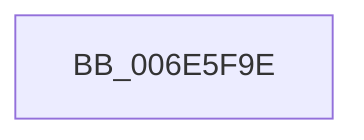

# sub_006E5F9E

- RVA: `0x006E5F9E`–`0x006E6083` (길이 `229` bytes)
- VA: `0x00000001406E5F9E`
- 실행 섹션: `.text`
- PDB 이름 있음: `아니요`; PDB Function 태그: `아니요`
- unwind 정보 RVA: `0x00081B04`
- 디코드: `44`개 명령, `229/229` bytes 표시
- 미해석 바이트: `0` (있으면 어셈블리에 `.byte`로 보존)

> 이 문서는 커널 이미지의 기계어와 PDB 기호를 분석해 생성했습니다. 4번과 5번은 함수 원형과 자료형을 바이너리 사용 방식에서 추정한 C 해석이며 원본 소스 복구 결과는 아닙니다.

## 1. Dependencies

- 직접 호출 지점: **1**; 고유 호출 대상: **1**
- 직접 호출자로 확인된 함수: **0**
- RIP 상대 이미지 참조: **2**

### Outgoing calls
- `0x006E6078` → [tlgWriteTransfer_EtwWriteTransfer](../42/tlgWriteTransfer_EtwWriteTransfer_function_004260E0.md) (function, `0x004260E0`)

### Direct callers
- 이 함수 시작 RVA로 연결되는 직접 call은 확인되지 않았습니다. 간접 호출은 완전히 역산할 수 없습니다.

### Static image references
- `0x006E5FB4` → RVA `0x00048592` (`.rdata`; read)
- `0x006E5FC9` → RVA `0x00E070D8` (`.data`; read)

## 2. Other-region calls and transfers

- 다른 실행 섹션으로 향하는 call: **0**
- call이 아닌 외부 분기/꼬리 이동: **1**
  - `0x006E607E` → [KiSetClockTimer + 0x7A](../39/KiSetClockTimer_function_0039DB2C.md) (`tail-transfer`)

## 3. Assembly (complete function range)

```asm
006E5F9E  89 44 24 34                     mov dword ptr [rsp + 0x34], eax
006E5FA2  48 8D 4C 24 48                  lea rcx, [rsp + 0x48]
006E5FA7  48 8D 44 24 34                  lea rax, [rsp + 0x34]
006E5FAC  48 89 4D 80                     mov qword ptr [rbp - 0x80], rcx
006E5FB0  48 89 45 90                     mov qword ptr [rbp - 0x70], rax
006E5FB4  48 8D 15 D7 25 96 FF            lea rdx, [rip - 0x69da29]
006E5FBB  48 8D 44 24 50                  lea rax, [rsp + 0x50]
006E5FC0  44 89 4C 24 3C                  mov dword ptr [rsp + 0x3c], r9d
006E5FC5  48 89 45 A0                     mov qword ptr [rbp - 0x60], rax
006E5FC9  48 8D 0D 08 11 72 00            lea rcx, [rip + 0x721108]
006E5FD0  49 8B C7                        mov rax, r15
006E5FD3  48 89 74 24 48                  mov qword ptr [rsp + 0x48], rsi
006E5FD8  48 2B C6                        sub rax, rsi
006E5FDB  48 C7 45 88 08 00 00 00         mov qword ptr [rbp - 0x78], 8
006E5FE3  48 89 44 24 58                  mov qword ptr [rsp + 0x58], rax
006E5FE8  45 33 C9                        xor r9d, r9d
006E5FEB  48 8D 44 24 58                  lea rax, [rsp + 0x58]
006E5FF0  48 C7 45 98 04 00 00 00         mov qword ptr [rbp - 0x68], 4
006E5FF8  48 89 45 B0                     mov qword ptr [rbp - 0x50], rax
006E5FFC  45 33 C0                        xor r8d, r8d
006E5FFF  48 8D 44 24 40                  lea rax, [rsp + 0x40]
006E6004  4C 89 64 24 50                  mov qword ptr [rsp + 0x50], r12
006E6009  48 89 45 C0                     mov qword ptr [rbp - 0x40], rax
006E600D  48 8D 44 24 3C                  lea rax, [rsp + 0x3c]
006E6012  48 89 45 D0                     mov qword ptr [rbp - 0x30], rax
006E6016  48 8D 44 24 30                  lea rax, [rsp + 0x30]
006E601B  48 89 45 E0                     mov qword ptr [rbp - 0x20], rax
006E601F  48 8D 44 24 31                  lea rax, [rsp + 0x31]
006E6024  48 89 45 F0                     mov qword ptr [rbp - 0x10], rax
006E6028  48 8D 44 24 60                  lea rax, [rsp + 0x60]
006E602D  48 89 44 24 28                  mov qword ptr [rsp + 0x28], rax
006E6032  C7 44 24 20 0A 00 00 00         mov dword ptr [rsp + 0x20], 0xa
006E603A  48 C7 45 A8 08 00 00 00         mov qword ptr [rbp - 0x58], 8
006E6042  48 C7 45 B8 08 00 00 00         mov qword ptr [rbp - 0x48], 8
006E604A  4C 89 7C 24 40                  mov qword ptr [rsp + 0x40], r15
006E604F  48 C7 45 C8 08 00 00 00         mov qword ptr [rbp - 0x38], 8
006E6057  48 C7 45 D8 04 00 00 00         mov qword ptr [rbp - 0x28], 4
006E605F  88 5C 24 30                     mov byte ptr [rsp + 0x30], bl
006E6063  48 C7 45 E8 01 00 00 00         mov qword ptr [rbp - 0x18], 1
006E606B  44 88 6C 24 31                  mov byte ptr [rsp + 0x31], r13b
006E6070  48 C7 45 F8 01 00 00 00         mov qword ptr [rbp - 8], 1
006E6078  E8 63 00 D4 FF                  call 0x1404260e0
006E607D  90                              nop
006E607E  E9 23 7B CB FF                  jmp 0x14039dba6
```

## 4. C-style interpretation (structured pseudocode)

```c
__int64 __fastcall sub_006E5F9E(__int64 a1, __int64 a2, int a3, int a4, __int64 a5, __int64 a6, __int64 a7, __int64 a8, __int64 a9, __int64 a10, __int64 a11, __int64 a12)
{
    __int64 result;
    unsigned int v_stack_p20;
    unsigned __int64 v_stack_p28;
    unsigned __int8 v_stack_p30;
    unsigned __int64 v_stack_p31;
    unsigned int v_stack_p34;
    unsigned int v_stack_p3C;
    unsigned __int64 v_stack_p40;
    unsigned __int64 v_stack_p48;
    unsigned __int64 v_stack_p50;
    unsigned __int64 v_stack_p58;

    v_stack_p34 = (unsigned int)(result);
    *(unsigned __int64 *)(v_rbp - 128) = a9;
    *(unsigned __int64 *)(v_rbp - 112) = v_stack_p34;
    v_stack_p3C = a4;
    *(unsigned __int64 *)(v_rbp - 96) = a10;
    v_stack_p48 = v_rsi;
    result = (v_r15) - (v_rsi);
    *(unsigned __int64 *)(v_rbp - 120) = 8;
    v_stack_p58 = result;
    a4 = 0;
    *(unsigned __int64 *)(v_rbp - 104) = 4;
    *(unsigned __int64 *)(v_rbp - 80) = a11;
    a3 = 0;
    v_stack_p50 = v_r12;
    *(unsigned __int64 *)(v_rbp - 64) = a8;
    *(unsigned __int64 *)(v_rbp - 48) = v_stack_p3C;
    *(unsigned __int64 *)(v_rbp - 32) = a6;
    *(unsigned __int64 *)(v_rbp - 16) = v_stack_p31;
    v_stack_p28 = a12;
    v_stack_p20 = 10;
    *(unsigned __int64 *)(v_rbp - 88) = 8;
    *(unsigned __int64 *)(v_rbp - 72) = 8;
    v_stack_p40 = v_r15;
    *(unsigned __int64 *)(v_rbp - 56) = 8;
    *(unsigned __int64 *)(v_rbp - 40) = 4;
    v_stack_p30 = (unsigned __int8)(v_rbx);
    *(unsigned __int64 *)(v_rbp - 24) = 1;
    v_stack_p31 = (unsigned __int8)(v_r13);
    *(unsigned __int64 *)(v_rbp - 8) = 1;
    result = tlgWriteTransfer_EtwWriteTransfer(v_rip + 7475464, v_rip - 6937129, a3, a4);
}
```

## 5. (Beta) C Style

```c
int64_t sub_006E5F9E(int64_t Arg1, int64_t Arg2, int32_t Arg3, int32_t Arg4, uint64_t Arg5, int64_t Arg6, uint64_t Arg7, int64_t Arg8, int64_t Arg9, int64_t Arg10, int64_t Arg11, int64_t Arg12)
{
    int64_t result;
    uint32_t v_stack_p20;
    uint64_t v_stack_p28;
    uint8_t v_stack_p30;
    uint64_t v_stack_p31;
    uint32_t v_stack_p34;
    uint32_t v_stack_p3C;
    uint64_t v_stack_p40;
    uint64_t v_stack_p48;
    uint64_t v_stack_p50;
    uint64_t v_stack_p58;

    v_stack_p34 = (uint32_t)(result);
    *(uint64_t *)(local_rbp - 0x80) = Arg9;
    *(uint64_t *)(local_rbp - 0x70) = v_stack_p34;
    v_stack_p3C = Arg4;
    *(uint64_t *)(local_rbp - 0x60) = Arg10;
    v_stack_p48 = local_rsi;
    result = (local_r15) - (local_rsi);
    *(uint64_t *)(local_rbp - 0x78) = 8;
    v_stack_p58 = result;
    Arg4 = 0;
    *(uint64_t *)(local_rbp - 0x68) = 4;
    *(uint64_t *)(local_rbp - 0x50) = Arg11;
    Arg3 = 0;
    v_stack_p50 = local_r12;
    *(uint64_t *)(local_rbp - 0x40) = Arg8;
    *(uint64_t *)(local_rbp - 0x30) = v_stack_p3C;
    *(uint64_t *)(local_rbp - 0x20) = Arg6;
    *(uint64_t *)(local_rbp - 0x10) = v_stack_p31;
    v_stack_p28 = Arg12;
    v_stack_p20 = 10;
    *(uint64_t *)(local_rbp - 0x58) = 8;
    *(uint64_t *)(local_rbp - 0x48) = 8;
    v_stack_p40 = local_r15;
    *(uint64_t *)(local_rbp - 0x38) = 8;
    *(uint64_t *)(local_rbp - 0x28) = 4;
    v_stack_p30 = (uint8_t)(local_rbx);
    *(uint64_t *)(local_rbp - 0x18) = 1;
    v_stack_p31 = (uint8_t)(local_r13);
    *(uint64_t *)(local_rbp - 0x8) = 1;
    result = tlgWriteTransfer_EtwWriteTransfer(v_rip + 7475464, v_rip - 6937129, Arg3, Arg4);
}
```

## 6. Execution-region graph

[열기: 2D/3D 그래프와 함수 탐색 컨트롤 패널](../../../control-panel.html?section=text&rva=0x006E5F9E&view=graph)

- 2D 그래프는 위에서 아래로 흐르고, 3D 그래프는 빈 공간을 드래그해 회전합니다. Shift+드래그는 이동, 휠은 확대·축소, 함수 노드 선택은 대상 보고서 이동입니다.

### Static fallback


