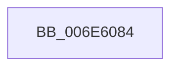

# sub_006E6084

- RVA: `0x006E6084`–`0x006E6176` (길이 `242` bytes)
- VA: `0x00000001406E6084`
- 실행 섹션: `.text`
- PDB 이름 있음: `아니요`; PDB Function 태그: `아니요`
- unwind 정보 RVA: `0x00081B98`
- 디코드: `52`개 명령, `242/242` bytes 표시
- 미해석 바이트: `0` (있으면 어셈블리에 `.byte`로 보존)

> 이 문서는 커널 이미지의 기계어와 PDB 기호를 분석해 생성했습니다. 4번과 5번은 함수 원형과 자료형을 바이너리 사용 방식에서 추정한 C 해석이며 원본 소스 복구 결과는 아닙니다.

## 1. Dependencies

- 직접 호출 지점: **1**; 고유 호출 대상: **1**
- 직접 호출자로 확인된 함수: **0**
- RIP 상대 이미지 참조: **2**

### Outgoing calls
- `0x006E616B` → [tlgWriteTransfer_EtwWriteTransfer](../42/tlgWriteTransfer_EtwWriteTransfer_function_004260E0.md) (function, `0x004260E0`)

### Direct callers
- 이 함수 시작 RVA로 연결되는 직접 call은 확인되지 않았습니다. 간접 호출은 완전히 역산할 수 없습니다.

### Static image references
- `0x006E6113` → RVA `0x000481C3` (`.rdata`; read)
- `0x006E6123` → RVA `0x00E070D8` (`.data`; read)

## 2. Other-region calls and transfers

- 다른 실행 섹션으로 향하는 call: **0**
- call이 아닌 외부 분기/꼬리 이동: **1**
  - `0x006E6171` → [KiShouldRearmClockTimer + 0xDE](../39/KiShouldRearmClockTimer_function_0039E134.md) (`tail-transfer`)

## 3. Assembly (complete function range)

```asm
006E6084  83 65 8C 00                     and dword ptr [rbp - 0x74], 0
006E6088  48 8D 44 24 40                  lea rax, [rsp + 0x40]
006E608D  83 65 9C 00                     and dword ptr [rbp - 0x64], 0
006E6091  41 B8 08 00 00 00               mov r8d, 8
006E6097  83 65 AC 00                     and dword ptr [rbp - 0x54], 0
006E609B  83 65 BC 00                     and dword ptr [rbp - 0x44], 0
006E609F  83 65 CC 00                     and dword ptr [rbp - 0x34], 0
006E60A3  83 65 DC 00                     and dword ptr [rbp - 0x24], 0
006E60A7  83 65 EC 00                     and dword ptr [rbp - 0x14], 0
006E60AB  83 65 FC 00                     and dword ptr [rbp - 4], 0
006E60AF  48 89 45 80                     mov qword ptr [rbp - 0x80], rax
006E60B3  8A 43 21                        mov al, byte ptr [rbx + 0x21]
006E60B6  88 44 24 30                     mov byte ptr [rsp + 0x30], al
006E60BA  48 8D 44 24 30                  lea rax, [rsp + 0x30]
006E60BF  48 89 45 90                     mov qword ptr [rbp - 0x70], rax
006E60C3  48 8D 44 24 48                  lea rax, [rsp + 0x48]
006E60C8  48 89 45 A0                     mov qword ptr [rbp - 0x60], rax
006E60CC  48 8D 44 24 34                  lea rax, [rsp + 0x34]
006E60D1  48 89 45 B0                     mov qword ptr [rbp - 0x50], rax
006E60D5  48 8D 44 24 50                  lea rax, [rsp + 0x50]
006E60DA  48 89 45 C0                     mov qword ptr [rbp - 0x40], rax
006E60DE  48 8D 44 24 58                  lea rax, [rsp + 0x58]
006E60E3  48 89 45 D0                     mov qword ptr [rbp - 0x30], rax
006E60E7  48 8D 44 24 38                  lea rax, [rsp + 0x38]
006E60EC  48 89 45 E0                     mov qword ptr [rbp - 0x20], rax
006E60F0  48 8D 44 24 31                  lea rax, [rsp + 0x31]
006E60F5  48 89 45 F0                     mov qword ptr [rbp - 0x10], rax
006E60F9  48 8D 44 24 60                  lea rax, [rsp + 0x60]
006E60FE  44 89 45 88                     mov dword ptr [rbp - 0x78], r8d
006E6102  44 89 45 A8                     mov dword ptr [rbp - 0x58], r8d
006E6106  44 89 4C 24 34                  mov dword ptr [rsp + 0x34], r9d
006E610B  45 33 C9                        xor r9d, r9d
006E610E  48 89 54 24 50                  mov qword ptr [rsp + 0x50], rdx
006E6113  48 8D 15 A9 20 96 FF            lea rdx, [rip - 0x69df57]
006E611A  44 89 45 C8                     mov dword ptr [rbp - 0x38], r8d
006E611E  48 89 4C 24 58                  mov qword ptr [rsp + 0x58], rcx
006E6123  48 8D 0D AE 0F 72 00            lea rcx, [rip + 0x720fae]
006E612A  44 89 45 D8                     mov dword ptr [rbp - 0x28], r8d
006E612E  44 89 45 E8                     mov dword ptr [rbp - 0x18], r8d
006E6132  45 33 C0                        xor r8d, r8d
006E6135  48 89 44 24 28                  mov qword ptr [rsp + 0x28], rax
006E613A  C7 44 24 20 0A 00 00 00         mov dword ptr [rsp + 0x20], 0xa
006E6142  4C 89 74 24 40                  mov qword ptr [rsp + 0x40], r14
006E6147  C7 45 98 01 00 00 00            mov dword ptr [rbp - 0x68], 1
006E614E  4C 89 7C 24 48                  mov qword ptr [rsp + 0x48], r15
006E6153  C7 45 B8 04 00 00 00            mov dword ptr [rbp - 0x48], 4
006E615A  48 89 7C 24 38                  mov qword ptr [rsp + 0x38], rdi
006E615F  44 88 64 24 31                  mov byte ptr [rsp + 0x31], r12b
006E6164  C7 45 F8 01 00 00 00            mov dword ptr [rbp - 8], 1
006E616B  E8 70 FF D3 FF                  call 0x1404260e0
006E6170  90                              nop
006E6171  E9 9C 80 CB FF                  jmp 0x14039e212
```

## 4. C-style interpretation (structured pseudocode)

```c
__int64 __fastcall sub_006E6084(__int64 a1, __int64 a2, __int64 a3, int a4, __int64 a5, __int64 a6, __int64 a7, __int64 a8, __int64 a9, __int64 a10, __int64 a11, __int64 a12)
{
    __int64 result;
    unsigned int v_stack_p20;
    unsigned __int64 v_stack_p28;
    unsigned __int8 v_stack_p30;
    unsigned __int64 v_stack_p31;
    unsigned __int64 v_stack_p34;
    unsigned __int64 v_stack_p38;
    unsigned __int64 v_stack_p40;
    unsigned __int64 v_stack_p48;
    unsigned __int64 v_stack_p50;
    unsigned __int64 v_stack_p58;

    *(unsigned __int64 *)(v_rbp - 128) = a8;
    v_stack_p30 = (unsigned __int8)(*(unsigned __int8 *)(v_rbx + 33));
    *(unsigned __int64 *)(v_rbp - 112) = a6;
    *(unsigned __int64 *)(v_rbp - 96) = a9;
    *(unsigned __int64 *)(v_rbp - 80) = v_stack_p34;
    *(unsigned __int64 *)(v_rbp - 64) = a10;
    *(unsigned __int64 *)(v_rbp - 48) = a11;
    *(unsigned __int64 *)(v_rbp - 32) = a7;
    *(unsigned __int64 *)(v_rbp - 16) = v_stack_p31;
    *(unsigned int *)(v_rbp - 120) = 8;
    *(unsigned int *)(v_rbp - 88) = 8;
    v_stack_p34 = a4;
    a4 = 0;
    v_stack_p50 = a2;
    *(unsigned int *)(v_rbp - 56) = 8;
    v_stack_p58 = a1;
    *(unsigned int *)(v_rbp - 40) = 8;
    *(unsigned int *)(v_rbp - 24) = 8;
    a3 = 0;
    v_stack_p28 = a12;
    v_stack_p20 = 10;
    v_stack_p40 = v_r14;
    *(unsigned int *)(v_rbp - 104) = 1;
    v_stack_p48 = v_r15;
    *(unsigned int *)(v_rbp - 72) = 4;
    v_stack_p38 = v_rdi;
    v_stack_p31 = (unsigned __int8)(v_r12);
    *(unsigned int *)(v_rbp - 8) = 1;
    result = tlgWriteTransfer_EtwWriteTransfer(v_rip + 7475118, v_rip - 6938455, a3, a4);
}
```

## 5. (Beta) C Style

```c
int64_t sub_006E6084(int64_t Arg1, int64_t Arg2, int64_t Arg3, int32_t Arg4, uint64_t Arg5, int64_t Arg6, int64_t Arg7, int64_t Arg8, int64_t Arg9, int64_t Arg10, int64_t Arg11, int64_t Arg12)
{
    int64_t result;
    uint32_t v_stack_p20;
    uint64_t v_stack_p28;
    uint8_t v_stack_p30;
    uint64_t v_stack_p31;
    uint64_t v_stack_p34;
    uint64_t v_stack_p38;
    uint64_t v_stack_p40;
    uint64_t v_stack_p48;
    uint64_t v_stack_p50;
    uint64_t v_stack_p58;

    *(uint64_t *)(local_rbp - 0x80) = Arg8;
    v_stack_p30 = (uint8_t)(*(uint8_t *)(local_rbx + 0x21));
    *(uint64_t *)(local_rbp - 0x70) = Arg6;
    *(uint64_t *)(local_rbp - 0x60) = Arg9;
    *(uint64_t *)(local_rbp - 0x50) = v_stack_p34;
    *(uint64_t *)(local_rbp - 0x40) = Arg10;
    *(uint64_t *)(local_rbp - 0x30) = Arg11;
    *(uint64_t *)(local_rbp - 0x20) = Arg7;
    *(uint64_t *)(local_rbp - 0x10) = v_stack_p31;
    *(uint32_t *)(local_rbp - 0x78) = 8;
    *(uint32_t *)(local_rbp - 0x58) = 8;
    v_stack_p34 = Arg4;
    Arg4 = 0;
    v_stack_p50 = Arg2;
    *(uint32_t *)(local_rbp - 0x38) = 8;
    v_stack_p58 = Arg1;
    *(uint32_t *)(local_rbp - 0x28) = 8;
    *(uint32_t *)(local_rbp - 0x18) = 8;
    Arg3 = 0;
    v_stack_p28 = Arg12;
    v_stack_p20 = 10;
    v_stack_p40 = local_r14;
    *(uint32_t *)(local_rbp - 0x68) = 1;
    v_stack_p48 = local_r15;
    *(uint32_t *)(local_rbp - 0x48) = 4;
    v_stack_p38 = local_rdi;
    v_stack_p31 = (uint8_t)(local_r12);
    *(uint32_t *)(local_rbp - 0x8) = 1;
    result = tlgWriteTransfer_EtwWriteTransfer(v_rip + 7475118, v_rip - 6938455, Arg3, Arg4);
}
```

## 6. Execution-region graph

[열기: 2D/3D 그래프와 함수 탐색 컨트롤 패널](../../../control-panel.html?section=text&rva=0x006E6084&view=graph)

- 2D 그래프는 위에서 아래로 흐르고, 3D 그래프는 빈 공간을 드래그해 회전합니다. Shift+드래그는 이동, 휠은 확대·축소, 함수 노드 선택은 대상 보고서 이동입니다.

### Static fallback


