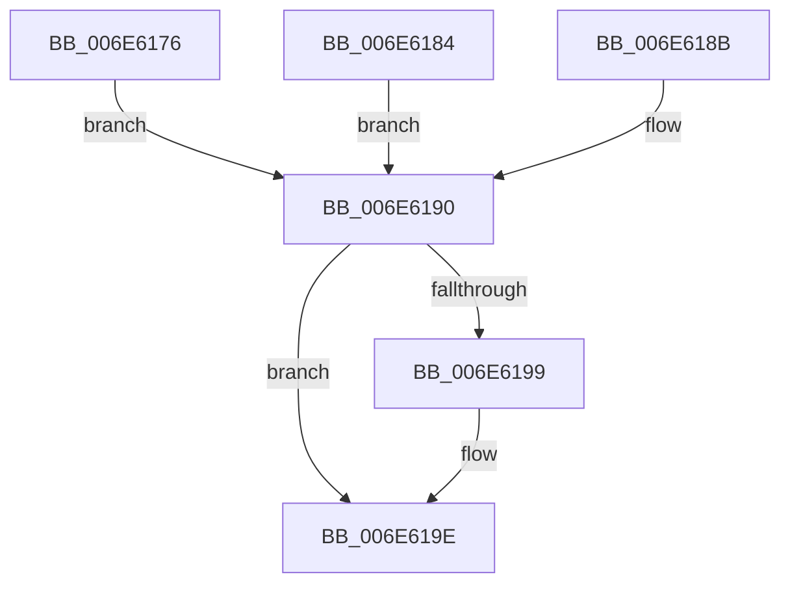

# sub_006E6176

- RVA: `0x006E6176`–`0x006E61A8` (길이 `50` bytes)
- VA: `0x00000001406E6176`
- 실행 섹션: `.text`
- PDB 이름 있음: `아니요`; PDB Function 태그: `아니요`
- unwind 정보 RVA: `0x00081C40`
- 디코드: `13`개 명령, `50/50` bytes 표시
- 미해석 바이트: `0` (있으면 어셈블리에 `.byte`로 보존)

> 이 문서는 커널 이미지의 기계어와 PDB 기호를 분석해 생성했습니다. 4번과 5번은 함수 원형과 자료형을 바이너리 사용 방식에서 추정한 C 해석이며 원본 소스 복구 결과는 아닙니다.

## 1. Dependencies

- 직접 호출 지점: **0**; 고유 호출 대상: **0**
- 직접 호출자로 확인된 함수: **0**
- RIP 상대 이미지 참조: **0**

### Outgoing calls
- 직접 디코드된 call 명령이 없습니다.

### Direct callers
- 이 함수 시작 RVA로 연결되는 직접 call은 확인되지 않았습니다. 간접 호출은 완전히 역산할 수 없습니다.

### Static image references
- 디코드된 RIP-relative 메모리 참조가 없습니다.

## 2. Other-region calls and transfers

- 다른 실행 섹션으로 향하는 call: **0**
- call이 아닌 외부 분기/꼬리 이동: **1**
  - `0x006E61A3` → [KeGetTopologySiblingGroupAffinityForProcessor + 0x43](../39/KeGetTopologySiblingGroupAffinityForProcessor_function_0039EEE4.md) (`tail-transfer`)

## 3. Assembly (complete function range)

```asm
006E6176  B9 05 00 00 00                  mov ecx, 5
006E617B  CD 29                           int 0x29
006E617D  B8 10 8C 00 00                  mov eax, 0x8c10
006E6182  EB 0C                           jmp 0x1406e6190
006E6184  B8 C0 9C 00 00                  mov eax, 0x9cc0
006E6189  EB 05                           jmp 0x1406e6190
006E618B  B8 10 9F 00 00                  mov eax, 0x9f10
006E6190  48 8D 0C 18                     lea rcx, [rax + rbx]
006E6194  66 3B 31                        cmp si, word ptr [rcx]
006E6197  73 05                           jae 0x1406e619e
006E6199  48 8B 7C F1 08                  mov rdi, qword ptr [rcx + rsi*8 + 8]
006E619E  48 89 7C 24 20                  mov qword ptr [rsp + 0x20], rdi
006E61A3  E9 7F 8D CB FF                  jmp 0x14039ef27
```

## 4. C-style interpretation (structured pseudocode)

```c
__int64 __fastcall sub_006E6176(void)
{
    __int64 v_rdi;
    unsigned __int64 v_stack_p20;

    goto loc_006E6190;
loc_006E6190:
    if (((unsigned __int16)(v_rsi)) < (*(unsigned __int16 *)((unsigned int)(0x8C10ULL) + v_rbx * 1))) {
        v_rdi = *(unsigned __int64 *)((unsigned int)(0x8C10ULL) + v_rbx * 1 + v_rsi * 8 + 8);
    }
    v_stack_p20 = v_rdi;
}
```

## 5. (Beta) C Style

```c
void sub_006E6176(void)
{
    int64_t local_rdi;
    uint64_t v_stack_p20;

    goto loc_006E6190;
loc_006E6190:
    if (((uint16_t)(local_rsi)) < (*(uint16_t *)((uint32_t)(0x8C10ULL) + local_rbx * 1))) {
        local_rdi = *(uint64_t *)((uint32_t)(0x8C10ULL) + local_rbx * 1 + local_rsi * 8 + 0x8);
    }
    v_stack_p20 = local_rdi;
}
```

## 6. Execution-region graph

[열기: 2D/3D 그래프와 함수 탐색 컨트롤 패널](../../../control-panel.html?section=text&rva=0x006E6176&view=graph)

- 2D 그래프는 위에서 아래로 흐르고, 3D 그래프는 빈 공간을 드래그해 회전합니다. Shift+드래그는 이동, 휠은 확대·축소, 함수 노드 선택은 대상 보고서 이동입니다.

### Static fallback


