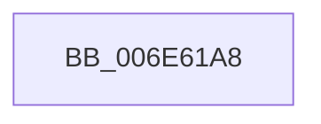

# sub_006E61A8

- RVA: `0x006E61A8`–`0x006E61FB` (길이 `83` bytes)
- VA: `0x00000001406E61A8`
- 실행 섹션: `.text`
- PDB 이름 있음: `아니요`; PDB Function 태그: `아니요`
- unwind 정보 RVA: `0x00081CA8`
- 디코드: `19`개 명령, `83/83` bytes 표시
- 미해석 바이트: `0` (있으면 어셈블리에 `.byte`로 보존)

> 이 문서는 커널 이미지의 기계어와 PDB 기호를 분석해 생성했습니다. 4번과 5번은 함수 원형과 자료형을 바이너리 사용 방식에서 추정한 C 해석이며 원본 소스 복구 결과는 아닙니다.

## 1. Dependencies

- 직접 호출 지점: **0**; 고유 호출 대상: **0**
- 직접 호출자로 확인된 함수: **0**
- RIP 상대 이미지 참조: **2**

### Outgoing calls
- 직접 디코드된 call 명령이 없습니다.

### Direct callers
- 이 함수 시작 RVA로 연결되는 직접 call은 확인되지 않았습니다. 간접 호출은 완전히 역산할 수 없습니다.

### Static image references
- `0x006E61A8` → RVA `0x00FC6F78` (`ALMOSTRO`; read)
- `0x006E61B5` → RVA `0x00FC7250` (`ALMOSTRO`; read)

## 2. Other-region calls and transfers

- 다른 실행 섹션으로 향하는 call: **0**
- call이 아닌 외부 분기/꼬리 이동: **1**
  - `0x006E61F6` → [ExDeleteTimer + 0x2A](../39/ExDeleteTimer_function_0039F2E0.md) (`tail-transfer`)

## 3. Assembly (complete function range)

```asm
006E61A8  48 8B 05 C9 0D 8E 00            mov rax, qword ptr [rip + 0x8e0dc9]
006E61AF  48 8B 57 08                     mov rdx, qword ptr [rdi + 8]
006E61B3  8B C8                           mov ecx, eax
006E61B5  48 33 15 94 10 8E 00            xor rdx, qword ptr [rip + 0x8e1094]
006E61BC  48 0F CA                        bswap rdx
006E61BF  48 33 D3                        xor rdx, rbx
006E61C2  48 D3 CA                        ror rdx, cl
006E61C5  48 33 D0                        xor rdx, rax
006E61C8  48 89 93 88 00 00 00            mov qword ptr [rbx + 0x88], rdx
006E61CF  48 8B 05 A2 0D 8E 00            mov rax, qword ptr [rip + 0x8e0da2]
006E61D6  48 8B 57 10                     mov rdx, qword ptr [rdi + 0x10]
006E61DA  8B C8                           mov ecx, eax
006E61DC  48 33 15 6D 10 8E 00            xor rdx, qword ptr [rip + 0x8e106d]
006E61E3  48 0F CA                        bswap rdx
006E61E6  48 33 D3                        xor rdx, rbx
006E61E9  48 D3 CA                        ror rdx, cl
006E61EC  48 33 D0                        xor rdx, rax
006E61EF  48 89 93 90 00 00 00            mov qword ptr [rbx + 0x90], rdx
006E61F6  E9 0F 91 CB FF                  jmp 0x14039f30a
```

## 4. C-style interpretation (structured pseudocode)

```c
__int64 __fastcall sub_006E61A8(void)
{
    a2 = (*(unsigned __int64 *)(v_rdi + 8)) ^ (*(unsigned __int64 *)(v_rip + 9310356));
    a2 = (a2) ^ (v_rbx);
    a2 = (a2) ^ (*(unsigned __int64 *)(v_rip + 9309641));
    *(unsigned __int64 *)(v_rbx + 136) = a2;
    a2 = (*(unsigned __int64 *)(v_rdi + 16)) ^ (*(unsigned __int64 *)(v_rip + 9310317));
    a2 = (a2) ^ (v_rbx);
    a2 = (a2) ^ (*(unsigned __int64 *)(v_rip + 9309602));
    *(unsigned __int64 *)(v_rbx + 144) = a2;
}
```

## 5. (Beta) C Style

```c
void sub_006E61A8(void)
{
    a2 = (*(uint64_t *)(local_rdi + 0x8)) ^ (*(uint64_t *)(v_rip + 0x8E1094));
    a2 = (a2) ^ (local_rbx);
    a2 = (a2) ^ (*(uint64_t *)(v_rip + 0x8E0DC9));
    *(uint64_t *)(local_rbx + 0x88) = a2;
    a2 = (*(uint64_t *)(local_rdi + 0x10)) ^ (*(uint64_t *)(v_rip + 0x8E106D));
    a2 = (a2) ^ (local_rbx);
    a2 = (a2) ^ (*(uint64_t *)(v_rip + 0x8E0DA2));
    *(uint64_t *)(local_rbx + 0x90) = a2;
}
```

## 6. Execution-region graph

[열기: 2D/3D 그래프와 함수 탐색 컨트롤 패널](../../../control-panel.html?section=text&rva=0x006E61A8&view=graph)

- 2D 그래프는 위에서 아래로 흐르고, 3D 그래프는 빈 공간을 드래그해 회전합니다. Shift+드래그는 이동, 휠은 확대·축소, 함수 노드 선택은 대상 보고서 이동입니다.

### Static fallback


