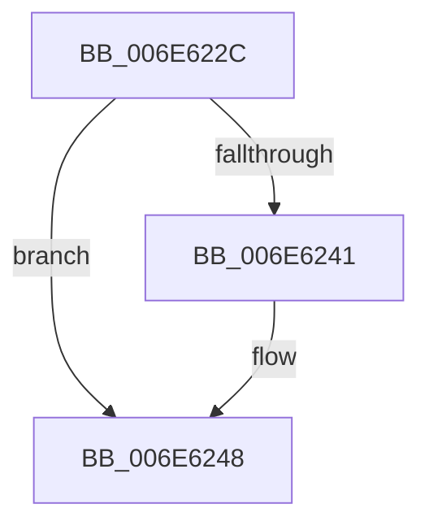

# sub_006E622C

- RVA: `0x006E622C`–`0x006E625B` (길이 `47` bytes)
- VA: `0x00000001406E622C`
- 실행 섹션: `.text`
- PDB 이름 있음: `아니요`; PDB Function 태그: `아니요`
- unwind 정보 RVA: `0x00081CF0`
- 디코드: `13`개 명령, `47/47` bytes 표시
- 미해석 바이트: `0` (있으면 어셈블리에 `.byte`로 보존)

> 이 문서는 커널 이미지의 기계어와 PDB 기호를 분석해 생성했습니다. 4번과 5번은 함수 원형과 자료형을 바이너리 사용 방식에서 추정한 C 해석이며 원본 소스 복구 결과는 아닙니다.

## 1. Dependencies

- 직접 호출 지점: **1**; 고유 호출 대상: **1**
- 직접 호출자로 확인된 함수: **0**
- RIP 상대 이미지 참조: **0**

### Outgoing calls
- `0x006E622C` → [KiDisconnectSecondaryInterruptInternal](../4B/KiDisconnectSecondaryInterruptInternal_function_004BCBD4.md) (function, `0x004BCBD4`)

### Direct callers
- 이 함수 시작 RVA로 연결되는 직접 call은 확인되지 않았습니다. 간접 호출은 완전히 역산할 수 없습니다.

### Static image references
- 디코드된 RIP-relative 메모리 참조가 없습니다.

## 2. Other-region calls and transfers

- 다른 실행 섹션으로 향하는 call: **0**
- call이 아닌 외부 분기/꼬리 이동: **1**
  - `0x006E6256` → [KiInterruptDispatchCommon + 0x291](../39/KiInterruptDispatchCommon_function_0039F3D0.md) (`tail-transfer`)

## 3. Assembly (complete function range)

```asm
006E622C  E8 A3 69 DD FF                  call 0x1404bcbd4
006E6231  89 43 10                        mov dword ptr [rbx + 0x10], eax
006E6234  48 83 C7 08                     add rdi, 8
006E6238  49 8B 47 08                     mov rax, qword ptr [r15 + 8]
006E623C  4C 39 38                        cmp qword ptr [rax], r15
006E623F  74 07                           je 0x1406e6248
006E6241  B9 03 00 00 00                  mov ecx, 3
006E6246  CD 29                           int 0x29
006E6248  4C 89 3F                        mov qword ptr [rdi], r15
006E624B  48 89 47 08                     mov qword ptr [rdi + 8], rax
006E624F  48 89 38                        mov qword ptr [rax], rdi
006E6252  49 89 7F 08                     mov qword ptr [r15 + 8], rdi
006E6256  E9 06 94 CB FF                  jmp 0x14039f661
```

## 4. C-style interpretation (structured pseudocode)

```c
__int64 __fastcall sub_006E622C(void)
{
    __int64 result;
    __int64 v_rdi;

    result = KiDisconnectSecondaryInterruptInternal(a1, a2, a3, a4);
    *(unsigned int *)(v_rbx + 16) = (unsigned int)(result);
    v_rdi = (v_rdi) + (8);
    if ((*(unsigned __int64 *)(*(unsigned __int64 *)(v_r15 + 8))) != v_r15) {
        a1 = 3;
    }
    *(unsigned __int64 *)(v_rdi) = v_r15;
    *(unsigned __int64 *)(v_rdi + 8) = *(unsigned __int64 *)(v_r15 + 8);
    *(unsigned __int64 *)(*(unsigned __int64 *)(v_r15 + 8)) = v_rdi;
    *(unsigned __int64 *)(v_r15 + 8) = v_rdi;
}
```

## 5. (Beta) C Style

```c
void sub_006E622C(void)
{
    int64_t result;
    int64_t local_rdi;

    result = KiDisconnectSecondaryInterruptInternal(a1, a2, a3, a4);
    *(uint32_t *)(local_rbx + 0x10) = (uint32_t)(result);
    local_rdi = (local_rdi) + (8);
    if ((*(uint64_t *)(*(uint64_t *)(local_r15 + 0x8))) != local_r15) {
        a1 = 3;
    }
    *(uint64_t *)(local_rdi) = local_r15;
    *(uint64_t *)(local_rdi + 0x8) = *(uint64_t *)(local_r15 + 0x8);
    *(uint64_t *)(*(uint64_t *)(local_r15 + 0x8)) = local_rdi;
    *(uint64_t *)(local_r15 + 0x8) = local_rdi;
}
```

## 6. Execution-region graph

[열기: 2D/3D 그래프와 함수 탐색 컨트롤 패널](../../../control-panel.html?section=text&rva=0x006E622C&view=graph)

- 2D 그래프는 위에서 아래로 흐르고, 3D 그래프는 빈 공간을 드래그해 회전합니다. Shift+드래그는 이동, 휠은 확대·축소, 함수 노드 선택은 대상 보고서 이동입니다.

### Static fallback


