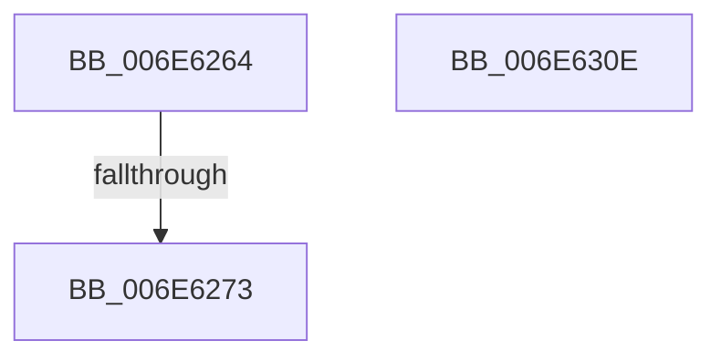

# sub_006E6264

- RVA: `0x006E6264`–`0x006E631B` (길이 `183` bytes)
- VA: `0x00000001406E6264`
- 실행 섹션: `.text`
- PDB 이름 있음: `아니요`; PDB Function 태그: `아니요`
- unwind 정보 RVA: `0x00081D38`
- 디코드: `39`개 명령, `183/183` bytes 표시
- 미해석 바이트: `0` (있으면 어셈블리에 `.byte`로 보존)

> 이 문서는 커널 이미지의 기계어와 PDB 기호를 분석해 생성했습니다. 4번과 5번은 함수 원형과 자료형을 바이너리 사용 방식에서 추정한 C 해석이며 원본 소스 복구 결과는 아닙니다.

## 1. Dependencies

- 직접 호출 지점: **1**; 고유 호출 대상: **1**
- 직접 호출자로 확인된 함수: **0**
- RIP 상대 이미지 참조: **2**

### Outgoing calls
- `0x006E62FF` → [KiSetTimerEx](../23/KiSetTimerEx_function_00232CB0.md) (function, `0x00232CB0`)

### Direct callers
- 이 함수 시작 RVA로 연결되는 직접 call은 확인되지 않았습니다. 간접 호출은 완전히 역산할 수 없습니다.

### Static image references
- `0x006E6264` → RVA `0x00E0B1FC` (`.data`; read)
- `0x006E62A8` → RVA `0x005C34A0` (`KiPassiveIsrWatchdog`; read)

## 2. Other-region calls and transfers

- 다른 실행 섹션으로 향하는 call: **0**
- call이 아닌 외부 분기/꼬리 이동: **3**
  - `0x006E626D` → [KiInvokeInterruptServiceRoutine + 0xD0](../39/KiInvokeInterruptServiceRoutine_function_0039F8E0.md) (`tail-transfer`)
  - `0x006E6309` → [KiInvokeInterruptServiceRoutine + 0xD0](../39/KiInvokeInterruptServiceRoutine_function_0039F8E0.md) (`tail-transfer`)
  - `0x006E6316` → [KiInvokeInterruptServiceRoutine + 0x151](../39/KiInvokeInterruptServiceRoutine_function_0039F8E0.md) (`tail-transfer`)

## 3. Assembly (complete function range)

```asm
006E6264  48 63 05 91 4F 72 00            movsxd rax, dword ptr [rip + 0x724f91]
006E626B  85 C0                           test eax, eax
006E626D  0F 84 3D 97 CB FF               je 0x14039f9b0
006E6273  48 8D 4C 24 40                  lea rcx, [rsp + 0x40]
006E6278  89 54 24 3C                     mov dword ptr [rsp + 0x3c], edx
006E627C  48 89 4C 24 48                  mov qword ptr [rsp + 0x48], rcx
006E6281  45 33 C9                        xor r9d, r9d
006E6284  48 8D 4C 24 40                  lea rcx, [rsp + 0x40]
006E6289  89 55 A4                        mov dword ptr [rbp - 0x5c], edx
006E628C  48 89 4C 24 40                  mov qword ptr [rsp + 0x40], rcx
006E6291  45 33 C0                        xor r8d, r8d
006E6294  48 89 55 B8                     mov qword ptr [rbp - 0x48], rdx
006E6298  48 8D 4D A8                     lea rcx, [rbp - 0x58]
006E629C  48 89 4D B0                     mov qword ptr [rbp - 0x50], rcx
006E62A0  48 8D 4D A8                     lea rcx, [rbp - 0x58]
006E62A4  48 89 4D A8                     mov qword ptr [rbp - 0x58], rcx
006E62A8  48 8D 0D F1 D1 ED FF            lea rcx, [rip - 0x122e0f]
006E62AF  48 89 4C 24 78                  mov qword ptr [rsp + 0x78], rcx
006E62B4  48 8D 4C 24 38                  lea rcx, [rsp + 0x38]
006E62B9  89 55 DC                        mov dword ptr [rbp - 0x24], edx
006E62BC  66 89 55 D8                     mov word ptr [rbp - 0x28], dx
006E62C0  48 89 55 98                     mov qword ptr [rbp - 0x68], rdx
006E62C4  48 89 54 24 70                  mov qword ptr [rsp + 0x70], rdx
006E62C9  48 69 D0 80 69 67 FF            imul rdx, rax, -0x989680
006E62D0  48 89 4D 80                     mov qword ptr [rbp - 0x80], rcx
006E62D4  48 8D 44 24 60                  lea rax, [rsp + 0x60]
006E62D9  48 8D 4D A0                     lea rcx, [rbp - 0x60]
006E62DD  48 89 5C 24 50                  mov qword ptr [rsp + 0x50], rbx
006E62E2  66 C7 44 24 38 01 00            mov word ptr [rsp + 0x38], 1
006E62E9  C6 44 24 3A 06                  mov byte ptr [rsp + 0x3a], 6
006E62EE  C6 45 A0 08                     mov byte ptr [rbp - 0x60], 8
006E62F2  C7 44 24 60 13 01 00 00         mov dword ptr [rsp + 0x60], 0x113
006E62FA  48 89 44 24 20                  mov qword ptr [rsp + 0x20], rax
006E62FF  E8 AC C9 B4 FF                  call 0x140232cb0
006E6304  44 88 6C 24 30                  mov byte ptr [rsp + 0x30], r13b
006E6309  E9 A2 96 CB FF                  jmp 0x14039f9b0
006E630E  40 0F B6 C7                     movzx eax, dil
006E6312  44 0F 22 C0                     mov cr8, rax
006E6316  E9 16 97 CB FF                  jmp 0x14039fa31
```

## 4. C-style interpretation (structured pseudocode)

```c
__int64 __fastcall sub_006E6264(__int64 a1, __int64 a2, int a3, int a4, __int64 a5, __int64 a6, __int64 a7, __int64 a8, __int64 a9, __int64 a10, __int64 a11, __int64 a12)
{
    __int64 result;
    unsigned __int64 v_stack_p20;
    unsigned __int8 v_stack_p30;
    unsigned __int16 v_stack_p38;
    unsigned __int8 v_stack_p3A;
    unsigned int v_stack_p3C;
    unsigned __int64 v_stack_p40;
    unsigned __int64 v_stack_p48;
    unsigned __int64 v_stack_p50;
    unsigned int v_stack_p60;
    unsigned __int64 v_stack_p70;
    unsigned __int64 v_stack_p78;

    v_stack_p3C = (unsigned int)(a2);
    v_stack_p48 = a8;
    a4 = 0;
    *(unsigned int *)(v_rbp - 92) = (unsigned int)(a2);
    v_stack_p40 = a8;
    a3 = 0;
    *(unsigned __int64 *)(v_rbp - 72) = a2;
    *(unsigned __int64 *)(v_rbp - 80) = v_rbp - 88;
    *(unsigned __int64 *)(v_rbp - 88) = v_rbp - 88;
    v_stack_p78 = v_rip - 1191439;
    *(unsigned int *)(v_rbp - 36) = (unsigned int)(a2);
    *(unsigned __int16 *)(v_rbp - 40) = (unsigned __int16)(a2);
    *(unsigned __int64 *)(v_rbp - 104) = a2;
    v_stack_p70 = a2;
    a2 = (a2) * ((int)(*(unsigned int *)(v_rip + 7491473)));
    *(unsigned __int64 *)(v_rbp - 128) = a7;
    v_stack_p50 = v_rbx;
    v_stack_p38 = 1;
    v_stack_p3A = 6;
    *(unsigned __int8 *)(v_rbp - 96) = 8;
    v_stack_p60 = 275;
    v_stack_p20 = a12;
    result = KiSetTimerEx(v_rbp - 96, a2, a3, a4);
    v_stack_p30 = (unsigned __int8)(v_r13);
}
```

## 5. (Beta) C Style

```c
int64_t sub_006E6264(int64_t Arg1, int64_t Arg2, int32_t Arg3, int32_t Arg4, uint64_t Arg5, uint64_t Arg6, int64_t Arg7, int64_t Arg8, uint64_t Arg9, uint64_t Arg10, uint64_t Arg11, int64_t Arg12)
{
    int64_t result;
    uint64_t v_stack_p20;
    uint8_t v_stack_p30;
    uint16_t v_stack_p38;
    uint8_t v_stack_p3A;
    uint32_t v_stack_p3C;
    uint64_t v_stack_p40;
    uint64_t v_stack_p48;
    uint64_t v_stack_p50;
    uint32_t v_stack_p60;
    uint64_t v_stack_p70;
    uint64_t v_stack_p78;

    v_stack_p3C = (uint32_t)(Arg2);
    v_stack_p48 = Arg8;
    Arg4 = 0;
    *(uint32_t *)(local_rbp - 0x5C) = (uint32_t)(Arg2);
    v_stack_p40 = Arg8;
    Arg3 = 0;
    *(uint64_t *)(local_rbp - 0x48) = Arg2;
    *(uint64_t *)(local_rbp - 0x50) = local_rbp - 88;
    *(uint64_t *)(local_rbp - 0x58) = local_rbp - 88;
    v_stack_p78 = v_rip - 1191439;
    *(uint32_t *)(local_rbp - 0x24) = (uint32_t)(Arg2);
    *(uint16_t *)(local_rbp - 0x28) = (uint16_t)(Arg2);
    *(uint64_t *)(local_rbp - 0x68) = Arg2;
    v_stack_p70 = Arg2;
    Arg2 = (Arg2) * ((int32_t)(*(uint32_t *)(v_rip + 0x724F91)));
    *(uint64_t *)(local_rbp - 0x80) = Arg7;
    v_stack_p50 = local_rbx;
    v_stack_p38 = 1;
    v_stack_p3A = 6;
    *(uint8_t *)(local_rbp - 0x60) = 8;
    v_stack_p60 = 275;
    v_stack_p20 = Arg12;
    result = KiSetTimerEx(local_rbp - 96, Arg2, Arg3, Arg4);
    v_stack_p30 = (uint8_t)(local_r13);
}
```

## 6. Execution-region graph

[열기: 2D/3D 그래프와 함수 탐색 컨트롤 패널](../../../control-panel.html?section=text&rva=0x006E6264&view=graph)

- 2D 그래프는 위에서 아래로 흐르고, 3D 그래프는 빈 공간을 드래그해 회전합니다. Shift+드래그는 이동, 휠은 확대·축소, 함수 노드 선택은 대상 보고서 이동입니다.

### Static fallback


