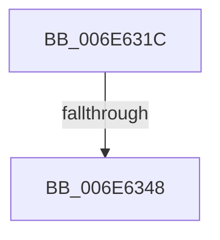

# sub_006E631C

- RVA: `0x006E631C`–`0x006E634D` (길이 `49` bytes)
- VA: `0x00000001406E631C`
- 실행 섹션: `.text`
- PDB 이름 있음: `아니요`; PDB Function 태그: `아니요`
- unwind 정보 RVA: `0x00081EBC`
- 디코드: `10`개 명령, `49/49` bytes 표시
- 미해석 바이트: `0` (있으면 어셈블리에 `.byte`로 보존)

> 이 문서는 커널 이미지의 기계어와 PDB 기호를 분석해 생성했습니다. 4번과 5번은 함수 원형과 자료형을 바이너리 사용 방식에서 추정한 C 해석이며 원본 소스 복구 결과는 아닙니다.

## 1. Dependencies

- 직접 호출 지점: **1**; 고유 호출 대상: **1**
- 직접 호출자로 확인된 함수: **0**
- RIP 상대 이미지 참조: **0**

### Outgoing calls
- `0x006E6334` → [KeReleaseSemaphoreEx](../34/KeReleaseSemaphoreEx_function_003468C0.md) (function, `0x003468C0`)

### Direct callers
- 이 함수 시작 RVA로 연결되는 직접 call은 확인되지 않았습니다. 간접 호출은 완전히 역산할 수 없습니다.

### Static image references
- 디코드된 RIP-relative 메모리 참조가 없습니다.

## 2. Other-region calls and transfers

- 다른 실행 섹션으로 향하는 call: **0**
- call이 아닌 외부 분기/꼬리 이동: **2**
  - `0x006E6342` → [NtSignalAndWaitForSingleObject + 0x4BF](../3A/NtSignalAndWaitForSingleObject_function_003A11D0.md) (`tail-transfer`)
  - `0x006E6348` → [NtSignalAndWaitForSingleObject + 0x188](../3A/NtSignalAndWaitForSingleObject_function_003A11D0.md) (`tail-transfer`)

## 3. Assembly (complete function range)

```asm
006E631C  48 89 74 24 28                  mov qword ptr [rsp + 0x28], rsi
006E6321  C7 44 24 20 01 00 00 00         mov dword ptr [rsp + 0x20], 1
006E6329  BA 01 00 00 00                  mov edx, 1
006E632E  44 8B C2                        mov r8d, edx
006E6331  49 8B CA                        mov rcx, r10
006E6334  E8 87 05 C6 FF                  call 0x1403468c0
006E6339  89 44 24 40                     mov dword ptr [rsp + 0x40], eax
006E633D  3D 47 00 00 C0                  cmp eax, 0xc0000047
006E6342  0F 84 47 B3 CB FF               je 0x1403a168f
006E6348  E9 0B B0 CB FF                  jmp 0x1403a1358
```

## 4. C-style interpretation (structured pseudocode)

```c
__int64 __fastcall sub_006E631C(void)
{
    __int64 result;
    unsigned int v_stack_p20;
    unsigned __int64 v_stack_p28;
    unsigned int v_stack_p40;

    v_stack_p28 = v_rsi;
    v_stack_p20 = 1;
    result = KeReleaseSemaphoreEx(v_r10, 1, 1, a4);
    v_stack_p40 = (unsigned int)(result);
}
```

## 5. (Beta) C Style

```c
void sub_006E631C(void)
{
    int64_t result;
    uint32_t v_stack_p20;
    uint64_t v_stack_p28;
    uint32_t v_stack_p40;

    v_stack_p28 = local_rsi;
    v_stack_p20 = 1;
    result = KeReleaseSemaphoreEx(local_r10, 1, 1, a4);
    v_stack_p40 = (uint32_t)(result);
}
```

## 6. Execution-region graph

[열기: 2D/3D 그래프와 함수 탐색 컨트롤 패널](../../../control-panel.html?section=text&rva=0x006E631C&view=graph)

- 2D 그래프는 위에서 아래로 흐르고, 3D 그래프는 빈 공간을 드래그해 회전합니다. Shift+드래그는 이동, 휠은 확대·축소, 함수 노드 선택은 대상 보고서 이동입니다.

### Static fallback


