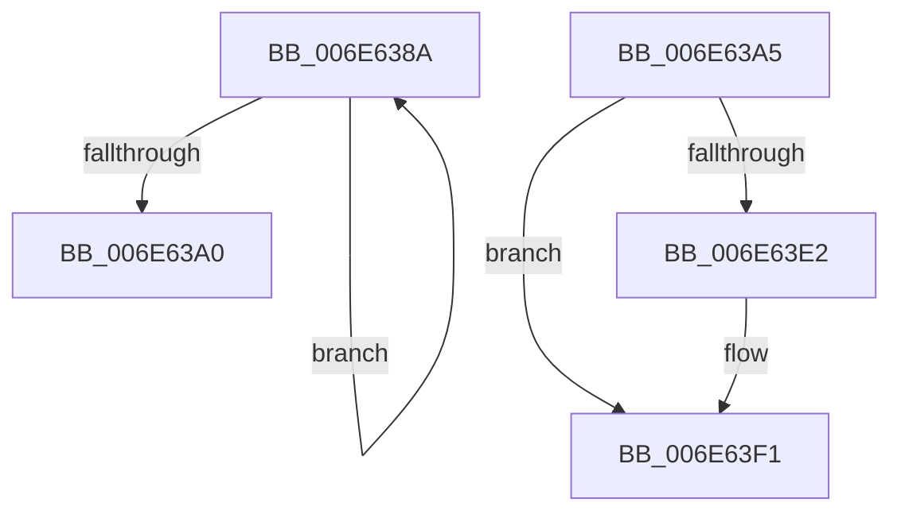

# sub_006E638A

- RVA: `0x006E638A`–`0x006E6412` (길이 `136` bytes)
- VA: `0x00000001406E638A`
- 실행 섹션: `.text`
- PDB 이름 있음: `아니요`; PDB Function 태그: `아니요`
- unwind 정보 RVA: `0x00082250`
- 디코드: `29`개 명령, `136/136` bytes 표시
- 미해석 바이트: `0` (있으면 어셈블리에 `.byte`로 보존)

> 이 문서는 커널 이미지의 기계어와 PDB 기호를 분석해 생성했습니다. 4번과 5번은 함수 원형과 자료형을 바이너리 사용 방식에서 추정한 C 해석이며 원본 소스 복구 결과는 아닙니다.

## 1. Dependencies

- 직접 호출 지점: **5**; 고유 호출 대상: **5**
- 직접 호출자로 확인된 함수: **0**
- RIP 상대 이미지 참조: **7**

### Outgoing calls
- `0x006E638F` → [KeYieldProcessorEx](../3F/KeYieldProcessorEx_function_003FBD00.md) (function, `0x003FBD00`)
- `0x006E63AA` → [KiSetForceIdleState](../48/KiSetForceIdleState_function_0048DCC0.md) (function, `0x0048DCC0`)
- `0x006E63B4` → [RtlGetInterruptTimePrecise](../20/RtlGetInterruptTimePrecise_function_0020A4C0.md) (function, `0x0020A4C0`)
- `0x006E63FD` → [KeInsertQueueDpc](../20/KeInsertQueueDpc_function_00207C50.md) (function, `0x00207C50`)
- `0x006E6407` → [PoTraceForceIdleReset](../5D/PoTraceForceIdleReset_function_005D5C5C.md) (function, `0x005D5C5C`)

### Direct callers
- 이 함수 시작 RVA로 연결되는 직접 call은 확인되지 않았습니다. 간접 호출은 완전히 역산할 수 없습니다.

### Static image references
- `0x006E6394` → RVA `0x00F23140` (`.data`; read)
- `0x006E63B9` → RVA `0x00FC51BC` (`ALMOSTRO`; read)
- `0x006E63C6` → RVA `0x00F21FB0` (`.data`; read)
- `0x006E63CF` → RVA `0x00F23148` (`.data`; write)
- `0x006E63D6` → RVA `0x00F23418` (`.data`; read)
- `0x006E63EA` → RVA `0x00F233E2` (`.data`; write)
- `0x006E63F4` → RVA `0x00F233E0` (`.data`; read)

## 2. Other-region calls and transfers

- 다른 실행 섹션으로 향하는 call: **0**
- call이 아닌 외부 분기/꼬리 이동: **2**
  - `0x006E63A0` → [sub_003A385F + 0x17](../3A/Unknown_function_003A385F.md) (`tail-transfer`)
  - `0x006E640D` → [sub_003A385F + 0x34](../3A/Unknown_function_003A385F.md) (`tail-transfer`)

## 3. Assembly (complete function range)

```asm
006E638A  48 8D 4C 24 30                  lea rcx, [rsp + 0x30]
006E638F  E8 6C 59 D1 FF                  call 0x1403fbd00
006E6394  48 8B 05 A5 CD 83 00            mov rax, qword ptr [rip + 0x83cda5]
006E639B  48 85 C0                        test rax, rax
006E639E  75 EA                           jne 0x1406e638a
006E63A0  E9 D1 D4 CB FF                  jmp 0x1403a3876
006E63A5  B9 03 00 00 00                  mov ecx, 3
006E63AA  E8 11 79 DA FF                  call 0x14048dcc0
006E63AF  48 8D 4C 24 38                  lea rcx, [rsp + 0x38]
006E63B4  E8 07 41 B2 FF                  call 0x14020a4c0
006E63B9  8B 0D FD ED 8D 00               mov ecx, dword ptr [rip + 0x8dedfd]
006E63BF  48 69 D1 80 96 98 00            imul rdx, rcx, 0x989680
006E63C6  8B 0D E4 BB 83 00               mov ecx, dword ptr [rip + 0x83bbe4]
006E63CC  48 03 C2                        add rax, rdx
006E63CF  48 89 05 72 CD 83 00            mov qword ptr [rip + 0x83cd72], rax
006E63D6  48 8B 05 3B D0 83 00            mov rax, qword ptr [rip + 0x83d03b]
006E63DD  48 85 C0                        test rax, rax
006E63E0  75 0F                           jne 0x1406e63f1
006E63E2  B8 00 08 00 00                  mov eax, 0x800
006E63E7  66 03 C8                        add cx, ax
006E63EA  66 89 0D F1 CF 83 00            mov word ptr [rip + 0x83cff1], cx
006E63F1  45 33 C0                        xor r8d, r8d
006E63F4  48 8D 0D E5 CF 83 00            lea rcx, [rip + 0x83cfe5]
006E63FB  33 D2                           xor edx, edx
006E63FD  E8 4E 18 B2 FF                  call 0x140207c50
006E6402  B9 01 00 00 00                  mov ecx, 1
006E6407  E8 50 F8 EE FF                  call 0x1405d5c5c
006E640C  90                              nop
006E640D  E9 81 D4 CB FF                  jmp 0x1403a3893
```

## 4. C-style interpretation (structured pseudocode)

```c
__int64 __fastcall sub_006E638A(__int64 a1, __int64 a2, int a3, __int64 a4, __int64 a5, __int64 a6)
{
    __int64 result;
    unsigned __int64 v_stack_p38;

    result = KeYieldProcessorEx(a6, a2, a3, a4);
    if (*(unsigned __int64 *)(v_rip + 8637861) != 0) goto loc_006E638A;
}
```

## 5. (Beta) C Style

```c
int64_t sub_006E638A(int64_t Arg1, int64_t Arg2, int32_t Arg3, int64_t Arg4, uint64_t Arg5, int64_t Arg6)
{
    int64_t result;
    uint64_t v_stack_p38;

    result = KeYieldProcessorEx(Arg6, Arg2, Arg3, Arg4);
    if (*(uint64_t *)(v_rip + 0x83CDA5) != 0) goto loc_006E638A;
}
```

## 6. Execution-region graph

[열기: 2D/3D 그래프와 함수 탐색 컨트롤 패널](../../../control-panel.html?section=text&rva=0x006E638A&view=graph)

- 2D 그래프는 위에서 아래로 흐르고, 3D 그래프는 빈 공간을 드래그해 회전합니다. Shift+드래그는 이동, 휠은 확대·축소, 함수 노드 선택은 대상 보고서 이동입니다.

### Static fallback


