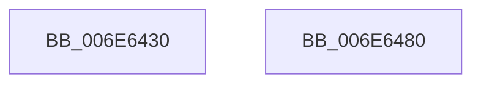

# sub_006E6430

- RVA: `0x006E6430`–`0x006E6497` (길이 `103` bytes)
- VA: `0x00000001406E6430`
- 실행 섹션: `.text`
- PDB 이름 있음: `아니요`; PDB Function 태그: `아니요`
- unwind 정보 RVA: `0x000822F4`
- 디코드: `24`개 명령, `103/103` bytes 표시
- 미해석 바이트: `0` (있으면 어셈블리에 `.byte`로 보존)

> 이 문서는 커널 이미지의 기계어와 PDB 기호를 분석해 생성했습니다. 4번과 5번은 함수 원형과 자료형을 바이너리 사용 방식에서 추정한 C 해석이며 원본 소스 복구 결과는 아닙니다.

## 1. Dependencies

- 직접 호출 지점: **1**; 고유 호출 대상: **1**
- 직접 호출자로 확인된 함수: **0**
- RIP 상대 이미지 참조: **0**

### Outgoing calls
- `0x006E6474` → [KiCustomAccessRoutine1](../6B/KiCustomAccessRoutine1_function_006BC040.md) (function, `0x006BC040`)

### Direct callers
- 이 함수 시작 RVA로 연결되는 직접 call은 확인되지 않았습니다. 간접 호출은 완전히 역산할 수 없습니다.

### Static image references
- 디코드된 RIP-relative 메모리 참조가 없습니다.

## 2. Other-region calls and transfers

- 다른 실행 섹션으로 향하는 call: **0**
- call이 아닌 외부 분기/꼬리 이동: **2**
  - `0x006E647B` → [IopTimerDispatch + 0x87](../3A/IopTimerDispatch_function_003A3900.md) (`tail-transfer`)
  - `0x006E6492` → [IopTimerDispatch + 0x87](../3A/IopTimerDispatch_function_003A3900.md) (`tail-transfer`)

## 3. Assembly (complete function range)

```asm
006E6430  89 7C 24 30                     mov dword ptr [rsp + 0x30], edi
006E6434  40 88 3E                        mov byte ptr [rsi], dil
006E6437  49 8B C4                        mov rax, r12
006E643A  48 C1 E8 08                     shr rax, 8
006E643E  48 89 46 20                     mov qword ptr [rsi + 0x20], rax
006E6442  4C 89 BC 24 82 01 00 00         mov qword ptr [rsp + 0x182], r15
006E644A  41 8B CF                        mov ecx, r15d
006E644D  48 8B C3                        mov rax, rbx
006E6450  48 D3 C0                        rol rax, cl
006E6453  48 89 84 24 3A 01 00 00         mov qword ptr [rsp + 0x13a], rax
006E645B  48 8B C6                        mov rax, rsi
006E645E  48 D3 C8                        ror rax, cl
006E6461  48 89 84 24 72 01 00 00         mov qword ptr [rsp + 0x172], rax
006E6469  4C 31 66 28                     xor qword ptr [rsi + 0x28], r12
006E646D  4C 31 7E 30                     xor qword ptr [rsi + 0x30], r15
006E6471  48 8B CB                        mov rcx, rbx
006E6474  E8 C7 5B FD FF                  call 0x1406bc040
006E6479  90                              nop
006E647A  90                              nop
006E647B  E9 07 D5 CB FF                  jmp 0x1403a3987
006E6480  33 FF                           xor edi, edi
006E6482  48 8B 9C 24 20 01 00 00         mov rbx, qword ptr [rsp + 0x120]
006E648A  44 8B B4 24 84 00 00 00         mov r14d, dword ptr [rsp + 0x84]
006E6492  E9 F0 D4 CB FF                  jmp 0x1403a3987
```

## 4. C-style interpretation (structured pseudocode)

```c
__int64 __fastcall sub_006E6430(void)
{
    __int64 result;
    unsigned __int64 v_stack_p120;
    unsigned __int64 v_stack_p13A;
    unsigned __int64 v_stack_p172;
    unsigned __int64 v_stack_p182;
    unsigned int v_stack_p30;
    unsigned int v_stack_p84;

    v_stack_p30 = (unsigned int)(v_rdi);
    *(unsigned __int8 *)(v_rsi) = (unsigned __int8)(v_rdi);
    result = (v_r12) >> (8);
    *(unsigned __int64 *)(v_rsi + 32) = result;
    v_stack_p182 = v_r15;
    v_stack_p13A = v_rbx;
    v_stack_p172 = v_rsi;
    result = KiCustomAccessRoutine1(v_rbx, a2, a3, a4);
}
```

## 5. (Beta) C Style

```c
void sub_006E6430(void)
{
    int64_t result;
    uint64_t v_stack_p120;
    uint64_t v_stack_p13A;
    uint64_t v_stack_p172;
    uint64_t v_stack_p182;
    uint32_t v_stack_p30;
    uint32_t v_stack_p84;

    v_stack_p30 = (uint32_t)(local_rdi);
    *(uint8_t *)(local_rsi) = (uint8_t)(local_rdi);
    result = (local_r12) >> (8);
    *(uint64_t *)(local_rsi + 0x20) = result;
    v_stack_p182 = local_r15;
    v_stack_p13A = local_rbx;
    v_stack_p172 = local_rsi;
    result = KiCustomAccessRoutine1(local_rbx, a2, a3, a4);
}
```

## 6. Execution-region graph

[열기: 2D/3D 그래프와 함수 탐색 컨트롤 패널](../../../control-panel.html?section=text&rva=0x006E6430&view=graph)

- 2D 그래프는 위에서 아래로 흐르고, 3D 그래프는 빈 공간을 드래그해 회전합니다. Shift+드래그는 이동, 휠은 확대·축소, 함수 노드 선택은 대상 보고서 이동입니다.

### Static fallback


