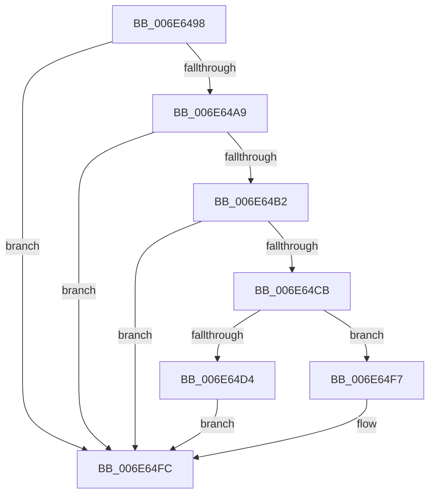

# sub_006E6498

- RVA: `0x006E6498`–`0x006E650A` (길이 `114` bytes)
- VA: `0x00000001406E6498`
- 실행 섹션: `.text`
- PDB 이름 있음: `아니요`; PDB Function 태그: `아니요`
- unwind 정보 RVA: `0x000823B8`
- 디코드: `23`개 명령, `114/114` bytes 표시
- 미해석 바이트: `0` (있으면 어셈블리에 `.byte`로 보존)

> 이 문서는 커널 이미지의 기계어와 PDB 기호를 분석해 생성했습니다. 4번과 5번은 함수 원형과 자료형을 바이너리 사용 방식에서 추정한 C 해석이며 원본 소스 복구 결과는 아닙니다.

## 1. Dependencies

- 직접 호출 지점: **1**; 고유 호출 대상: **1**
- 직접 호출자로 확인된 함수: **0**
- RIP 상대 이미지 참조: **1**

### Outgoing calls
- `0x006E64F7` → [KiSetUserTbFlushPending](../6B/KiSetUserTbFlushPending_function_006B20C0.md) (function, `0x006B20C0`)

### Direct callers
- 이 함수 시작 RVA로 연결되는 직접 call은 확인되지 않았습니다. 간접 호출은 완전히 역산할 수 없습니다.

### Static image references
- `0x006E64A9` → RVA `0x00FC6A87` (`ALMOSTRO`; read)

## 2. Other-region calls and transfers

- 다른 실행 섹션으로 향하는 call: **0**
- call이 아닌 외부 분기/꼬리 이동: **1**
  - `0x006E6505` → [sub_003A3B13 + 0x29B](../3A/Unknown_function_003A3B13.md) (`tail-transfer`)

## 3. Assembly (complete function range)

```asm
006E6498  48 C1 F8 07                     sar rax, 7
006E649C  48 8B 28                        mov rbp, qword ptr [rax]
006E649F  8B 40 08                        mov eax, dword ptr [rax + 8]
006E64A2  FF C8                           dec eax
006E64A4  83 F8 01                        cmp eax, 1
006E64A7  77 53                           ja 0x1406e64fc
006E64A9  80 3D D7 05 8E 00 00            cmp byte ptr [rip + 0x8e05d7], 0
006E64B0  74 4A                           je 0x1406e64fc
006E64B2  65 48 8B 04 25 88 01 00 00      mov rax, qword ptr gs:[0x188]
006E64BB  48 8B 88 B8 00 00 00            mov rcx, qword ptr [rax + 0xb8]
006E64C2  80 B9 60 01 00 00 00            cmp byte ptr [rcx + 0x160], 0
006E64C9  75 31                           jne 0x1406e64fc
006E64CB  F6 05 B5 05 8E 00 02            test byte ptr [rip + 0x8e05b5], 2
006E64D2  74 23                           je 0x1406e64f7
006E64D4  48 C7 84 24 88 00 00 00 01 00 00 00  mov qword ptr [rsp + 0x88], 1
006E64E0  48 89 AC 24 90 00 00 00         mov qword ptr [rsp + 0x90], rbp
006E64E8  41 8B C4                        mov eax, r12d
006E64EB  66 0F 38 82 84 24 88 00 00 00   invpcid rax, xmmword ptr [rsp + 0x88]
006E64F5  EB 05                           jmp 0x1406e64fc
006E64F7  E8 C4 BB FC FF                  call 0x1406b20c0
006E64FC  0F 01 7D 00                     invlpg byte ptr [rbp]
006E6500  48 8B 6C 24 40                  mov rbp, qword ptr [rsp + 0x40]
006E6505  E9 A4 D8 CB FF                  jmp 0x1403a3dae
```

## 4. C-style interpretation (structured pseudocode)

```c
__int64 __fastcall sub_006E6498(__int64 a1, __int64 a2, __int64 a3, __int64 a4, __int64 a5, __int64 a6, __int64 a7, __int64 a8, __int64 a9, __int64 a10, __int64 a11, __int64 a12, __int64 a13, __int64 a14, __int64 a15, __int64 a16, __int64 a17)
{
    __int64 result;
    unsigned __int64 v_stack_p88;
    unsigned __int64 v_stack_p90;

    result = (result) >> (7);
    result = (unsigned int)(((unsigned int)(*(unsigned int *)(result + 8))) - 1);
    if (((unsigned int)(result)) > 1) goto loc_006E64FC;
    if ((*(unsigned __int8 *)(v_rip + 9307607)) == 0) goto loc_006E64FC;
    if ((*(unsigned __int8 *)(*(unsigned __int64 *)(*(unsigned __int64 *)(gs_base + (0 + 392)) + 184) + 352)) != 0) goto loc_006E64FC;
    if (((*(unsigned __int8 *)(v_rip + 9307573)) & (2)) == 0) goto loc_006E64F7;
    v_stack_p88 = 1;
    v_stack_p90 = *(unsigned __int64 *)(result);
    goto loc_006E64FC;
loc_006E64F7:
    result = KiSetUserTbFlushPending(*(unsigned __int64 *)(*(unsigned __int64 *)(gs_base + (0 + 392)) + 184), a2, a3, a4);
loc_006E64FC:
}
```

## 5. (Beta) C Style

```c
int64_t sub_006E6498(int64_t Arg1, int64_t Arg2, int64_t Arg3, int64_t Arg4, uint64_t Arg5, uint64_t Arg6, uint64_t Arg7, int64_t Arg8, uint64_t Arg9, uint64_t Arg10, uint64_t Arg11, uint64_t Arg12, uint64_t Arg13, uint64_t Arg14, uint64_t Arg15, uint64_t Arg16, int64_t Arg17)
{
    int64_t result;
    uint64_t v_stack_p88;
    uint64_t v_stack_p90;

    result = (result) >> (7);
    result = (uint32_t)(((uint32_t)(*(uint32_t *)(result + 0x8))) - 1);
    if (((uint32_t)(result)) > 1) goto loc_006E64FC;
    if ((*(uint8_t *)(v_rip + 0x8E05D7)) == 0) goto loc_006E64FC;
    if ((*(uint8_t *)(*(uint64_t *)(*(uint64_t *)(gs_base + (0 + 0x188)) + 0xB8) + 0x160)) != 0) goto loc_006E64FC;
    if (((*(uint8_t *)(v_rip + 0x8E05B5)) & (2)) == 0) goto loc_006E64F7;
    v_stack_p88 = 1;
    v_stack_p90 = *(uint64_t *)(result);
    goto loc_006E64FC;
loc_006E64F7:
    result = KiSetUserTbFlushPending(*(uint64_t *)(*(uint64_t *)(gs_base + (0 + 0x188)) + 0xB8), Arg2, Arg3, Arg4);
loc_006E64FC:
}
```

## 6. Execution-region graph

[열기: 2D/3D 그래프와 함수 탐색 컨트롤 패널](../../../control-panel.html?section=text&rva=0x006E6498&view=graph)

- 2D 그래프는 위에서 아래로 흐르고, 3D 그래프는 빈 공간을 드래그해 회전합니다. Shift+드래그는 이동, 휠은 확대·축소, 함수 노드 선택은 대상 보고서 이동입니다.

### Static fallback


