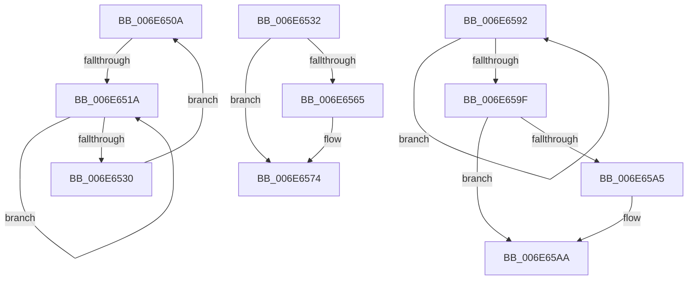

# sub_006E650A

- RVA: `0x006E650A`–`0x006E65B0` (길이 `166` bytes)
- VA: `0x00000001406E650A`
- 실행 섹션: `.text`
- PDB 이름 있음: `아니요`; PDB Function 태그: `아니요`
- unwind 정보 RVA: `0x00082410`
- 디코드: `38`개 명령, `166/166` bytes 표시
- 미해석 바이트: `0` (있으면 어셈블리에 `.byte`로 보존)

> 이 문서는 커널 이미지의 기계어와 PDB 기호를 분석해 생성했습니다. 4번과 5번은 함수 원형과 자료형을 바이너리 사용 방식에서 추정한 C 해석이며 원본 소스 복구 결과는 아닙니다.

## 1. Dependencies

- 직접 호출 지점: **5**; 고유 호출 대상: **5**
- 직접 호출자로 확인된 함수: **0**
- RIP 상대 이미지 참조: **8**

### Outgoing calls
- `0x006E651F` → [KeYieldProcessorEx](../3F/KeYieldProcessorEx_function_003FBD00.md) (function, `0x003FBD00`)
- `0x006E6537` → [RtlGetInterruptTimePrecise](../20/RtlGetInterruptTimePrecise_function_0020A4C0.md) (function, `0x0020A4C0`)
- `0x006E6580` → [KeInsertQueueDpc](../20/KeInsertQueueDpc_function_00207C50.md) (function, `0x00207C50`)
- `0x006E6587` → [PoTraceForceIdleReset](../5D/PoTraceForceIdleReset_function_005D5C5C.md) (function, `0x005D5C5C`)
- `0x006E65A5` → [KiRemoveSystemWorkPriorityKick](../26/KiRemoveSystemWorkPriorityKick_function_002631D0.md) (function, `0x002631D0`)

### Direct callers
- 이 함수 시작 RVA로 연결되는 직접 call은 확인되지 않았습니다. 간접 호출은 완전히 역산할 수 없습니다.

### Static image references
- `0x006E650A` → RVA `0x00F23140` (`.data`; read/write)
- `0x006E6524` → RVA `0x00F23140` (`.data`; read)
- `0x006E653C` → RVA `0x00FC51BC` (`ALMOSTRO`; read)
- `0x006E654C` → RVA `0x00F21FB0` (`.data`; read)
- `0x006E6552` → RVA `0x00F23148` (`.data`; write)
- `0x006E6559` → RVA `0x00F23418` (`.data`; read)
- `0x006E656D` → RVA `0x00F233E2` (`.data`; write)
- `0x006E6577` → RVA `0x00F233E0` (`.data`; read)

## 2. Other-region calls and transfers

- 다른 실행 섹션으로 향하는 call: **0**
- call이 아닌 외부 분기/꼬리 이동: **3**
  - `0x006E6514` → [KiResetForceIdle + 0x20](../3A/KiResetForceIdle_function_003A4160.md) (`tail-transfer`)
  - `0x006E658D` → [KiResetForceIdle + 0x29](../3A/KiResetForceIdle_function_003A4160.md) (`tail-transfer`)
  - `0x006E65AB` → [KiResetForceIdle + 0x2E](../3A/KiResetForceIdle_function_003A4160.md) (`tail-transfer`)

## 3. Assembly (complete function range)

```asm
006E650A  F0 48 0F BA 2D 2C CC 83 00 00   lock bts qword ptr [rip + 0x83cc2c], 0
006E6514  0F 83 66 DC CB FF               jae 0x1403a4180
006E651A  48 8D 4C 24 38                  lea rcx, [rsp + 0x38]
006E651F  E8 DC 57 D1 FF                  call 0x1403fbd00
006E6524  48 8B 05 15 CC 83 00            mov rax, qword ptr [rip + 0x83cc15]
006E652B  48 85 C0                        test rax, rax
006E652E  75 EA                           jne 0x1406e651a
006E6530  EB D8                           jmp 0x1406e650a
006E6532  48 8D 4C 24 40                  lea rcx, [rsp + 0x40]
006E6537  E8 84 3F B2 FF                  call 0x14020a4c0
006E653C  8B 0D 7A EC 8D 00               mov ecx, dword ptr [rip + 0x8dec7a]
006E6542  48 69 D1 80 96 98 00            imul rdx, rcx, 0x989680
006E6549  48 03 C2                        add rax, rdx
006E654C  8B 0D 5E BA 83 00               mov ecx, dword ptr [rip + 0x83ba5e]
006E6552  48 89 05 EF CB 83 00            mov qword ptr [rip + 0x83cbef], rax
006E6559  48 8B 05 B8 CE 83 00            mov rax, qword ptr [rip + 0x83ceb8]
006E6560  48 85 C0                        test rax, rax
006E6563  75 0F                           jne 0x1406e6574
006E6565  B8 00 08 00 00                  mov eax, 0x800
006E656A  66 03 C8                        add cx, ax
006E656D  66 89 0D 6E CE 83 00            mov word ptr [rip + 0x83ce6e], cx
006E6574  45 33 C0                        xor r8d, r8d
006E6577  48 8D 0D 62 CE 83 00            lea rcx, [rip + 0x83ce62]
006E657E  33 D2                           xor edx, edx
006E6580  E8 CB 16 B2 FF                  call 0x140207c50
006E6585  8B CE                           mov ecx, esi
006E6587  E8 D0 F6 EE FF                  call 0x1405d5c5c
006E658C  90                              nop
006E658D  E9 F7 DB CB FF                  jmp 0x1403a4189
006E6592  8B D0                           mov edx, eax
006E6594  0F BA F2 15                     btr edx, 0x15
006E6598  F0 41 0F B1 10                  lock cmpxchg dword ptr [r8], edx
006E659D  75 F3                           jne 0x1406e6592
006E659F  0F BA E0 15                     bt eax, 0x15
006E65A3  73 05                           jae 0x1406e65aa
006E65A5  E8 26 CC B7 FF                  call 0x1402631d0
006E65AA  FB                              sti
006E65AB  E9 DE DB CB FF                  jmp 0x1403a418e
```

## 4. C-style interpretation (structured pseudocode)

```c
__int64 __fastcall sub_006E650A(__int64 a1, __int64 a2, int a3, __int64 a4, __int64 a5, __int64 a6, __int64 a7)
{
    __int64 result;
    unsigned __int64 v_stack_p40;

loc_006E651A:
    result = KeYieldProcessorEx(a7, a2, a3, a4);
    if (*(unsigned __int64 *)(v_rip + 8637461) != 0) goto loc_006E651A;
    goto loc_006E650A;
}
```

## 5. (Beta) C Style

```c
int64_t sub_006E650A(int64_t Arg1, int64_t Arg2, int32_t Arg3, int64_t Arg4, uint64_t Arg5, uint64_t Arg6, int64_t Arg7)
{
    int64_t result;
    uint64_t v_stack_p40;

loc_006E651A:
    result = KeYieldProcessorEx(Arg7, Arg2, Arg3, Arg4);
    if (*(uint64_t *)(v_rip + 0x83CC15) != 0) goto loc_006E651A;
    goto loc_006E650A;
}
```

## 6. Execution-region graph

[열기: 2D/3D 그래프와 함수 탐색 컨트롤 패널](../../../control-panel.html?section=text&rva=0x006E650A&view=graph)

- 2D 그래프는 위에서 아래로 흐르고, 3D 그래프는 빈 공간을 드래그해 회전합니다. Shift+드래그는 이동, 휠은 확대·축소, 함수 노드 선택은 대상 보고서 이동입니다.

### Static fallback


