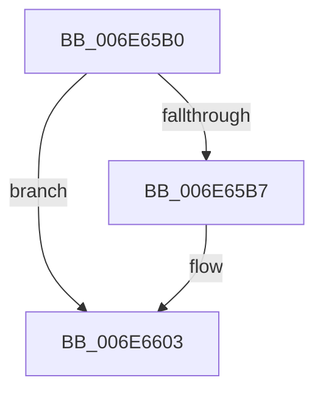

# sub_006E65B0

- RVA: `0x006E65B0`–`0x006E6613` (길이 `99` bytes)
- VA: `0x00000001406E65B0`
- 실행 섹션: `.text`
- PDB 이름 있음: `아니요`; PDB Function 태그: `아니요`
- unwind 정보 RVA: `0x00082494`
- 디코드: `30`개 명령, `99/99` bytes 표시
- 미해석 바이트: `0` (있으면 어셈블리에 `.byte`로 보존)

> 이 문서는 커널 이미지의 기계어와 PDB 기호를 분석해 생성했습니다. 4번과 5번은 함수 원형과 자료형을 바이너리 사용 방식에서 추정한 C 해석이며 원본 소스 복구 결과는 아닙니다.

## 1. Dependencies

- 직접 호출 지점: **4**; 고유 호출 대상: **4**
- 직접 호출자로 확인된 함수: **0**
- RIP 상대 이미지 참조: **0**

### Outgoing calls
- `0x006E65C1` → [ExAcquireSpinLockExclusive](../24/ExAcquireSpinLockExclusive_function_00248690.md) (function, `0x00248690`)
- `0x006E65F4` → [RtlSetBits](../3E/RtlSetBits_function_003E1610.md) (function, `0x003E1610`)
- `0x006E65FE` → [MiReleaseSpinLockExclusive](../24/MiReleaseSpinLockExclusive_function_002482C0.md) (function, `0x002482C0`)
- `0x006E6608` → [MiAttemptChangePagingFileMaximum](../67/MiAttemptChangePagingFileMaximum_function_0067FE7C.md) (function, `0x0067FE7C`)

### Direct callers
- 이 함수 시작 RVA로 연결되는 직접 call은 확인되지 않았습니다. 간접 호출은 완전히 역산할 수 없습니다.

### Static image references
- 디코드된 RIP-relative 메모리 참조가 없습니다.

## 2. Other-region calls and transfers

- 다른 실행 섹션으로 향하는 call: **0**
- call이 아닌 외부 분기/꼬리 이동: **1**
  - `0x006E660E` → [MiStoreContractVirtualPagefileApc + 0x1A5](../3A/MiStoreContractVirtualPagefileApc_function_003A4710.md) (`tail-transfer`)

## 3. Assembly (complete function range)

```asm
006E65B0  41 2B F2                        sub esi, r10d
006E65B3  3B F5                           cmp esi, ebp
006E65B5  73 4C                           jae 0x1406e6603
006E65B7  49 8D BE C8 00 00 00            lea rdi, [r14 + 0xc8]
006E65BE  48 8B CF                        mov rcx, rdi
006E65C1  E8 CA 20 B6 FF                  call 0x140248690
006E65C6  41 89 36                        mov dword ptr [r14], esi
006E65C9  8B D6                           mov edx, esi
006E65CB  41 8B 4E 0C                     mov ecx, dword ptr [r14 + 0xc]
006E65CF  8A D8                           mov bl, al
006E65D1  2B CD                           sub ecx, ebp
006E65D3  03 CE                           add ecx, esi
006E65D5  41 89 4E 0C                     mov dword ptr [r14 + 0xc], ecx
006E65D9  45 8B 4E 14                     mov r9d, dword ptr [r14 + 0x14]
006E65DD  44 2B CD                        sub r9d, ebp
006E65E0  2B EE                           sub ebp, esi
006E65E2  44 03 CE                        add r9d, esi
006E65E5  44 8B C5                        mov r8d, ebp
006E65E8  45 89 4E 14                     mov dword ptr [r14 + 0x14], r9d
006E65EC  49 8B 4E 50                     mov rcx, qword ptr [r14 + 0x50]
006E65F0  48 83 C1 08                     add rcx, 8
006E65F4  E8 17 B0 CF FF                  call 0x1403e1610
006E65F9  8A D3                           mov dl, bl
006E65FB  48 8B CF                        mov rcx, rdi
006E65FE  E8 BD 1C B6 FF                  call 0x1402482c0
006E6603  8B D6                           mov edx, esi
006E6605  49 8B CE                        mov rcx, r14
006E6608  E8 6F 98 F9 FF                  call 0x14067fe7c
006E660D  90                              nop
006E660E  E9 A2 E2 CB FF                  jmp 0x1403a48b5
```

## 4. C-style interpretation (structured pseudocode)

```c
__int64 __fastcall sub_006E65B0(void)
{
    __int64 result;
    __int64 v_rbp;
    __int64 v_rbx;
    __int64 v_rdi;
    __int64 v_rsi;

    v_rsi = (unsigned int)((v_rsi) - ((unsigned int)(v_r10)));
    if (((unsigned int)(v_rsi)) < ((unsigned int)(v_rbp))) {
        v_rdi = v_r14 + 200;
        a1 = v_rdi;
        result = ExAcquireSpinLockExclusive(a1, a2, a3, a4);
        *(unsigned int *)(v_r14) = (unsigned int)(v_rsi);
        a2 = (unsigned int)(v_rsi);
        a1 = *(unsigned int *)(v_r14 + 12);
        v_rbx = (unsigned __int8)(result);
        a1 = (unsigned int)((a1) - ((unsigned int)(v_rbp)));
        a1 = (unsigned int)((a1) + ((unsigned int)(v_rsi)));
        *(unsigned int *)(v_r14 + 12) = (unsigned int)(a1);
        a4 = *(unsigned int *)(v_r14 + 20);
        a4 = (unsigned int)((a4) - ((unsigned int)(v_rbp)));
        v_rbp = (unsigned int)((v_rbp) - ((unsigned int)(v_rsi)));
        a4 = (unsigned int)((a4) + ((unsigned int)(v_rsi)));
        a3 = (unsigned int)(v_rbp);
        *(unsigned int *)(v_r14 + 20) = (unsigned int)(a4);
        a1 = *(unsigned __int64 *)(v_r14 + 80);
        a1 = (a1) + (8);
        result = RtlSetBits(a1, a2, a3, a4);
        a2 = (unsigned __int8)(v_rbx);
        a1 = v_rdi;
        result = MiReleaseSpinLockExclusive(a1, a2, a3, a4);
    }
    result = MiAttemptChangePagingFileMaximum(v_r14, (unsigned int)((unsigned int)(v_rsi)), a3, a4);
}
```

## 5. (Beta) C Style

```c
void sub_006E65B0(void)
{
    int64_t result;
    int64_t local_rbp;
    int64_t local_rbx;
    int64_t local_rdi;
    int64_t local_rsi;

    local_rsi = (uint32_t)((local_rsi) - ((uint32_t)(local_r10)));
    if (((uint32_t)(local_rsi)) < ((uint32_t)(local_rbp))) {
        local_rdi = local_r14 + 200;
        a1 = local_rdi;
        result = ExAcquireSpinLockExclusive(a1, a2, a3, a4);
        *(uint32_t *)(local_r14) = (uint32_t)(local_rsi);
        a2 = (uint32_t)(local_rsi);
        a1 = *(uint32_t *)(local_r14 + 0xC);
        local_rbx = (uint8_t)(result);
        a1 = (uint32_t)((a1) - ((uint32_t)(local_rbp)));
        a1 = (uint32_t)((a1) + ((uint32_t)(local_rsi)));
        *(uint32_t *)(local_r14 + 0xC) = (uint32_t)(a1);
        a4 = *(uint32_t *)(local_r14 + 0x14);
        a4 = (uint32_t)((a4) - ((uint32_t)(local_rbp)));
        local_rbp = (uint32_t)((local_rbp) - ((uint32_t)(local_rsi)));
        a4 = (uint32_t)((a4) + ((uint32_t)(local_rsi)));
        a3 = (uint32_t)(local_rbp);
        *(uint32_t *)(local_r14 + 0x14) = (uint32_t)(a4);
        a1 = *(uint64_t *)(local_r14 + 0x50);
        a1 = (a1) + (8);
        result = RtlSetBits(a1, a2, a3, a4);
        a2 = (uint8_t)(local_rbx);
        a1 = local_rdi;
        result = MiReleaseSpinLockExclusive(a1, a2, a3, a4);
    }
    result = MiAttemptChangePagingFileMaximum(local_r14, (uint32_t)((uint32_t)(local_rsi)), a3, a4);
}
```

## 6. Execution-region graph

[열기: 2D/3D 그래프와 함수 탐색 컨트롤 패널](../../../control-panel.html?section=text&rva=0x006E65B0&view=graph)

- 2D 그래프는 위에서 아래로 흐르고, 3D 그래프는 빈 공간을 드래그해 회전합니다. Shift+드래그는 이동, 휠은 확대·축소, 함수 노드 선택은 대상 보고서 이동입니다.

### Static fallback


