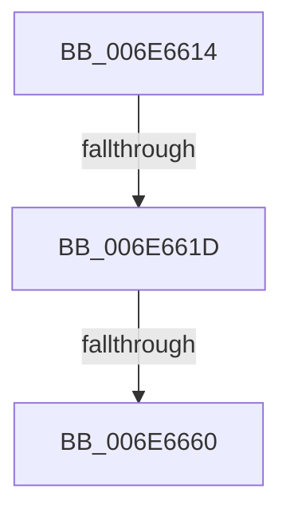

# sub_006E6614

- RVA: `0x006E6614`–`0x006E6667` (길이 `83` bytes)
- VA: `0x00000001406E6614`
- 실행 섹션: `.text`
- PDB 이름 있음: `아니요`; PDB Function 태그: `아니요`
- unwind 정보 RVA: `0x000899B4`
- 디코드: `23`개 명령, `83/83` bytes 표시
- 미해석 바이트: `0` (있으면 어셈블리에 `.byte`로 보존)

> 이 문서는 커널 이미지의 기계어와 PDB 기호를 분석해 생성했습니다. 4번과 5번은 함수 원형과 자료형을 바이너리 사용 방식에서 추정한 C 해석이며 원본 소스 복구 결과는 아닙니다.

## 1. Dependencies

- 직접 호출 지점: **3**; 고유 호출 대상: **1**
- 직접 호출자로 확인된 함수: **0**
- RIP 상대 이미지 참조: **0**

### Outgoing calls
- `0x006E6635` → [crc32](../46/crc32_function_00468F58.md) (function, `0x00468F58`)
- `0x006E6646` → [crc32](../46/crc32_function_00468F58.md) (function, `0x00468F58`)
- `0x006E6653` → [crc32](../46/crc32_function_00468F58.md) (function, `0x00468F58`)

### Direct callers
- 이 함수 시작 RVA로 연결되는 직접 call은 확인되지 않았습니다. 간접 호출은 완전히 역산할 수 없습니다.

### Static image references
- 디코드된 RIP-relative 메모리 참조가 없습니다.

## 2. Other-region calls and transfers

- 다른 실행 섹션으로 향하는 call: **0**
- call이 아닌 외부 분기/꼬리 이동: **3**
  - `0x006E6617` → [SmDecompressBuffer + 0x1B0](../3A/SmDecompressBuffer_function_003A4978.md) (`tail-transfer`)
  - `0x006E665A` → [SmDecompressBuffer + 0x1B0](../3A/SmDecompressBuffer_function_003A4978.md) (`tail-transfer`)
  - `0x006E6662` → [SmDecompressBuffer + 0x60](../3A/SmDecompressBuffer_function_003A4978.md) (`tail-transfer`)

## 3. Assembly (complete function range)

```asm
006E6614  83 FE 04                        cmp esi, 4
006E6617  0F 82 0B E5 CB FF               jb 0x1403a4b28
006E661D  33 C0                           xor eax, eax
006E661F  49 8D 5E 08                     lea rbx, [r14 + 8]
006E6623  44 8B C2                        mov r8d, edx
006E6626  89 45 EC                        mov dword ptr [rbp - 0x14], eax
006E6629  49 8B D4                        mov rdx, r12
006E662C  4C 8D 73 04                     lea r14, [rbx + 4]
006E6630  33 C9                           xor ecx, ecx
006E6632  83 C6 FC                        add esi, -4
006E6635  E8 1E 29 D8 FF                  call 0x140468f58
006E663A  8B C8                           mov ecx, eax
006E663C  48 8D 55 EC                     lea rdx, [rbp - 0x14]
006E6640  41 B8 04 00 00 00               mov r8d, 4
006E6646  E8 0D 29 D8 FF                  call 0x140468f58
006E664B  8B C8                           mov ecx, eax
006E664D  44 8B C6                        mov r8d, esi
006E6650  49 8B D6                        mov rdx, r14
006E6653  E8 00 29 D8 FF                  call 0x140468f58
006E6658  3B 03                           cmp eax, dword ptr [rbx]
006E665A  0F 85 C8 E4 CB FF               jne 0x1403a4b28
006E6660  33 DB                           xor ebx, ebx
006E6662  E9 71 E3 CB FF                  jmp 0x1403a49d8
```

## 4. C-style interpretation (structured pseudocode)

```c
__int64 __fastcall sub_006E6614(int a1, int a2)
{
    __int64 result;
    __int64 v_rbx;
    __int64 v_rsi;

    result = 0;
    *(unsigned int *)(v_rbp - 20) = 0;
    a1 = 0;
    v_rsi = (unsigned int)((v_rsi) + (-4));
    result = crc32(a1, v_r12, (unsigned int)(a2), a4);
    result = crc32((unsigned int)((unsigned int)(result)), v_rbp - 20, 4, a4);
    result = crc32((unsigned int)((unsigned int)(result)), v_r14 + 8 + 4, (unsigned int)((unsigned int)(v_rsi)), a4);
    v_rbx = 0;
}
```

## 5. (Beta) C Style

```c
int64_t sub_006E6614(int32_t Arg1, int32_t Arg2)
{
    int64_t result;
    int64_t local_rbx;
    int64_t local_rsi;

    result = 0;
    *(uint32_t *)(local_rbp - 0x14) = 0;
    Arg1 = 0;
    local_rsi = (uint32_t)((local_rsi) + (-4));
    result = crc32(Arg1, local_r12, (uint32_t)(Arg2), a4);
    result = crc32((uint32_t)((uint32_t)(result)), local_rbp - 20, 4, a4);
    result = crc32((uint32_t)((uint32_t)(result)), local_r14 + 8 + 4, (uint32_t)((uint32_t)(local_rsi)), a4);
    local_rbx = 0;
}
```

## 6. Execution-region graph

[열기: 2D/3D 그래프와 함수 탐색 컨트롤 패널](../../../control-panel.html?section=text&rva=0x006E6614&view=graph)

- 2D 그래프는 위에서 아래로 흐르고, 3D 그래프는 빈 공간을 드래그해 회전합니다. Shift+드래그는 이동, 휠은 확대·축소, 함수 노드 선택은 대상 보고서 이동입니다.

### Static fallback


