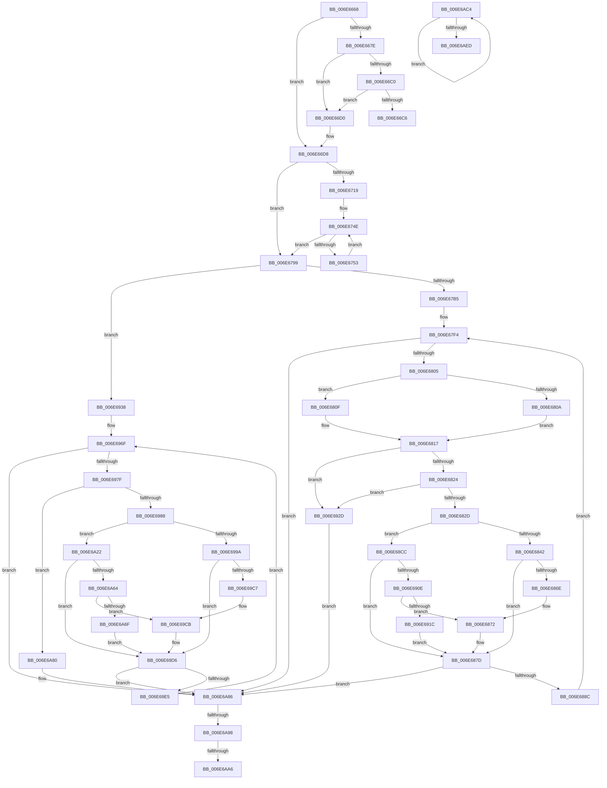

# sub_006E6668

- RVA: `0x006E6668`–`0x006E6B00` (길이 `1,176` bytes)
- VA: `0x00000001406E6668`
- 실행 섹션: `.text`
- PDB 이름 있음: `아니요`; PDB Function 태그: `아니요`
- unwind 정보 RVA: `0x00089A04`
- 디코드: `249`개 명령, `1,176/1,176` bytes 표시
- 미해석 바이트: `0` (있으면 어셈블리에 `.byte`로 보존)

> 이 문서는 커널 이미지의 기계어와 PDB 기호를 분석해 생성했습니다. 4번과 5번은 함수 원형과 자료형을 바이너리 사용 방식에서 추정한 C 해석이며 원본 소스 복구 결과는 아닙니다.

## 1. Dependencies

- 직접 호출 지점: **7**; 고유 호출 대상: **5**
- 직접 호출자로 확인된 함수: **0**
- RIP 상대 이미지 참조: **1**

### Outgoing calls
- `0x006E66B1` → [SmHwAcceleratorPartitionMgrGetDescriptor](../26/SmHwAcceleratorPartitionMgrGetDescriptor_function_0026A190.md) (function, `0x0026A190`)
- `0x006E6859` → [SmHwAcceleratorIssueRequest](../61/SmHwAcceleratorIssueRequest_function_006114C0.md) (function, `0x006114C0`)
- `0x006E68F5` → [RtlDecompressBufferEx](../3A/RtlDecompressBufferEx_function_003A4C60.md) (function, `0x003A4C60`)
- `0x006E69B2` → [SmHwAcceleratorIssueRequest](../61/SmHwAcceleratorIssueRequest_function_006114C0.md) (function, `0x006114C0`)
- `0x006E6A4B` → [RtlDecompressBufferEx](../3A/RtlDecompressBufferEx_function_003A4C60.md) (function, `0x003A4C60`)
- `0x006E6AE0` → [SmHwAcceleratorWaitForRequest](../61/SmHwAcceleratorWaitForRequest_function_00611A7C.md) (function, `0x00611A7C`)
- `0x006E6AF5` → [SmHwAcceleratorPartitionMgrFreeDescriptor](../4D/SmHwAcceleratorPartitionMgrFreeDescriptor_function_004D7918.md) (function, `0x004D7918`)

### Direct callers
- 이 함수 시작 RVA로 연결되는 직접 call은 확인되지 않았습니다. 간접 호출은 완전히 역산할 수 없습니다.

### Static image references
- `0x006E67F4` → RVA `0x00011C18` (`.rdata`; read)

## 2. Other-region calls and transfers

- 다른 실행 섹션으로 향하는 call: **0**
- call이 아닌 외부 분기/꼬리 이동: **5**
  - `0x006E66CB` → [SmStoreDecompressBuffer + 0xB1](../3A/SmStoreDecompressBuffer_function_003A4B6C.md) (`tail-transfer`)
  - `0x006E6A92` → [SmStoreDecompressBuffer + 0xB1](../3A/SmStoreDecompressBuffer_function_003A4B6C.md) (`tail-transfer`)
  - `0x006E6AA0` → [SmStoreDecompressBuffer + 0xB1](../3A/SmStoreDecompressBuffer_function_003A4B6C.md) (`tail-transfer`)
  - `0x006E6ABF` → [SmStoreDecompressBuffer + 0xB1](../3A/SmStoreDecompressBuffer_function_003A4B6C.md) (`tail-transfer`)
  - `0x006E6AFB` → [SmStoreDecompressBuffer + 0xB8](../3A/SmStoreDecompressBuffer_function_003A4B6C.md) (`tail-transfer`)

## 3. Assembly (complete function range)

```asm
006E6668  48 8B 84 24 30 01 00 00         mov rax, qword ptr [rsp + 0x130]
006E6670  48 8B 00                        mov rax, qword ptr [rax]
006E6673  BE 01 00 00 00                  mov esi, 1
006E6678  48 83 F8 02                     cmp rax, 2
006E667C  74 5A                           je 0x1406e66d8
006E667E  8D 7E 02                        lea edi, [rsi + 2]
006E6681  48 3B C6                        cmp rax, rsi
006E6684  0F 45 FE                        cmovne edi, esi
006E6687  65 48 8B 04 25 20 00 00 00      mov rax, qword ptr gs:[0x20]
006E6690  48 8B 88 C0 00 00 00            mov rcx, qword ptr [rax + 0xc0]
006E6697  44 0F B7 81 8A 00 00 00         movzx r8d, word ptr [rcx + 0x8a]
006E669F  8B D7                           mov edx, edi
006E66A1  4C 8B 6C 24 58                  mov r13, qword ptr [rsp + 0x58]
006E66A6  4C 89 AC 24 90 00 00 00         mov qword ptr [rsp + 0x90], r13
006E66AE  49 8B CD                        mov rcx, r13
006E66B1  E8 DA 3A B8 FF                  call 0x14026a190
006E66B6  48 89 44 24 60                  mov qword ptr [rsp + 0x60], rax
006E66BB  48 85 C0                        test rax, rax
006E66BE  75 10                           jne 0x1406e66d0
006E66C0  40 F6 C7 02                     test dil, 2
006E66C4  74 0A                           je 0x1406e66d0
006E66C6  BF 94 01 00 C0                  mov edi, 0xc0000194
006E66CB  E9 4D E5 CB FF                  jmp 0x1403a4c1d
006E66D0  4C 8B 94 24 18 01 00 00         mov r10, qword ptr [rsp + 0x118]
006E66D8  B8 00 08 00 00                  mov eax, 0x800
006E66DD  41 BC 00 10 00 00               mov r12d, 0x1000
006E66E3  83 BC 24 80 00 00 00 02         cmp dword ptr [rsp + 0x80], 2
006E66EB  44 0F 44 E0                     cmove r12d, eax
006E66EF  44 89 64 24 78                  mov dword ptr [rsp + 0x78], r12d
006E66F4  4C 89 7C 24 68                  mov qword ptr [rsp + 0x68], r15
006E66F9  4C 8B 84 24 28 01 00 00         mov r8, qword ptr [rsp + 0x128]
006E6701  4C 89 84 24 A0 00 00 00         mov qword ptr [rsp + 0xa0], r8
006E6709  4C 89 44 24 70                  mov qword ptr [rsp + 0x70], r8
006E670E  48 39 5C 24 60                  cmp qword ptr [rsp + 0x60], rbx
006E6713  0F 84 80 00 00 00               je 0x1406e6799
006E6719  49 8B CA                        mov rcx, r10
006E671C  81 E1 FF 0F 00 00               and ecx, 0xfff
006E6722  49 8D 86 FF 0F 00 00            lea rax, [r14 + 0xfff]
006E6729  48 03 C8                        add rcx, rax
006E672C  49 8B C2                        mov rax, r10
006E672F  48 25 00 F0 FF FF               and rax, 0xfffffffffffff000
006E6735  48 89 84 24 A8 00 00 00         mov qword ptr [rsp + 0xa8], rax
006E673D  81 E1 00 F0 FF FF               and ecx, 0xfffff000
006E6743  48 03 C8                        add rcx, rax
006E6746  48 89 8C 24 B8 00 00 00         mov qword ptr [rsp + 0xb8], rcx
006E674E  48 3B C1                        cmp rax, rcx
006E6751  73 46                           jae 0x1406e6799
006E6753  8A 00                           mov al, byte ptr [rax]
006E6755  48 8B 84 24 A8 00 00 00         mov rax, qword ptr [rsp + 0xa8]
006E675D  48 05 00 10 00 00               add rax, 0x1000
006E6763  48 89 84 24 A8 00 00 00         mov qword ptr [rsp + 0xa8], rax
006E676B  48 8B 8C 24 B8 00 00 00         mov rcx, qword ptr [rsp + 0xb8]
006E6773  44 8B 64 24 78                  mov r12d, dword ptr [rsp + 0x78]
006E6778  4C 8B 44 24 70                  mov r8, qword ptr [rsp + 0x70]
006E677D  4C 89 84 24 A0 00 00 00         mov qword ptr [rsp + 0xa0], r8
006E6785  4C 8B 7C 24 68                  mov r15, qword ptr [rsp + 0x68]
006E678A  48 8B 54 24 58                  mov rdx, qword ptr [rsp + 0x58]
006E678F  48 89 94 24 90 00 00 00         mov qword ptr [rsp + 0x90], rdx
006E6797  EB B5                           jmp 0x1406e674e
006E6799  8B D3                           mov edx, ebx
006E679B  BF 02 01 00 C0                  mov edi, 0xc0000102
006E67A0  8B 8C 24 84 00 00 00            mov ecx, dword ptr [rsp + 0x84]
006E67A7  83 BC 24 80 00 00 00 02         cmp dword ptr [rsp + 0x80], 2
006E67AF  0F 85 83 01 00 00               jne 0x1406e6938
006E67B5  89 5C 24 48                     mov dword ptr [rsp + 0x48], ebx
006E67B9  48 89 9C 24 98 00 00 00         mov qword ptr [rsp + 0x98], rbx
006E67C1  89 5C 24 44                     mov dword ptr [rsp + 0x44], ebx
006E67C5  89 9C 24 88 00 00 00            mov dword ptr [rsp + 0x88], ebx
006E67CC  4D 8D 4A 02                     lea r9, [r10 + 2]
006E67D0  4C 89 8C 24 98 00 00 00         mov qword ptr [rsp + 0x98], r9
006E67D8  44 89 74 24 44                  mov dword ptr [rsp + 0x44], r14d
006E67DD  45 8D 6E FE                     lea r13d, [r14 - 2]
006E67E1  44 89 6C 24 44                  mov dword ptr [rsp + 0x44], r13d
006E67E6  89 5C 24 48                     mov dword ptr [rsp + 0x48], ebx
006E67EA  44 8B F3                        mov r14d, ebx
006E67ED  89 9C 24 88 00 00 00            mov dword ptr [rsp + 0x88], ebx
006E67F4  4C 8D 1D 1D B4 92 FF            lea r11, [rip - 0x6d4be3]
006E67FB  41 83 FE 02                     cmp r14d, 2
006E67FF  0F 83 81 02 00 00               jae 0x1406e6a86
006E6805  44 3B F6                        cmp r14d, esi
006E6808  75 05                           jne 0x1406e680f
006E680A  41 8B C5                        mov eax, r13d
006E680D  EB 08                           jmp 0x1406e6817
006E680F  41 8B C6                        mov eax, r14d
006E6812  41 0F B7 04 42                  movzx eax, word ptr [r10 + rax*2]
006E6817  89 44 24 40                     mov dword ptr [rsp + 0x40], eax
006E681B  45 85 ED                        test r13d, r13d
006E681E  0F 84 09 01 00 00               je 0x1406e692d
006E6824  41 3B C5                        cmp eax, r13d
006E6827  0F 87 00 01 00 00               ja 0x1406e692d
006E682D  89 9C 24 00 01 00 00            mov dword ptr [rsp + 0x100], ebx
006E6834  48 8B 4C 24 60                  mov rcx, qword ptr [rsp + 0x60]
006E6839  48 85 C9                        test rcx, rcx
006E683C  0F 84 8A 00 00 00               je 0x1406e68cc
006E6842  89 44 24 30                     mov dword ptr [rsp + 0x30], eax
006E6846  4C 89 4C 24 28                  mov qword ptr [rsp + 0x28], r9
006E684B  44 89 64 24 20                  mov dword ptr [rsp + 0x20], r12d
006E6850  4D 8B CF                        mov r9, r15
006E6853  44 8B C6                        mov r8d, esi
006E6856  41 8B D6                        mov edx, r14d
006E6859  E8 62 AC F2 FF                  call 0x1406114c0
006E685E  8B C8                           mov ecx, eax
006E6860  89 84 24 84 00 00 00            mov dword ptr [rsp + 0x84], eax
006E6867  44 8B C0                        mov r8d, eax
006E686A  85 C0                           test eax, eax
006E686C  78 0F                           js 0x1406e687d
006E686E  01 74 24 7C                     add dword ptr [rsp + 0x7c], esi
006E6872  41 8B C4                        mov eax, r12d
006E6875  4C 03 F8                        add r15, rax
006E6878  4C 89 7C 24 68                  mov qword ptr [rsp + 0x68], r15
006E687D  8B D1                           mov edx, ecx
006E687F  89 4C 24 48                     mov dword ptr [rsp + 0x48], ecx
006E6883  45 85 C0                        test r8d, r8d
006E6886  0F 88 FA 01 00 00               js 0x1406e6a86
006E688C  44 8B 44 24 40                  mov r8d, dword ptr [rsp + 0x40]
006E6891  4C 8B 8C 24 98 00 00 00         mov r9, qword ptr [rsp + 0x98]
006E6899  4D 03 C8                        add r9, r8
006E689C  4C 89 8C 24 98 00 00 00         mov qword ptr [rsp + 0x98], r9
006E68A4  45 2B E8                        sub r13d, r8d
006E68A7  44 89 6C 24 44                  mov dword ptr [rsp + 0x44], r13d
006E68AC  44 03 F6                        add r14d, esi
006E68AF  44 89 B4 24 88 00 00 00         mov dword ptr [rsp + 0x88], r14d
006E68B7  4C 8B 94 24 18 01 00 00         mov r10, qword ptr [rsp + 0x118]
006E68BF  4C 8B 84 24 A0 00 00 00         mov r8, qword ptr [rsp + 0xa0]
006E68C7  E9 28 FF FF FF                  jmp 0x1406e67f4
006E68CC  48 63 8C 24 80 00 00 00         movsxd rcx, dword ptr [rsp + 0x80]
006E68D4  4C 89 44 24 30                  mov qword ptr [rsp + 0x30], r8
006E68D9  48 8D 94 24 00 01 00 00         lea rdx, [rsp + 0x100]
006E68E1  48 89 54 24 28                  mov qword ptr [rsp + 0x28], rdx
006E68E6  89 44 24 20                     mov dword ptr [rsp + 0x20], eax
006E68EA  45 8B C4                        mov r8d, r12d
006E68ED  49 8B D7                        mov rdx, r15
006E68F0  41 0F B7 0C 4B                  movzx ecx, word ptr [r11 + rcx*2]
006E68F5  E8 66 E3 CB FF                  call 0x1403a4c60
006E68FA  8B C8                           mov ecx, eax
006E68FC  44 8B C0                        mov r8d, eax
006E68FF  89 84 24 84 00 00 00            mov dword ptr [rsp + 0x84], eax
006E6906  85 C0                           test eax, eax
006E6908  0F 88 6F FF FF FF               js 0x1406e687d
006E690E  44 39 A4 24 00 01 00 00         cmp dword ptr [rsp + 0x100], r12d
006E6916  0F 84 56 FF FF FF               je 0x1406e6872
006E691C  8B CF                           mov ecx, edi
006E691E  89 8C 24 84 00 00 00            mov dword ptr [rsp + 0x84], ecx
006E6925  44 8B C7                        mov r8d, edi
006E6928  E9 50 FF FF FF                  jmp 0x1406e687d
006E692D  8B D7                           mov edx, edi
006E692F  89 54 24 48                     mov dword ptr [rsp + 0x48], edx
006E6933  E9 4E 01 00 00                  jmp 0x1406e6a86
006E6938  89 5C 24 50                     mov dword ptr [rsp + 0x50], ebx
006E693C  48 89 9C 24 B0 00 00 00         mov qword ptr [rsp + 0xb0], rbx
006E6944  89 5C 24 4C                     mov dword ptr [rsp + 0x4c], ebx
006E6948  89 9C 24 8C 00 00 00            mov dword ptr [rsp + 0x8c], ebx
006E694F  4C 89 94 24 B0 00 00 00         mov qword ptr [rsp + 0xb0], r10
006E6957  44 89 74 24 4C                  mov dword ptr [rsp + 0x4c], r14d
006E695C  44 89 74 24 4C                  mov dword ptr [rsp + 0x4c], r14d
006E6961  89 5C 24 50                     mov dword ptr [rsp + 0x50], ebx
006E6965  44 8B EB                        mov r13d, ebx
006E6968  89 9C 24 8C 00 00 00            mov dword ptr [rsp + 0x8c], ebx
006E696F  48 8D 05 A2 B2 92 FF            lea rax, [rip - 0x6d4d5e]
006E6976  44 3B EE                        cmp r13d, esi
006E6979  0F 83 07 01 00 00               jae 0x1406e6a86
006E697F  45 85 F6                        test r14d, r14d
006E6982  0F 84 F8 00 00 00               je 0x1406e6a80
006E6988  89 5C 24 40                     mov dword ptr [rsp + 0x40], ebx
006E698C  48 8B 4C 24 60                  mov rcx, qword ptr [rsp + 0x60]
006E6991  48 85 C9                        test rcx, rcx
006E6994  0F 84 88 00 00 00               je 0x1406e6a22
006E699A  44 89 74 24 30                  mov dword ptr [rsp + 0x30], r14d
006E699F  4C 89 54 24 28                  mov qword ptr [rsp + 0x28], r10
006E69A4  44 89 64 24 20                  mov dword ptr [rsp + 0x20], r12d
006E69A9  4D 8B CF                        mov r9, r15
006E69AC  44 8B C6                        mov r8d, esi
006E69AF  41 8B D5                        mov edx, r13d
006E69B2  E8 09 AB F2 FF                  call 0x1406114c0
006E69B7  8B C8                           mov ecx, eax
006E69B9  89 84 24 84 00 00 00            mov dword ptr [rsp + 0x84], eax
006E69C0  44 8B C0                        mov r8d, eax
006E69C3  85 C0                           test eax, eax
006E69C5  78 0F                           js 0x1406e69d6
006E69C7  01 74 24 7C                     add dword ptr [rsp + 0x7c], esi
006E69CB  41 8B C4                        mov eax, r12d
006E69CE  4C 03 F8                        add r15, rax
006E69D1  4C 89 7C 24 68                  mov qword ptr [rsp + 0x68], r15
006E69D6  8B D1                           mov edx, ecx
006E69D8  89 4C 24 50                     mov dword ptr [rsp + 0x50], ecx
006E69DC  45 85 C0                        test r8d, r8d
006E69DF  0F 88 A1 00 00 00               js 0x1406e6a86
006E69E5  41 8B C6                        mov eax, r14d
006E69E8  4C 8B 94 24 18 01 00 00         mov r10, qword ptr [rsp + 0x118]
006E69F0  4C 03 D0                        add r10, rax
006E69F3  4C 89 94 24 18 01 00 00         mov qword ptr [rsp + 0x118], r10
006E69FB  4C 89 94 24 B0 00 00 00         mov qword ptr [rsp + 0xb0], r10
006E6A03  44 8B F3                        mov r14d, ebx
006E6A06  89 5C 24 4C                     mov dword ptr [rsp + 0x4c], ebx
006E6A0A  44 03 EE                        add r13d, esi
006E6A0D  44 89 AC 24 8C 00 00 00         mov dword ptr [rsp + 0x8c], r13d
006E6A15  4C 8B 84 24 A0 00 00 00         mov r8, qword ptr [rsp + 0xa0]
006E6A1D  E9 4D FF FF FF                  jmp 0x1406e696f
006E6A22  48 63 8C 24 80 00 00 00         movsxd rcx, dword ptr [rsp + 0x80]
006E6A2A  4C 89 44 24 30                  mov qword ptr [rsp + 0x30], r8
006E6A2F  48 8D 54 24 40                  lea rdx, [rsp + 0x40]
006E6A34  48 89 54 24 28                  mov qword ptr [rsp + 0x28], rdx
006E6A39  44 89 74 24 20                  mov dword ptr [rsp + 0x20], r14d
006E6A3E  4D 8B CA                        mov r9, r10
006E6A41  45 8B C4                        mov r8d, r12d
006E6A44  49 8B D7                        mov rdx, r15
006E6A47  0F B7 0C 48                     movzx ecx, word ptr [rax + rcx*2]
006E6A4B  E8 10 E2 CB FF                  call 0x1403a4c60
006E6A50  8B C8                           mov ecx, eax
006E6A52  44 8B C0                        mov r8d, eax
006E6A55  89 84 24 84 00 00 00            mov dword ptr [rsp + 0x84], eax
006E6A5C  85 C0                           test eax, eax
006E6A5E  0F 88 72 FF FF FF               js 0x1406e69d6
006E6A64  44 39 64 24 40                  cmp dword ptr [rsp + 0x40], r12d
006E6A69  0F 84 5C FF FF FF               je 0x1406e69cb
006E6A6F  8B CF                           mov ecx, edi
006E6A71  89 8C 24 84 00 00 00            mov dword ptr [rsp + 0x84], ecx
006E6A78  44 8B C7                        mov r8d, edi
006E6A7B  E9 56 FF FF FF                  jmp 0x1406e69d6
006E6A80  8B D7                           mov edx, edi
006E6A82  89 54 24 50                     mov dword ptr [rsp + 0x50], edx
006E6A86  8B FA                           mov edi, edx
006E6A88  4C 8B AC 24 90 00 00 00         mov r13, qword ptr [rsp + 0x90]
006E6A90  85 FF                           test edi, edi
006E6A92  0F 88 85 E1 CB FF               js 0x1403a4c1d
006E6A98  8B F9                           mov edi, ecx
006E6A9A  81 F9 03 01 00 00               cmp ecx, 0x103
006E6AA0  0F 85 77 E1 CB FF               jne 0x1403a4c1d
006E6AA6  48 8B 44 24 60                  mov rax, qword ptr [rsp + 0x60]
006E6AAB  48 8B 8C 24 30 01 00 00         mov rcx, qword ptr [rsp + 0x130]
006E6AB3  48 89 01                        mov qword ptr [rcx], rax
006E6AB6  48 89 5C 24 60                  mov qword ptr [rsp + 0x60], rbx
006E6ABB  89 5C 24 7C                     mov dword ptr [rsp + 0x7c], ebx
006E6ABF  E9 59 E1 CB FF                  jmp 0x1403a4c1d
006E6AC4  48 8D 84 24 00 01 00 00         lea rax, [rsp + 0x100]
006E6ACC  48 89 44 24 20                  mov qword ptr [rsp + 0x20], rax
006E6AD1  4C 8D 4C 24 40                  lea r9, [rsp + 0x40]
006E6AD6  45 33 C0                        xor r8d, r8d
006E6AD9  8B D3                           mov edx, ebx
006E6ADB  48 8B 4C 24 60                  mov rcx, qword ptr [rsp + 0x60]
006E6AE0  E8 97 AF F2 FF                  call 0x140611a7c
006E6AE5  03 DE                           add ebx, esi
006E6AE7  3B 5C 24 7C                     cmp ebx, dword ptr [rsp + 0x7c]
006E6AEB  72 D7                           jb 0x1406e6ac4
006E6AED  48 8B 54 24 60                  mov rdx, qword ptr [rsp + 0x60]
006E6AF2  49 8B CD                        mov rcx, r13
006E6AF5  E8 1E 0E DF FF                  call 0x1404d7918
006E6AFA  90                              nop
006E6AFB  E9 24 E1 CB FF                  jmp 0x1403a4c24
```

## 4. C-style interpretation (structured pseudocode)

```c
__int64 __fastcall sub_006E6668(__int64 a1, __int64 a2, __int64 a3, __int64 a4, __int64 a5, __int64 a6, __int64 a7, unsigned int a8, __int64 a9, __int64 a10, __int64 a11, __int64 a12, __int64 a13, __int64 a14, unsigned int a15, unsigned int a16, __int64 a17, __int64 a18, __int64 a19, __int64 a20, __int64 a21, __int64 a22, __int64 a23, __int64 a24, __int64 a25, __int64 a26, __int64 a27, __int64 a28, __int64 a29, __int64 a30, __int64 a31, unsigned int a32, __int64 a33, __int64 a34, __int64 a35, __int64 a36, __int64 a37, __int64 a38)
{
    __int64 result;
    __int64 v_r10;
    __int64 v_r12;
    __int64 v_r13;
    __int64 v_r14;
    __int64 v_r15;
    __int64 v_rdi;
    unsigned int v_stack_p100;
    unsigned __int64 v_stack_p118;
    unsigned int v_stack_p20;
    unsigned __int64 v_stack_p28;
    unsigned int v_stack_p30;
    unsigned int v_stack_p40;
    unsigned int v_stack_p44;
    unsigned int v_stack_p48;
    unsigned int v_stack_p4C;
    unsigned int v_stack_p50;
    unsigned __int64 v_stack_p60;
    unsigned __int64 v_stack_p68;
    unsigned __int64 v_stack_p70;
    unsigned int v_stack_p78;
    unsigned int v_stack_p7C;
    unsigned int v_stack_p84;
    unsigned int v_stack_p88;
    unsigned int v_stack_p8C;
    unsigned __int64 v_stack_p90;
    unsigned __int64 v_stack_p98;
    unsigned __int64 v_stack_pA0;
    unsigned __int64 v_stack_pA8;
    unsigned __int64 v_stack_pB0;
    unsigned __int64 v_stack_pB8;

    if ((*(unsigned __int64 *)(a38)) == 2) goto loc_006E66D8;
    v_rdi = 1 + 2;
    if ((*(unsigned __int64 *)(a38)) != 1) { v_rdi = 1; }
    v_stack_p90 = a11;
    result = SmHwAcceleratorPartitionMgrGetDescriptor(a11, (unsigned int)((unsigned int)(v_rdi)), *(unsigned __int16 *)(*(unsigned __int64 *)(*(unsigned __int64 *)(gs_base + (0 + 32)) + 192) + 138), a4);
    v_stack_p60 = result;
    if (result != 0) goto loc_006E66D0;
    if ((((unsigned __int8)(v_rdi)) & (2)) == 0) goto loc_006E66D0;
loc_006E66D0:
loc_006E66D8:
    v_r12 = (unsigned int)(0x1000ULL);
    if (a16 == 2) { v_r12 = (unsigned int)((unsigned int)(0x800ULL)); }
    v_stack_p78 = (unsigned int)(v_r12);
    v_stack_p68 = v_r15;
    v_stack_pA0 = a37;
    v_stack_p70 = a37;
    if (a12 == v_rbx) goto loc_006E6799;
    a1 = (unsigned int)((a35) & (0xFFFULL));
    a1 = (a1) + (v_r14 + 4095);
    result = (a35) & (0xFFFFFFFFFFFFF000ULL);
    v_stack_pA8 = result;
    a1 = (unsigned int)((a1) & (0xFFFFF000ULL));
    a1 = (a1) + (result);
    v_stack_pB8 = a1;
loc_006E674E:
    if (result >= a1) goto loc_006E6799;
    result = (a21) + (0x1000ULL);
    v_stack_pA8 = result;
    v_stack_pA0 = a14;
    v_stack_p90 = a11;
    goto loc_006E674E;
loc_006E6799:
    if (a16 != 2) goto loc_006E6938;
    v_stack_p48 = (unsigned int)(v_rbx);
    v_stack_p98 = v_rbx;
    v_stack_p44 = (unsigned int)(v_rbx);
    v_stack_p88 = (unsigned int)(v_rbx);
    v_stack_p98 = a35 + 2;
    v_stack_p44 = (unsigned int)(v_r14);
    v_stack_p44 = (unsigned int)(v_r14 - 2);
    v_stack_p48 = (unsigned int)(v_rbx);
    v_stack_p88 = (unsigned int)(v_rbx);
loc_006E67F4:
    if (((unsigned int)((unsigned int)((unsigned int)(v_rbx)))) >= 2) goto loc_006E6A86;
    if (((unsigned int)((unsigned int)((unsigned int)(v_rbx)))) != 1) goto loc_006E680F;
    goto loc_006E6817;
loc_006E680F:
loc_006E6817:
    v_stack_p40 = (unsigned int)(*(unsigned __int16 *)(a35 + (unsigned int)((unsigned int)((unsigned int)((unsigned int)(v_rbx)))) * 2));
    if ((unsigned int)(v_r14 - 2) == 0) goto loc_006E692D;
    if (((unsigned int)(*(unsigned __int16 *)(a35 + (unsigned int)((unsigned int)((unsigned int)((unsigned int)(v_rbx)))) * 2))) > ((unsigned int)(v_r14 - 2))) goto loc_006E692D;
    v_stack_p100 = (unsigned int)(v_rbx);
    if (a12 == 0) goto loc_006E68CC;
    v_stack_p30 = (unsigned int)(*(unsigned __int16 *)(a35 + (unsigned int)((unsigned int)((unsigned int)((unsigned int)(v_rbx)))) * 2));
    v_stack_p28 = a35 + 2;
    v_stack_p20 = (unsigned int)((unsigned int)(a15));
    result = SmHwAcceleratorIssueRequest(a12, (unsigned int)((unsigned int)((unsigned int)((unsigned int)(v_rbx)))), 1, a13);
    v_stack_p84 = (unsigned int)(result);
    if (sign_flag) goto loc_006E687D;
loc_006E6872:
    v_r15 = (a13) + ((unsigned int)((unsigned int)((unsigned int)(a15))));
    v_stack_p68 = v_r15;
loc_006E687D:
    v_stack_p48 = (unsigned int)((unsigned int)((unsigned int)(result)));
    if (sign_flag) goto loc_006E6A86;
    a4 = (a19) + ((unsigned int)(a8));
    v_stack_p98 = a4;
    v_r13 = (unsigned int)((v_r14 - 2) - ((unsigned int)((unsigned int)(a8))));
    v_stack_p44 = (unsigned int)(v_r13);
    v_r14 = (unsigned int)(((unsigned int)((unsigned int)(v_rbx))) + (1));
    v_stack_p88 = (unsigned int)(v_r14);
    goto loc_006E67F4;
loc_006E68CC:
    v_stack_p30 = a20;
    v_stack_p28 = a32;
    v_stack_p20 = (unsigned int)((unsigned int)((unsigned int)((unsigned int)(a15))));
    result = RtlDecompressBufferEx(*(unsigned __int16 *)(v_rip - 7162851 + (int)(a16) * 2), v_r15, (unsigned int)((unsigned int)((unsigned int)(a15))), a4);
    v_stack_p84 = (unsigned int)(result);
    if (sign_flag) goto loc_006E687D;
    if (a32 == ((unsigned int)((unsigned int)(a15)))) goto loc_006E6872;
    v_stack_p84 = (unsigned int)((unsigned int)((unsigned int)((unsigned int)(0xC0000102ULL))));
    goto loc_006E687D;
loc_006E692D:
    v_stack_p48 = (unsigned int)((unsigned int)((unsigned int)((unsigned int)(0xC0000102ULL))));
    goto loc_006E6A86;
loc_006E6938:
    v_stack_p50 = (unsigned int)(v_rbx);
    v_stack_pB0 = v_rbx;
    v_stack_p4C = (unsigned int)(v_rbx);
    v_stack_p8C = (unsigned int)(v_rbx);
    v_stack_pB0 = a35;
    v_stack_p4C = (unsigned int)(v_r14);
    v_stack_p4C = (unsigned int)(v_r14);
    v_stack_p50 = (unsigned int)(v_rbx);
    v_stack_p8C = (unsigned int)(v_rbx);
loc_006E696F:
    if (((unsigned int)((unsigned int)((unsigned int)(v_rbx)))) >= 1) goto loc_006E6A86;
    if ((unsigned int)(v_r14) == 0) goto loc_006E6A80;
    v_stack_p40 = (unsigned int)(v_rbx);
    if (a12 == 0) goto loc_006E6A22;
    v_stack_p30 = (unsigned int)(v_r14);
    v_stack_p28 = a35;
    v_stack_p20 = (unsigned int)((unsigned int)(a15));
    result = SmHwAcceleratorIssueRequest(a12, (unsigned int)((unsigned int)((unsigned int)((unsigned int)(v_rbx)))), 1, v_r15);
    v_stack_p84 = (unsigned int)(result);
    if (sign_flag) goto loc_006E69D6;
loc_006E69CB:
    v_r15 = (v_r15) + ((unsigned int)((unsigned int)((unsigned int)(a15))));
    v_stack_p68 = v_r15;
loc_006E69D6:
    v_stack_p50 = (unsigned int)((unsigned int)((unsigned int)(result)));
    if (sign_flag) goto loc_006E6A86;
    v_r10 = (a35) + ((unsigned int)((unsigned int)(v_r14)));
    v_stack_p118 = v_r10;
    v_stack_pB0 = v_r10;
    v_stack_p4C = (unsigned int)(v_rbx);
    v_r13 = (unsigned int)(((unsigned int)((unsigned int)(v_rbx))) + (1));
    v_stack_p8C = (unsigned int)(v_r13);
    goto loc_006E696F;
loc_006E6A22:
    v_stack_p30 = a20;
    v_stack_p28 = a8;
    v_stack_p20 = (unsigned int)((unsigned int)((unsigned int)(v_rbx)));
    result = RtlDecompressBufferEx(*(unsigned __int16 *)((unsigned int)((unsigned int)(v_r14)) + (int)(a16) * 2), v_r15, (unsigned int)((unsigned int)((unsigned int)(a15))), v_r10);
    v_stack_p84 = (unsigned int)(result);
    if (sign_flag) goto loc_006E69D6;
    if (a8 == ((unsigned int)((unsigned int)(a15)))) goto loc_006E69CB;
    v_stack_p84 = (unsigned int)((unsigned int)((unsigned int)((unsigned int)(0xC0000102ULL))));
    goto loc_006E69D6;
loc_006E6A80:
    v_stack_p50 = (unsigned int)((unsigned int)((unsigned int)((unsigned int)(0xC0000102ULL))));
loc_006E6A86:
    *(unsigned __int64 *)(a38) = a12;
    v_stack_p60 = v_rbx;
    v_stack_p7C = (unsigned int)(v_rbx);
}
```

## 5. (Beta) C Style

```c
int64_t sub_006E6668(int64_t Arg1, int64_t Arg2, int64_t Arg3, int64_t Arg4, uint64_t Arg5, uint64_t Arg6, uint64_t Arg7, uint32_t Arg8, uint64_t Arg9, uint64_t Arg10, int64_t Arg11, int64_t Arg12, int64_t Arg13, int64_t Arg14, uint32_t Arg15, uint32_t Arg16, uint64_t Arg17, int64_t Arg18, int64_t Arg19, int64_t Arg20, int64_t Arg21, uint64_t Arg22, int64_t Arg23, uint64_t Arg24, uint64_t Arg25, uint64_t Arg26, uint64_t Arg27, uint64_t Arg28, uint64_t Arg29, uint64_t Arg30, uint64_t Arg31, uint32_t Arg32, uint64_t Arg33, uint64_t Arg34, int64_t Arg35, uint64_t Arg36, int64_t Arg37, void *Arg38)
{
    uint8_t *arg38 = (uint8_t *)Arg38;

    int64_t result;
    int64_t local_r10;
    int64_t local_r12;
    int64_t local_r13;
    int64_t local_r14;
    int64_t local_r15;
    int64_t local_rdi;
    uint32_t v_stack_p100;
    uint64_t v_stack_p118;
    uint32_t v_stack_p20;
    uint64_t v_stack_p28;
    uint32_t v_stack_p30;
    uint32_t v_stack_p40;
    uint32_t v_stack_p44;
    uint32_t v_stack_p48;
    uint32_t v_stack_p4C;
    uint32_t v_stack_p50;
    uint64_t v_stack_p60;
    uint64_t v_stack_p68;
    uint64_t v_stack_p70;
    uint32_t v_stack_p78;
    uint32_t v_stack_p7C;
    uint32_t v_stack_p84;
    uint32_t v_stack_p88;
    uint32_t v_stack_p8C;
    uint64_t v_stack_p90;
    uint64_t v_stack_p98;
    uint64_t v_stack_pA0;
    uint64_t v_stack_pA8;
    uint64_t v_stack_pB0;
    uint64_t v_stack_pB8;

    if ((*(uint64_t *)(arg38)) == 2) goto loc_006E66D8;
    local_rdi = 1 + 2;
    if ((*(uint64_t *)(arg38)) != 1) { local_rdi = 1; }
    v_stack_p90 = Arg11;
    result = SmHwAcceleratorPartitionMgrGetDescriptor(Arg11, (uint32_t)((uint32_t)(local_rdi)), *(uint16_t *)(*(uint64_t *)(*(uint64_t *)(gs_base + (0 + 0x20)) + 0xC0) + 0x8A), Arg4);
    v_stack_p60 = result;
    if (result != 0) goto loc_006E66D0;
    if ((((uint8_t)(local_rdi)) & (2)) == 0) goto loc_006E66D0;
loc_006E66D0:
loc_006E66D8:
    local_r12 = (uint32_t)(0x1000ULL);
    if (Arg16 == 2) { local_r12 = (uint32_t)((uint32_t)(0x800ULL)); }
    v_stack_p78 = (uint32_t)(local_r12);
    v_stack_p68 = local_r15;
    v_stack_pA0 = Arg37;
    v_stack_p70 = Arg37;
    if (Arg12 == local_rbx) goto loc_006E6799;
    Arg1 = (uint32_t)((Arg35) & (0xFFFULL));
    Arg1 = (Arg1) + (local_r14 + 4095);
    result = (Arg35) & (0xFFFFFFFFFFFFF000ULL);
    v_stack_pA8 = result;
    Arg1 = (uint32_t)((Arg1) & (0xFFFFF000ULL));
    Arg1 = (Arg1) + (result);
    v_stack_pB8 = Arg1;
loc_006E674E:
    if (result >= Arg1) goto loc_006E6799;
    result = (Arg21) + (0x1000ULL);
    v_stack_pA8 = result;
    v_stack_pA0 = Arg14;
    v_stack_p90 = Arg11;
    goto loc_006E674E;
loc_006E6799:
    if (Arg16 != 2) goto loc_006E6938;
    v_stack_p48 = (uint32_t)(local_rbx);
    v_stack_p98 = local_rbx;
    v_stack_p44 = (uint32_t)(local_rbx);
    v_stack_p88 = (uint32_t)(local_rbx);
    v_stack_p98 = Arg35 + 2;
    v_stack_p44 = (uint32_t)(local_r14);
    v_stack_p44 = (uint32_t)(local_r14 - 2);
    v_stack_p48 = (uint32_t)(local_rbx);
    v_stack_p88 = (uint32_t)(local_rbx);
loc_006E67F4:
    if (((uint32_t)((uint32_t)((uint32_t)(local_rbx)))) >= 2) goto loc_006E6A86;
    if (((uint32_t)((uint32_t)((uint32_t)(local_rbx)))) != 1) goto loc_006E680F;
    goto loc_006E6817;
loc_006E680F:
loc_006E6817:
    v_stack_p40 = (uint32_t)(*(uint16_t *)(Arg35 + (uint32_t)((uint32_t)((uint32_t)((uint32_t)(local_rbx)))) * 2));
    if ((uint32_t)(local_r14 - 2) == 0) goto loc_006E692D;
    if (((uint32_t)(*(uint16_t *)(Arg35 + (uint32_t)((uint32_t)((uint32_t)((uint32_t)(local_rbx)))) * 2))) > ((uint32_t)(local_r14 - 2))) goto loc_006E692D;
    v_stack_p100 = (uint32_t)(local_rbx);
    if (Arg12 == 0) goto loc_006E68CC;
    v_stack_p30 = (uint32_t)(*(uint16_t *)(Arg35 + (uint32_t)((uint32_t)((uint32_t)((uint32_t)(local_rbx)))) * 2));
    v_stack_p28 = Arg35 + 2;
    v_stack_p20 = (uint32_t)((uint32_t)(Arg15));
    result = SmHwAcceleratorIssueRequest(Arg12, (uint32_t)((uint32_t)((uint32_t)((uint32_t)(local_rbx)))), 1, Arg13);
    v_stack_p84 = (uint32_t)(result);
    if (sign_flag) goto loc_006E687D;
loc_006E6872:
    local_r15 = (Arg13) + ((uint32_t)((uint32_t)((uint32_t)(Arg15))));
    v_stack_p68 = local_r15;
loc_006E687D:
    v_stack_p48 = (uint32_t)((uint32_t)((uint32_t)(result)));
    if (sign_flag) goto loc_006E6A86;
    Arg4 = (Arg19) + ((uint32_t)(Arg8));
    v_stack_p98 = Arg4;
    local_r13 = (uint32_t)((local_r14 - 2) - ((uint32_t)((uint32_t)(Arg8))));
    v_stack_p44 = (uint32_t)(local_r13);
    local_r14 = (uint32_t)(((uint32_t)((uint32_t)(local_rbx))) + (1));
    v_stack_p88 = (uint32_t)(local_r14);
    goto loc_006E67F4;
loc_006E68CC:
    v_stack_p30 = Arg20;
    v_stack_p28 = Arg32;
    v_stack_p20 = (uint32_t)((uint32_t)((uint32_t)((uint32_t)(Arg15))));
    result = RtlDecompressBufferEx(*(uint16_t *)(v_rip - 0x6D4BE3 + (int32_t)(Arg16) * 2), local_r15, (uint32_t)((uint32_t)((uint32_t)(Arg15))), Arg4);
    v_stack_p84 = (uint32_t)(result);
    if (sign_flag) goto loc_006E687D;
    if (Arg32 == ((uint32_t)((uint32_t)(Arg15)))) goto loc_006E6872;
    v_stack_p84 = (uint32_t)((uint32_t)((uint32_t)((uint32_t)(0xC0000102ULL))));
    goto loc_006E687D;
loc_006E692D:
    v_stack_p48 = (uint32_t)((uint32_t)((uint32_t)((uint32_t)(0xC0000102ULL))));
    goto loc_006E6A86;
loc_006E6938:
    v_stack_p50 = (uint32_t)(local_rbx);
    v_stack_pB0 = local_rbx;
    v_stack_p4C = (uint32_t)(local_rbx);
    v_stack_p8C = (uint32_t)(local_rbx);
    v_stack_pB0 = Arg35;
    v_stack_p4C = (uint32_t)(local_r14);
    v_stack_p4C = (uint32_t)(local_r14);
    v_stack_p50 = (uint32_t)(local_rbx);
    v_stack_p8C = (uint32_t)(local_rbx);
loc_006E696F:
    if (((uint32_t)((uint32_t)((uint32_t)(local_rbx)))) >= 1) goto loc_006E6A86;
    if ((uint32_t)(local_r14) == 0) goto loc_006E6A80;
    v_stack_p40 = (uint32_t)(local_rbx);
    if (Arg12 == 0) goto loc_006E6A22;
    v_stack_p30 = (uint32_t)(local_r14);
    v_stack_p28 = Arg35;
    v_stack_p20 = (uint32_t)((uint32_t)(Arg15));
    result = SmHwAcceleratorIssueRequest(Arg12, (uint32_t)((uint32_t)((uint32_t)((uint32_t)(local_rbx)))), 1, local_r15);
    v_stack_p84 = (uint32_t)(result);
    if (sign_flag) goto loc_006E69D6;
loc_006E69CB:
    local_r15 = (local_r15) + ((uint32_t)((uint32_t)((uint32_t)(Arg15))));
    v_stack_p68 = local_r15;
loc_006E69D6:
    v_stack_p50 = (uint32_t)((uint32_t)((uint32_t)(result)));
    if (sign_flag) goto loc_006E6A86;
    local_r10 = (Arg35) + ((uint32_t)((uint32_t)(local_r14)));
    v_stack_p118 = local_r10;
    v_stack_pB0 = local_r10;
    v_stack_p4C = (uint32_t)(local_rbx);
    local_r13 = (uint32_t)(((uint32_t)((uint32_t)(local_rbx))) + (1));
    v_stack_p8C = (uint32_t)(local_r13);
    goto loc_006E696F;
loc_006E6A22:
    v_stack_p30 = Arg20;
    v_stack_p28 = Arg8;
    v_stack_p20 = (uint32_t)((uint32_t)((uint32_t)(local_rbx)));
    result = RtlDecompressBufferEx(*(uint16_t *)((uint32_t)((uint32_t)(local_r14)) + (int32_t)(Arg16) * 2), local_r15, (uint32_t)((uint32_t)((uint32_t)(Arg15))), local_r10);
    v_stack_p84 = (uint32_t)(result);
    if (sign_flag) goto loc_006E69D6;
    if (Arg8 == ((uint32_t)((uint32_t)(Arg15)))) goto loc_006E69CB;
    v_stack_p84 = (uint32_t)((uint32_t)((uint32_t)((uint32_t)(0xC0000102ULL))));
    goto loc_006E69D6;
loc_006E6A80:
    v_stack_p50 = (uint32_t)((uint32_t)((uint32_t)((uint32_t)(0xC0000102ULL))));
loc_006E6A86:
    *(uint64_t *)(arg38) = Arg12;
    v_stack_p60 = local_rbx;
    v_stack_p7C = (uint32_t)(local_rbx);
}
```

### 관측된 메모리 오프셋

구조체 형식이 확인되지 않은 접근은 인자 기준의 오프셋으로만 기록했습니다.

| 기준 인자 | 오프셋 표현 | 폭 (bit) | 접근 |
|---|---:|---:|---|
| `Arg38` | `+ 0x0` | `64` | `R` |
| `Arg38` | `+ 0x0` | `64` | `W` |

## 6. Execution-region graph

[열기: 2D/3D 그래프와 함수 탐색 컨트롤 패널](../../../control-panel.html?section=text&rva=0x006E6668&view=graph)

- 2D 그래프는 위에서 아래로 흐르고, 3D 그래프는 빈 공간을 드래그해 회전합니다. Shift+드래그는 이동, 휠은 확대·축소, 함수 노드 선택은 대상 보고서 이동입니다.

### Static fallback


