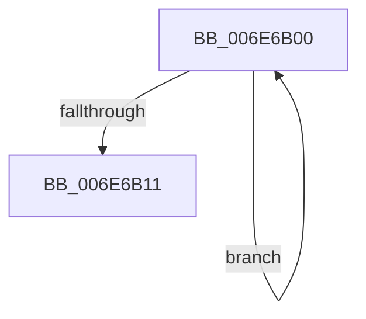

# sub_006E6B00

- RVA: `0x006E6B00`–`0x006E6B16` (길이 `22` bytes)
- VA: `0x00000001406E6B00`
- 실행 섹션: `.text`
- PDB 이름 있음: `아니요`; PDB Function 태그: `아니요`
- unwind 정보 RVA: `0x00089A44`
- 디코드: `6`개 명령, `22/22` bytes 표시
- 미해석 바이트: `0` (있으면 어셈블리에 `.byte`로 보존)

> 이 문서는 커널 이미지의 기계어와 PDB 기호를 분석해 생성했습니다. 4번과 5번은 함수 원형과 자료형을 바이너리 사용 방식에서 추정한 C 해석이며 원본 소스 복구 결과는 아닙니다.

## 1. Dependencies

- 직접 호출 지점: **0**; 고유 호출 대상: **0**
- 직접 호출자로 확인된 함수: **0**
- RIP 상대 이미지 참조: **0**

### Outgoing calls
- 직접 디코드된 call 명령이 없습니다.

### Direct callers
- 이 함수 시작 RVA로 연결되는 직접 call은 확인되지 않았습니다. 간접 호출은 완전히 역산할 수 없습니다.

### Static image references
- 디코드된 RIP-relative 메모리 참조가 없습니다.

## 2. Other-region calls and transfers

- 다른 실행 섹션으로 향하는 call: **0**
- call이 아닌 외부 분기/꼬리 이동: **1**
  - `0x006E6B11` → [RtlDecompressBufferLz4 + 0x3BA](../3A/RtlDecompressBufferLz4_function_003A4D20.md) (`tail-transfer`)

## 3. Assembly (complete function range)

```asm
006E6B00  48 8B 44 39 08                  mov rax, qword ptr [rcx + rdi + 8]
006E6B05  48 89 01                        mov qword ptr [rcx], rax
006E6B08  48 83 C1 08                     add rcx, 8
006E6B0C  49 3B CA                        cmp rcx, r10
006E6B0F  72 EF                           jb 0x1406e6b00
006E6B11  E9 C4 E5 CB FF                  jmp 0x1403a50da
```

## 4. C-style interpretation (structured pseudocode)

```c
__int64 __fastcall sub_006E6B00(__int64 a1)
{
    *(unsigned __int64 *)(a1) = *(unsigned __int64 *)(a1 + v_rdi * 1 + 8);
    a1 = (a1) + (8);
    if (a1 < v_r10) goto loc_006E6B00;
}
```

## 5. (Beta) C Style

```c
int64_t sub_006E6B00(int64_t Arg1)
{
    *(uint64_t *)(Arg1) = *(uint64_t *)(Arg1 + local_rdi * 1 + 0x8);
    Arg1 = (Arg1) + (8);
    if (Arg1 < local_r10) goto loc_006E6B00;
}
```

## 6. Execution-region graph

[열기: 2D/3D 그래프와 함수 탐색 컨트롤 패널](../../../control-panel.html?section=text&rva=0x006E6B00&view=graph)

- 2D 그래프는 위에서 아래로 흐르고, 3D 그래프는 빈 공간을 드래그해 회전합니다. Shift+드래그는 이동, 휠은 확대·축소, 함수 노드 선택은 대상 보고서 이동입니다.

### Static fallback


