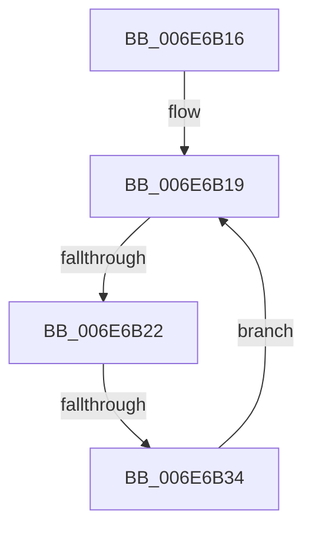

# sub_006E6B16

- RVA: `0x006E6B16`–`0x006E6B39` (길이 `35` bytes)
- VA: `0x00000001406E6B16`
- 실행 섹션: `.text`
- PDB 이름 있음: `아니요`; PDB Function 태그: `아니요`
- unwind 정보 RVA: `0x00089F10`
- 디코드: `9`개 명령, `35/35` bytes 표시
- 미해석 바이트: `0` (있으면 어셈블리에 `.byte`로 보존)

> 이 문서는 커널 이미지의 기계어와 PDB 기호를 분석해 생성했습니다. 4번과 5번은 함수 원형과 자료형을 바이너리 사용 방식에서 추정한 C 해석이며 원본 소스 복구 결과는 아닙니다.

## 1. Dependencies

- 직접 호출 지점: **0**; 고유 호출 대상: **0**
- 직접 호출자로 확인된 함수: **0**
- RIP 상대 이미지 참조: **0**

### Outgoing calls
- 직접 디코드된 call 명령이 없습니다.

### Direct callers
- 이 함수 시작 RVA로 연결되는 직접 call은 확인되지 않았습니다. 간접 호출은 완전히 역산할 수 없습니다.

### Static image references
- 디코드된 RIP-relative 메모리 참조가 없습니다.

## 2. Other-region calls and transfers

- 다른 실행 섹션으로 향하는 call: **0**
- call이 아닌 외부 분기/꼬리 이동: **2**
  - `0x006E6B1C` → [AuthzBasepValidateSecurityAttributes + 0x145](../3A/AuthzBasepValidateSecurityAttributes_function_003A90EC.md) (`tail-transfer`)
  - `0x006E6B2E` → [AuthzBasepValidateSecurityAttributes + 0x2A2](../3A/AuthzBasepValidateSecurityAttributes_function_003A90EC.md) (`tail-transfer`)

## 3. Assembly (complete function range)

```asm
006E6B16  45 8B DD                        mov r11d, r13d
006E6B19  44 3B DB                        cmp r11d, ebx
006E6B1C  0F 83 0F 27 CC FF               jae 0x1403a9231
006E6B22  4B 8B 44 D1 20                  mov rax, qword ptr [r9 + r10*8 + 0x20]
006E6B27  41 8B CB                        mov ecx, r11d
006E6B2A  48 39 3C C8                     cmp qword ptr [rax + rcx*8], rdi
006E6B2E  0F 87 5A 28 CC FF               ja 0x1403a938e
006E6B34  44 03 DF                        add r11d, edi
006E6B37  EB E0                           jmp 0x1406e6b19
```

## 4. C-style interpretation (structured pseudocode)

```c
__int64 __fastcall sub_006E6B16(__int64 a1, __int64 a2, __int64 a3, __int64 a4)
{
    __int64 v_r11;

loc_006E6B19:
    v_r11 = (unsigned int)(((unsigned int)((unsigned int)(v_r13))) + ((unsigned int)(v_rdi)));
    goto loc_006E6B19;
}
```

## 5. (Beta) C Style

```c
int64_t sub_006E6B16(int64_t Arg1, int64_t Arg2, int64_t Arg3, void *Arg4)
{
    uint8_t *arg4 = (uint8_t *)Arg4;

    int64_t local_r11;

loc_006E6B19:
    local_r11 = (uint32_t)(((uint32_t)((uint32_t)(local_r13))) + ((uint32_t)(local_rdi)));
    goto loc_006E6B19;
}
```

### 관측된 메모리 오프셋

구조체 형식이 확인되지 않은 접근은 인자 기준의 오프셋으로만 기록했습니다.

| 기준 인자 | 오프셋 표현 | 폭 (bit) | 접근 |
|---|---:|---:|---|
| `Arg4` | `+ 0x20 + r10*8` | `64` | `R` |

## 6. Execution-region graph

[열기: 2D/3D 그래프와 함수 탐색 컨트롤 패널](../../../control-panel.html?section=text&rva=0x006E6B16&view=graph)

- 2D 그래프는 위에서 아래로 흐르고, 3D 그래프는 빈 공간을 드래그해 회전합니다. Shift+드래그는 이동, 휠은 확대·축소, 함수 노드 선택은 대상 보고서 이동입니다.

### Static fallback


