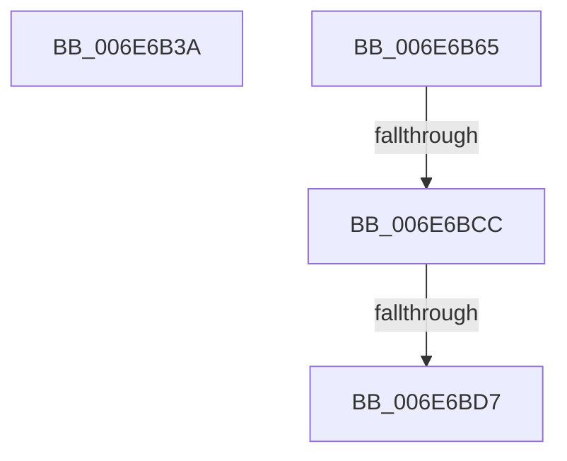

# sub_006E6B3A

- RVA: `0x006E6B3A`–`0x006E6BDC` (길이 `162` bytes)
- VA: `0x00000001406E6B3A`
- 실행 섹션: `.text`
- PDB 이름 있음: `아니요`; PDB Function 태그: `아니요`
- unwind 정보 RVA: `0x00089FE8`
- 디코드: `39`개 명령, `162/162` bytes 표시
- 미해석 바이트: `0` (있으면 어셈블리에 `.byte`로 보존)

> 이 문서는 커널 이미지의 기계어와 PDB 기호를 분석해 생성했습니다. 4번과 5번은 함수 원형과 자료형을 바이너리 사용 방식에서 추정한 C 해석이며 원본 소스 복구 결과는 아닙니다.

## 1. Dependencies

- 직접 호출 지점: **2**; 고유 호출 대상: **2**
- 직접 호출자로 확인된 함수: **0**
- RIP 상대 이미지 참조: **0**

### Outgoing calls
- `0x006E6B59` → [SeQuerySecurityAttributesToken](../../page/9F/SeQuerySecurityAttributesToken_function_009F6410.md) (function, `0x009F6410`)
- `0x006E6BBA` → [AuthzBasepEvaluateAceCondition](../2F/AuthzBasepEvaluateAceCondition_function_002FEBD0.md) (function, `0x002FEBD0`)

### Direct callers
- 이 함수 시작 RVA로 연결되는 직접 call은 확인되지 않았습니다. 간접 호출은 완전히 역산할 수 없습니다.

### Static image references
- 디코드된 RIP-relative 메모리 참조가 없습니다.

## 2. Other-region calls and transfers

- 다른 실행 섹션으로 향하는 call: **1**
  - `0x006E6B59` → [SeQuerySecurityAttributesToken](../../page/9F/SeQuerySecurityAttributesToken_function_009F6410.md) (`.text` → `PAGE`)
- call이 아닌 외부 분기/꼬리 이동: **4**
  - `0x006E6B60` → [SepVerifyDesktopAppxPackageName + 0x16F](../3A/SepVerifyDesktopAppxPackageName_function_003A9728.md) (`tail-transfer`)
  - `0x006E6BC6` → [SepVerifyDesktopAppxPackageName + 0x129](../3A/SepVerifyDesktopAppxPackageName_function_003A9728.md) (`tail-transfer`)
  - `0x006E6BD1` → [SepVerifyDesktopAppxPackageName + 0x130](../3A/SepVerifyDesktopAppxPackageName_function_003A9728.md) (`tail-transfer`)
  - `0x006E6BD7` → [SepVerifyDesktopAppxPackageName + 0x121](../3A/SepVerifyDesktopAppxPackageName_function_003A9728.md) (`tail-transfer`)

## 3. Assembly (complete function range)

```asm
006E6B3A  48 8D 44 24 60                  lea rax, [rsp + 0x60]
006E6B3F  4C 8B CE                        mov r9, rsi
006E6B42  48 89 44 24 28                  mov qword ptr [rsp + 0x28], rax
006E6B47  48 8D 54 24 70                  lea rdx, [rsp + 0x70]
006E6B4C  41 B8 01 00 00 00               mov r8d, 1
006E6B52  89 5C 24 20                     mov dword ptr [rsp + 0x20], ebx
006E6B56  49 8B CC                        mov rcx, r12
006E6B59  E8 B2 F8 30 00                  call 0x1409f6410
006E6B5E  8B D8                           mov ebx, eax
006E6B60  E9 32 2D CC FF                  jmp 0x1403a9897
006E6B65  0F B6 47 09                     movzx eax, byte ptr [rdi + 9]
006E6B69  45 33 C9                        xor r9d, r9d
006E6B6C  0F B7 57 02                     movzx edx, word ptr [rdi + 2]
006E6B70  8D 04 85 08 00 00 00            lea eax, [rax*4 + 8]
006E6B77  2B D0                           sub edx, eax
006E6B79  8B C8                           mov ecx, eax
006E6B7B  48 83 C1 08                     add rcx, 8
006E6B7F  48 8D 44 24 64                  lea rax, [rsp + 0x64]
006E6B84  48 89 44 24 58                  mov qword ptr [rsp + 0x58], rax
006E6B89  83 EA 08                        sub edx, 8
006E6B8C  44 88 44 24 50                  mov byte ptr [rsp + 0x50], r8b
006E6B91  48 03 CF                        add rcx, rdi
006E6B94  44 88 44 24 48                  mov byte ptr [rsp + 0x48], r8b
006E6B99  89 54 24 40                     mov dword ptr [rsp + 0x40], edx
006E6B9D  49 8B D6                        mov rdx, r14
006E6BA0  48 89 4C 24 38                  mov qword ptr [rsp + 0x38], rcx
006E6BA5  49 8B CC                        mov rcx, r12
006E6BA8  4C 89 44 24 30                  mov qword ptr [rsp + 0x30], r8
006E6BAD  4C 89 44 24 28                  mov qword ptr [rsp + 0x28], r8
006E6BB2  4C 89 44 24 20                  mov qword ptr [rsp + 0x20], r8
006E6BB7  45 33 C0                        xor r8d, r8d
006E6BBA  E8 11 80 C1 FF                  call 0x1402febd0
006E6BBF  45 33 C0                        xor r8d, r8d
006E6BC2  8B D8                           mov ebx, eax
006E6BC4  85 C0                           test eax, eax
006E6BC6  0F 88 85 2C CC FF               js 0x1403a9851
006E6BCC  83 7C 24 64 01                  cmp dword ptr [rsp + 0x64], 1
006E6BD1  0F 84 81 2C CC FF               je 0x1403a9858
006E6BD7  E9 6D 2C CC FF                  jmp 0x1403a9849
```

## 4. C-style interpretation (structured pseudocode)

```c
__int64 __fastcall sub_006E6B3A(__int64 a1, __int64 a2, __int64 a3, __int64 a4, __int64 a5, __int64 a6, __int64 a7, __int64 a8, __int64 a9, __int64 a10, __int64 a11, __int64 a12, __int64 a13, __int64 a14)
{
    __int64 result;
    unsigned int v_stack_p20;
    unsigned __int64 v_stack_p28;
    unsigned __int64 v_stack_p30;
    unsigned __int64 v_stack_p38;
    unsigned int v_stack_p40;
    unsigned __int8 v_stack_p48;
    unsigned __int8 v_stack_p50;
    unsigned __int64 v_stack_p58;
    unsigned __int64 v_stack_p64;

    v_stack_p28 = a12;
    v_stack_p20 = (unsigned int)(v_rbx);
    result = SeQuerySecurityAttributesToken(v_r12, a14, 1, v_rsi);
}
```

## 5. (Beta) C Style

```c
int64_t sub_006E6B3A(int64_t Arg1, int64_t Arg2, int64_t Arg3, int64_t Arg4, uint64_t Arg5, uint64_t Arg6, uint64_t Arg7, uint64_t Arg8, uint64_t Arg9, uint64_t Arg10, uint64_t Arg11, int64_t Arg12, uint64_t Arg13, int64_t Arg14)
{
    int64_t result;
    uint32_t v_stack_p20;
    uint64_t v_stack_p28;
    uint64_t v_stack_p30;
    uint64_t v_stack_p38;
    uint32_t v_stack_p40;
    uint8_t v_stack_p48;
    uint8_t v_stack_p50;
    uint64_t v_stack_p58;
    uint64_t v_stack_p64;

    v_stack_p28 = Arg12;
    v_stack_p20 = (uint32_t)(local_rbx);
    result = SeQuerySecurityAttributesToken(local_r12, Arg14, 1, local_rsi);
}
```

## 6. Execution-region graph

[열기: 2D/3D 그래프와 함수 탐색 컨트롤 패널](../../../control-panel.html?section=text&rva=0x006E6B3A&view=graph)

- 2D 그래프는 위에서 아래로 흐르고, 3D 그래프는 빈 공간을 드래그해 회전합니다. Shift+드래그는 이동, 휠은 확대·축소, 함수 노드 선택은 대상 보고서 이동입니다.

### Static fallback


