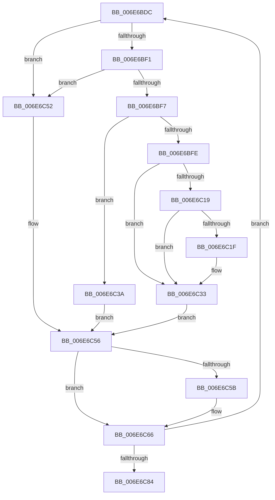

# sub_006E6BDC

- RVA: `0x006E6BDC`–`0x006E6C89` (길이 `173` bytes)
- VA: `0x00000001406E6BDC`
- 실행 섹션: `.text`
- PDB 이름 있음: `아니요`; PDB Function 태그: `아니요`
- unwind 정보 RVA: `0x0008B6C4`
- 디코드: `49`개 명령, `173/173` bytes 표시
- 미해석 바이트: `0` (있으면 어셈블리에 `.byte`로 보존)

> 이 문서는 커널 이미지의 기계어와 PDB 기호를 분석해 생성했습니다. 4번과 5번은 함수 원형과 자료형을 바이너리 사용 방식에서 추정한 C 해석이며 원본 소스 복구 결과는 아닙니다.

## 1. Dependencies

- 직접 호출 지점: **3**; 고유 호출 대상: **2**
- 직접 호출자로 확인된 함수: **0**
- RIP 상대 이미지 참조: **0**

### Outgoing calls
- `0x006E6C26` → [guard_dispatch_icall](../6B/guard_dispatch_icall_function_006BAAD0.md) (function, `0x006BAAD0`)
- `0x006E6C49` → [guard_dispatch_icall](../6B/guard_dispatch_icall_function_006BAAD0.md) (function, `0x006BAAD0`)
- `0x006E6C61` → [B_TREE<unsigned long,ST_STORE<SM_TRAITS>::_ST_HASH_ENTRY,4096,NP_CONTEXT,ST_STORE<SM_TRAITS>::ST_HASH_ENTRY_COMPARATOR>::BTreeNodeFree](../3A/B_TREE_unsigned_long_ST_STORE_SM_TRAITS__ST_HASH_ENTRY_4096_NP_CONTEXT_ST_STORE_SM_TRAITS_ST_HASH_EN_function_003A99DC.md) (function, `0x003A99DC`)

### Direct callers
- 이 함수 시작 RVA로 연결되는 직접 call은 확인되지 않았습니다. 간접 호출은 완전히 역산할 수 없습니다.

### Static image references
- 디코드된 RIP-relative 메모리 참조가 없습니다.

## 2. Other-region calls and transfers

- 다른 실행 섹션으로 향하는 call: **0**
- call이 아닌 외부 분기/꼬리 이동: **1**
  - `0x006E6C84` → [B_TREE<unsigned long,ST_STORE<SM_TRAITS>::_ST_HASH_ENTRY,4096,NP_CONTEXT,ST_STORE<SM_TRAITS>::ST_HASH_ENTRY_COMPARATOR>::BTreeNodeFree + 0x28](../3A/B_TREE_unsigned_long_ST_STORE_SM_TRAITS__ST_HASH_ENTRY_4096_NP_CONTEXT_ST_STORE_SM_TRAITS_ST_HASH_EN_function_003A99DC.md) (`tail-transfer`)

## 3. Assembly (complete function range)

```asm
006E6BDC  4D 8B 2C 24                     mov r13, qword ptr [r12]
006E6BE0  48 3B FA                        cmp rdi, rdx
006E6BE3  49 8B EF                        mov rbp, r15
006E6BE6  49 0F 46 E8                     cmovbe rbp, r8
006E6BEA  41 83 7D 00 FF                  cmp dword ptr [r13], -1
006E6BEF  74 61                           je 0x1406e6c52
006E6BF1  80 7B 02 02                     cmp byte ptr [rbx + 2], 2
006E6BF5  75 5B                           jne 0x1406e6c52
006E6BF7  8B 45 00                        mov eax, dword ptr [rbp]
006E6BFA  A8 01                           test al, 1
006E6BFC  74 3C                           je 0x1406e6c3a
006E6BFE  48 8B 6D 00                     mov rbp, qword ptr [rbp]
006E6C02  48 81 E5 00 F0 FF FF            and rbp, 0xfffffffffffff000
006E6C09  4C 8D 7D 0B                     lea r15, [rbp + 0xb]
006E6C0D  49 83 E7 F8                     and r15, 0xfffffffffffffff8
006E6C11  49 8B 17                        mov rdx, qword ptr [r15]
006E6C14  48 85 D2                        test rdx, rdx
006E6C17  74 1A                           je 0x1406e6c33
006E6C19  8B C2                           mov eax, edx
006E6C1B  A8 02                           test al, 2
006E6C1D  75 14                           jne 0x1406e6c33
006E6C1F  49 8B 45 20                     mov rax, qword ptr [r13 + 0x20]
006E6C23  49 8B CC                        mov rcx, r12
006E6C26  E8 A5 3E FD FF                  call 0x1406baad0
006E6C2B  41 83 0F 02                     or dword ptr [r15], 2
006E6C2F  41 FF 4D 30                     dec dword ptr [r13 + 0x30]
006E6C33  4C 8B 7C 24 58                  mov r15, qword ptr [rsp + 0x58]
006E6C38  EB 1C                           jmp 0x1406e6c56
006E6C3A  41 FF 4D 2C                     dec dword ptr [r13 + 0x2c]
006E6C3E  49 8B CC                        mov rcx, r12
006E6C41  48 8B 55 00                     mov rdx, qword ptr [rbp]
006E6C45  49 8B 45 20                     mov rax, qword ptr [r13 + 0x20]
006E6C49  E8 82 3E FD FF                  call 0x1406baad0
006E6C4E  33 ED                           xor ebp, ebp
006E6C50  EB 04                           jmp 0x1406e6c56
006E6C52  48 8B 6D 00                     mov rbp, qword ptr [rbp]
006E6C56  48 85 ED                        test rbp, rbp
006E6C59  74 0B                           je 0x1406e6c66
006E6C5B  48 8B D5                        mov rdx, rbp
006E6C5E  49 8B CE                        mov rcx, r14
006E6C61  E8 76 2D CC FF                  call 0x1403a99dc
006E6C66  49 83 C7 10                     add r15, 0x10
006E6C6A  48 8D 53 10                     lea rdx, [rbx + 0x10]
006E6C6E  48 83 C7 10                     add rdi, 0x10
006E6C72  4C 89 7C 24 58                  mov qword ptr [rsp + 0x58], r15
006E6C77  4C 8D 43 08                     lea r8, [rbx + 8]
006E6C7B  48 3B FE                        cmp rdi, rsi
006E6C7E  0F 86 58 FF FF FF               jbe 0x1406e6bdc
006E6C84  E9 7B 2D CC FF                  jmp 0x1403a9a04
```

## 4. C-style interpretation (structured pseudocode)

```c
__int64 __fastcall sub_006E6BDC(__int64 a1, __int64 a2, __int64 a3, __int64 a4, __int64 a5, __int64 a6, __int64 a7, __int64 a8, __int64 a9, __int64 a10, __int64 a11)
{
    __int64 result;
    __int64 v_r15;
    __int64 v_rbp;
    __int64 v_rdi;
    unsigned __int64 v_stack_p58;

    v_rbp = v_r15;
    if (v_rdi <= a2) { v_rbp = a3; }
    if ((*(unsigned int *)(*(unsigned __int64 *)(v_r12))) == -1) goto loc_006E6C52;
    if ((*(unsigned __int8 *)(v_rbx + 2)) != 2) goto loc_006E6C52;
    if ((((unsigned __int8)((unsigned int)(*(unsigned int *)(v_rbp)))) & (1)) == 0) goto loc_006E6C3A;
    v_rbp = (*(unsigned __int64 *)(v_rbp)) & (0xFFFFFFFFFFFFF000ULL);
    v_r15 = (v_rbp + 11) & (-8);
    if (*(unsigned __int64 *)(v_r15) == 0) goto loc_006E6C33;
    result = (unsigned int)((unsigned int)(*(unsigned __int64 *)(v_r15)));
    if ((((unsigned __int8)((unsigned int)((unsigned int)(*(unsigned __int64 *)(v_r15))))) & (2)) == 0) {
        result = *(unsigned __int64 *)(*(unsigned __int64 *)(v_r12) + 32);
        a1 = v_r12;
        result = guard_dispatch_icall(a1, *(unsigned __int64 *)(v_r15), a3, a4);
    }
    goto loc_006E6C56;
loc_006E6C3A:
    result = guard_dispatch_icall(v_r12, *(unsigned __int64 *)(v_rbp), a3, a4);
    v_rbp = 0;
    goto loc_006E6C56;
loc_006E6C52:
loc_006E6C56:
    if (*(unsigned __int64 *)(v_rbp) != 0) {
        a2 = *(unsigned __int64 *)(v_rbp);
        a1 = v_r14;
        result = B_TREE_unsigned_long_ST_STORE_SM_TRAITS____ST_HASH_ENTRY_4096_NP_CONTEXT_ST_STORE_SM_TRAITS___ST_HAS(a1, a2, a3, a4);
    }
    v_r15 = (a11) + (16);
    v_rdi = (v_rdi) + (16);
    v_stack_p58 = v_r15;
    if (v_rdi <= v_rsi) goto loc_006E6BDC;
}
```

## 5. (Beta) C Style

```c
int64_t sub_006E6BDC(int64_t Arg1, int64_t Arg2, int64_t Arg3, int64_t Arg4, uint64_t Arg5, uint64_t Arg6, uint64_t Arg7, uint64_t Arg8, uint64_t Arg9, uint64_t Arg10, int64_t Arg11)
{
    int64_t result;
    int64_t local_r15;
    int64_t local_rbp;
    int64_t local_rdi;
    uint64_t v_stack_p58;

    local_rbp = local_r15;
    if (local_rdi <= Arg2) { local_rbp = Arg3; }
    if ((*(uint32_t *)(*(uint64_t *)(local_r12))) == -1) goto loc_006E6C52;
    if ((*(uint8_t *)(local_rbx + 0x2)) != 2) goto loc_006E6C52;
    if ((((uint8_t)((uint32_t)(*(uint32_t *)(local_rbp)))) & (1)) == 0) goto loc_006E6C3A;
    local_rbp = (*(uint64_t *)(local_rbp)) & (0xFFFFFFFFFFFFF000ULL);
    local_r15 = (local_rbp + 11) & (-8);
    if (*(uint64_t *)(local_r15) == 0) goto loc_006E6C33;
    result = (uint32_t)((uint32_t)(*(uint64_t *)(local_r15)));
    if ((((uint8_t)((uint32_t)((uint32_t)(*(uint64_t *)(local_r15))))) & (2)) == 0) {
        result = *(uint64_t *)(*(uint64_t *)(local_r12) + 0x20);
        Arg1 = local_r12;
        result = guard_dispatch_icall(Arg1, *(uint64_t *)(local_r15), Arg3, Arg4);
    }
    goto loc_006E6C56;
loc_006E6C3A:
    result = guard_dispatch_icall(local_r12, *(uint64_t *)(local_rbp), Arg3, Arg4);
    local_rbp = 0;
    goto loc_006E6C56;
loc_006E6C52:
loc_006E6C56:
    if (*(uint64_t *)(local_rbp) != 0) {
        Arg2 = *(uint64_t *)(local_rbp);
        Arg1 = local_r14;
        result = B_TREE_unsigned_long_ST_STORE_SM_TRAITS____ST_HASH_ENTRY_4096_NP_CONTEXT_ST_STORE_SM_TRAITS___ST_HAS(Arg1, Arg2, Arg3, Arg4);
    }
    local_r15 = (Arg11) + (16);
    local_rdi = (local_rdi) + (16);
    v_stack_p58 = local_r15;
    if (local_rdi <= local_rsi) goto loc_006E6BDC;
}
```

## 6. Execution-region graph

[열기: 2D/3D 그래프와 함수 탐색 컨트롤 패널](../../../control-panel.html?section=text&rva=0x006E6BDC&view=graph)

- 2D 그래프는 위에서 아래로 흐르고, 3D 그래프는 빈 공간을 드래그해 회전합니다. Shift+드래그는 이동, 휠은 확대·축소, 함수 노드 선택은 대상 보고서 이동입니다.

### Static fallback


