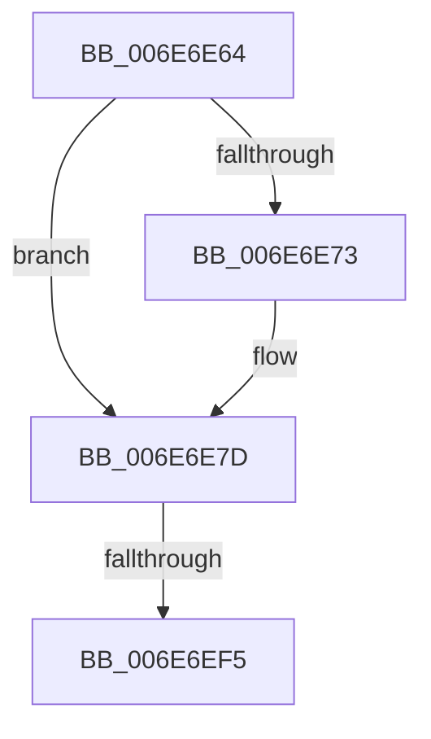

# sub_006E6E64

- RVA: `0x006E6E64`–`0x006E6F03` (길이 `159` bytes)
- VA: `0x00000001406E6E64`
- 실행 섹션: `.text`
- PDB 이름 있음: `아니요`; PDB Function 태그: `아니요`
- unwind 정보 RVA: `0x0008BEF8`
- 디코드: `40`개 명령, `159/159` bytes 표시
- 미해석 바이트: `0` (있으면 어셈블리에 `.byte`로 보존)

> 이 문서는 커널 이미지의 기계어와 PDB 기호를 분석해 생성했습니다. 4번과 5번은 함수 원형과 자료형을 바이너리 사용 방식에서 추정한 C 해석이며 원본 소스 복구 결과는 아닙니다.

## 1. Dependencies

- 직접 호출 지점: **4**; 고유 호출 대상: **4**
- 직접 호출자로 확인된 함수: **0**
- RIP 상대 이미지 참조: **0**

### Outgoing calls
- `0x006E6E84` → [_chkstk](../6B/_chkstk_function_006BA960.md) (function, `0x006BA960`)
- `0x006E6EB6` → [B_TREE<unsigned long,ST_STORE<SM_TRAITS>::_ST_HASH_ENTRY,4096,NP_CONTEXT,ST_STORE<SM_TRAITS>::ST_HASH_ENTRY_COMPARATOR>::BTreeSearchKey](../3A/B_TREE_unsigned_long_ST_STORE_SM_TRAITS__ST_HASH_ENTRY_4096_NP_CONTEXT_ST_STORE_SM_TRAITS_ST_HASH_EN_function_003ADDB0.md) (function, `0x003ADDB0`)
- `0x006E6ED1` → [B_TREE<unsigned long,ST_STORE<SM_TRAITS>::_ST_HASH_ENTRY,4096,NP_CONTEXT,ST_STORE<SM_TRAITS>::ST_HASH_ENTRY_COMPARATOR>::BTreeSearchResultDeref](../3A/B_TREE_unsigned_long_ST_STORE_SM_TRAITS__ST_HASH_ENTRY_4096_NP_CONTEXT_ST_STORE_SM_TRAITS_ST_HASH_EN_function_003AE310.md) (function, `0x003AE310`)
- `0x006E6EF8` → [NP_CONTEXT::NpLeafDerefInternal](../3A/NP_CONTEXT_NpLeafDerefInternal_function_003A9A70.md) (function, `0x003A9A70`)

### Direct callers
- 이 함수 시작 RVA로 연결되는 직접 call은 확인되지 않았습니다. 간접 호출은 완전히 역산할 수 없습니다.

### Static image references
- 디코드된 RIP-relative 메모리 참조가 없습니다.

## 2. Other-region calls and transfers

- 다른 실행 섹션으로 향하는 call: **0**
- call이 아닌 외부 분기/꼬리 이동: **2**
  - `0x006E6EEF` → [B_TREE<unsigned long,ST_STORE<SM_TRAITS>::_ST_HASH_ENTRY,4096,NP_CONTEXT,ST_STORE<SM_TRAITS>::ST_HASH_ENTRY_COMPARATOR>::BTreeSearchResultDeref + 0x9C](../3A/B_TREE_unsigned_long_ST_STORE_SM_TRAITS__ST_HASH_ENTRY_4096_NP_CONTEXT_ST_STORE_SM_TRAITS_ST_HASH_EN_function_003AE310.md) (`tail-transfer`)
  - `0x006E6EFE` → [B_TREE<unsigned long,ST_STORE<SM_TRAITS>::_ST_HASH_ENTRY,4096,NP_CONTEXT,ST_STORE<SM_TRAITS>::ST_HASH_ENTRY_COMPARATOR>::BTreeSearchResultDeref + 0x9C](../3A/B_TREE_unsigned_long_ST_STORE_SM_TRAITS__ST_HASH_ENTRY_4096_NP_CONTEXT_ST_STORE_SM_TRAITS_ST_HASH_EN_function_003AE310.md) (`tail-transfer`)

## 3. Assembly (complete function range)

```asm
006E6E64  8B C6                           mov eax, esi
006E6E66  48 C1 E0 04                     shl rax, 4
006E6E6A  48 8D 48 0F                     lea rcx, [rax + 0xf]
006E6E6E  48 3B C8                        cmp rcx, rax
006E6E71  77 0A                           ja 0x1406e6e7d
006E6E73  48 B9 F0 FF FF FF FF FF FF 0F   movabs rcx, 0xffffffffffffff0
006E6E7D  48 83 E1 F0                     and rcx, 0xfffffffffffffff0
006E6E81  48 8B C1                        mov rax, rcx
006E6E84  E8 D7 3A FD FF                  call 0x1406ba960
006E6E89  8B 52 10                        mov edx, dword ptr [rdx + 0x10]
006E6E8C  4C 8D 45 00                     lea r8, [rbp]
006E6E90  48 2B E1                        sub rsp, rcx
006E6E93  48 C7 45 20 01 00 00 00         mov qword ptr [rbp + 0x20], 1
006E6E9B  0F 57 C0                        xorps xmm0, xmm0
006E6E9E  44 89 65 18                     mov dword ptr [rbp + 0x18], r12d
006E6EA2  49 8B CF                        mov rcx, r15
006E6EA5  89 75 1C                        mov dword ptr [rbp + 0x1c], esi
006E6EA8  F3 0F 7F 45 08                  movdqu xmmword ptr [rbp + 8], xmm0
006E6EAD  48 8D 7C 24 20                  lea rdi, [rsp + 0x20]
006E6EB2  48 89 7D 00                     mov qword ptr [rbp], rdi
006E6EB6  E8 F5 6E CC FF                  call 0x1403addb0
006E6EBB  8D 4E FE                        lea ecx, [rsi - 2]
006E6EBE  48 03 C9                        add rcx, rcx
006E6EC1  48 8D 55 00                     lea rdx, [rbp]
006E6EC5  48 8B 74 CF 08                  mov rsi, qword ptr [rdi + rcx*8 + 8]
006E6ECA  48 8B 3C CF                     mov rdi, qword ptr [rdi + rcx*8]
006E6ECE  49 8B CF                        mov rcx, r15
006E6ED1  E8 3A 74 CC FF                  call 0x1403ae310
006E6ED6  48 8D 47 08                     lea rax, [rdi + 8]
006E6EDA  48 8D 4F 10                     lea rcx, [rdi + 0x10]
006E6EDE  48 3B F1                        cmp rsi, rcx
006E6EE1  48 8D 56 F8                     lea rdx, [rsi - 8]
006E6EE5  48 0F 46 D0                     cmovbe rdx, rax
006E6EE9  48 8B 03                        mov rax, qword ptr [rbx]
006E6EEC  83 38 FF                        cmp dword ptr [rax], -1
006E6EEF  0F 84 B7 74 CC FF               je 0x1403ae3ac
006E6EF5  48 8B CB                        mov rcx, rbx
006E6EF8  E8 73 2B CC FF                  call 0x1403a9a70
006E6EFD  90                              nop
006E6EFE  E9 A9 74 CC FF                  jmp 0x1403ae3ac
```

## 4. C-style interpretation (structured pseudocode)

```c
__int64 __fastcall sub_006E6E64(__int64 a1, __int64 a2)
{
    __int64 result;
    __int64 v_rsp;
    unsigned __int64 v_stack_p20;

    result = ((unsigned int)((unsigned int)(v_rsi))) << (4);
    if ((result + 15) <= result) {
    }
    a1 = (result + 15) & (-16);
    result = _chkstk(a1, a2, a3, a4);
    v_rsp = (v_rsp) - (a1);
    *(unsigned __int64 *)(v_rbp + 32) = 1;
    *(unsigned int *)(v_rbp + 24) = (unsigned int)(v_r12);
    *(unsigned int *)(v_rbp + 28) = (unsigned int)(v_rsi);
    *(unsigned __int64 *)(v_rbp + 8) = v_xmm0;
    *(unsigned __int64 *)(v_rbp) = v_stack_p20;
    result = B_TREE_unsigned_long_ST_STORE_SM_TRAITS____ST_HASH_ENTRY_4096_NP_CONTEXT_ST_STORE_SM_TRAITS___ST_HAS(v_r15, (unsigned int)(*(unsigned int *)(a2 + 16)), v_rbp, a4);
    a1 = (v_rsi - 2) + (v_rsi - 2);
    result = B_TREE_unsigned_long_ST_STORE_SM_TRAITS____ST_HASH_ENTRY_4096_NP_CONTEXT_ST_STORE_SM_TRAITS___ST_HAS(v_r15, v_rbp, v_rbp, a4);
    a2 = *(unsigned __int64 *)(v_stack_p20 + a1 * 8 + 8) - 8;
    if ((*(unsigned __int64 *)(v_stack_p20 + a1 * 8 + 8)) <= (*(unsigned __int64 *)(v_stack_p20 + a1 * 8) + 16)) { a2 = *(unsigned __int64 *)(v_stack_p20 + a1 * 8) + 8; }
    result = NP_CONTEXT__NpLeafDerefInternal(v_rbx, a2, v_rbp, a4);
}
```

## 5. (Beta) C Style

```c
int64_t sub_006E6E64(int64_t Arg1, int64_t Arg2)
{
    int64_t result;
    int64_t local_rsp;
    uint64_t v_stack_p20;

    result = ((uint32_t)((uint32_t)(local_rsi))) << (4);
    if ((result + 15) <= result) {
    }
    Arg1 = (result + 15) & (-16);
    result = _chkstk(Arg1, Arg2, a3, a4);
    local_rsp = (local_rsp) - (Arg1);
    *(uint64_t *)(local_rbp + 0x20) = 1;
    *(uint32_t *)(local_rbp + 0x18) = (uint32_t)(local_r12);
    *(uint32_t *)(local_rbp + 0x1C) = (uint32_t)(local_rsi);
    *(uint64_t *)(local_rbp + 0x8) = v_xmm0;
    *(uint64_t *)(local_rbp) = v_stack_p20;
    result = B_TREE_unsigned_long_ST_STORE_SM_TRAITS____ST_HASH_ENTRY_4096_NP_CONTEXT_ST_STORE_SM_TRAITS___ST_HAS(local_r15, (uint32_t)(*(uint32_t *)(Arg2 + 0x10)), local_rbp, a4);
    Arg1 = (local_rsi - 2) + (local_rsi - 2);
    result = B_TREE_unsigned_long_ST_STORE_SM_TRAITS____ST_HASH_ENTRY_4096_NP_CONTEXT_ST_STORE_SM_TRAITS___ST_HAS(local_r15, local_rbp, local_rbp, a4);
    Arg2 = *(uint64_t *)(v_stack_p20 + Arg1 * 8 + 0x8) - 8;
    if ((*(uint64_t *)(v_stack_p20 + Arg1 * 8 + 0x8)) <= (*(uint64_t *)(v_stack_p20 + Arg1 * 8) + 16)) { Arg2 = *(uint64_t *)(v_stack_p20 + Arg1 * 8) + 8; }
    result = NP_CONTEXT__NpLeafDerefInternal(local_rbx, Arg2, local_rbp, a4);
}
```

## 6. Execution-region graph

[열기: 2D/3D 그래프와 함수 탐색 컨트롤 패널](../../../control-panel.html?section=text&rva=0x006E6E64&view=graph)

- 2D 그래프는 위에서 아래로 흐르고, 3D 그래프는 빈 공간을 드래그해 회전합니다. Shift+드래그는 이동, 휠은 확대·축소, 함수 노드 선택은 대상 보고서 이동입니다.

### Static fallback


