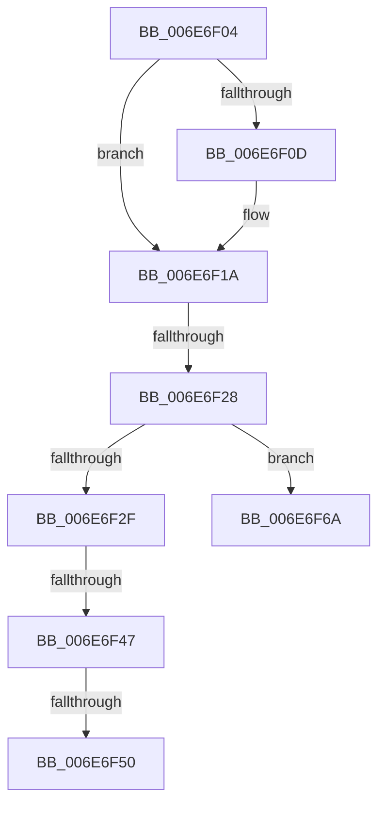

# sub_006E6F04

- RVA: `0x006E6F04`–`0x006E6F84` (길이 `128` bytes)
- VA: `0x00000001406E6F04`
- 실행 섹션: `.text`
- PDB 이름 있음: `아니요`; PDB Function 태그: `아니요`
- unwind 정보 RVA: `0x0008BFB4`
- 디코드: `32`개 명령, `128/128` bytes 표시
- 미해석 바이트: `0` (있으면 어셈블리에 `.byte`로 보존)

> 이 문서는 커널 이미지의 기계어와 PDB 기호를 분석해 생성했습니다. 4번과 5번은 함수 원형과 자료형을 바이너리 사용 방식에서 추정한 C 해석이며 원본 소스 복구 결과는 아닙니다.

## 1. Dependencies

- 직접 호출 지점: **3**; 고유 호출 대상: **2**
- 직접 호출자로 확인된 함수: **0**
- RIP 상대 이미지 참조: **0**

### Outgoing calls
- `0x006E6F15` → [NP_CONTEXT::NpLeafDerefInternal](../3A/NP_CONTEXT_NpLeafDerefInternal_function_003A9A70.md) (function, `0x003A9A70`)
- `0x006E6F58` → [guard_dispatch_icall](../6B/guard_dispatch_icall_function_006BAAD0.md) (function, `0x006BAAD0`)
- `0x006E6F79` → [guard_dispatch_icall](../6B/guard_dispatch_icall_function_006BAAD0.md) (function, `0x006BAAD0`)

### Direct callers
- 이 함수 시작 RVA로 연결되는 직접 call은 확인되지 않았습니다. 간접 호출은 완전히 역산할 수 없습니다.

### Static image references
- 디코드된 RIP-relative 메모리 참조가 없습니다.

## 2. Other-region calls and transfers

- 다른 실행 섹션으로 향하는 call: **0**
- call이 아닌 외부 분기/꼬리 이동: **5**
  - `0x006E6F22` → [sub_003AE62C + 0x35](../3A/Unknown_function_003AE62C.md) (`tail-transfer`)
  - `0x006E6F41` → [sub_003AE62C + 0x35](../3A/Unknown_function_003AE62C.md) (`tail-transfer`)
  - `0x006E6F4A` → [sub_003AE62C + 0x35](../3A/Unknown_function_003AE62C.md) (`tail-transfer`)
  - `0x006E6F65` → [sub_003AE62C + 0x35](../3A/Unknown_function_003AE62C.md) (`tail-transfer`)
  - `0x006E6F7F` → [sub_003AE62C + 0x35](../3A/Unknown_function_003AE62C.md) (`tail-transfer`)

## 3. Assembly (complete function range)

```asm
006E6F04  48 8B 46 10                     mov rax, qword ptr [rsi + 0x10]
006E6F08  83 38 FF                        cmp dword ptr [rax], -1
006E6F0B  74 0D                           je 0x1406e6f1a
006E6F0D  48 8D 53 08                     lea rdx, [rbx + 8]
006E6F11  48 8D 4E 10                     lea rcx, [rsi + 0x10]
006E6F15  E8 56 2B CC FF                  call 0x1403a9a70
006E6F1A  48 8B 6E 10                     mov rbp, qword ptr [rsi + 0x10]
006E6F1E  83 7D 00 FF                     cmp dword ptr [rbp], -1
006E6F22  0F 84 39 77 CC FF               je 0x1403ae661
006E6F28  8B 43 08                        mov eax, dword ptr [rbx + 8]
006E6F2B  A8 01                           test al, 1
006E6F2D  74 3B                           je 0x1406e6f6a
006E6F2F  4C 8B 73 08                     mov r14, qword ptr [rbx + 8]
006E6F33  49 81 E6 00 F0 FF FF            and r14, 0xfffffffffffff000
006E6F3A  49 8B 56 08                     mov rdx, qword ptr [r14 + 8]
006E6F3E  48 85 D2                        test rdx, rdx
006E6F41  0F 84 1A 77 CC FF               je 0x1403ae661
006E6F47  F6 C2 02                        test dl, 2
006E6F4A  0F 85 11 77 CC FF               jne 0x1403ae661
006E6F50  48 8B 45 20                     mov rax, qword ptr [rbp + 0x20]
006E6F54  48 8D 4E 10                     lea rcx, [rsi + 0x10]
006E6F58  E8 73 3B FD FF                  call 0x1406baad0
006E6F5D  41 83 4E 08 02                  or dword ptr [r14 + 8], 2
006E6F62  FF 4D 30                        dec dword ptr [rbp + 0x30]
006E6F65  E9 F7 76 CC FF                  jmp 0x1403ae661
006E6F6A  FF 4D 2C                        dec dword ptr [rbp + 0x2c]
006E6F6D  48 8D 4E 10                     lea rcx, [rsi + 0x10]
006E6F71  48 8B 53 08                     mov rdx, qword ptr [rbx + 8]
006E6F75  48 8B 45 20                     mov rax, qword ptr [rbp + 0x20]
006E6F79  E8 52 3B FD FF                  call 0x1406baad0
006E6F7E  90                              nop
006E6F7F  E9 DD 76 CC FF                  jmp 0x1403ae661
```

## 4. C-style interpretation (structured pseudocode)

```c
__int64 __fastcall sub_006E6F04(void)
{
    __int64 result;
    __int64 v_r14;

    result = *(unsigned __int64 *)(v_rsi + 16);
    if ((*(unsigned int *)(*(unsigned __int64 *)(v_rsi + 16))) != -1) {
        a2 = v_rbx + 8;
        a1 = v_rsi + 16;
        result = NP_CONTEXT__NpLeafDerefInternal(a1, a2, a3, a4);
    }
    if ((((unsigned __int8)((unsigned int)(*(unsigned int *)(v_rbx + 8)))) & (1)) == 0) goto loc_006E6F6A;
    v_r14 = (*(unsigned __int64 *)(v_rbx + 8)) & (0xFFFFFFFFFFFFF000ULL);
    result = guard_dispatch_icall(v_rsi + 16, *(unsigned __int64 *)(v_r14 + 8), a3, a4);
loc_006E6F6A:
    result = guard_dispatch_icall(v_rsi + 16, *(unsigned __int64 *)(v_rbx + 8), a3, a4);
}
```

## 5. (Beta) C Style

```c
void sub_006E6F04(void)
{
    int64_t result;
    int64_t local_r14;

    result = *(uint64_t *)(local_rsi + 0x10);
    if ((*(uint32_t *)(*(uint64_t *)(local_rsi + 0x10))) != -1) {
        a2 = local_rbx + 8;
        a1 = local_rsi + 16;
        result = NP_CONTEXT__NpLeafDerefInternal(a1, a2, a3, a4);
    }
    if ((((uint8_t)((uint32_t)(*(uint32_t *)(local_rbx + 0x8)))) & (1)) == 0) goto loc_006E6F6A;
    local_r14 = (*(uint64_t *)(local_rbx + 0x8)) & (0xFFFFFFFFFFFFF000ULL);
    result = guard_dispatch_icall(local_rsi + 16, *(uint64_t *)(local_r14 + 0x8), a3, a4);
loc_006E6F6A:
    result = guard_dispatch_icall(local_rsi + 16, *(uint64_t *)(local_rbx + 0x8), a3, a4);
}
```

## 6. Execution-region graph

[열기: 2D/3D 그래프와 함수 탐색 컨트롤 패널](../../../control-panel.html?section=text&rva=0x006E6F04&view=graph)

- 2D 그래프는 위에서 아래로 흐르고, 3D 그래프는 빈 공간을 드래그해 회전합니다. Shift+드래그는 이동, 휠은 확대·축소, 함수 노드 선택은 대상 보고서 이동입니다.

### Static fallback


