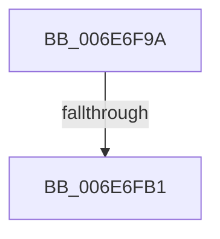

# sub_006E6F9A

- RVA: `0x006E6F9A`–`0x006E6FB6` (길이 `28` bytes)
- VA: `0x00000001406E6F9A`
- 실행 섹션: `.text`
- PDB 이름 있음: `아니요`; PDB Function 태그: `아니요`
- unwind 정보 RVA: `0x0008C09C`
- 디코드: `7`개 명령, `28/28` bytes 표시
- 미해석 바이트: `0` (있으면 어셈블리에 `.byte`로 보존)

> 이 문서는 커널 이미지의 기계어와 PDB 기호를 분석해 생성했습니다. 4번과 5번은 함수 원형과 자료형을 바이너리 사용 방식에서 추정한 C 해석이며 원본 소스 복구 결과는 아닙니다.

## 1. Dependencies

- 직접 호출 지점: **1**; 고유 호출 대상: **1**
- 직접 호출자로 확인된 함수: **0**
- RIP 상대 이미지 참조: **0**

### Outgoing calls
- `0x006E6FA0` → [NP_CONTEXT::NpLeafRefInternal](../3A/NP_CONTEXT_NpLeafRefInternal_function_003AA340.md) (function, `0x003AA340`)

### Direct callers
- 이 함수 시작 RVA로 연결되는 직접 call은 확인되지 않았습니다. 간접 호출은 완전히 역산할 수 없습니다.

### Static image references
- 디코드된 RIP-relative 메모리 참조가 없습니다.

## 2. Other-region calls and transfers

- 다른 실행 섹션으로 향하는 call: **0**
- call이 아닌 외부 분기/꼬리 이동: **2**
  - `0x006E6FAB` → [B_TREE<unsigned long,ST_STORE<SM_TRAITS>::_ST_REGION_ENTRY,4096,NP_CONTEXT,ST_STORE<SM_TRAITS>::ST_REGION_ENTRY_COMPARATOR>::BTreeRedistribute + 0xA9](../3A/B_TREE_unsigned_long_ST_STORE_SM_TRAITS__ST_REGION_ENTRY_4096_NP_CONTEXT_ST_STORE_SM_TRAITS_ST_REGIO_function_003AEA1C.md) (`tail-transfer`)
  - `0x006E6FB1` → [B_TREE<unsigned long,ST_STORE<SM_TRAITS>::_ST_REGION_ENTRY,4096,NP_CONTEXT,ST_STORE<SM_TRAITS>::ST_REGION_ENTRY_COMPARATOR>::BTreeRedistribute + 0x1CE](../3A/B_TREE_unsigned_long_ST_STORE_SM_TRAITS__ST_REGION_ENTRY_4096_NP_CONTEXT_ST_STORE_SM_TRAITS_ST_REGIO_function_003AEA1C.md) (`tail-transfer`)

## 3. Assembly (complete function range)

```asm
006E6F9A  45 33 C0                        xor r8d, r8d
006E6F9D  49 8B D1                        mov rdx, r9
006E6FA0  E8 9B 33 CC FF                  call 0x1403aa340
006E6FA5  48 89 03                        mov qword ptr [rbx], rax
006E6FA8  48 85 C0                        test rax, rax
006E6FAB  0F 85 14 7B CC FF               jne 0x1403aeac5
006E6FB1  E9 34 7C CC FF                  jmp 0x1403aebea
```

## 4. C-style interpretation (structured pseudocode)

```c
__int64 __fastcall sub_006E6F9A(__int64 a1, __int64 a2, int a3, __int64 a4)
{
    __int64 result;

    a3 = 0;
    result = NP_CONTEXT__NpLeafRefInternal(a1, a4, a3, a4);
    *(unsigned __int64 *)(v_rbx) = result;
}
```

## 5. (Beta) C Style

```c
int64_t sub_006E6F9A(int64_t Arg1, int64_t Arg2, int32_t Arg3, int64_t Arg4)
{
    int64_t result;

    Arg3 = 0;
    result = NP_CONTEXT__NpLeafRefInternal(Arg1, Arg4, Arg3, Arg4);
    *(uint64_t *)(local_rbx) = result;
}
```

## 6. Execution-region graph

[열기: 2D/3D 그래프와 함수 탐색 컨트롤 패널](../../../control-panel.html?section=text&rva=0x006E6F9A&view=graph)

- 2D 그래프는 위에서 아래로 흐르고, 3D 그래프는 빈 공간을 드래그해 회전합니다. Shift+드래그는 이동, 휠은 확대·축소, 함수 노드 선택은 대상 보고서 이동입니다.

### Static fallback


