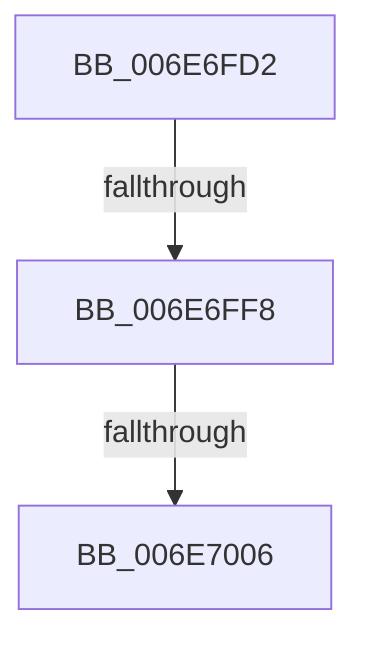

# sub_006E6FD2

- RVA: `0x006E6FD2`–`0x006E702F` (길이 `93` bytes)
- VA: `0x00000001406E6FD2`
- 실행 섹션: `.text`
- PDB 이름 있음: `아니요`; PDB Function 태그: `아니요`
- unwind 정보 RVA: `0x0008C0F8`
- 디코드: `20`개 명령, `93/93` bytes 표시
- 미해석 바이트: `0` (있으면 어셈블리에 `.byte`로 보존)

> 이 문서는 커널 이미지의 기계어와 PDB 기호를 분석해 생성했습니다. 4번과 5번은 함수 원형과 자료형을 바이너리 사용 방식에서 추정한 C 해석이며 원본 소스 복구 결과는 아닙니다.

## 1. Dependencies

- 직접 호출 지점: **2**; 고유 호출 대상: **2**
- 직접 호출자로 확인된 함수: **0**
- RIP 상대 이미지 참조: **0**

### Outgoing calls
- `0x006E6FDD` → [ST_STORE<SM_TRAITS>::StDmGetSpaceStats](../41/ST_STORE_SM_TRAITS_StDmGetSpaceStats_function_0041DCF0.md) (function, `0x0041DCF0`)
- `0x006E7024` → [SmWorkItemQueue](../31/SmWorkItemQueue_function_0031799C.md) (function, `0x0031799C`)

### Direct callers
- 이 함수 시작 RVA로 연결되는 직접 call은 확인되지 않았습니다. 간접 호출은 완전히 역산할 수 없습니다.

### Static image references
- 디코드된 RIP-relative 메모리 참조가 없습니다.

## 2. Other-region calls and transfers

- 다른 실행 섹션으로 향하는 call: **0**
- call이 아닌 외부 분기/꼬리 이동: **3**
  - `0x006E6FF2` → [ST_STORE<SM_TRAITS>::StReleaseRegion + 0xD0](../3A/ST_STORE_SM_TRAITS_StReleaseRegion_function_003AF138.md) (`tail-transfer`)
  - `0x006E7000` → [ST_STORE<SM_TRAITS>::StReleaseRegion + 0xD0](../3A/ST_STORE_SM_TRAITS_StReleaseRegion_function_003AF138.md) (`tail-transfer`)
  - `0x006E702A` → [ST_STORE<SM_TRAITS>::StReleaseRegion + 0xD0](../3A/ST_STORE_SM_TRAITS_StReleaseRegion_function_003AF138.md) (`tail-transfer`)

## 3. Assembly (complete function range)

```asm
006E6FD2  45 33 C0                        xor r8d, r8d
006E6FD5  48 8D 54 24 78                  lea rdx, [rsp + 0x78]
006E6FDA  48 8B CE                        mov rcx, rsi
006E6FDD  E8 0E 6D D3 FF                  call 0x14041dcf0
006E6FE2  44 8B 86 58 03 00 00            mov r8d, dword ptr [rsi + 0x358]
006E6FE9  44 2B 44 24 78                  sub r8d, dword ptr [rsp + 0x78]
006E6FEE  41 83 F8 08                     cmp r8d, 8
006E6FF2  0F 82 10 82 CC FF               jb 0x1403af208
006E6FF8  8B 86 20 11 00 00               mov eax, dword ptr [rsi + 0x1120]
006E6FFE  A8 01                           test al, 1
006E7000  0F 85 02 82 CC FF               jne 0x1403af208
006E7006  33 C0                           xor eax, eax
006E7008  48 8D 96 18 0A 00 00            lea rdx, [rsi + 0xa18]
006E700F  89 42 10                        mov dword ptr [rdx + 0x10], eax
006E7012  83 8E 20 11 00 00 01            or dword ptr [rsi + 0x1120], 1
006E7019  48 8B 8E 20 03 00 00            mov rcx, qword ptr [rsi + 0x320]
006E7020  44 8D 40 06                     lea r8d, [rax + 6]
006E7024  E8 73 09 C3 FF                  call 0x14031799c
006E7029  90                              nop
006E702A  E9 D9 81 CC FF                  jmp 0x1403af208
```

## 4. C-style interpretation (structured pseudocode)

```c
__int64 __fastcall sub_006E6FD2(__int64 a1, __int64 a2, int a3, __int64 a4, __int64 a5, __int64 a6, __int64 a7, __int64 a8, __int64 a9, __int64 a10, __int64 a11, __int64 a12, __int64 a13, __int64 a14, unsigned int a15)
{
    __int64 result;

    a3 = 0;
    result = ST_STORE_SM_TRAITS___StDmGetSpaceStats(v_rsi, a15, a3, a4);
    a3 = (unsigned int)(((unsigned int)(*(unsigned int *)(v_rsi + 856))) - (a15));
    result = 0;
    *(unsigned int *)(v_rsi + 2584 + 16) = 0;
    result = SmWorkItemQueue(*(unsigned __int64 *)(v_rsi + 800), v_rsi + 2584, result + 6, a4);
}
```

## 5. (Beta) C Style

```c
int64_t sub_006E6FD2(int64_t Arg1, int64_t Arg2, int32_t Arg3, int64_t Arg4, uint64_t Arg5, uint64_t Arg6, uint64_t Arg7, uint64_t Arg8, uint64_t Arg9, uint64_t Arg10, uint64_t Arg11, uint64_t Arg12, uint64_t Arg13, uint64_t Arg14, uint32_t Arg15)
{
    int64_t result;

    Arg3 = 0;
    result = ST_STORE_SM_TRAITS___StDmGetSpaceStats(local_rsi, Arg15, Arg3, Arg4);
    Arg3 = (uint32_t)(((uint32_t)(*(uint32_t *)(local_rsi + 0x358))) - (Arg15));
    result = 0;
    *(uint32_t *)(local_rsi + 0xA18 + 0x10) = 0;
    result = SmWorkItemQueue(*(uint64_t *)(local_rsi + 0x320), local_rsi + 2584, result + 6, Arg4);
}
```

## 6. Execution-region graph

[열기: 2D/3D 그래프와 함수 탐색 컨트롤 패널](../../../control-panel.html?section=text&rva=0x006E6FD2&view=graph)

- 2D 그래프는 위에서 아래로 흐르고, 3D 그래프는 빈 공간을 드래그해 회전합니다. Shift+드래그는 이동, 휠은 확대·축소, 함수 노드 선택은 대상 보고서 이동입니다.

### Static fallback


