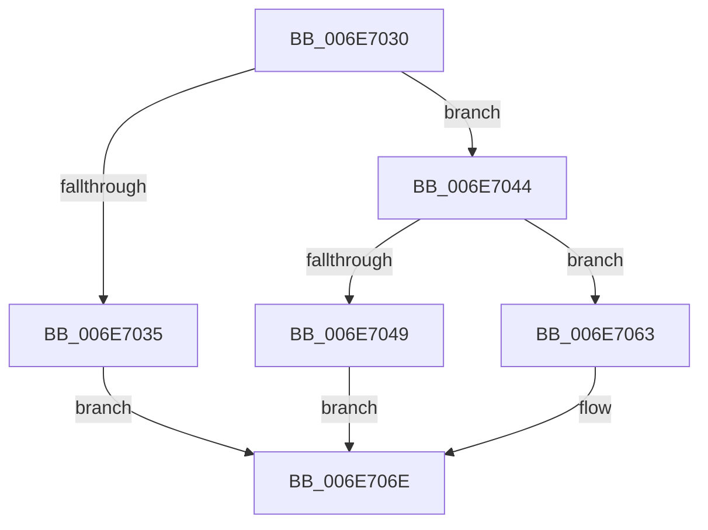

# sub_006E7030

- RVA: `0x006E7030`–`0x006E707E` (길이 `78` bytes)
- VA: `0x00000001406E7030`
- 실행 섹션: `.text`
- PDB 이름 있음: `아니요`; PDB Function 태그: `아니요`
- unwind 정보 RVA: `0x0008C25C`
- 디코드: `23`개 명령, `78/78` bytes 표시
- 미해석 바이트: `0` (있으면 어셈블리에 `.byte`로 보존)

> 이 문서는 커널 이미지의 기계어와 PDB 기호를 분석해 생성했습니다. 4번과 5번은 함수 원형과 자료형을 바이너리 사용 방식에서 추정한 C 해석이며 원본 소스 복구 결과는 아닙니다.

## 1. Dependencies

- 직접 호출 지점: **4**; 고유 호출 대상: **3**
- 직접 호출자로 확인된 함수: **0**
- RIP 상대 이미지 참조: **0**

### Outgoing calls
- `0x006E703D` → [SmKmFreeMdlForLock](../3C/SmKmFreeMdlForLock_function_003C3D98.md) (function, `0x003C3D98`)
- `0x006E705C` → [SmAcquireReleaseCharges](../28/SmAcquireReleaseCharges_function_00285C40.md) (function, `0x00285C40`)
- `0x006E7069` → [ExFreePoolWithTag](../../poolcode/B8/ExFreePoolWithTag_function_00B82870.md) (function, `0x00B82870`)
- `0x006E7073` → [ExFreePoolWithTag](../../poolcode/B8/ExFreePoolWithTag_function_00B82870.md) (function, `0x00B82870`)

### Direct callers
- 이 함수 시작 RVA로 연결되는 직접 call은 확인되지 않았습니다. 간접 호출은 완전히 역산할 수 없습니다.

### Static image references
- 디코드된 RIP-relative 메모리 참조가 없습니다.

## 2. Other-region calls and transfers

- 다른 실행 섹션으로 향하는 call: **2**
  - `0x006E7069` → [ExFreePoolWithTag](../../poolcode/B8/ExFreePoolWithTag_function_00B82870.md) (`.text` → `POOLCODE`)
  - `0x006E7073` → [ExFreePoolWithTag](../../poolcode/B8/ExFreePoolWithTag_function_00B82870.md) (`.text` → `POOLCODE`)
- call이 아닌 외부 분기/꼬리 이동: **1**
  - `0x006E7079` → [SmFpCleanup + 0x26](../3B/SmFpCleanup_function_003B082C.md) (`tail-transfer`)

## 3. Assembly (complete function range)

```asm
006E7030  83 FB 02                        cmp ebx, 2
006E7033  75 0F                           jne 0x1406e7044
006E7035  48 8B 57 08                     mov rdx, qword ptr [rdi + 8]
006E7039  48 8B 4D 20                     mov rcx, qword ptr [rbp + 0x20]
006E703D  E8 56 CD CD FF                  call 0x1403c3d98
006E7042  EB 2A                           jmp 0x1406e706e
006E7044  83 FB 03                        cmp ebx, 3
006E7047  75 1A                           jne 0x1406e7063
006E7049  41 0F B7 16                     movzx edx, word ptr [r14]
006E704D  44 8D 4B FE                     lea r9d, [rbx - 2]
006E7051  48 8B 4D 20                     mov rcx, qword ptr [rbp + 0x20]
006E7055  45 8B C1                        mov r8d, r9d
006E7058  48 C1 E2 0C                     shl rdx, 0xc
006E705C  E8 DF EB B9 FF                  call 0x140285c40
006E7061  EB 0B                           jmp 0x1406e706e
006E7063  48 8B 4F 08                     mov rcx, qword ptr [rdi + 8]
006E7067  33 D2                           xor edx, edx
006E7069  E8 02 B8 49 00                  call 0x140b82870
006E706E  33 D2                           xor edx, edx
006E7070  48 8B CF                        mov rcx, rdi
006E7073  E8 F8 B7 49 00                  call 0x140b82870
006E7078  90                              nop
006E7079  E9 D4 97 CC FF                  jmp 0x1403b0852
```

## 4. C-style interpretation (structured pseudocode)

```c
__int64 __fastcall sub_006E7030(void)
{
    __int64 result;

    if (((unsigned int)(v_rbx)) != 2) goto loc_006E7044;
    result = SmKmFreeMdlForLock(*(unsigned __int64 *)(v_rbp + 32), *(unsigned __int64 *)(v_rdi + 8), a3, a4);
    goto loc_006E706E;
loc_006E7044:
    if (((unsigned int)(v_rbx)) != 3) goto loc_006E7063;
    a2 = (*(unsigned __int16 *)(v_r14)) << (12);
    result = SmAcquireReleaseCharges(*(unsigned __int64 *)(v_rbp + 32), a2, (unsigned int)((unsigned int)(v_rbx - 2)), v_rbx - 2);
    goto loc_006E706E;
loc_006E7063:
    a2 = 0;
    result = ExFreePoolWithTag(*(unsigned __int64 *)(v_rdi + 8), a2, (unsigned int)((unsigned int)(v_rbx - 2)), v_rbx - 2);
loc_006E706E:
    a2 = 0;
    result = ExFreePoolWithTag(v_rdi, a2, (unsigned int)((unsigned int)(v_rbx - 2)), v_rbx - 2);
}
```

## 5. (Beta) C Style

```c
void sub_006E7030(void)
{
    int64_t result;

    if (((uint32_t)(local_rbx)) != 2) goto loc_006E7044;
    result = SmKmFreeMdlForLock(*(uint64_t *)(local_rbp + 0x20), *(uint64_t *)(local_rdi + 0x8), a3, a4);
    goto loc_006E706E;
loc_006E7044:
    if (((uint32_t)(local_rbx)) != 3) goto loc_006E7063;
    a2 = (*(uint16_t *)(local_r14)) << (12);
    result = SmAcquireReleaseCharges(*(uint64_t *)(local_rbp + 0x20), a2, (uint32_t)((uint32_t)(local_rbx - 2)), local_rbx - 2);
    goto loc_006E706E;
loc_006E7063:
    a2 = 0;
    result = ExFreePoolWithTag(*(uint64_t *)(local_rdi + 0x8), a2, (uint32_t)((uint32_t)(local_rbx - 2)), local_rbx - 2);
loc_006E706E:
    a2 = 0;
    result = ExFreePoolWithTag(local_rdi, a2, (uint32_t)((uint32_t)(local_rbx - 2)), local_rbx - 2);
}
```

## 6. Execution-region graph

[열기: 2D/3D 그래프와 함수 탐색 컨트롤 패널](../../../control-panel.html?section=text&rva=0x006E7030&view=graph)

- 2D 그래프는 위에서 아래로 흐르고, 3D 그래프는 빈 공간을 드래그해 회전합니다. Shift+드래그는 이동, 휠은 확대·축소, 함수 노드 선택은 대상 보고서 이동입니다.

### Static fallback


