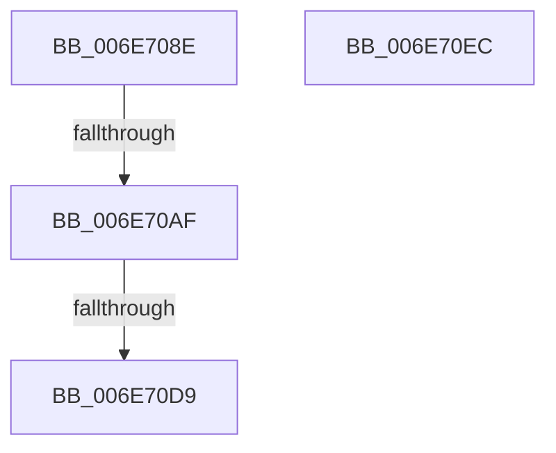

# sub_006E708E

- RVA: `0x006E708E`–`0x006E70F4` (길이 `102` bytes)
- VA: `0x00000001406E708E`
- 실행 섹션: `.text`
- PDB 이름 있음: `아니요`; PDB Function 태그: `아니요`
- unwind 정보 RVA: `0x0008C374`
- 디코드: `29`개 명령, `102/102` bytes 표시
- 미해석 바이트: `0` (있으면 어셈블리에 `.byte`로 보존)

> 이 문서는 커널 이미지의 기계어와 PDB 기호를 분석해 생성했습니다. 4번과 5번은 함수 원형과 자료형을 바이너리 사용 방식에서 추정한 C 해석이며 원본 소스 복구 결과는 아닙니다.

## 1. Dependencies

- 직접 호출 지점: **4**; 고유 호출 대상: **2**
- 직접 호출자로 확인된 함수: **0**
- RIP 상대 이미지 참조: **0**

### Outgoing calls
- `0x006E709D` → [SmAllocEx](../34/SmAllocEx_function_0034C794.md) (function, `0x0034C794`)
- `0x006E70B7` → [memset](../6C/memset_function_006C6C40.md) (function, `0x006C6C40`)
- `0x006E70C7` → [SmAllocEx](../34/SmAllocEx_function_0034C794.md) (function, `0x0034C794`)
- `0x006E70E1` → [memset](../6C/memset_function_006C6C40.md) (function, `0x006C6C40`)

### Direct callers
- 이 함수 시작 RVA로 연결되는 직접 call은 확인되지 않았습니다. 간접 호출은 완전히 역산할 수 없습니다.

### Static image references
- 디코드된 RIP-relative 메모리 참조가 없습니다.

## 2. Other-region calls and transfers

- 다른 실행 섹션으로 향하는 call: **0**
- call이 아닌 외부 분기/꼬리 이동: **4**
  - `0x006E70A9` → [ST_STORE<SM_TRAITS>::StStart + 0x2FA](../3B/ST_STORE_SM_TRAITS_StStart_function_003B1BBC.md) (`tail-transfer`)
  - `0x006E70D3` → [ST_STORE<SM_TRAITS>::StStart + 0x2FA](../3B/ST_STORE_SM_TRAITS_StStart_function_003B1BBC.md) (`tail-transfer`)
  - `0x006E70E7` → [ST_STORE<SM_TRAITS>::StStart + 0x1C0](../3B/ST_STORE_SM_TRAITS_StStart_function_003B1BBC.md) (`tail-transfer`)
  - `0x006E70EF` → [ST_STORE<SM_TRAITS>::StStart + 0x28F](../3B/ST_STORE_SM_TRAITS_StStart_function_003B1BBC.md) (`tail-transfer`)

## 3. Assembly (complete function range)

```asm
006E708E  8B 73 0C                        mov esi, dword ptr [rbx + 0xc]
006E7091  41 83 CE FF                     or r14d, 0xffffffff
006E7095  45 8B C6                        mov r8d, r14d
006E7098  8B CE                           mov ecx, esi
006E709A  41 8B D4                        mov edx, r12d
006E709D  E8 F2 56 C6 FF                  call 0x14034c794
006E70A2  48 89 47 40                     mov qword ptr [rdi + 0x40], rax
006E70A6  48 85 C0                        test rax, rax
006E70A9  0F 84 07 AE CC FF               je 0x1403b1eb6
006E70AF  44 8B C6                        mov r8d, esi
006E70B2  33 D2                           xor edx, edx
006E70B4  48 8B C8                        mov rcx, rax
006E70B7  E8 84 FB FD FF                  call 0x1406c6c40
006E70BC  8B 73 0C                        mov esi, dword ptr [rbx + 0xc]
006E70BF  45 8B C6                        mov r8d, r14d
006E70C2  8B CE                           mov ecx, esi
006E70C4  41 8B D4                        mov edx, r12d
006E70C7  E8 C8 56 C6 FF                  call 0x14034c794
006E70CC  48 89 47 48                     mov qword ptr [rdi + 0x48], rax
006E70D0  48 85 C0                        test rax, rax
006E70D3  0F 84 DD AD CC FF               je 0x1403b1eb6
006E70D9  44 8B C6                        mov r8d, esi
006E70DC  33 D2                           xor edx, edx
006E70DE  48 8B C8                        mov rcx, rax
006E70E1  E8 5A FB FD FF                  call 0x1406c6c40
006E70E6  90                              nop
006E70E7  E9 90 AC CC FF                  jmp 0x1403b1d7c
006E70EC  83 C8 60                        or eax, 0x60
006E70EF  E9 57 AD CC FF                  jmp 0x1403b1e4b
```

## 4. C-style interpretation (structured pseudocode)

```c
__int64 __fastcall sub_006E708E(void)
{
    __int64 result;
    __int64 v_r14;

    v_r14 = (unsigned int)((v_r14) | (0xFFFFFFFFULL));
    result = SmAllocEx((unsigned int)((unsigned int)((unsigned int)(*(unsigned int *)(v_rbx + 12)))), (unsigned int)((unsigned int)(v_r12)), (unsigned int)((unsigned int)(v_r14)), a4);
    *(unsigned __int64 *)(v_rdi + 64) = result;
    a2 = 0;
    result = memset(result, a2, (unsigned int)((unsigned int)((unsigned int)(*(unsigned int *)(v_rbx + 12)))), a4);
    result = SmAllocEx((unsigned int)((unsigned int)((unsigned int)(*(unsigned int *)(v_rbx + 12)))), (unsigned int)((unsigned int)(v_r12)), (unsigned int)((unsigned int)(v_r14)), a4);
    *(unsigned __int64 *)(v_rdi + 72) = result;
    a2 = 0;
    result = memset(result, a2, (unsigned int)((unsigned int)((unsigned int)(*(unsigned int *)(v_rbx + 12)))), a4);
}
```

## 5. (Beta) C Style

```c
void sub_006E708E(void)
{
    int64_t result;
    int64_t local_r14;

    local_r14 = (uint32_t)((local_r14) | (0xFFFFFFFFULL));
    result = SmAllocEx((uint32_t)((uint32_t)((uint32_t)(*(uint32_t *)(local_rbx + 0xC)))), (uint32_t)((uint32_t)(local_r12)), (uint32_t)((uint32_t)(local_r14)), a4);
    *(uint64_t *)(local_rdi + 0x40) = result;
    a2 = 0;
    result = memset(result, a2, (uint32_t)((uint32_t)((uint32_t)(*(uint32_t *)(local_rbx + 0xC)))), a4);
    result = SmAllocEx((uint32_t)((uint32_t)((uint32_t)(*(uint32_t *)(local_rbx + 0xC)))), (uint32_t)((uint32_t)(local_r12)), (uint32_t)((uint32_t)(local_r14)), a4);
    *(uint64_t *)(local_rdi + 0x48) = result;
    a2 = 0;
    result = memset(result, a2, (uint32_t)((uint32_t)((uint32_t)(*(uint32_t *)(local_rbx + 0xC)))), a4);
}
```

## 6. Execution-region graph

[열기: 2D/3D 그래프와 함수 탐색 컨트롤 패널](../../../control-panel.html?section=text&rva=0x006E708E&view=graph)

- 2D 그래프는 위에서 아래로 흐르고, 3D 그래프는 빈 공간을 드래그해 회전합니다. Shift+드래그는 이동, 휠은 확대·축소, 함수 노드 선택은 대상 보고서 이동입니다.

### Static fallback


