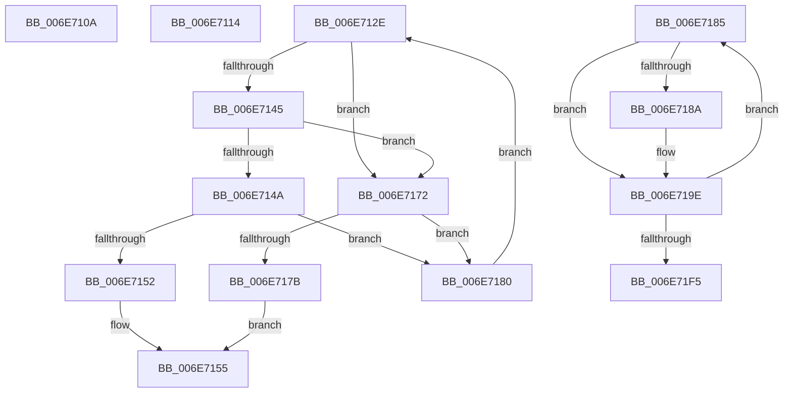

# sub_006E710A

- RVA: `0x006E710A`–`0x006E7201` (길이 `247` bytes)
- VA: `0x00000001406E710A`
- 실행 섹션: `.text`
- PDB 이름 있음: `아니요`; PDB Function 태그: `아니요`
- unwind 정보 RVA: `0x0008C480`
- 디코드: `64`개 명령, `247/247` bytes 표시
- 미해석 바이트: `0` (있으면 어셈블리에 `.byte`로 보존)

> 이 문서는 커널 이미지의 기계어와 PDB 기호를 분석해 생성했습니다. 4번과 5번은 함수 원형과 자료형을 바이너리 사용 방식에서 추정한 C 해석이며 원본 소스 복구 결과는 아닙니다.

## 1. Dependencies

- 직접 호출 지점: **4**; 고유 호출 대상: **4**
- 직접 호출자로 확인된 함수: **0**
- RIP 상대 이미지 참조: **1**

### Outgoing calls
- `0x006E7123` → [MiReleasePtes](../24/MiReleasePtes_function_00247240.md) (function, `0x00247240`)
- `0x006E715B` → [RtlAvlInsertNodeEx](../26/RtlAvlInsertNodeEx_function_00265790.md) (function, `0x00265790`)
- `0x006E7167` → [MiReleaseSpinLockExclusive](../24/MiReleaseSpinLockExclusive_function_002482C0.md) (function, `0x002482C0`)
- `0x006E71D3` → [MiMapWithLargePages](../3B/MiMapWithLargePages_function_003B6624.md) (function, `0x003B6624`)

### Direct callers
- 이 함수 시작 RVA로 연결되는 직접 call은 확인되지 않았습니다. 간접 호출은 완전히 역산할 수 없습니다.

### Static image references
- `0x006E7119` → RVA `0x00E35E20` (`.data`; read)

## 2. Other-region calls and transfers

- 다른 실행 섹션으로 향하는 call: **0**
- call이 아닌 외부 분기/꼬리 이동: **4**
  - `0x006E710F` → [MiInsertInSystemSpace + 0x427](../3B/MiInsertInSystemSpace_function_003B2F5C.md) (`tail-transfer`)
  - `0x006E7129` → [MiInsertInSystemSpace + 0x5BD](../3B/MiInsertInSystemSpace_function_003B2F5C.md) (`tail-transfer`)
  - `0x006E716D` → [MiInsertInSystemSpace + 0x4F2](../3B/MiInsertInSystemSpace_function_003B2F5C.md) (`tail-transfer`)
  - `0x006E71FC` → [MiInsertInSystemSpace + 0x56C](../3B/MiInsertInSystemSpace_function_003B2F5C.md) (`tail-transfer`)

## 3. Assembly (complete function range)

```asm
006E710A  C6 44 24 40 01                  mov byte ptr [rsp + 0x40], 1
006E710F  E9 6F C2 CC FF                  jmp 0x1403b3383
006E7114  44 8B 44 24 58                  mov r8d, dword ptr [rsp + 0x58]
006E7119  48 8D 0D 00 ED 74 00            lea rcx, [rip + 0x74ed00]
006E7120  49 8B D5                        mov rdx, r13
006E7123  E8 18 01 B6 FF                  call 0x140247240
006E7128  90                              nop
006E7129  E9 EB C3 CC FF                  jmp 0x1403b3519
006E712E  4C 8B 42 58                     mov r8, qword ptr [rdx + 0x58]
006E7132  48 8B 4A 20                     mov rcx, qword ptr [rdx + 0x20]
006E7136  49 81 E0 00 F0 FF FF            and r8, 0xfffffffffffff000
006E713D  49 03 C8                        add rcx, r8
006E7140  48 3B F1                        cmp rsi, rcx
006E7143  73 2D                           jae 0x1406e7172
006E7145  49 3B F0                        cmp rsi, r8
006E7148  73 28                           jae 0x1406e7172
006E714A  48 8B 02                        mov rax, qword ptr [rdx]
006E714D  48 85 C0                        test rax, rax
006E7150  75 2E                           jne 0x1406e7180
006E7152  45 32 C0                        xor r8b, r8b
006E7155  4C 8B CF                        mov r9, rdi
006E7158  48 8B CB                        mov rcx, rbx
006E715B  E8 30 E6 B7 FF                  call 0x140265790
006E7160  48 8D 4B 0C                     lea rcx, [rbx + 0xc]
006E7164  41 8A D7                        mov dl, r15b
006E7167  E8 54 11 B6 FF                  call 0x1402482c0
006E716C  90                              nop
006E716D  E9 DC C2 CC FF                  jmp 0x1403b344e
006E7172  48 8B 42 08                     mov rax, qword ptr [rdx + 8]
006E7176  48 85 C0                        test rax, rax
006E7179  75 05                           jne 0x1406e7180
006E717B  45 8A C1                        mov r8b, r9b
006E717E  EB D5                           jmp 0x1406e7155
006E7180  48 8B D0                        mov rdx, rax
006E7183  EB A9                           jmp 0x1406e712e
006E7185  49 3B DD                        cmp rbx, r13
006E7188  75 14                           jne 0x1406e719e
006E718A  48 8B 52 10                     mov rdx, qword ptr [rdx + 0x10]
006E718E  48 89 54 24 60                  mov qword ptr [rsp + 0x60], rdx
006E7193  48 8B 5A 08                     mov rbx, qword ptr [rdx + 8]
006E7197  8B 4A 2C                        mov ecx, dword ptr [rdx + 0x2c]
006E719A  4C 8D 2C CB                     lea r13, [rbx + rcx*8]
006E719E  4C 8B 03                        mov r8, qword ptr [rbx]
006E71A1  48 B8 FF FF FF FF FF 00 00 00   movabs rax, 0xffffffffff
006E71AB  49 C1 E8 0C                     shr r8, 0xc
006E71AF  4C 8B CF                        mov r9, rdi
006E71B2  4C 23 C0                        and r8, rax
006E71B5  C7 44 24 30 01 00 00 00         mov dword ptr [rsp + 0x30], 1
006E71BD  8B 44 24 44                     mov eax, dword ptr [rsp + 0x44]
006E71C1  49 8B D7                        mov rdx, r15
006E71C4  C7 44 24 28 04 00 00 00         mov dword ptr [rsp + 0x28], 4
006E71CC  48 8B CE                        mov rcx, rsi
006E71CF  89 44 24 20                     mov dword ptr [rsp + 0x20], eax
006E71D3  E8 4C F4 CC FF                  call 0x1403b6624
006E71D8  48 8B 54 24 60                  mov rdx, qword ptr [rsp + 0x60]
006E71DD  48 8D 04 FD 00 00 00 00         lea rax, [rdi*8]
006E71E5  48 03 D8                        add rbx, rax
006E71E8  4D 03 FE                        add r15, r14
006E71EB  4C 03 E7                        add r12, rdi
006E71EE  4C 3B 64 24 58                  cmp r12, qword ptr [rsp + 0x58]
006E71F3  72 90                           jb 0x1406e7185
006E71F5  48 8B 74 24 70                  mov rsi, qword ptr [rsp + 0x70]
006E71FA  33 DB                           xor ebx, ebx
006E71FC  E9 C7 C2 CC FF                  jmp 0x1403b34c8
```

## 4. C-style interpretation (structured pseudocode)

```c
__int64 __fastcall sub_006E710A(void)
{
    unsigned int v_stack_p20;
    unsigned int v_stack_p28;
    unsigned int v_stack_p30;
    unsigned __int8 v_stack_p40;
    unsigned int v_stack_p44;
    unsigned int v_stack_p58;
    unsigned __int64 v_stack_p60;
    unsigned __int64 v_stack_p70;

    v_stack_p40 = 1;
}
```

## 5. (Beta) C Style

```c
void sub_006E710A(void)
{
    uint32_t v_stack_p20;
    uint32_t v_stack_p28;
    uint32_t v_stack_p30;
    uint8_t v_stack_p40;
    uint32_t v_stack_p44;
    uint32_t v_stack_p58;
    uint64_t v_stack_p60;
    uint64_t v_stack_p70;

    v_stack_p40 = 1;
}
```

## 6. Execution-region graph

[열기: 2D/3D 그래프와 함수 탐색 컨트롤 패널](../../../control-panel.html?section=text&rva=0x006E710A&view=graph)

- 2D 그래프는 위에서 아래로 흐르고, 3D 그래프는 빈 공간을 드래그해 회전합니다. Shift+드래그는 이동, 휠은 확대·축소, 함수 노드 선택은 대상 보고서 이동입니다.

### Static fallback


