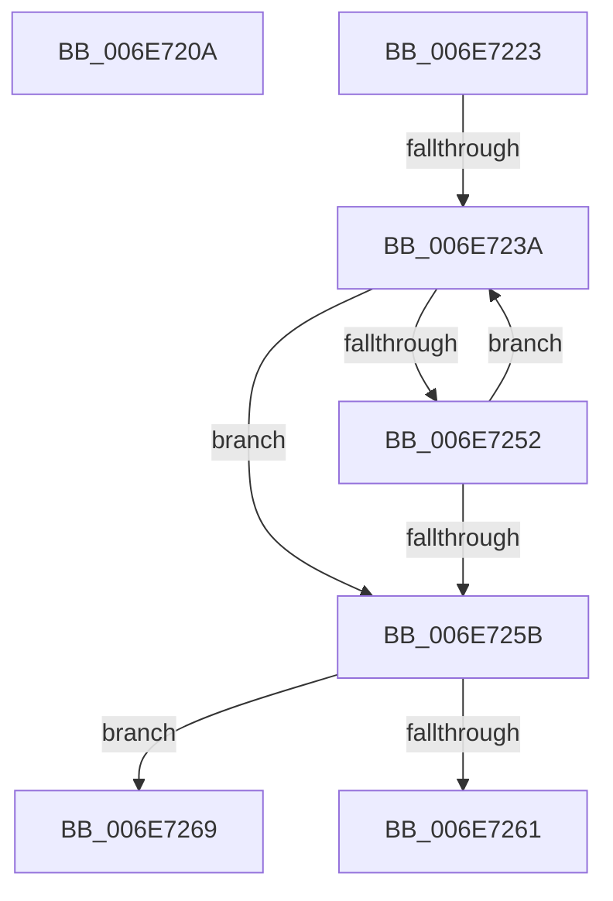

# sub_006E720A

- RVA: `0x006E720A`–`0x006E7297` (길이 `141` bytes)
- VA: `0x00000001406E720A`
- 실행 섹션: `.text`
- PDB 이름 있음: `아니요`; PDB Function 태그: `아니요`
- unwind 정보 RVA: `0x0008C4AC`
- 디코드: `40`개 명령, `141/141` bytes 표시
- 미해석 바이트: `0` (있으면 어셈블리에 `.byte`로 보존)

> 이 문서는 커널 이미지의 기계어와 PDB 기호를 분석해 생성했습니다. 4번과 5번은 함수 원형과 자료형을 바이너리 사용 방식에서 추정한 C 해석이며 원본 소스 복구 결과는 아닙니다.

## 1. Dependencies

- 직접 호출 지점: **4**; 고유 호출 대상: **4**
- 직접 호출자로 확인된 함수: **0**
- RIP 상대 이미지 참조: **1**

### Outgoing calls
- `0x006E7217` → [MiAddViewsForSection](../32/MiAddViewsForSection_function_00324990.md) (function, `0x00324990`)
- `0x006E7229` → [MiIncrementLargeSubsections](../4D/MiIncrementLargeSubsections_function_004D3410.md) (function, `0x004D3410`)
- `0x006E7281` → [MiLocateSubsectionNode](../2B/MiLocateSubsectionNode_function_002BBEE0.md) (function, `0x002BBEE0`)
- `0x006E728C` → [MiDecrementLargeSubsections](../4D/MiDecrementLargeSubsections_function_004D2BE0.md) (function, `0x004D2BE0`)

### Direct callers
- 이 함수 시작 RVA로 연결되는 직접 call은 확인되지 않았습니다. 간접 호출은 완전히 역산할 수 없습니다.

### Static image references
- `0x006E723F` → RVA `0x00011C60` (`.rdata`; read)

## 2. Other-region calls and transfers

- 다른 실행 섹션으로 향하는 call: **0**
- call이 아닌 외부 분기/꼬리 이동: **4**
  - `0x006E721E` → [MiReferenceDataSubsections + 0x74](../3B/MiReferenceDataSubsections_function_003B3768.md) (`tail-transfer`)
  - `0x006E7234` → [MiReferenceDataSubsections + 0x83](../3B/MiReferenceDataSubsections_function_003B3768.md) (`tail-transfer`)
  - `0x006E7264` → [MiReferenceDataSubsections + 0x83](../3B/MiReferenceDataSubsections_function_003B3768.md) (`tail-transfer`)
  - `0x006E7292` → [MiReferenceDataSubsections + 0x83](../3B/MiReferenceDataSubsections_function_003B3768.md) (`tail-transfer`)

## 3. Assembly (complete function range)

```asm
006E720A  0F BA F6 09                     btr esi, 9
006E720E  49 8B D4                        mov rdx, r12
006E7211  44 8B C6                        mov r8d, esi
006E7214  48 8B CD                        mov rcx, rbp
006E7217  E8 74 D7 C3 FF                  call 0x140324990
006E721C  8B F8                           mov edi, eax
006E721E  E9 B9 C5 CC FF                  jmp 0x1403b37dc
006E7223  49 8B D4                        mov rdx, r12
006E7226  48 8B CD                        mov rcx, rbp
006E7229  E8 E2 C1 DE FF                  call 0x1404d3410
006E722E  44 8B C0                        mov r8d, eax
006E7231  83 F8 FF                        cmp eax, -1
006E7234  0F 84 B1 C5 CC FF               je 0x1403b37eb
006E723A  33 D2                           xor edx, edx
006E723C  41 8B C8                        mov ecx, r8d
006E723F  4C 8D 0D 1A AA 92 FF            lea r9, [rip - 0x6d55e6]
006E7246  49 8B C6                        mov rax, r14
006E7249  49 F7 34 C9                     div qword ptr [r9 + rcx*8]
006E724D  48 85 D2                        test rdx, rdx
006E7250  74 09                           je 0x1406e725b
006E7252  41 FF C0                        inc r8d
006E7255  41 83 F8 01                     cmp r8d, 1
006E7259  76 DF                           jbe 0x1406e723a
006E725B  41 83 F8 01                     cmp r8d, 1
006E725F  77 08                           ja 0x1406e7269
006E7261  45 89 07                        mov dword ptr [r15], r8d
006E7264  E9 82 C5 CC FF                  jmp 0x1403b37eb
006E7269  48 8B 44 24 78                  mov rax, qword ptr [rsp + 0x78]
006E726E  45 33 C0                        xor r8d, r8d
006E7271  49 C1 E6 0C                     shl r14, 0xc
006E7275  49 8B CD                        mov rcx, r13
006E7278  48 8B 10                        mov rdx, qword ptr [rax]
006E727B  48 FF CA                        dec rdx
006E727E  49 03 D6                        add rdx, r14
006E7281  E8 5A 4C BD FF                  call 0x1402bbee0
006E7286  48 8B D0                        mov rdx, rax
006E7289  48 8B CD                        mov rcx, rbp
006E728C  E8 4F B9 DE FF                  call 0x1404d2be0
006E7291  90                              nop
006E7292  E9 54 C5 CC FF                  jmp 0x1403b37eb
```

## 4. C-style interpretation (structured pseudocode)

```c
__int64 __fastcall sub_006E720A(void)
{
    __int64 result;
    unsigned __int64 v_stack_p78;

    result = MiAddViewsForSection(v_rbp, v_r12, (unsigned int)((unsigned int)(v_rsi)), a4);
}
```

## 5. (Beta) C Style

```c
void sub_006E720A(void)
{
    int64_t result;
    uint64_t v_stack_p78;

    result = MiAddViewsForSection(local_rbp, local_r12, (uint32_t)((uint32_t)(local_rsi)), a4);
}
```

## 6. Execution-region graph

[열기: 2D/3D 그래프와 함수 탐색 컨트롤 패널](../../../control-panel.html?section=text&rva=0x006E720A&view=graph)

- 2D 그래프는 위에서 아래로 흐르고, 3D 그래프는 빈 공간을 드래그해 회전합니다. Shift+드래그는 이동, 휠은 확대·축소, 함수 노드 선택은 대상 보고서 이동입니다.

### Static fallback


