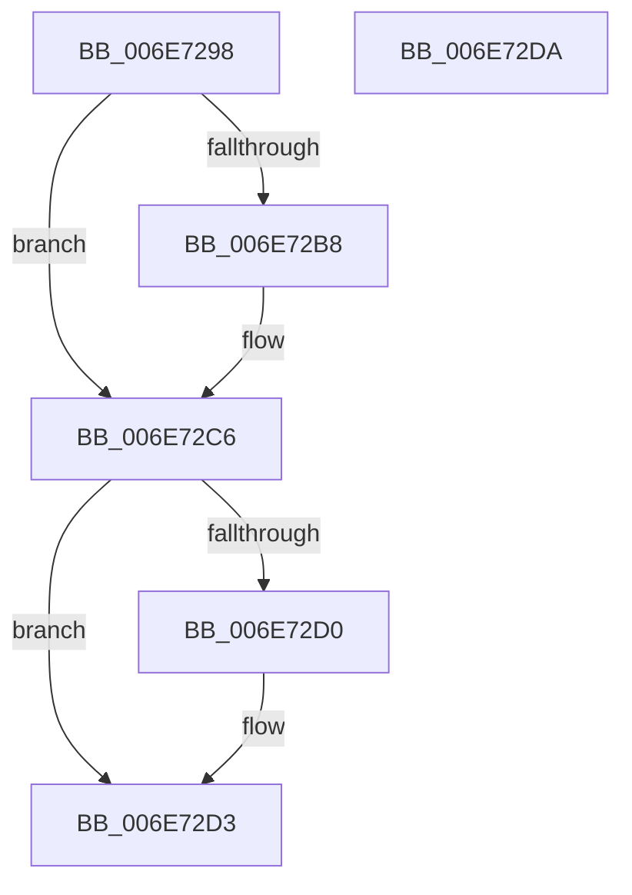

# sub_006E7298

- RVA: `0x006E7298`–`0x006E72E8` (길이 `80` bytes)
- VA: `0x00000001406E7298`
- 실행 섹션: `.text`
- PDB 이름 있음: `아니요`; PDB Function 태그: `아니요`
- unwind 정보 RVA: `0x0008C53C`
- 디코드: `23`개 명령, `80/80` bytes 표시
- 미해석 바이트: `0` (있으면 어셈블리에 `.byte`로 보존)

> 이 문서는 커널 이미지의 기계어와 PDB 기호를 분석해 생성했습니다. 4번과 5번은 함수 원형과 자료형을 바이너리 사용 방식에서 추정한 C 해석이며 원본 소스 복구 결과는 아닙니다.

## 1. Dependencies

- 직접 호출 지점: **4**; 고유 호출 대상: **4**
- 직접 호출자로 확인된 함수: **0**
- RIP 상대 이미지 참조: **0**

### Outgoing calls
- `0x006E729B` → [KeAbPostRelease](../2E/KeAbPostRelease_function_002E1600.md) (function, `0x002E1600`)
- `0x006E72A8` → [KeAbPreAcquire](../21/KeAbPreAcquire_function_00210230.md) (function, `0x00210230`)
- `0x006E72C1` → [ExfAcquirePushLockExclusiveEx](../20/ExfAcquirePushLockExclusiveEx_function_0020FC90.md) (function, `0x0020FC90`)
- `0x006E72DD` → [ExpSaAllocatorOptimizeList](../4B/ExpSaAllocatorOptimizeList_function_004B5DDC.md) (function, `0x004B5DDC`)

### Direct callers
- 이 함수 시작 RVA로 연결되는 직접 call은 확인되지 않았습니다. 간접 호출은 완전히 역산할 수 없습니다.

### Static image references
- 디코드된 RIP-relative 메모리 참조가 없습니다.

## 2. Other-region calls and transfers

- 다른 실행 섹션으로 향하는 call: **0**
- call이 아닌 외부 분기/꼬리 이동: **2**
  - `0x006E72D5` → [ExpSaAllocatorAllocate + 0xCC](../3B/ExpSaAllocatorAllocate_function_003B402C.md) (`tail-transfer`)
  - `0x006E72E3` → [ExpSaAllocatorAllocate + 0xE9](../3B/ExpSaAllocatorAllocate_function_003B402C.md) (`tail-transfer`)

## 3. Assembly (complete function range)

```asm
006E7298  48 8B CE                        mov rcx, rsi
006E729B  E8 60 A3 BF FF                  call 0x1402e1600
006E72A0  45 33 C0                        xor r8d, r8d
006E72A3  33 D2                           xor edx, edx
006E72A5  48 8B CE                        mov rcx, rsi
006E72A8  E8 83 8F B2 FF                  call 0x140210230
006E72AD  F0 48 0F BA 2E 00               lock bts qword ptr [rsi], 0
006E72B3  48 8B E8                        mov rbp, rax
006E72B6  73 0E                           jae 0x1406e72c6
006E72B8  4C 8B C6                        mov r8, rsi
006E72BB  48 8B D0                        mov rdx, rax
006E72BE  48 8B CE                        mov rcx, rsi
006E72C1  E8 CA 89 B2 FF                  call 0x14020fc90
006E72C6  B9 01 00 00 00                  mov ecx, 1
006E72CB  48 85 ED                        test rbp, rbp
006E72CE  74 03                           je 0x1406e72d3
006E72D0  88 4D 0A                        mov byte ptr [rbp + 0xa], cl
006E72D3  33 ED                           xor ebp, ebp
006E72D5  E9 1E CE CC FF                  jmp 0x1403b40f8
006E72DA  48 8B CE                        mov rcx, rsi
006E72DD  E8 FA EA DC FF                  call 0x1404b5ddc
006E72E2  90                              nop
006E72E3  E9 2D CE CC FF                  jmp 0x1403b4115
```

## 4. C-style interpretation (structured pseudocode)

```c
__int64 __fastcall sub_006E7298(__int64 a1, int a2, int a3)
{
    __int64 result;
    __int64 v_rbp;

    result = KeAbPostRelease(v_rsi, a2, a3, a4);
    a3 = 0;
    a2 = 0;
    result = KeAbPreAcquire(v_rsi, a2, a3, a4);
    if (!(condition_is_above_or_equal)) {
        a3 = v_rsi;
        a2 = result;
        a1 = v_rsi;
        result = ExfAcquirePushLockExclusiveEx(a1, a2, a3, a4);
    }
    if (result != 0) {
        *(unsigned __int8 *)(result + 10) = 1;
    }
    v_rbp = 0;
}
```

## 5. (Beta) C Style

```c
int64_t sub_006E7298(int64_t Arg1, int32_t Arg2, int32_t Arg3)
{
    int64_t result;
    int64_t local_rbp;

    result = KeAbPostRelease(local_rsi, Arg2, Arg3, a4);
    Arg3 = 0;
    Arg2 = 0;
    result = KeAbPreAcquire(local_rsi, Arg2, Arg3, a4);
    if (!(condition_is_above_or_equal)) {
        Arg3 = local_rsi;
        Arg2 = result;
        Arg1 = local_rsi;
        result = ExfAcquirePushLockExclusiveEx(Arg1, Arg2, Arg3, a4);
    }
    if (result != 0) {
        *(uint8_t *)(result + 0xA) = 1;
    }
    local_rbp = 0;
}
```

## 6. Execution-region graph

[열기: 2D/3D 그래프와 함수 탐색 컨트롤 패널](../../../control-panel.html?section=text&rva=0x006E7298&view=graph)

- 2D 그래프는 위에서 아래로 흐르고, 3D 그래프는 빈 공간을 드래그해 회전합니다. Shift+드래그는 이동, 휠은 확대·축소, 함수 노드 선택은 대상 보고서 이동입니다.

### Static fallback


