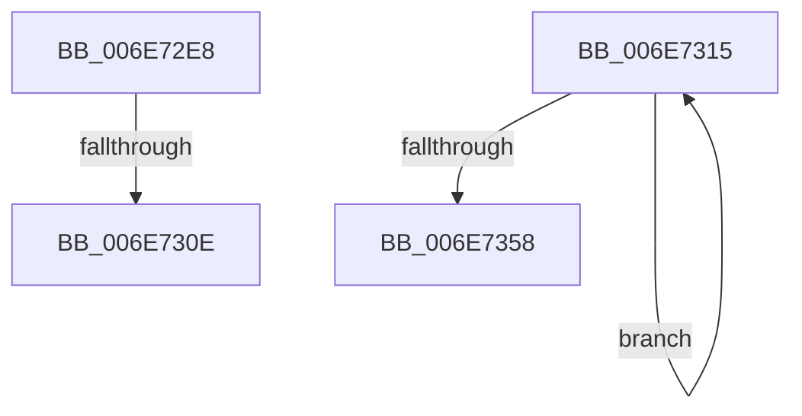

# sub_006E72E8

- RVA: `0x006E72E8`–`0x006E7378` (길이 `144` bytes)
- VA: `0x00000001406E72E8`
- 실행 섹션: `.text`
- PDB 이름 있음: `아니요`; PDB Function 태그: `아니요`
- unwind 정보 RVA: `0x0008C574`
- 디코드: `38`개 명령, `144/144` bytes 표시
- 미해석 바이트: `0` (있으면 어셈블리에 `.byte`로 보존)

> 이 문서는 커널 이미지의 기계어와 PDB 기호를 분석해 생성했습니다. 4번과 5번은 함수 원형과 자료형을 바이너리 사용 방식에서 추정한 C 해석이며 원본 소스 복구 결과는 아닙니다.

## 1. Dependencies

- 직접 호출 지점: **6**; 고유 호출 대상: **4**
- 직접 호출자로 확인된 함수: **0**
- RIP 상대 이미지 참조: **2**

### Outgoing calls
- `0x006E72EA` → [KeSetSystemGroupAffinityThread](../39/KeSetSystemGroupAffinityThread_function_00399140.md) (function, `0x00399140`)
- `0x006E72FD` → [ExAllocatePool2](../../poolcode/B8/ExAllocatePool2_function_00B820F0.md) (function, `0x00B820F0`)
- `0x006E7343` → [ExFreePoolWithTag](../../poolcode/B8/ExFreePoolWithTag_function_00B82870.md) (function, `0x00B82870`)
- `0x006E734E` → [ExpSaBinaryArrayRemove](../4F/ExpSaBinaryArrayRemove_function_004F77B4.md) (function, `0x004F77B4`)
- `0x006E7362` → [ExpSaBinaryArrayRemove](../4F/ExpSaBinaryArrayRemove_function_004F77B4.md) (function, `0x004F77B4`)
- `0x006E736C` → [ExFreePoolWithTag](../../poolcode/B8/ExFreePoolWithTag_function_00B82870.md) (function, `0x00B82870`)

### Direct callers
- 이 함수 시작 RVA로 연결되는 직접 call은 확인되지 않았습니다. 간접 호출은 완전히 역산할 수 없습니다.

### Static image references
- `0x006E7315` → RVA `0x00EFA278` (`.data`; read)
- `0x006E735B` → RVA `0x00EFA280` (`.data`; read)

## 2. Other-region calls and transfers

- 다른 실행 섹션으로 향하는 call: **3**
  - `0x006E72FD` → [ExAllocatePool2](../../poolcode/B8/ExAllocatePool2_function_00B820F0.md) (`.text` → `POOLCODE`)
  - `0x006E7343` → [ExFreePoolWithTag](../../poolcode/B8/ExFreePoolWithTag_function_00B82870.md) (`.text` → `POOLCODE`)
  - `0x006E736C` → [ExFreePoolWithTag](../../poolcode/B8/ExFreePoolWithTag_function_00B82870.md) (`.text` → `POOLCODE`)
- call이 아닌 외부 분기/꼬리 이동: **3**
  - `0x006E7308` → [ExpSaPageGroupDescriptorAllocate + 0x275](../3B/ExpSaPageGroupDescriptorAllocate_function_003B4224.md) (`tail-transfer`)
  - `0x006E7310` → [ExpSaPageGroupDescriptorAllocate + 0x1D2](../3B/ExpSaPageGroupDescriptorAllocate_function_003B4224.md) (`tail-transfer`)
  - `0x006E7373` → [ExpSaPageGroupDescriptorAllocate + 0x21A](../3B/ExpSaPageGroupDescriptorAllocate_function_003B4224.md) (`tail-transfer`)

## 3. Assembly (complete function range)

```asm
006E72E8  33 D2                           xor edx, edx
006E72EA  E8 51 1E CB FF                  call 0x140399140
006E72EF  BA 00 10 00 00                  mov edx, 0x1000
006E72F4  41 B8 45 78 53 61               mov r8d, 0x61537845
006E72FA  49 8B CC                        mov rcx, r12
006E72FD  E8 EE AD 49 00                  call 0x140b820f0
006E7302  48 8B D8                        mov rbx, rax
006E7305  48 85 C0                        test rax, rax
006E7308  0F 84 8B D1 CC FF               je 0x1403b4499
006E730E  8A 08                           mov cl, byte ptr [rax]
006E7310  E9 E1 D0 CC FF                  jmp 0x1403b43f6
006E7315  48 8B 05 5C 2F 81 00            mov rax, qword ptr [rip + 0x812f5c]
006E731C  BA 01 00 00 00                  mov edx, 1
006E7321  41 FF CE                        dec r14d
006E7324  4A 8B 1C F0                     mov rbx, qword ptr [rax + r14*8]
006E7328  8B 47 20                        mov eax, dword ptr [rdi + 0x20]
006E732B  0F BD C8                        bsr ecx, eax
006E732E  D3 E2                           shl edx, cl
006E7330  83 C1 FE                        add ecx, -2
006E7333  89 4D B4                        mov dword ptr [rbp - 0x4c], ecx
006E7336  33 C2                           xor eax, edx
006E7338  33 D2                           xor edx, edx
006E733A  48 8B 0C CB                     mov rcx, qword ptr [rbx + rcx*8]
006E733E  48 8B 4C C1 08                  mov rcx, qword ptr [rcx + rax*8 + 8]
006E7343  E8 28 B5 49 00                  call 0x140b82870
006E7348  8B 57 20                        mov edx, dword ptr [rdi + 0x20]
006E734B  48 8B CB                        mov rcx, rbx
006E734E  E8 61 04 E1 FF                  call 0x1404f77b4
006E7353  45 85 F6                        test r14d, r14d
006E7356  75 BD                           jne 0x1406e7315
006E7358  8B 57 20                        mov edx, dword ptr [rdi + 0x20]
006E735B  48 8B 0D 1E 2F 81 00            mov rcx, qword ptr [rip + 0x812f1e]
006E7362  E8 4D 04 E1 FF                  call 0x1404f77b4
006E7367  33 D2                           xor edx, edx
006E7369  48 8B CF                        mov rcx, rdi
006E736C  E8 FF B4 49 00                  call 0x140b82870
006E7371  33 FF                           xor edi, edi
006E7373  E9 C6 D0 CC FF                  jmp 0x1403b443e
```

## 4. C-style interpretation (structured pseudocode)

```c
__int64 __fastcall sub_006E72E8(__int64 a1, int a2)
{
    __int64 result;

    a2 = 0;
    result = KeSetSystemGroupAffinityThread(a1, a2, a3, a4);
    result = ExAllocatePool2(v_r12, (unsigned int)(0x1000ULL), (unsigned int)(0x61537845ULL), a4);
}
```

## 5. (Beta) C Style

```c
int64_t sub_006E72E8(int64_t Arg1, int32_t Arg2)
{
    int64_t result;

    Arg2 = 0;
    result = KeSetSystemGroupAffinityThread(Arg1, Arg2, a3, a4);
    result = ExAllocatePool2(local_r12, (uint32_t)(0x1000ULL), (uint32_t)(0x61537845ULL), a4);
}
```

## 6. Execution-region graph

[열기: 2D/3D 그래프와 함수 탐색 컨트롤 패널](../../../control-panel.html?section=text&rva=0x006E72E8&view=graph)

- 2D 그래프는 위에서 아래로 흐르고, 3D 그래프는 빈 공간을 드래그해 회전합니다. Shift+드래그는 이동, 휠은 확대·축소, 함수 노드 선택은 대상 보고서 이동입니다.

### Static fallback


