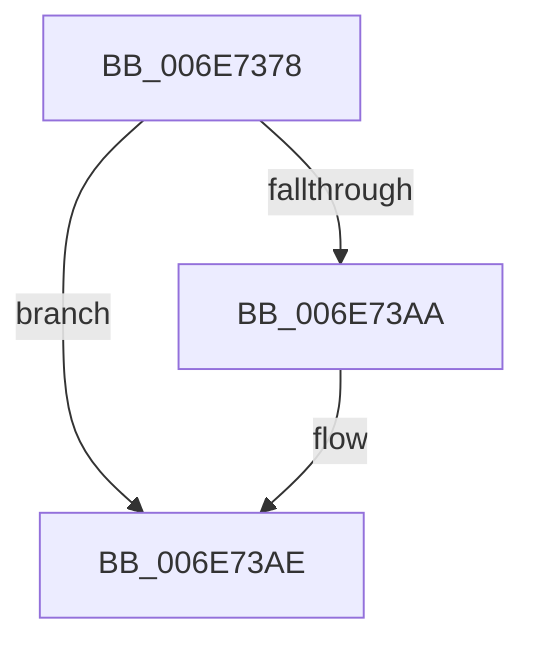

# sub_006E7378

- RVA: `0x006E7378`–`0x006E73C3` (길이 `75` bytes)
- VA: `0x00000001406E7378`
- 실행 섹션: `.text`
- PDB 이름 있음: `아니요`; PDB Function 태그: `아니요`
- unwind 정보 RVA: `0x0008C600`
- 디코드: `17`개 명령, `75/75` bytes 표시
- 미해석 바이트: `0` (있으면 어셈블리에 `.byte`로 보존)

> 이 문서는 커널 이미지의 기계어와 PDB 기호를 분석해 생성했습니다. 4번과 5번은 함수 원형과 자료형을 바이너리 사용 방식에서 추정한 C 해석이며 원본 소스 복구 결과는 아닙니다.

## 1. Dependencies

- 직접 호출 지점: **3**; 고유 호출 대상: **3**
- 직접 호출자로 확인된 함수: **0**
- RIP 상대 이미지 참조: **0**

### Outgoing calls
- `0x006E7378` → [ExAcquireSpinLockExclusive](../24/ExAcquireSpinLockExclusive_function_00248690.md) (function, `0x00248690`)
- `0x006E73A1` → [MiSplitBitmapPages](../3B/MiSplitBitmapPages_function_003B4A34.md) (function, `0x003B4A34`)
- `0x006E73B8` → [MiReleaseSpinLockExclusive](../24/MiReleaseSpinLockExclusive_function_002482C0.md) (function, `0x002482C0`)

### Direct callers
- 이 함수 시작 RVA로 연결되는 직접 call은 확인되지 않았습니다. 간접 호출은 완전히 역산할 수 없습니다.

### Static image references
- 디코드된 RIP-relative 메모리 참조가 없습니다.

## 2. Other-region calls and transfers

- 다른 실행 섹션으로 향하는 call: **0**
- call이 아닌 외부 분기/꼬리 이동: **1**
  - `0x006E73BE` → [MiExpandPtes + 0x119](../3B/MiExpandPtes_function_003B4B78.md) (`tail-transfer`)

## 3. Assembly (complete function range)

```asm
006E7378  E8 13 13 B6 FF                  call 0x140248690
006E737D  88 84 24 A0 00 00 00            mov byte ptr [rsp + 0xa0], al
006E7384  48 8B 44 24 48                  mov rax, qword ptr [rsp + 0x48]
006E7389  41 83 E4 07                     and r12d, 7
006E738D  48 8B 94 24 98 00 00 00         mov rdx, qword ptr [rsp + 0x98]
006E7395  41 B9 01 00 00 00               mov r9d, 1
006E739B  8B CD                           mov ecx, ebp
006E739D  4D 8D 04 44                     lea r8, [r12 + rax*2]
006E73A1  E8 8E D6 CC FF                  call 0x1403b4a34
006E73A6  85 C0                           test eax, eax
006E73A8  75 04                           jne 0x1406e73ae
006E73AA  83 67 28 FB                     and dword ptr [rdi + 0x28], 0xfffffffb
006E73AE  8A 94 24 A0 00 00 00            mov dl, byte ptr [rsp + 0xa0]
006E73B5  49 8B CD                        mov rcx, r13
006E73B8  E8 03 0F B6 FF                  call 0x1402482c0
006E73BD  90                              nop
006E73BE  E9 CE D8 CC FF                  jmp 0x1403b4c91
```

## 4. C-style interpretation (structured pseudocode)

```c
__int64 __fastcall sub_006E7378(__int64 a1, __int64 a2, __int64 a3, __int64 a4, __int64 a5, __int64 a6, __int64 a7, __int64 a8, __int64 a9, __int64 a10, __int64 a11, __int64 a12, __int64 a13, __int64 a14, __int64 a15, __int64 a16, __int64 a17, __int64 a18, __int64 a19, unsigned __int8 a20)
{
    __int64 result;
    __int64 v_r12;
    unsigned __int8 v_stack_pA0;

    result = ExAcquireSpinLockExclusive(a1, a2, a3, a4);
    v_stack_pA0 = (unsigned __int8)(result);
    v_r12 = (unsigned int)((v_r12) & (7));
    result = MiSplitBitmapPages((unsigned int)((unsigned int)(v_rbp)), a19, v_r12 + a9 * 2, 1);
    if ((unsigned int)(result) == 0) {
    }
    result = MiReleaseSpinLockExclusive(v_r13, a20, v_r12 + a9 * 2, 1);
}
```

## 5. (Beta) C Style

```c
int64_t sub_006E7378(int64_t Arg1, int64_t Arg2, int64_t Arg3, int64_t Arg4, uint64_t Arg5, uint64_t Arg6, uint64_t Arg7, uint64_t Arg8, int64_t Arg9, uint64_t Arg10, uint64_t Arg11, uint64_t Arg12, uint64_t Arg13, uint64_t Arg14, uint64_t Arg15, uint64_t Arg16, uint64_t Arg17, uint64_t Arg18, int64_t Arg19, uint8_t Arg20)
{
    int64_t result;
    int64_t local_r12;
    uint8_t v_stack_pA0;

    result = ExAcquireSpinLockExclusive(Arg1, Arg2, Arg3, Arg4);
    v_stack_pA0 = (uint8_t)(result);
    local_r12 = (uint32_t)((local_r12) & (7));
    result = MiSplitBitmapPages((uint32_t)((uint32_t)(local_rbp)), Arg19, local_r12 + Arg9 * 2, 1);
    if ((uint32_t)(result) == 0) {
    }
    result = MiReleaseSpinLockExclusive(local_r13, Arg20, local_r12 + Arg9 * 2, 1);
}
```

## 6. Execution-region graph

[열기: 2D/3D 그래프와 함수 탐색 컨트롤 패널](../../../control-panel.html?section=text&rva=0x006E7378&view=graph)

- 2D 그래프는 위에서 아래로 흐르고, 3D 그래프는 빈 공간을 드래그해 회전합니다. Shift+드래그는 이동, 휠은 확대·축소, 함수 노드 선택은 대상 보고서 이동입니다.

### Static fallback


