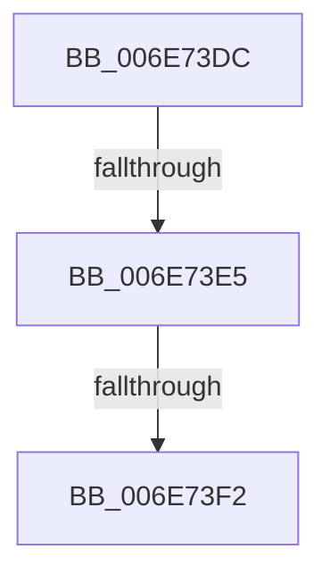

# sub_006E73DC

- RVA: `0x006E73DC`–`0x006E7435` (길이 `89` bytes)
- VA: `0x00000001406E73DC`
- 실행 섹션: `.text`
- PDB 이름 있음: `아니요`; PDB Function 태그: `아니요`
- unwind 정보 RVA: `0x0008C660`
- 디코드: `18`개 명령, `89/89` bytes 표시
- 미해석 바이트: `0` (있으면 어셈블리에 `.byte`로 보존)

> 이 문서는 커널 이미지의 기계어와 PDB 기호를 분석해 생성했습니다. 4번과 5번은 함수 원형과 자료형을 바이너리 사용 방식에서 추정한 C 해석이며 원본 소스 복구 결과는 아닙니다.

## 1. Dependencies

- 직접 호출 지점: **1**; 고유 호출 대상: **1**
- 직접 호출자로 확인된 함수: **0**
- RIP 상대 이미지 참조: **1**

### Outgoing calls
- `0x006E7421` → [MiFastReplenishWithAsync](../4A/MiFastReplenishWithAsync_function_004AA500.md) (function, `0x004AA500`)

### Direct callers
- 이 함수 시작 RVA로 연결되는 직접 call은 확인되지 않았습니다. 간접 호출은 완전히 역산할 수 없습니다.

### Static image references
- `0x006E73E5` → RVA `0x00FC6A88` (`ALMOSTRO`; read)

## 2. Other-region calls and transfers

- 다른 실행 섹션으로 향하는 call: **0**
- call이 아닌 외부 분기/꼬리 이동: **3**
  - `0x006E73DF` → [MiMakeZeroedPageTablesEx + 0x1C6](../3B/MiMakeZeroedPageTablesEx_function_003B59FC.md) (`tail-transfer`)
  - `0x006E73EC` → [MiMakeZeroedPageTablesEx + 0x208](../3B/MiMakeZeroedPageTablesEx_function_003B59FC.md) (`tail-transfer`)
  - `0x006E7430` → [MiMakeZeroedPageTablesEx + 0x1C6](../3B/MiMakeZeroedPageTablesEx_function_003B59FC.md) (`tail-transfer`)

## 3. Assembly (complete function range)

```asm
006E73DC  40 84 FF                        test dil, dil
006E73DF  0F 88 DD E7 CC FF               js 0x1403b5bc2
006E73E5  48 85 0D 9C F6 8D 00            test qword ptr [rip + 0x8df69c], rcx
006E73EC  0F 84 12 E8 CC FF               je 0x1403b5c04
006E73F2  48 8B 54 24 40                  mov rdx, qword ptr [rsp + 0x40]
006E73F7  45 8B C6                        mov r8d, r14d
006E73FA  48 2B 54 24 48                  sub rdx, qword ptr [rsp + 0x48]
006E73FF  8B C3                           mov eax, ebx
006E7401  48 69 C8 80 DF 00 00            imul rcx, rax, 0xdf80
006E7408  48 8B 44 24 38                  mov rax, qword ptr [rsp + 0x38]
006E740D  48 C1 FA 03                     sar rdx, 3
006E7411  48 FF C2                        inc rdx
006E7414  48 8B 40 10                     mov rax, qword ptr [rax + 0x10]
006E7418  48 05 A8 43 00 00               add rax, 0x43a8
006E741E  48 03 C8                        add rcx, rax
006E7421  E8 DA 30 DC FF                  call 0x1404aa500
006E7426  48 B9 00 00 00 00 04 00 00 00   movabs rcx, 0x400000000
006E7430  E9 8D E7 CC FF                  jmp 0x1403b5bc2
```

## 4. C-style interpretation (structured pseudocode)

```c
__int64 __fastcall sub_006E73DC(__int64 a1, __int64 a2, __int64 a3, __int64 a4, __int64 a5, __int64 a6, __int64 a7, __int64 a8, __int64 a9)
{
    __int64 result;

    a2 = (a8) - (a9);
    a1 = (a1) * ((unsigned int)((unsigned int)(v_rbx)));
    a2 = (a2) >> (3);
    a2 = (a2) + 1;
    result = (*(unsigned __int64 *)(a7 + 16)) + (0x43A8ULL);
    a1 = (a1) + (result);
    result = MiFastReplenishWithAsync(a1, a2, (unsigned int)((unsigned int)(v_r14)), a4);
}
```

## 5. (Beta) C Style

```c
int64_t sub_006E73DC(int64_t Arg1, int64_t Arg2, int64_t Arg3, int64_t Arg4, uint64_t Arg5, uint64_t Arg6, void *Arg7, int64_t Arg8, int64_t Arg9)
{
    uint8_t *arg7 = (uint8_t *)Arg7;

    int64_t result;

    Arg2 = (Arg8) - (Arg9);
    Arg1 = (Arg1) * ((uint32_t)((uint32_t)(local_rbx)));
    Arg2 = (Arg2) >> (3);
    Arg2 = (Arg2) + 1;
    result = (*(uint64_t *)(arg7 + 0x10)) + (0x43A8ULL);
    Arg1 = (Arg1) + (result);
    result = MiFastReplenishWithAsync(Arg1, Arg2, (uint32_t)((uint32_t)(local_r14)), Arg4);
}
```

### 관측된 메모리 오프셋

구조체 형식이 확인되지 않은 접근은 인자 기준의 오프셋으로만 기록했습니다.

| 기준 인자 | 오프셋 표현 | 폭 (bit) | 접근 |
|---|---:|---:|---|
| `Arg7` | `+ 0x10` | `64` | `R` |

## 6. Execution-region graph

[열기: 2D/3D 그래프와 함수 탐색 컨트롤 패널](../../../control-panel.html?section=text&rva=0x006E73DC&view=graph)

- 2D 그래프는 위에서 아래로 흐르고, 3D 그래프는 빈 공간을 드래그해 회전합니다. Shift+드래그는 이동, 휠은 확대·축소, 함수 노드 선택은 대상 보고서 이동입니다.

### Static fallback


